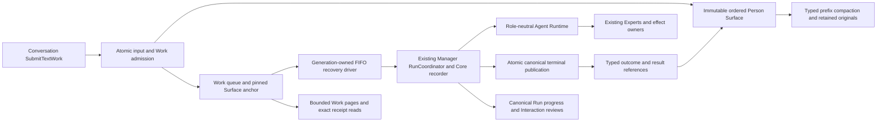

# Runtime architecture

This document describes the canonical runtime and current product boundaries.

## Shared reasoning and source processing

Manager, delegated Experts and Learner use the same role-neutral Engine and purpose-only model preparation path. Inference selects Gateway Primary and may select the local model only when planning positively establishes valid Primary absence. A failed Primary, missing source permission, unavailable credential expectation or dispatch uncertainty cannot trigger fallback. [ADR 0034](../decisions/0034-gateway-reasoning-and-source-processing-authority.md) defines this source-processing boundary.

Access owns source-grant DeviceOnly/GatewayAllowed processing permission and live dispatch fences. Health has a separate mandatory local privacy transformation before either reasoning placement; its output retains HighlySensitive classification and transform provenance. Model selection, pairing and transformation confer no source or Action permission.

The Engine's iteration allowance counts completed model batches, including a
restored pending batch. Conversation deducts completed ancestor batches before
constructing the request; the shared Engine consumes the pending batch from that
remaining allowance before preparing another model call. Settling a restored Tool
batch at the limit preserves its journal/result and returns without another model
attempt. A restored final Answer can still complete within that last iteration.
Token/cost accounting, deadline, cancellation and durable effect receipts remain
independent fences; recovery never resets them to obtain another iteration.

Retained Attention evidence is process/host scoped. An expired or evicted
observation, a previous host epoch, or a disposed native host is `StaleContext`
when reauthorizing history. Context omits only the derived historical entry under
that result; the original transcript and the current user turn are preserved.
Known cross-person/device observation claims remain `PolicyDenied`, malformed
lookup identities remain `InvalidInput`, and lock/infrastructure failures are not
converted into staleness. Grant, subject and recorded-proof validation remain
mandatory before retained evidence can authorize any new model input.

## Build-selected storage custody

Composition selects one custody profile at build time. Rust's default `os-keyring`
feature retains OS key storage; `development-storage` excludes that adapter and is
forbidden in a non-debug-assertion build. Both implement the same VaultKeyProvider and
use the same encrypted Vault engine. Vault activation uses the selected provider;
missing/malformed development keys expose a Vault failure without blocking the
independent product host, replacing keys or resetting data.
Development installation admission is marker-bound and separate from normal app data.
Explicit-path diagnostics enforce the same profile boundary. Flutter checks the FFI
storage-profile code before opening or preflighting data.

Go composition similarly chooses the ordinary Keychain Store or a build-tagged
private development file Store. There is no error-triggered selection. Debug client
and `run-local.sh` use an isolated Gateway root and port 18431; Release/Profile use the
ordinary root and port 8431. iOS Debug's native Contacts handle key has separate private
file custody; Release/Profile retains its Keychain item. OS source permissions and
owner authority/recovery checks are unchanged. This is local storage isolation,
not a network pairing policy: an explicitly selected Gateway still requires its
ordinary verified identity and administrator approval. Cross-profile pairing is
not currently prohibited by a signed profile claim.

`scripts/run-local.sh` defaults to a development server built with `floe_dev` and a
Flutter Debug client, using isolated development roots and private file credential
stores. `--release` and `--profile` build the server without `floe_dev` and use
production roots with the OS credential store. Combining either production mode
with `--debug` is rejected; credential-store failures never switch modes.

The host product store remains distinct from EncryptedAgentVault but now uses its
own AES-256-GCM encrypted database/WAL and purpose-separated root key. Its encrypted
identity row must match the admitted Person/device before Day activation. Only a
fresh installation can create that key; existing open never falls back to plaintext
or recreates missing keys. Production loads the product key from its separate OS
keyring service; development uses an isolated private file. Shared key bytes and
physical custody mechanics do not merge the two stores' lifecycle or semantic owners.
Gateway private-file permissions are still not a blanket encryption guarantee;
Gateway payload encryption remains an open gate in the active plan.

## Explicit Linux Calendar fixture boundary

Linux QA builds may opt into `qa-fixtures`, which selects development storage and
exposes `calendar.fixture` with the distinct `fixture:<device-id>` execution owner.
The provider adapter supplies only immutable synthetic Calendar facts, filtered by
the requested range and selected resources. It does not emulate Apple permission
or mutation behavior. Connections still owns setup/resource selection, Access owns
source grants and processing restrictions, Context owns observation/dependency
reauthorization, and the real Expert/Conversation owners drive tool execution.
Platform availability is an observation supplied by `NativeSourceSetupPort`, not
an OS branch in Connections. Ordinary builds do not provision this fixture.
Access's supported product Calendar connector/provider set is also shared by
Context's acquisition inventory and Vault's parameterized commit-time inventory
query. The storage transaction compares the complete same-scope inventory and
source versions; it does not maintain a separate list that can omit a source.

Stable fixture event IDs, timestamps and revisions are independent of the query
window. Synthetic host tags identify the fixture adapter, not an Apple OS host
generation. These tests therefore cannot qualify native permission, host restart,
external write or crash recovery behavior.

## General Conversation

Conversation owns the durable Session/root-Run lifecycle and projects the state required by the role-neutral Agent Runtime. A newly persisted Session has revision zero before its first turn; product snapshots preserve that valid CAS revision. Session absence is explicit and must not be inferred from revision zero or from a failed read.

### Person Surface custody boundary

Conversation now defines a separate `SurfaceRepository` for settled user input
and durable Work admission under the existing product Session ID. Vault stores
one ordered `SurfaceEntryReceipt` envelope for original input, pending-work
cancellation intent, terminal-outcome references and canonical complete/partial
result references, with a content-bound, monotonic prefix independently
of the Manager Session revision and Core recorder. `SurfaceAnchor` is a history
boundary, not a source grant. The value lives in the Conversation contract so
Context/Inference can carry the same exact prefix without depending on the
Conversation implementation. Link advancement and stored-prefix membership
remain Conversation-owned; shape validation does not authenticate a reference.
Voice input and delegation identities include the
exact live-session identity; matching a model role is not sufficient.

The Surface/Work path below is also the public text admission path. App/FFI
project safe history and Work values; Flutter keeps the Person timeline separate
from Core execution details. Live Voice provider/native integration is separate;
this is not a diagram of an already-working voice client.



Work receipts reference a retained input and an exact prefix. Storage rejects
cross-person, mismatched voice-session, future-input and changed-digest replay.
Pending work is bounded at 64 per Session; transcript history has bounded pages
but no lifetime entry cap. Exact receipt observation uses a Deferred transaction
before any fresh writer reservation. Startup validation scans bounded pages and
fails closed on missing or altered prefixes, rather than repairing custody.

The generation-owned Conversation recovery driver discovers queued Sessions in
bounded pages and claims FIFO work through the existing RunCoordinator. Vault
links work and opens the Manager Run/Core recorder in one transaction. Work
stores queue/link custody only; progress and results are read from the linked
Run rather than copied into a second execution state machine. Normal claim
refusals explicitly roll back and settle the journal guard.

Bounded Work pages recover admitted work without requiring a client to remember
command IDs. The newest admission command pins page membership and an exclusive
before-command cursor selects older items. New admissions cannot shift an old
page; queue/link state is deliberately a current observation, not rewritten
Surface history. Cursor ownership, queue order and canonical receipts are
verified in one Deferred transaction, using the same snapshot decoder as exact
Work lookup. Linked execution progress remains on Run; no duplicate status is
stored on Work.

`SurfaceWorkSnapshot.current_run_id` observes the current canonical descendant
while the initial `Linked(root)` claim remains immutable. One typed Continue/
Resume successor receipt replaces the Resume-only slot and commits atomically
with child admission. The query checks that receipt against the canonical Run
payload's indexed parent reference; deleting a slot cannot silently regress the
current Work to its old root. Reads follow bounded, validated edges, not a global
Run scan or a second mutable Work execution cache. Startup verifies missing,
orphaned and inconsistent links without repair. Continue carries cumulative
Resume depth, so interleaving Continue cannot renew the existing Resume budget.

The owner-level Surface snapshot resolves original input, canonical complete or
partial bodies, terminal status and pending-cancellation references in one
Deferred snapshot. Safe display entries omit provider utterance/session IDs,
source/review payloads and grants. Pages end at an immutable prefix and return
the before-anchor of their oldest retained entry as the older cursor. A bounded
whole-entry byte budget can shorten a page; it never clips original text or
substitutes compaction summaries. Public App/FFI/Flutter mapping remains a separate
same-snapshot cutover gate.

Pending-work cancellation atomically changes queued custody and appends its
canonical Person-intent receipt to that same Surface prefix. The target index
contains references only. Original input remains retained; a later model sees
an explicit normalized cancellation intent with the exact input/Work identity,
not a retroactive filter based on current queue state. Exact replay is read-only
before writer reservation. A claim/cancel race has one winner. Linked Runs are
refused by this pending-only command and keep the existing Run cancellation
owner. Neither closing the panel nor voice hangup issues a cancellation.

Completed Surface-origin Runs append one result reference in the same terminal
transaction as the Run/Core settlement. The entry means available as text in the
shared transcript; it proves neither that the Person read it nor that audio was
accepted or played. Its body and dependency coverage remain in the canonical
Run, validated by a content-bound reference. A rollback cannot leave a phantom
result entry. Reopen or terminal replay cannot publish it again. Result entries
cannot be admitted as new Person input.

Non-completed terminal Runs append a separate outcome reference bound to their
canonical state, issue, output and blocked-review custody. The model-facing
status contains only the exact Run identity, terminal state and whether partial
output exists; it excludes review/source payloads and never grants access. This
owner-known metadata has its own registered independent evidence identity.
Source-derived partial output keeps its original Run evidence identity and
coverage. A failed Run with partial text atomically publishes status followed by
an explicitly partial result reference. Working Runs and pending terminal
requests publish neither. Blocked reviews remain with the Interaction owner;
reopen/replay cannot duplicate either terminal entry. Publication reads also
require the actual Surface Work lineage, with an anchor preceding the entry;
a valid terminal Run alone is not proof that its result belonged on this Surface.
Learning discovery remains
limited to completed Runs, and none of these entries proves audio delivery.

Queued execution projects its retained input/result prefix, not the latest Core
head. Model projection uses the canonical Run evidence identity when Context
reauthorizes a referenced result; a presentation/UI identity is not a grant.
Later input or result publication cannot enter a previously admitted anchor. Continue/Resume can resolve the original work through bounded, validated
lineage. The existing Conversation compaction driver accepts explicitly typed
Core or Surface source prefixes. Surface selection is pinned to the admitted
Work anchor and strictly precedes its selected input. A checkpoint references
one committed compaction execution; its summary is registered with canonical
Context dependency coverage. Model projection replaces only that prefix, keeps
the selected input original, and reports an incomplete suffix rather than
silently treating truncated history as complete. Later input received during
summarization cannot enter that source or foreground request.

Original Surface entries remain addressable in product history. Typed archive
pointers and groups distinguish Core turns, Surface entries and prior Surface
summaries; archive recovery validates the exact source before Context applies
current authorization. Checkpoint selection and archive reads use one Deferred
snapshot and bounded source records, without recursive checkpoint-chain
hydration. Completed compaction replay is also read-only before reserving a
writer; first installation still atomically commits checkpoint, coverage and
execution receipt under the existing journal fence. Startup validates both the
execution records and checkpoint index and never repairs corrupted custody.
The stored meaning uses Conversation schema 16 and an explicitly selected fresh
development profile; no automatic reset or old-data reinterpretation is added.

Text enters through `conversation.work.submit_text`. An explicit
`conversation.work.retry` retains a new input and Work while binding its source
to the original canonical input of a terminal Run from the same Person, device
and Session. Queue claim may occur after other Work advances the Session;
source identity and text do not change. Receipt observation precedes validation
of a reused request body, so an invalid reuse cannot make an occupied command
identity appear disposable. Pending cancellation remains a distinct command.

`conversation.continue_turn` accepts only the owner-issued reference and expected
Session revision. Conversation retrieves the original input itself; Continue
cannot append replacement text, become a Retry, or reset cumulative accounting.
Its command receipt carries the immutable admission revision derived from the
Run record, while Run observation retains the current execution revision.
Replaying after terminal settlement returns the original admission stamp.
An explicit Run observer stops at that Run's terminal state; it cannot follow
`Session.activeTurn` into unrelated queued Work. Only the Conversation-owned
Work descendant projection identifies continuation of a particular Work.

Flutter polls Surface and bounded Work snapshots through pure queries. A retained
immutable Work command survives uncertain transport and controller replacement;
only explicit admission recovery can resubmit it. A running Manager does not
block new text admission. Core messages are used for execution detail cards,
not as the Person timeline or as fabricated Surface turn IDs. An accepted input
is never restored into the composer merely because its later Run failed.

Voice provider/media/control adapters remain separate execution-plan gates.
Core recording, authority, external-effect ownership and budget limits are
unchanged. [ADR 0036](../decisions/0036-live-surface-and-manager-work.md) records
the target and the reasons for this cutover.

### Production Manager conversation custody

Conversation owns Manager product admission, Session compare-and-swap, Run
lifecycle, interaction display/correlation, cancellation and recovery. Core
owns role-neutral transcript integrity, recording receipts and checkpoint
custody. Vault composes the owner transition, Run journal update, typed message,
Core entry and evidence link in one transaction. Run journals remain the sole
authority for model effects and Expert Task execution; Core is not a scheduler
or a second effect journal.

The default Manager has a stable identity per Person: deterministic instance
and assignment IDs, definition `manager-role`, and the current prompt-policy
revision (`MANAGER_ROLE_REVISION`, currently 8). Run IDs, Task IDs and the
mutable Expert registry revision do not define Manager identity. Vault stores
the exact Session-to-Conversation/branch binding. If the pinned definition
changes, Conversation selects a new identity-bound conversation instead of
reinterpreting prior history.

Manager Sessions retain a bounded owner metadata/CAS shell; the growing
serialized `AgentSession.messages` vector is not a history authority. User and
generated contributions live as normalized typed owner records linked to the
neutral Core transcript. New appends exactly one User entry. Continue and
linked Resume resolve and reuse that exact retained User entry, open a fresh
Run and recorder, and append no User duplicate. Continue preserves a pending
batch, cursor and model selection only while that work remains pending; a
Continue without pending work and a linked Resume start fresh model work. The
original Task producer remains distinct from the Manager recorder. Exact ACK
retries return the durable receipt without dispatch.

Product head, reverse-page and exact-message reads resolve typed evidence from
normalized storage. Public cursor aliases are persisted separately from Core
Message IDs. Missing, ambiguous, stale or mismatched aliases return explicit
errors; reverse-page byte budgets count Core envelopes, hydrated typed payloads
and live coverage, and reads do not hydrate the whole transcript first.
Textless Interaction entries retain their structured owner reference.

Supported Manager outputs, Tool results, Delegation results and Interaction
evidence are recorded with deterministic contribution and alias identities in
the same transaction as the corresponding owner journal/evidence. Admitted
Delegation resolves the actual Task snapshot and execution receipt against the
producer Run journal. Blocked publication commits the owner interaction and
typed/Core evidence before terminal settlement and recorder close. During late
recovery, a newly authenticated TaskResult can be recorded while the Run is
terminal or pending-terminal and its original recorder still holds unsettled
Task contributions. Core grants this narrow recovered Task contribution under
the existing custody fence only after Vault proves the exact TaskResult receipt;
no Working state is fabricated. Durable terminal owner state fences ordinary
journal/output writes. Once non-model contributions settle, its current recorder
closes or its older-generation recorder retires, even if a model result remains
unknown. The original intent, conservative accounting and archival protections
remain unchanged; release of exclusive writing authority does not settle usage,
authorize pruning or retry a model call. Recovery discovery includes terminal
Runs with an authentic retained recorder, not only unresolved delegations.

Compaction completion verifies the admitted source pin and recorded Answer, then
commits the Core checkpoint, archive manifest, exact Answer projection coverage
and terminal execution receipt in one write transaction. The public Session
revision and original transcript entries remain unchanged. Summary coverage uses
its distinct stable summary alias; it never merges into the final original
answer. Archive reads reconstruct the exact typed prefix from normalized Core
entries. This milestone does not physically prune transcript payloads. Except for the exact clean BeforeFirstModel window described below, active turns, pending batches, open
interactions, Continue origins, pending Resume slots, uncertain effects and
archive references remain protected. Unknown coverage stays Unknown, and
source revocation continues to apply to summaries. Continue eligibility is read
from the canonical Run receipt: budget-exhausted Failed and deadline-exhausted
TimedOut Runs can remain valid protected origins. An attempted compaction of such
a Session returns a conflict without changing its revision, input or continuation;
malformed owner/Session/continuation bindings still fail as unavailable storage.


Conversation's compaction admission selects its bounded source inside the same
transaction that records the execution. Vault uses the same eligibility gate as
checkpoint commit and pins
the Session revision, Core identity/head, previous checkpoint and exact selected
prefix digest. Selection checks whole owner-turn boundaries, includes the prior
summary when present, and returns complete messages with recorded provenance coverage. The snapshot is
not authority; Context must revalidate current processing permission before any
model release.
The structural ceilings are 96 entries and 96 KiB. The owner may request a
smaller byte allowance, which also lowers the byte-pressure trigger; a whole turn
that cannot fit is rejected rather than clipped. These are below the existing
128-entry/128-KiB framing ceilings; they are not a substitute for Inference's
model-specific token budget. Selection normally retains at least 16 recent
entries. Byte pressure may use a shorter tail, never fewer than two entries and
never cutting through an owner turn. Source and coverage bytes are preflighted
before hydration. Selection itself is read-only and does not dispatch a model,
reserve an execution or install a checkpoint. Admission and proof-driven
completion are wired to durable custody; automatic scheduling and model
projection are not yet connected.

Fresh development profiles are the supported activation scope. There is no
automatic legacy Session import, migration chain, dual read/write or reset.
Existing incompatible profiles remain untouched and fail closed at the stored
meaning/version check; no database or key is deleted. Manager production
history does not fall back to serialized Session vectors. Persistent isolated
Expert conversations now use bounded history pinned by canonical Task
admission. Each Task execution maps to one fresh Core Run segment; a later Task
continues the transcript only when its verified Person, registry instance,
installation, assignment, package/version and definition match. The existing
Task owner remains the sole lifecycle authority. Vault returns an immutable
Expert admission reference separately from the unchanged Task record; its
canonical receipt binds the original Task request digest and a commitment over
the complete host input and history pin. Working activation, exact replay,
history resolution and terminal receipt verification resolve that same receipt
and fail closed if mutable input JSON no longer matches it. The admitted input
is recorded as Host provenance with the commitment linked into Core. No Expert
learning loop is added and A2A remains a mapping boundary.

Builtin Expert finalizers select the latest actual outcome of a full-snapshot
source tool. Mail and Calendar instead retain distinct normalized tool inputs
(query/range/cursor/limit); rereading the same input supersedes only that page,
including an unavailable result. Every retained view is validated independently.
Overlapping item handles are deduplicated by observation time; contradictory
items with equal timestamps fail closed. Results retain exact observed source
handles and the earliest retained expiry, never a fabricated aggregate source or
an upgraded completeness claim. Coverage still accounts for all observations
seen by the model, including superseded pages. The existing 32-observation Task
bound, individual payload/view limits and final output budget remain enforced.
Communication results carry plural `source_handles`; its result contract and the
changed package definition revisions advance together. There is no singleton
compatibility decoder. Existing Task/history pins retain their exact admitted
definition and are not silently rebound to the new definition.

`floe-a2a` is a separate transport-neutral module over the Agent and Conversation
contracts. It owns versioned exchange values, peer-scoped IDs, explicit mapping
and ports to the host Task owner and peer binding, including a bounded remote
cancellation request that returns an observation without claiming effect
rollback. Admission commits a semantic digest for mapped artifacts, and
`HostedTaskAdmission::validate` lets a future host owner verify that reference
before it stores evidence bytes; no production Task adapter is connected. The
A2A wire DTO is not a persistence schema. Provisional part, aggregate artifact
and serialized envelope limits are framing guards, not measured context or
user-content defaults. Remote Task
observations and artifacts remain external exchange data until the host Task
owner accepts them. Each exchange call carries the host agent identity and
execution scope for owner authorization and peer/Task binding checks. The module
does not depend on Conversation Core or duplicate host Task state; HTTP transport
and standard conformance are future binding work. An in-process binding will
call the same operation directly rather than loop through HTTP.

### Model path

Canonical ownership:

```text
Conversation, Experts Task or Knowledge claim
  -> role-neutral Agent Runtime Engine
  -> ModelPort::prepare(ModelPlanRequest)
  -> owned PreparedModelCall + immutable PreparedModelPlan
  -> Context projection against that exact plan
  -> NeedsSourceReview | AuthorizedModelProjection
  -> canonical owner journal ModelIntent
  -> Inference attempt reservation and Access admission/consumption
  -> prepared transport handoff and response revalidation
  -> immutable attempt receipt -> canonical journal ModelResult
```

Responsibilities do not collapse across this chain:

- Conversation owns Run/transcript/continuation and durable user interactions (origin, reviewed target, lifecycle, decision intent, resume linkage).
- Context owns source-backed projection, coverage, provenance and freshness.
- Inference owns prepared model selection, attempt reservation, dispatch accounting and bounded transport handoff.
- Access owns source processing permission and admission, consumption, revalidation and release fences.
- Provider adapters resolve private credentials and execute transport.

The Agent contract's `PromptAssembly` owns the stable-instruction limit: 9,216 UTF-8 bytes including rendered separators, accommodating the revision-8 Manager policy with a maximum-size Persona, with each component and Persona still bounded to 4,096 bytes. Rust device-reasoning and server transports use `MAX_STABLE_INSTRUCTIONS_BYTES`; the neutral DeviceModel request and Go `/v1/agent` enforce the same byte boundary before model I/O. This limit does not enlarge token budgets, response limits, deadlines, Foundation context reservation or transport-body limits.

### Gateway model budget profile (R3a)

The Go inference owner resolves a non-secret profile from the selected provider/purpose configuration. Its versioned `budget_override` can hold measured context-window, model output, selected output-reservation, provider-overhead, safety-margin and input-JSON byte limits. Catalog revision, optional descriptive limits and provenance travel as separate facts; they never populate effective limits or declared capabilities. A provider-confirmed token fact is valid only with the matching `available` source status; the current runtime has no such provider source and resolves those facts as unknown. The configured profile and selected provider/model already participate in account identity and the existing private capability revision.

Gateway inventory schema 3 carries profile schema 1 to Rust. Rust stores it in `ObservedModelCapability`, the fresh `PreparedModelPlan` and `CanonicalModelRequest`; the plan requires both its budget profile and opaque selection commitment at decode and validation. Missing or null proof is not a supported stored format; genuinely unknown provider limits remain explicit inside a valid profile. The Gateway adapter retains the observed copy and rejects a changed request profile before Access consumes the dispatch permit. Its preflight checks instructions, serialized messages/tools, output schema and the complete outer request against their separate byte/message guards. When context, output reservation, provider overhead and safety margin are known, Go and Rust use the same deterministic serialized model-input UTF-8 byte-length estimate and uncertainty label. It is a budget estimate, not tokenizer output or provider usage. The output reservation is counted once in input capacity and is also enforced as a provider output cap for OpenAI-compatible and Ollama calls; Codex OAuth rejects configured token reservations because it cannot carry that cap. Runtime usage settlement remains on the existing attempt ledger.

Existing limits remain in force: effective Agent-input JSON bytes are `min(configured, 32,768, 98,304)`, encoded messages at most 256, tools at most 64, stable instructions at most 9,216 bytes, typed Rust Conversation at most 128 entries/128 KiB, outer requests at most 98,304 bytes, and generated Agent output at most 16,384 bytes. A configured value above a legacy cap does not enlarge it. Go rejects an input that exceeds the pinned profile before provider dispatch with HTTP 413; the Rust caller classifies that as `ModelInputCapacityExceeded`. If the existing capability revision changes before admission, Go returns `capability_changed`; Rust maps that to `PolicyDenied`. Neither failure creates a dispatched model attempt or permits tool replay. Context-overflow responses from providers are not replay-safe evidence.

The Agent pins a complete `ModelExecutionSelection` for each logical execution from its first acknowledged `ModelIntent`. It includes the provider-owned opaque target/revision commitment, caller, purpose, consumer, capabilities, processing boundary, Access binding digest and exact budget profile. Every later preparation must match before Context projection or Access dispatch admission. Run journals pin Manager selections; Expert Task journals pin Expert selections independently. The Run and Task append owners validate each new `ModelIntent` against the durable prefix before committing it; the Vault Run owner performs this check in the same immediate transaction as the append. A pending Continue restores the parent's selection through the validated resume lineage, while a Continue with no pending batch and an explicit linked Resume start a fresh execution. Finalization inherits the work selection. Every stored and fresh plan requires its commitment and profile; incomplete older plan bytes fail closed rather than entering a compatibility decoder. `Unproven` remains for a current batch-only continuation whose isolated projection lacks the original parent lineage: its already validated pending batch may replay, but a later model attempt is denied before preparation until the actual owner lineage proves the pin. A later plan alone cannot reconstruct that proof. Invalid complete plans are rejected by the Engine and both journal owners. Select a fresh development profile explicitly when existing local data contains the removed incomplete format; do not repair, reset or discard old data or uncertain-effect records automatically. Selection digests correlate the chosen plan; they never authorize dispatch or replace live Access/source/credential checks. Existing capability revision, source fencing and no-fallback behavior remain authoritative.

This slice does not add context compaction, transcript storage, a new provider account, or large-context support. Unknown token metadata continues to use the existing framing guards until measured operator configuration exists.

The generic Engine runs the selected `PreparedModelCall`'s pure request preflight
before writing `ModelIntent`. Inference validates the request/plan binding and
uses the same canonical-request builder and transport codec/limits check as
actual dispatch. This preflight neither admits source processing nor creates a
model attempt. Dispatch still performs live Access admission, budget reservation,
codec validation, permit consumption and post-response revalidation. Thus an
input-capacity rejection before intent leaves no model-attempt journal; the same
error after handoff retains its intent and conservative unknown accounting. The
error code alone is never proof that a retry is uncharged. Compaction can use this
boundary with progressively smaller whole-prefix source allowances; its durable
execution/recovery driver remains a separate pending cutover.

`AgentFailure::ModelInputCapacityExceeded` is reserved for model-input capacity at the provider boundary: the serialized device request cap, Gateway rendered-instruction and request-body preflight limits, Gateway `413 body_too_large`, and FoundationModels context-window exhaustion (carried across the neutral DeviceModel contract as `InputCapacityExceeded`). A preflight failure does not become a dispatched attempt. After handoff, unknown provider usage remains charged at the reserved estimate. This terminal failure does not alter Gateway Primary/local fallback policy, trigger correction/finalization/retry, enable continuation, or truncate context or provenance. `BudgetExceeded` still covers Floe-owned history, iteration and token-budget limits, as well as response/output-size limits such as an oversized device response and Gateway model output.

`AgentFailure::LocalModelTimeout` identifies a DeviceModel provider time cap expiring while the canonical Run deadline is still live. Cancellation wins classification; an expired Run deadline remains `DeadlineExceeded`. A local provider timeout is a failed Run with no automatic retry, fallback, finalization or continuation; it is transient without a recovery action.

### Model-input lifetimes and content identity

`ContextEnvelope` schema 2 directly separates stable program, `RunInstructions`, `DiscoveryContext`, contextual evidence, causal Conversation, `AttemptContext` and a derived safe manifest. Context derives discovery only from the executable `AllowedCatalog`: capability IDs and Expert definitions sort by stable ID, retaining the exact catalog revision, including zero. Discovery and evidence remain data, not higher-precedence instructions.

Conversation constructs the Manager `PromptAssembly` once when its Run-bound projector is created. Retries clone that assembly; finalization clones a separately stored assembly whose Role contains only finalization prose. Role output contracts remain in Run instructions. Conversation binds the same Experts-owned `RunExpertEnvironmentIdentity` into the projector and durable `TurnRequest`; its neutral manifest projection is diagnostic metadata, not another authority.

The Agent contract owns canonical Run-frame JSON (`run_instructions`, `discovery`) and Attempt-frame JSON (`contextual_data`, `attempt`, `manifest`), with fixed field ordering. Shared provider framing preserves Run frame → retained history → Attempt frame → current turn, without sorting causal messages. Server sends those exact frames as user messages with separate stable `instructions`; the Rust device-reasoning adapter renders the admitted frames and catalog into a neutral DeviceModel request. The FoundationModels backend consumes generic input, output schema and inert tool descriptors without parsing Agent frames or selecting domain logic by purpose. Go's outer `/v1/agent` remains schema 1 and validates native transcript grammar without decoding a second envelope contract.

Validated manifest hashes are SHA-256 of exact component content UTF-8, rendered stable instructions, canonical Agent-card JSON, and canonical Run-frame JSON. Card definition revisions and optional environment revision/digest are recorded separately, alongside evidence/memory identities. Evidence and correction changes affect only the Attempt frame; discovery changes do not affect stable program identity. These safe identities support diagnostics/cache optimization, never freshness, permission or authority. No provider cache metrics are synthesized when the provider does not report them.

Context returns `NeedsSourceReview` before the Engine allocates an attempt or acknowledges a ModelIntent. The review binds the actual immutable plan, projection operation and source blockers. A root model projection block is a typed Conversation outcome; a delegated block is stored in an immutable Task execution receipt. Neither creates a model attempt, synthetic answer or model-recipient consent. Hard planning, authority and transport failures remain typed failures. A validation correction may use the same owned prepared call and plan; a dispatch-uncertain failure is never reissued to recover an answer.

Product Run snapshots project model-attempt and delegated-Task references from Conversation's
durable intent journal. The refs remain derived read data: FFI does not manufacture them, and
Inference and Experts retain ownership of attempt and Task semantics.

`InferenceService : ModelPort` serves all three reasoning roles. Its public plan carries bounded non-secret identity and capabilities. Only the consumed Access fence yields the transport's admitted dispatch target; private credentials and endpoint binding remain provider-owned. The preparation's cancellation and deadline remain effective when the owned prepared call is retained, so a new caller scope cannot revive a closed generation.

### Host composition

`floe_app::open_default` admits one internal installation from the application-support directory; ordinary startup has no user-facing profile selection or setup wizard. Rust owns the stable Person/device identity and creates the encrypted product store on first use. `floe_app::open` remains an explicit existing-database diagnostic entry point. It constructs the host runtime, product store, Day owner, native acquisition brokers, source-lease registry and initially locked `ProductGatewayLeaseRegistry`. `CallerContext` retains the verified identity and host runtime epoch. These host-lifetime resources exist independently of an encrypted ready generation or a Conversation Session.

The App-owned Runtime preparation queue is the sole host path that activates an encrypted ready generation. Its single worker accepts immutable `runtime.prepare` intents with random UUID-v4 identities bound to the verified Person, device and runtime epoch. Rust decides whether the physical Vault is missing and must be created, or already exists and must be opened; a healthy published generation is a no-op. A sealed generation closes owner and Gateway admission before bounded drain and replacement. Activation checks the Vault Person, activates Task recovery first, advances the Conversation executor fence, constructs the source adapters and shared Inference service, and assembles the Connections, Experts, Knowledge, Calendar Operations and Conversation owners. Each owner performs its own activation before App publishes `ReadyOwners`. Conversation starts retained paged recovery instead of draining an unbounded backlog during activation. A failed activation closes constructed owners, retires its exact Gateway generation and seals the Vault.

### AppHost product router

Each product request first acquires `AppHost::request`, which retains the verified caller, service lifetime and admission guard for the full operation. The stateless typed App router accepts product commands, queries and bounded Conversation observations; it retains command identity independently from request correlation and passes the caller's actor and runtime epoch to the owner. AppWire's command disposition is authoritative for retry identity: Flutter discards a pending ID only after `NotApplied`, or `NotAdmitted` on its first submission. `Admitted`, `Indeterminate`, and a later `NotAdmitted` preserve the exact command ID. Flutter does not infer admission from an error or owner reason code. When an owner does not return a typed disposition, App reports its failure as `Indeterminate`. The FFI layer only validates and converts the versioned DTOs around these typed calls. The product API does not depend on protocol serialization or FFI.

Day commands and queries call the Day owner directly from the admitted request and remain independent of `ReadyOwners` readiness. Direct manual external Calendar commands use Day's inward port to Calendar Operations, without holding Day's mutation admission lock through provider work. Conversation, Connections, Calendar Operations, Experts and Memory operations use the ready owner generation. A bounded event observation uses its own short scope; dropping the request or observation does not issue Run cancellation. Runtime preparation/readiness/history and the independent NativeHost callback API stay in their own lanes. Assistant feature settings, proposal submission, decisions and calendar-policy settings use Conversation routes; Access remains the semantic policy owner. There is no top-level Actions, Access, Experts, Vault or Calendar Operations product namespace.

`runtime.readiness` is a pure current-state query. `runtime.preparation.get` returns the immutable historical outcome for one preparation UUID, and the explicit idempotent ACK only releases its bounded in-memory entry after the encrypted product store has archived that exact result. A lost or uncertain command retains and reuses the same UUID. Archive lookup and write failures never trigger a second physical operation; admitted jobs remain queued until their durable outcome can be observed. The Flutter app observes Runtime readiness after native callback registration and does not block Day startup. Feature errors update shared readiness only when Rust projects the intrinsic `VaultLocked` or `VaultUnavailable` failure; provider and Conversation turn failures remain feature-scoped. No feature route creates, unlocks, locks or resets the physical Vault.

Every build preserves local data after failed installation admission, schema validation or Vault access. Build mode never authorizes automatic archive/reset or replacement keys. Selecting a fresh development root is an explicit operator action; retain the old root, diagnostics and original keys. Startup exposes no automatic archive/reset path or in-place compatibility repair. Installation admission and validation precede owner activation. Explicit-path hosts canonicalize the database path before profile validation, installation locking, identity loading and store admission; aliases cannot select a different installation lock.

The Flutter `ClientAppBootstrap` owns one real `AppRuntime`, the Day gateway built on that runtime, and the app's startup-created native callback services. Its canonical open uses `AppRuntime.openDefault`; `platform_acquisition_services.dart` constructs the existing OS readers at the platform boundary. Applicable native callback registrations precede one asynchronous Runtime readiness observation and preparation attempt; the Day UI does not wait for encrypted-owner preparation to finish. Individual optional registration failures retain diagnostics and dispose that service without blocking Day. Linux has no native callback registrations; its Calendar fixture remains selected by the existing build feature. Bootstrap shutdown closes AppRuntime admission first, observes every native disposal concurrently under one five-second bound, and always awaits `AppRuntime.close`. A timeout ends observation only; native host/transport retirement owns cleanup that continues afterward.

The Flutter client and `AppDiagnostics` share one platform support-directory resolver.
In Debug only, an explicit absolute `FLOE_DEBUG_SUPPORT_DIRECTORY` selects the shared
support root; Rust still applies the build-selected storage profile and all existing
installation, Vault and authorization checks beneath it. Profile and Release ignore the
variable and retain `path_provider` resolution. Diagnostics persist under the selected
support root, so QA journals stay with the selected test run.

Flutter diagnostic persistence uses one bounded latest-500-record spool during
startup, unavailable storage and producer backpressure, with one drain and at most
one additional in-flight record. A drain yields after 32 writes so explicit
export/delete barriers are finite. Overflow discards the oldest queued diagnostic
and counts it; exports include availability, queued-record and dropped-record
metadata rather than claiming complete history. A write failure pauses persistence
without a retry loop; explicit initialization retries the retained spool. Clear
fences the previous drain generation before deletion, preserving records admitted
after that barrier. Export snapshots memory and disk within the same serialized
writer lane. The existing journal rotation remains separate from the backlog cap;
these are record-count bounds, not per-record byte limits or agent-context limits.


The client AppRuntime owns one shared RuntimeController over AppWire `runtime.readiness`, `runtime.prepare`, `runtime.preparation.get` and explicit ACK. All features observe the current readiness and typed owner failure. An uncertain preparation keeps its UUID through route disposal and rejoins that operation; a new UUID is used only after a completed outcome was acknowledged and Runtime permits an explicit retry. Settings and Connections do not open Conversation or create a Session. Conversation performs Start/Resume/Run work only when its own view is opened and Runtime is ready; a successful zero-session lookup returns explicit absence, while arbitrary read failures never authorize a new Session. Calendar-policy presentation uses the Conversation product projection, while Day's manual Calendar activity remains a Day feature; Connections, Experts and Memory presentation controllers are app-lifetime peers with independent operation gates. A turn or provider failure does not invalidate Runtime readiness. Feature disposal and navigation cannot change physical Vault state. Explicit recovery follows owner safe actions, and `AppRuntime.closeAdmission` closes local presentation admission before bootstrap invokes its existing host retirement/drain path.

Flutter Expert Calendar policy settings retain one unresolved immutable policy command per gateway identity. Its UUID, target mode and original revision survive controller recreation and current-value reloads. Reload is a query and never resolves or rebases pending intent; Settings exposes an explicit exact retry and prevents another policy change until resolution. The shared AppWire disposition predicate retires NotApplied or first-submission NotAdmitted only, with a latest-submission fence against overlapping late failures. Validated historical receipts settle correlation without regressing a newer observed policy revision. This correlation does not own or widen Access policy; the owner still validates revisions and applies changes.

`ExpertsService.activate` owns shipped-bundle reconciliation and Directory publication. Existing binding and enable configuration survive reopen, including empty or unavailable selections; activation does not silently rebind them. An intentionally empty Directory remains valid. Conversation Start/Resume/Get/Recover own Session semantics, while each admitted Run retains one Experts-owned environment for discovery and delegation. The public `ContinueTurn` intent contains session/revision and the required owner-issued continuation reference; fresh text and explicit retry enter through Work. App supplies the verified actor separately; the caller does not choose a model profile or credential source.

`SourceServices` constructs one `GatewayCredentialStore` over the encrypted Vault's trust reader for each ready generation. Shared clones feed pairing, integration and cleanup adapters, the default `CompositeModelProvider`, Inference admission and the product Gateway lease registry. The registry publishes that reader and the Vault authorization signer under an exact generation; each remote source operation prepares and retains its own verified credential binding. Readiness does not require a configured Gateway. Only verified credential absence produces `None`; locked, unreadable, malformed, staged or foreign identity remains a failure. Private credentials stay inside provider/storage adapters, and source catalogs are observed only by their owning operations.

Rust callers may provide an immutable `AppOpenOptions` model-provider factory for external adapter composition. `open_default` uses the default factory, which builds `CompositeModelProvider`; `open_default_with_options` retains the selected factory for each Runtime preparation and invokes it for each activated generation with that generation's existing `GatewayCredentialStore`. The factory supplies only `ModelProvider`: App still constructs the actual `InferenceService` with the generation's source dependency resolver and Gateway admission. This seam is Rust-only and is not persisted or exposed through FFI.

App injects the same model, repository and source capabilities into the owners. Context implements Expert source/projection/candidate and Learner projection ports; builtin registrations supply pure Expert programs. App does not branch on package names, run model loops or publish source reviews. Lock and generation retirement first close owner admission and the exact Gateway lease generation, then drain owners and seal the Vault. Panic isolation lets the remaining owner retirements proceed when another owner fails; failure never becomes a usable ready generation.

### Root Manager capabilities and generic Tools

The root Manager catalogue contains active Expert cards with their actual definition revisions and the narrow `memory.forget` Tool. The Tool accepts only an exact saved-memory identity/revision present in confirmed context; it is not a general source or external-effect capability. Other unexpected Tool invocations fail with `CapabilityDenied` without I/O or mutation. It may answer from sufficient already-admitted Conversation, Persona, Memory and product context; fresh source-backed domain acquisition and domain judgment use the Experts-owned Task path. Disabled, unavailable or unbound Experts cannot trigger direct-source fallback or hidden context prefetch.

Tool descriptors explicitly retain read-only versus mutating classification through capability projection; it is descriptive metadata, never an authorization grant.

Generic `ToolDescriptor`, `ToolPort`, `ModelStep::CallTool`, provider Tool wire support and stable Tool journals remain role-neutral. An unregistered Tool request can produce a durable correction intent/result without dispatch. Expert capabilities and future non-domain presentation/navigation capabilities may use these contracts; no presentation capability is implemented here.

Manager orchestration guidance is owned by Conversation and remains independent of the installed Expert roster. Agent Cards describe purpose and capabilities; they do not grant source access or prescribe routing policy. Selection and evidence sufficiency remain model judgments, while existing host contracts continue to enforce identity, authorization, output shape, budgets and external effects.

The revision-8 Manager policy permits factual claims about private, current or changing external state only with relevant user-supplied information, admitted current Context or a settled Expert result covering the claim's scope and time. When required support is missing, the Manager delegates to a suitable advertised Expert if allowed, otherwise states the limitation and answers only the supported remainder. Cards are discovery metadata, not observations or authority. Failed, blocked, unavailable or partial observations cannot be silently widened into success or full coverage; external-change success requires an observed successful result. This is model-visible production policy: `ManagerPayloadValidator` still validates structure, not arbitrary natural-language truth. The pre-cutover Foundation evaluation remains historical evidence, not qualification of the intended Gateway Primary; ADR 0034 defines the separate Primary/Fallback evaluation and defers typed-grounding follow-up until that evaluation.

Provider adapters preserve the supplied instructions and catalog. They may describe native call mechanics, but do not append a separate delegation preference or infer tool visibility from user-language substrings. The assembled stable-instruction limit is 9216 UTF-8 bytes across Rust provider preparation, the native input contract and the server Agent endpoint; individual prompt-component, Persona and total transport limits remain separate.

Trusted endpoint blockage is a closed typed result: model projection review, source-read review or missing declared binding requirements. Experts settles it under the admitted Task and its canonical journal. Conversation authenticates the exact `TaskExecutionReceiptRef` and parent journal linkage before publishing source or binding reviews. Package artifact JSON cannot authorize a review, and Experts has no Conversation publication callback.

### Expert delegation

Canonical ownership:

```text
Conversation Run admission
  -> TaskCoordinator::environment(principal)
  -> immutable Directory snapshot / RunExpertEnvironment
  -> Manager catalog and DelegationPort
  -> validated Delegate batch with exact projection coverage
  -> DelegationIntent
  -> TaskCoordinator admission, exact Expert history pin and assignment reservation
  -> Task-owned execution journal
  -> Submitted -> Working CAS appends delegated input and opens TaskExecution Core recorder
  -> bounded pinned history with live Context coverage reauthorization
  -> EngineExpertEndpoint + retained pure ExpertProgram
  -> Context source/projection ports + common Engine/ModelPort
  -> atomic Task/Core output, journal head, terminal state and execution receipt
  -> parent DelegationResult references the exact receipt
  -> Manager synthesis or typed Conversation blockage
```

Experts owns Task identity, admission, lifecycle, persistence and cancellation. `RunExpertEnvironment` retains the principal and exact Directory snapshot for a Run. The Engine binds `DelegationContextInput` to the actual authorized projection, producing `DelegationExecutionContext` with inherited coverage. The canonical request digest covers principal, original parent, selected definition, context references, session/device, output bound and projection coverage; Task and invocation IDs are checked separately, and Task admission pins the exact assignment and source selection. `EndpointInvocation` carries the real Task execution key and its sole canonical journal. The common `EngineExpertEndpoint` runs under the Task's bounded child scope and uses the same prepared ModelPort as the Manager.

The host Task input separately stores the canonical delegated message, Expert conversation identity and exact pre-input history head/reference/prefix digest; that local pin is not part of the external DelegationRequest digest. Exact Task replay resolves this immutable input and terminal receipt before consulting today's Directory or conversation head. New admissions reserve one assignment conversation and pin its current head atomically. The existing Working CAS appends that exact input and opens one TaskExecution recorder. A terminal Task, including Blocked, never reopens; only a later Task ID may continue a settled assignment with a new Run. Recorder custody consumes the authenticated role-neutral journal projection, including unresolved tool calls. A durable source-review result settles its tool intent; it must not retain an assignment reservation as though a tool were still executing. Unknown model accounting and genuinely unsettled intents remain preserved. Changed Person, registry instance, installation, assignment, package/version or definition selects separate custody.

History resolution reads the exact pinned prefix under one Vault snapshot and checks entry count plus cumulative serialized/reference/typed-evidence/coverage bytes before hydrating payloads. Context reauthorizes each historical coverage record against current source and processing authority; revoked or Unknown derived entries are omitted. Person-originated historical input may remain. Manager private transcript and other Expert conversations are not included in this path.

Directory publication replaces one owner's complete endpoint set under one write lock, preserving unrelated registrations and rejecting cross-owner collisions before mutation. Run admission samples the exact Directory revision, sorted eligible definitions, admission identities, execution selections and endpoints under one read lock. The environment's SHA-256 digest binds configuration only, never endpoint pointers or live authority. Its catalog preserves revision zero for an intentionally empty initial environment. Delegation resolves only this snapshot, including before Task admission; a later publication cannot reroute the active Run, and the next Run samples the changed Directory. Task replay must match the pinned admission and selection.

Every Conversation Run durably stores the required `RunExpertEnvironmentIdentity` revision/digest as execution admission, separate from canonical user intent and request digest. A duplicate/lost-ack command or linked-resume winner returns the stored identity without redriving against current configuration. Every validated model batch, including finalization and resumed re-records, must retain the admitted Run's catalog revision. New delegating batches pin the live contextual data of that exact model projection, so a later batch cannot restore memories removed earlier in the Run from its initial context snapshot. Already persisted batches retain their original binding and live dispatch fences. Continue starts a new Run; takeover of pending validated work requires the source and destination environment identities to match exactly before execution. Without pending work, the new Run may use a new environment. Crash/reopen interrupts Working Runs and preserves their original identity rather than restarting them under current Directory state. Registry rebind and assignment/installation disable affect future Runs only; they cannot cancel, reroute or suppress an admitted Task.

Task admission registers a retained owner driver before its first storage mutation. Exact duplicates join that reservation; observer loss cannot drop admission, Working CAS or terminal settlement. Storage uncertainty is reconciled by exact same-execution readback without redispatching the endpoint. A validated acknowledged endpoint completion settles despite later cancellation, subject to the live source/grant and private-state transaction fences. Task admission persists the exact selection, execution/generation, output bound and allowance. Each append atomically advances an authenticated journal revision/digest. Terminal settlement validates the canonical journal, exact final payload and coverage, then stores one immutable `TaskExecutionReceipt`; a stateful package's private-state CAS occurs in the same transaction. Settlement preserves newer binding/enable configuration and conflicts on an incompatible same-assignment state transition. Successful non-stateful Tasks retain the same live dependency checks. A missing journal tail is corruption, not an empty execution.

Assistant feature settings project feature enablement and persisted source choices without exposing package versions or registry structure. A reviewed source selection remains separate from source permission; Configure commits feature enablement and all reviewed source changes through one registry compare-and-swap. An unavailable catalog leaves saved refs visible and removable; nonempty replacement still resolves current candidate IDs. Hosted Calendar candidates use the Calendar product connection and the current paired server's pinned producer for execution-owner identity; candidate identity depends on the connection/View, not selected leaf resources. Native and hosted Calendar each have one stable connection/View candidate and binding across resource edits. The next read acquires the current Calendar set and records that exact set in dependency provenance.

The common endpoint resolves each Tool call to a declared requirement in the admitted manifest/selection and calls the Experts-owned `ExpertSourcePort`. Context implements that inverse port and `ExpertProjectionPort`: it bounds the query, reauthorizes inherited coverage, captures actual source outcomes and projects them against the prepared plan. Source dependencies and native retention capabilities remain attached through Task settlement. A never-called source cannot be reported as Unavailable; a later actual Ready observation clears that requirement's earlier Unavailable warning.

The builtin crate supplies `ExpertRegistration<Arc<dyn ExpertProgram>>`. Each pure Program declares its role, output contract and source-tool schemas, then validates/finalizes a response over actual captured observations. It neither calls a model nor drives a private loop. `ExpertsService.activate` reconciles the supplied manifest bundle through its RegistryRepository and publishes compiled common endpoints. Package selection is resolved once from the admitted registration; App does not branch on package names or construct domain hosts. The delegated model consumer is `experts.delegated`; source reads retain the exact admitted package consumer.

Package finalization returns `ValidatedFinalPayload { text, artifacts }` before the Engine acknowledges `ValidatedBatch` or `Output`. The Engine checks final byte/artifact bounds and coverage against the actual projection. Task settlement requires exact equality with the journaled output; replay consumes this stored payload without rerunning package transformation. Package result artifacts preserve full judgment coverage, while an inert Schedule proposal identifies its actual captured Calendar contributor. The Task execution receipt retains the full terminal coverage for later Calendar Operations admission. A generic text result or artifact schema never substitutes for that receipt.

Context's declared-source resolver accepts a key only when it occurs in the admitted manifest and Task selection, bounds the query and returns typed `SourceReadOutcome<ExpertSourceRead>` with every successful contributor dependency. Pure package finalizers decode their domain views from the captured observations; model and settlement control stay in the common endpoint. Candidate discovery is a read-only settings operation over current connection metadata and canonical Context source identities; it never reads payload or creates a grant. Product sees opaque candidate IDs and safe labels, not `SourceSelectionReference`, and save resolves IDs against a fresh catalog. Expert reads receive only the Task's exact selected references. Remote acquisition checks the pinned producer and selected connector, connection and logical View resource before exact grant/scope and signed-preview checks; unrelated grants are not candidates or blockers. Native and hosted Calendar Expert selections each name one `calendar.timeline:<connection>` View. Native Context reloads Connections and acquires every current Calendar resource at read time. Hosted Context reads through the generic remote View path; its signed source preview names the logical resource and exact current server `calendar_ids`, and its dependency records the logical permission in `resources` and physical IDs in `source_resources`. Remote reauthorization compares both the signed source authority and exact physical set. The server uses one generic `PreviewView -> AdmitView -> ReadView -> Release` authority path and a connection-level bounded multi-Calendar runtime. Attention, Contacts and Wellbeing receive exact native references; Tasks and Confirmed Memory validate intrinsic local Context projection targets without Access grants. ConfirmedInteractions currently has no authorized candidate and reports an optional limitation rather than successful empty evidence. Context retains exact dependency reauthorization for later model/history use.

Personal standing candidates exist only for serving Contacts, Attention and Wellbeing `SourceConnection`s, never as synthetic grant-derived fallbacks. The personal native acquisition broker carries only People and Wellbeing; Attention retains its separate trusted observation broker. Apple mobile inventory contains Contacts, Health and the Screen Time capability gate. Their IDs and saved Expert references bind stable connection/View identity rather than current source resources or subject, so source edits preserve binding revisions. Expert personal reads reload the selected Connections source, use its native subject and physical resources for acquisition, then recheck source and grant continuity after device I/O.

Experts owns per-assignment bindings and enable state as configuration. An empty required binding is detected after real Task admission and produces a typed Blocked receipt with declared requirement keys and an empty model journal. Assistant feature settings and Task-origin review use the same immutable `BindingReviewRef`, candidate snapshot and replacement policy. Public reviews expose opaque candidate references and safe labels; Configure resolves every submitted source choice against its exact stored review and commits the feature toggle and bindings with one Registry compare-and-swap. Durable command and consumed-review receipts support exact lost-ack replay and Conversation refresh. Activation preserves saved empty or unavailable selections and never silently rebinds. Binding grants no source, model-processing or Action permission. Source/grant owners still admit each acquisition and release.

Schedule owns bounded Calendar/time-planning judgment. Its pure request plan fixes the requested range; the common Engine invokes the declared Calendar tool and the finalizer validates complete bounded pagination over actual observations. The finalizer prepares the assignment-local state transition and asks Actions' pure sealer to construct an inert proposal from the exact captured Calendar dependency and admitted selection. Task storage commits the state transition and final payload together. The proposal itself grants no execution authority.

### Knowledge and Learner

`memory.forget` is an exact-target product command (`target_id`, `expected_revision`) owned by Knowledge. The Memory settings action submits it immediately, without a Learner review proposal. Its command identity survives uncertain transport results; only an exact acknowledgement reports success. The transaction removes all saved-memory revisions for the target, records identity-only exclusions for their original evidence turns, withdraws pending proposals using that target/evidence, and commits a success or stable negative receipt. Old stage/enqueue replay cannot create a replacement memory, and claimed Learner input is revalidated before projection. A fresh explicit statement on a new turn can be learned normally. Exclusion is deliberately by evidence-turn identity, not a retained semantic copy of forgotten text.

Confirmed memory projected into a model request carries its exact target/revision. Access asks the Context resolver to validate those identities through Knowledge's narrow live-evidence port at admission, provider handoff and output release. Manager projection also reacquires the current memory snapshot for each model attempt. This does not recall a request already sent to a provider. The original Conversation and immutable historical execution/review/accounting receipts remain; forgetting saved memory is not transcript deletion or secure erasure of historical files.

Conversational forgetting uses the same Knowledge owner through a narrow Manager Tool. Its command ID derives from the stable Tool invocation identity, and Knowledge verifies the actual current Manager Run, executor generation and exact durable Tool intent inside the mutation transaction. A terminal/pending-terminal Run or superseded executor cannot admit a fresh deletion. Only a committed positive or negative receipt settles normal invocation; uncertain mutation stays unresolved until recovery. After the Run is fenced, recovery reads the immutable Knowledge receipt without dispatching the Tool. Proven absence becomes an interrupted, unadmitted Tool result. The authenticated result journal, typed Tool contribution and Core custody settlement commit atomically; replay requires existing exact recording evidence and cannot repair missing receipts. Original Run outcome and unknown model accounting remain unchanged. Manager instructions require an explicit user request, clarify ambiguous targets, and acknowledge deletion only after success; this prompt policy is not a deterministic natural-language intent classifier.

`KnowledgeService` owns confirmed-memory reads, safe review projections, user decisions and the Learner lifecycle. Context receives the narrow `KnowledgeRead` capability. Product review returns `MemoryReviewDisplay` with candidate text, kind, confidence, source count, validity and owner-derived actions; decision acknowledgement exposes actual command/candidate/decision/time and resulting target/revision. Storage hashes, idempotency keys, source references and raw candidate envelopes remain internal. Only a user decision activates a staged memory.

Knowledge owns a durable discovery queue of completed Manager Runs. The owner
terminal transaction appends an identity-only entry alongside its terminal
receipt and Core settlement. Discovery reads at most 64 due entries in settlement
order, not the latest Sessions. Exact original User and completed Assistant
entries resolve through normalized owner/Core bindings, including retained
entries before a compaction checkpoint; summaries are never learning evidence.
The evidence revision is the exact highest terminal Session revision of those
selected source Runs, not today's mutable Session revision. Person, original-user
linkage, terminal outcome, membership, live coverage, current-memory revisions
and explicit-forget exclusions remain checked. Later ordinary or active turns do
not rewrite completed source proof. Experts produce no discovery entries.

Enqueue commits the immutable job and consumes its exact discovery entry in one
transaction. Non-requested or explicitly forgotten sources are acknowledged by
Knowledge; a forgotten source returns no message text. Oversized or temporarily
ineligible sources receive bounded deferral so later entries can be considered.
Partial comparison-memory projections still defer new discovery. Reopen validates
the retained queue in pages, its terminal receipts, and each consumed job link;
missing completed-Run entries fail closed. The obsolete suffix discovery path is
removed. The stored queue is a fresh-profile cutover, with no automatic import,
repair or reset of incompatible profiles.

A claimed job pins Person/device, budget and claim generation.
`ContextLearnerProjection` re-reads that actual claim and source evidence and
projects against the Engine's prepared plan and exact correction operation. The
Learner has an empty Tool/delegation catalog and uses the same Engine, ModelPort
and canonical JournalEvent sequence as other roles.

Each claim has one durable journal and authenticated head. Unknown or unresolved attempts remain conservatively charged and cannot be retried automatically. Recovery of an empty journal or a known acknowledged Output retains the same claim; acknowledged Output is parsed/staged without another model call. Candidate staging is Pending-only and idempotent under an immutable full-request stage receipt. Same candidate-key reuse with changed payload, revision, time or claim proof conflicts.

Knowledge owns background discovery and execution scheduling. Foreground lease acquisition first fences new Learner admissions and requests cancellation of the active background lease, then asynchronously waits for that retained lease to drain under the caller's deadline/cancellation scope. A cancellation request alone is not proof that the background transaction has ended. A cancelled/closed acquisition releases its foreground admission. Conversation holds `KnowledgeForegroundLease` through its admitted driver, finalization and outer error settlement; background writes cannot restart merely because execution returned an error. Closing the owner stops new admissions and cancels its generation. Shutdown drains admitted memory operations and the retained Learner/background driver under one bounded deadline, reporting timeout without claiming unfinished work has stopped or erasing durable journal evidence.

### Durable interactions

Conversation publishes typed source-processing, source-navigation and Expert-binding reviews from authenticated execution evidence. A root projection binds its actual model operation; a delegated review binds the exact durable Task execution receipt and parent journal linkage. The encrypted publication transaction checks the owner-produced review reference and audit against the recorded Run and Task. Package artifact JSON, a capability name or a client-supplied target cannot authorize a review. Session transcripts carry opaque interaction identity and safe owner projections.

Session interaction discovery returns an explicit live keyset page of at most 64 snapshots. The Vault inbox index orders Pending/Resolving records before terminal history, newest creation time and identity first within each group; this is a per-read bound, never a lifetime Session or per-Run publication cap. The typed cursor retains its observed terminal group, creation timestamp and interaction identity, so a later terminal transition cannot reinterpret the boundary and skip still-active reviews. Cross-page reads are not a frozen snapshot: a transitioned record may reappear, and Flutter merges exact identities without regressing revisions. Reload starts discovery again; older pages load only on an explicit gesture. Page failures retain the current window/cursor for local retry, while semantic owner failures still apply their required lifecycle restrictions. A Session/generation replacement fences delayed pages. Visible transcript references can load their exact interaction even outside the current list page. No review, decision, command receipt or publication proof is removed or rewritten by paging. Existing per-Run active/stored publication budgets remain unchanged.

A SourceAccess decision records its immutable command, target digest and subordinate Connections command before applying the source review. Connections and Access own the actual mutation and committed receipt. Conversation resolves only against that exact receipt, verified again in the encrypted transaction. The resolution and durable resume request commit together. The retained Conversation recovery driver observes actor-scoped pages of interrupted source decisions and pending resume requests; ordinary queries do not redrive them. A deterministic per-origin command and transactional child slot make duplicate wakeups and lost acknowledgements rejoin the same child Run. Resolved interactions do not expose a routine Continue button.

ExpertBinding uses an immutable Experts review reference. Settings save is a separate Experts command, and Allow cannot select or mutate bindings. Explicit Refresh has its own durable command and resolves only after finding the exact consumed review receipt, including its admitted device and validity interval. A changed current Registry binding alone is not approval. Source reviews originating in a Task retain its admitted selection; a later rebind or disable changes future admission, while source and grant fences remain live.

A failure or cancellation cannot finish a parent with missing delegated evidence. An internal immutable pending-terminal intent retains the original failure while the public state is Cancelling or Finalizing. Recovery authenticates exact Task receipts and settles the parent in the same transaction; no model or endpoint is reissued. It also recovers orphaned Working Runs only after the admission barrier and retained-driver registry prove that no driver owns them. Late evidence may advance an older terminal Run without changing its outcome; Session usage changes only at that Run’s still-current terminal revision with no active newer turn. Metadata and journal receipt reads use one consistent snapshot.

Linked resume admits a fresh Run with the recorded interaction lineage. Budget continuation instead replays the exact validated batch and cursor without model recall. Conversation reauthorizes its stored projection coverage before executing pending work and before releasing output. Task acknowledgements are recovered from the actual Task repository and re-journaled as immutable receipt references; a Task projected into the Session transcript appears once. Unknown coverage, an unresolved model attempt or altered evidence cannot be converted into successful empty work or a fresh external retry.

## Day receipt retention and recovery working sets

Lifetime replay evidence and active work have separate budgets. The encrypted
product store records a checked `is_terminal` index field with each refresh's
canonical payload, updating both in the same revision/payload CAS transaction.
Point reads validate their agreement. Activation and retirement select only
nonterminal rows for the exact Person/device and applicable executor generation,
processing at most 64 records at a time inside the owner transaction. They never
hydrate completed Day snapshots or return an unbounded collection of retired
records. A later-page failure rolls back the generation change and every earlier
interruption. Old-owner retirement cannot disturb a newer executor.

This is a prestable stored-layout change: a freshly selected development profile
is required for the new table/index meaning. Existing incompatible stores fail
schema admission; no profile reset, key replacement, migration fallback or receipt
deletion is performed. Existing immutable command identities and exact replies are
preserved for every store created under this layout.

## Day and product Calendar reads

`DayService` owns manual records, bounded Day projection, durable refresh and Calendar cache reconciliation. It is a host-lifetime owner over `DayRepository`, `CalendarAcquisitionPort` and its clock. Context implements the acquisition and metadata-inspection port over current Connections metadata and real native/Gateway transport handles. Native product display is independent of the opened agent Vault generation; Gateway reads require the encrypted signer/pin and a current private credential lease.

Manual mutation and refresh share one Person/command UUID namespace. Intent includes the normalized requested date/offsets; manual intent also includes the complete mutation, including occurred_at and expected_revision. Display-only day.now and executor generation are excluded. A duplicate command rejoins its exact stored result, including the original safe snapshot, before new effects. A changed device, kind or intent conflicts. Manual mutation applies the Day-owned transition, local row changes, selected snapshot and immutable receipt in one transaction. Completed command receipts do not consume future admission capacity. At most 4,096 unsettled refreshes per Person may be admitted; manual mutations do not consume those slots. Exact receipts remain point-readable without eviction, and manual input/stored receipt bytes remain separately bounded.

`day.refresh` durably admits a Pending operation with the real operation ID and exact `MirrorExpectation::Absent` or `Present(revision)`, then starts bounded owned work. `day.refresh.get` only reads its closed state. Recovery interrupts unfinished work rather than issuing another provider read. Context resolves the complete configured source inventory; the product supplies a display date/offset range, never source selection or grant authority. Refresh accepts a nonnegative UTC span of at most 48 hours, 64 sources, 256 selected calendars, 10,000 records and 4 MiB normalized payload; remote pages are at most 128 records/1 MiB within the 60-second operation deadline. Overflow or unknown consumption fails explicitly.

Access issues a separate product Calendar permit bound to Person/device, the exact configured source/resources and current OS/provider permission, operation/read identity, range, limits, expiry and original cancellation/deadline. Native acquisition checks the real subject and permission around the read. Gateway acquisition retains one exact credential/signing generation and uses distinct `day_calendar_admission` / `day_calendar_release` proofs for `day_refresh` / `calendar.mirror`; release binds the staged page hash, and the adapter verifies the released raw bytes before decoding. These values cannot become an assistant grant, ContextDependency, model permission or Action approval. Assistant Calendar Tools continue through their own Observe grants and live dependency checks.

Day reconciles by source, provider, calendar and external event identity, with no first-source shortcut. Each resource retains its latest complete interval; complete empty replaces that resource’s cache, while a failed resource retains its prior complete interval and explicit failure metadata. The final short transaction compares the complete current inventory, successful-source fences, mirror revision and refresh operation. Any drift rejects the whole commit; stable partial provider failure may preserve failed resources while committing successful ones. Newly cached or reinserted events take the next durable mirror revision as their Day revision, avoiding EventId/revision reuse after interval eviction. External ProviderOpaque and ObservationFingerprint revisions keep their distinct meaning.

A fresh `day.read` calls metadata-only `inspect_sources`: Context reloads configured identity/resources and active fences and obtains actual available OS/provider permission evidence. Day compares that observation with the cached versions and rechecks the mirror after I/O. Changed, removed, fenced or unverified sources cannot appear Current, and a date outside the retained interval is stale/pending rather than complete-empty. This read does not prompt, acquire provider events, alter grants/identity, persist new cache state or implicitly refresh. Owner clock governs freshness. A new manual mutation receipt conservatively marks cache status stale because its transaction performs no metadata I/O; replay of any completed command returns the immutable historical result unchanged. The client keeps that acknowledgement separately and queries a current display snapshot afterward. A display-query failure cannot turn the completed command into a failed operation or generate a new command on read retry.

`DayReadQuery` selects only the requested display, Action window, open Tasks or current Notes before accumulating bounded results. The storage adapter uses conservative physical predicates and Day’s exact predicate, preserving truthful overdue counts without loading unrelated historical/deleted rows or truncating the selected result. Public Day values expose opaque source/resource/Event references and Day revisions; physical IDs, source authority and provider revisions remain private for owner revalidation.

Manual mutation and Action-result collection share Day’s admission/drain guard and durable active executor fence. Their nonserializable `DayWriteFence` retains the exact actor/generation and original owner/caller cancellation and deadline through the pre-commit check. Historical receipt replay is first. Collection atomically records the execution ID, exact effect-receipt digest and normalized collection intent with the mirror update; a retry cannot repeat an external effect or manufacture whole-calendar freshness. Day Activity exposes `Update Day` only for a succeeded operation whose owner receipt still reports collection pending. It submits the existing reconciliation command with the exact operation identity and current revision; the Calendar Operations recovery path collects the committed receipt without dispatching the Calendar effect again. Command admission does not imply collection completion, so the pending status remains until a newer owner receipt confirms it. Unknown effects keep the distinct `Reconcile` action. These local transactions contain no OS/provider I/O.

## Consequential actions

`CalendarOperationsService` owns Calendar Create, Update and Delete, with manual instructions and Expert proposals admitted through the existing encrypted repository. Access owns operation authorization policy, immutable subject/review/decision values. App constructs both owners and wires Day's inward external-operation port to Calendar Operations; it does not choose between repositories or run an approve/execute/collect workflow. A locked or unavailable Vault cannot fall back to plaintext state. Model or Expert output may produce an inert proposal artifact; a stored Task receipt proves its provenance but does not authorize an external effect. Conversation owns proposal presentation, command identity and resume correlation: a pending Ask creates a typed interaction in the same Vault transaction as the exact operation, and approval resumes against that operation using the Access receipt rather than proposing another write.

The shipped external-write executor remains macOS EventKit, as in the baseline. iOS retains Calendar read/acquisition support but does not bundle that write library. Product change controls require an actual owner-observed writable destination; history and reconciliation remain separate, and an unavailable executor is never inferred from a mirrored Event reference or replaced by a client platform guess.

The Day product submits safe manual intent: Create names an opaque owner-issued destination choice; Update/Delete name a Day Event and expected Day revision. Calendar Operations privately resolves the current source, native target and exact preconditions. A direct manual instruction is authorized independently of Expert Allow/Ask/Deny policy; an Expert effect requires the exact Access review or current standing policy. Before native dispatch, the encrypted transaction commits the exact `Executing` intent and consumes the bound Access receipt. Only that first commit may consume the single-use prepared native capability.

Calendar Operations owns bounded background execution and shutdown/drain. A receipt settles success or a proven prewrite rejection; insufficient evidence settles `Unknown`. Startup marks retained `Executing` intents as response-lost uncertainty without native I/O or redispatch. Read-only inspection never drives work. Explicit reconciliation reads native evidence, and successful effects retain a durable collection ticket until Day acknowledges the exact execution and receipt digest. Day collection is idempotent and cannot turn a succeeded provider effect back into failure.

See [Authority and recovery](authority-recovery.md).

## Product boundary

The final outer path is:

```text
Flutter / native caller
  -> protocol / FFI intent conversion
  -> AppHost request admission / verified CallerContext
  -> typed App service / composition
  -> owner service
  -> canonical internal runtime
  -> adapters
```

Local schema-2 commands and queries pass through `AppHost::request` and a `HostRequest` that owns its caller copy, service `Arc` and admission guard. Identity and runtime epoch come from verified `CallerContext`; product requests cannot supply Person/device authority. FFI validates and converts the safe DTO to the transport-neutral App API; the single stateless App router dispatches product commands and queries to Conversation, Connections, Day or Memory. There are no product routes for Actions, Experts, Access, Vault or top-level Calendar Operations. Native acquisition callbacks have their own narrow host API. Product open rejects unavailable identity before opening the database, and a locked ready-generation request fails explicitly.

The existing AppWire command and query envelopes separate NativeHost, Runtime and Product DTO lanes. Product routes use the four groups `conversation.*`, `connections.*`, `day.*` and `memory.*`; operation policy and approval remain Conversation projections, direct Calendar operations remain Day commands, and Expert directory state is not a product DTO. Runtime preparation, acknowledgement, readiness and receipt-history requests are admitted by AppHost and dispatched directly to the Runtime owner; they are control operations rather than Product intents. The independently owned native callback lane accepts NativeHost DTOs only and rejects Runtime or Product requests.

Product commands carry owner intent and opaque references. They contain no model-profile choice, saved bearer, resolved route bundle, raw Task artifact authority or Access policy flags. Connections owns Gateway setup/pairing, integration, source configuration and Observe reviews through the same AppWire command/query surface. The caller supplies only the bounded setup address and explicit review or confirmation intent. Provider adapters verify remote pairing material; Vault persists private Gateway proof and bearer records in the same encrypted database as the Connections operation. The existing macOS login/file Keychain holds only the Vault root key for this client path. iOS uses its distinct protected root-key backend. There is no direct Gateway DP slot or error-triggered credential-backend fallback. Tokens, signed pairing proofs and root-key access are not a Flutter workflow. Responses expose safe owner snapshots and actions.

Owner services retain admitted background work and durable command identity. Reads and `events_v2` observe owner state; query timeout, screen disposal and native broker disposal do not cancel a Run or Task. A lost acknowledgement is recovered with the same command or operation identity through its owner API. Conversation owns Run event publication and Session projection. The Runtime preparation queue retains only immutable preparation intents; there is no generic product worker action map or approve/execute/collect coordinator in App or FFI.

`floe_native_host_acquire` creates an independently owned callback lane under an admitted host request before serial product work can wait on native metadata. The lane retains the verified caller, `LocalContextHost` and shared admission token, with no `FloeHandle` pointer. Its command/query entry points accept only native registration, poll, completion, failure and disposal intents. Registrations are host-issued and bound to the exact Person/device/runtime epoch; completion must match that registration and an outstanding broker request. The lane can outlive the core handle, rejects calls after closure and disposes only its own exact registrations. Flutter can therefore service native callbacks while the product transport awaits their results.

Native acquisition callbacks are one-shot answers to the Rust broker's existing request, not durable product commands. The native lane validates the command envelope but does not use its `command_id` as a replay key; exact registration and outstanding acquisition `request_id` are authoritative. Flutter therefore retains no JSON/payload-keyed callback replay map. It keeps only the current registration and at most one identity-only request binding per Calendar, Attention and Personal lane, matching the broker's single in-flight slot. A newly admitted job retires the old binding; an empty poll does not prove completion. Successful completion/failure/disposal releases the matching binding, and replacement registration retires the old generation. Delayed replies cannot clear a newer binding or admit jobs under a replaced registration. Concurrent registration joins one replacement. Transport failure or malformed acknowledgement remains failure, never synthetic success; no automatic acquisition re-read or product/external-effect redispatch is introduced. Raw results are held only by the active call and underlying transport while it runs, not in long-lived callback state. Product command receipts and native Calendar effect recovery remain separate and unchanged.

App composition dispatches owned `Send` futures to Rust-owned Tokio workers before domain/storage polling. Synchronous FFI callers wait only on a join handle; their foreign-thread stack size is not a domain execution resource. Startup/open/preflight, Day and ready-owner commands/queries use that same dispatch boundary. Both composition and Runtime workers use an explicit 8 MiB stack budget with two workers, matching the Runtime preparation queue thread. A task panic propagates to the existing host/FFI failure boundary without manufacturing a command rejection or cancelling admitted background work. The Runtime queue retains its serialized preparation work and drains.

`AppHost` precreates one retirement worker before exposing request admission. That worker owns the lifetime-root service `Arc`; the host keeps a weak lookup, and each admitted request releases its caller/service ownership before dropping the guard that announces completion. Closing admission first retires native callback registrations, then waits for admitted requests and invokes owner shutdown. Each close hook is isolated from another hook's panic, and terminal close state is recorded and signalled even on failure. The worker performs final service/runtime destruction without borrowing the opaque core handle.

The first close establishes one 175-second total caller budget, shared by all concurrent or repeated closes: 35 seconds for admitted requests, 60 for a lifecycle operation, 35 for generation retirement, 5 for the lifecycle runtime, 35 for Day retirement and 5 margin. Timeout records `Closed` with `HostError::Shutdown`; this permanently rejects new admission and does not assert a clean drain. The same retirement worker retains unfinished cleanup and resources until actual completion. Later close calls return the stored failure without starting a worker or renewing the deadline. Core and callback-lane free catch panics without unwinding through the C boundary.

The local C ABI consists of default installation open, explicit diagnostic database open, admitted identity read, command/query/events v2, the independent native callback-lane acquire/command/query/free operations, protocol version and string/core free. Separate remote pairing/Access and old Day/Actions/LocalContext/AgentVault/fixture entry points are absent. App wire 2 and protocol 1 remain unchanged; callers and the bundled native library must come from the same source snapshot. Schema numbers do not imply compatibility with an obsolete local profile or binary.

## Local Go server

`server/internal/node` assembles the semantic owners, durable storage and connection-scoped provider runtimes. Trust issues immutable authenticated client principals and separate operator-session principals, owns producer and issuer identity, and atomically persists client issuance with enrollment activation. Its durable revocation tickets fence source use until Integrations completes the exact cleanup. Integrations owns source records, setup operations, scopes, provider identity, revisions, cached snapshots and cleanup. Views owns typed queries, normalized results and reader contracts. Authority combines Trust and Integrations fences with bounded signed admission, staging and one-use release. Day's private `calendar.mirror` acquisition has its own product proof domain; it carries no assistant grant or consumer.

Pairing owns immutable start/proof receipts, local confirmation, operator approval and credential delivery. The encrypted receipt index atomically retains one complete signed initial reservation while its separate attempt slot is published. A mutating Start/retry or state transition publishes that exact attempt and clears the reservation before advancing it; an existing unequal attempt is a repair error. Read-only Pending and poll paths can inspect the retained reservation without writes. Thus cancellation or acknowledgement loss between index and attempt persistence cannot require a new challenge or strand a newly admitted operation. Operator Reject can settle a reserved-only attempt. An older missing attempt without complete reservation evidence remains untouched and unavailable; it is never fabricated or silently reset. Enrollment identity is the signed challenge UUID; the pairing UUID identifies the client and attempt. An interrupted activation has explicit operator Resume and Abort actions. Resume requires the original protected token, proof, still-valid challenge and Trust revision. Abort requires authoritative non-commit. Committed activation wins cancellation, and uncertain or missing inputs remain repair errors. Rust publishes Paired through one encrypted transaction for credential, pin, expectation and operation. Eligible repair reconciliation remains fenced by the original Pending expectation. The Rust owner driver retains nonterminal pairing work until owner shutdown, bounds each transport round and backs off transient failures; pure queries never secretly re-dispatch work.

Credentials owns context-aware exact Keychain slots. A serialized native worker and bounded waiting observers retain mutation ownership through late write/readback settlement. Three-second observation limits and noninteractive, nonsynchronizing Security calls preserve missing, locked, unavailable and timed-out outcomes. This server macOS adapter uses file/login Keychain; it does not claim Data Protection ThisDeviceOnly guarantees. Pairing requests have a ten-second observation limit. Inference owns durable operator configuration, purpose selection, account readiness, structured and Agent execution, and accounting; concrete model adapters live under `adapters/models/providers` and `adapters/models/codex`. Its typed `ConfigRepository` persists whole configuration snapshots; Inference validates routes and targets, prepares accounts, and adopts state and engine configuration only after a confirmed snapshot commit. `adapters/storage` owns `inference.json`, bounded strict JSON, and encrypted atomic replacement. The provider credential capability is limited to generated `FLOE_KEY_*` references and is implemented by `adapters/credentials`; Node supplies it to both configuration and provider runtime composition. Provider-key creation follows a durably committed exact-slot intent; exact readback settles the candidate or retains uncertainty. Removed owned slots enter durable cleanup with their retirement generation. Cleanup waits for every lease at or before that generation, since route-only updates may share the same credential across earlier generations; a later replacement generation does not delay that barrier. Observer cancellation does not release a running provider lease. Shared unowned references are never deleted. The separate `modelcatalog` owner loads bounded versioned suggestion data from the private profile directory, falls back to the embedded migrated list, and periodically publishes validated local-file snapshots. A catalog’s schema-v1 suggestion metadata (provider/model labels, capability labels and token limits) remains descriptive: it cannot select targets, supply credentials or establish model support. Inference resolves support from the separately versioned `capability_evidence` contract for the exact provider, model and canonical endpoint, constrained by the selected adapter’s implemented protocol paths; absent facts are `unknown`, and execution requires positive chat evidence plus positive evidence for every requested feature. The authenticated dashboard receives a read-only projection, and saved model selections remain independent. Schema-3 inventory, product invocation, response and inference-error DTOs move together; schema-2 peers are rejected. Product invocations pin a purpose capability revision and verified client principal. The operator-only `ProbeTarget` diagnostic accepts a registered target with fixed synthetic input, no tools and a bounded output; its total 40-second deadline includes readiness. Inference seals that exact invocation (including attempt identity, input, output format and byte bound) in the private resolved target; the provider registry checks this admission before wire dispatch. The seal is separate from capability evidence, cannot admit modified input or tools, and does not promote unknown product support after success. Ordinary product invocations still require the exact observed positive capability states. Codex OAuth rotation and durable replacement storage share one bounded owner context after dispatch; cancellation of the requesting observer cannot abandon storage of an already rotated credential. An observer canceled before admission does not start rotation, and failed storage never publishes the replacement as ready. Startup initializes local state without model dispatch.

### Inference configuration receipt custody

The live `inference.json` snapshot retains at most 64 recent immutable command
receipts. This is a working-set bound, not a lifetime command quota. Before a
new command or credential intent needs another slot, Inference stores the full
old page as an immutable encrypted receipt page. The page commits its preceding
hash, sequence and exact receipts; the new live snapshot atomically publishes
that head together with its candidate state. The pending credential path reserves
its eventual success/failure receipt slot before any credential creation.

Storage owns bounded strict page encoding (32 KiB), content-addressed private
filenames and idempotent encrypted writes. Inference owns chain validation and
command identity. Historical replay and recovery read one 64-receipt page at a
time and validate hash/sequence before treating a command as present or absent.
Missing, malformed or unavailable referenced pages fail closed; no receipt is
evicted and a lost archive file is never interpreted as a new command. Observer
cancellation stops lookup without retiring the live configuration. Lookup IO is
linear in retained page count, while memory and each file read remain bounded.

An archive write alone publishes no new command outcome. A rejected/ambiguous
snapshot replacement can leave an unreferenced immutable page; retry reuses its
same content identity, and authoritative snapshot recovery chooses the committed
head. No automatic archive deletion or repair is performed. The changed local
snapshot requires the explicit receipt-archive identity even when empty; select
a fresh development profile rather than resetting an incompatible profile.

`transport/http` owns strict framing, routes, headers, cookies and redacted response mapping, calling typed owners directly. Paired routes reject nonempty Origin; operator mutations require the current session, matching Origin and CSRF. No CORS, product model selection, recipient-consent fields or Go provider-write API is exposed. Rust Access owns client-side source-processing permission; the Gateway independently validates its producer, client, source and provider-account boundaries before dispatch and release.


## Neutral device execution and domain transforms

ModelPort remains the authorized reasoning facade above Inference and Access. All roles share remote Primary/device Fallback, with Learner purpose deep_work. Device fallback uses the same neutral DeviceModel semantic contract as direct local transformation, with matching Rust/Swift values. The pure model contract owns bounded schema/output-format values; it imports no business owner or provider.

RoleSpec and the exact projected RunInstructions carry explicit Text or schema-guided JSON output format. Knowledge supplies its bounded candidate schema and accepts zero or one proposals. Domain parsers continue to enforce meaning and provenance. Capability preparation checks structured output and tool proposal requirements before dispatch. A selected provider lacking requirements fails; it is not reinterpreted as absent. Gateway model-support states use the resolved capability-evidence facts and selected adapter protocol support; the opaque capability revision pins the effective states. Provider-family defaults and successful text probes do not establish support.

FoundationModels implements DeviceModel as the first peer backend. It owns SDK availability, generic schema translation, bounded sessions and error mapping. It has no Health/Learner/Agent schema definitions or purpose-string dispatch. Each invocation uses independent state; the native job host retains bounded records, exact identity and cancellation/deadline fences. Completed output validation failure preserves trusted usage; invalid identity or usage remains untrusted. No second device backend is currently supplied.

The shared Transform protocol has associated input/output types. HealthTransform owns its Health prompt, small numeric input and closed capacity/recovery output, consuming DeviceModel without an Agent context or remote fallback. Apple acquisition, input mapping and source envelope construction are separate responsibilities. The Health host retains independent operation state and single-use source receipts in the same dynamic image as the generic device host. Model success cannot mint source authority. Only stateless contracts and transport clients are linked into Runner.

HealthKit sleep acquisition preserves its existing 36-hour observation window. It requests overlapping category samples with a 4,096-record budget plus one overflow sentinel; overflow and malformed result shapes fail as unavailable rather than returning a partial aggregate. The acquisition-owned helper clips asleep intervals to the window and unions overlaps/duplicates before calculating hours. Awake-only/empty observations remain absent, not fabricated zero sleep. Raw samples remain local and ephemeral; the existing required local Health transform and HighlySensitive classification remain unchanged. A bounded complete query does not establish that HealthKit read authorization exposed all underlying records.


Feature requests that encounter an intrinsic `VaultUnavailable`/`VaultLocked` failure retain the Runtime owner's readiness/recovery projection through AppWire. Generic provider and turn errors are not relabeled as readiness failures. This lets the shared client observer retire its displayed readiness and expose only the owner-approved Runtime recovery action after a sealed generation.


Runtime readiness is a pure query and never occupies a command-receipt observer slot. Recovery first rejoins any pending immutable preparation intent, then reads current readiness. A sealed generation is reported as requiring preparation; Rust retires and drains it on the sole Runtime queue before reopening. Terminal preparation results are archived in the encrypted product store before an explicit ACK releases the bounded memory entry. Replaying an archived UUID only returns its original outcome and never executes or retires the current generation. Unacknowledged/in-flight work remains bounded; an archival failure retains the in-memory result.


### Conversation history windows

Product history and model context are explicit views of the same normalized owner transcript reader. Product pages retain original messages and immutable cursor aliases across model checkpoint installation; they do not inject a compaction summary. Model context alone replaces the checkpoint prefix with its summary and can pin the current required User entry. Both views retain the same bounded preflight, owner-evidence validation, live coverage hydration and read-only snapshot transaction.

The existing session-read query accepts an optional `before_message_id` cursor. Conversation authorizes the Person/session first and locates that stable message identity inside the same stored session; a missing cursor is Conflict, never a different latest page. Both the default latest window and earlier windows retain the 256-message and existing payload bounds. History reads are pure: they do not start a continuation, rerun a model or recover a pending product command. Flutter keeps earlier text separate from current session authority, deduplicates by message identity, and discards stale page responses on session replacement or Vault sealing.

Connections catalog descriptors preserve one owner-level IntegrationState through
provider adaptation, including Connecting and Error. Presentation service kinds
are computed from target and connector identity, not mutable display labels;
Flutter uses the safe kind for service-specific copy while capability decisions
remain with Connections. A fresh setup review is admitted only from Available.

Connections' product journal is observed through explicit ordered record-ID pages;
overview and recovery consume continuation instead of treating a fixed prefix as
complete history. Each owner scan retains a bounded page and checks its execution
scope. This does not promise a cross-owner transaction snapshot. Integration/source
presentation joins use catalog connection identity, execution owner and source
incarnation/epoch, then load that exact already-admitted source. Gateway entries
must also match the current paired credential binding. Catalog identity is display
correlation, never source-access authority; identity-unverified remote entries do
not attach a local source.


App bootstrap installs a passive startup surface before awaiting host admission.
It shows waiting while the native worker opens encrypted storage, and failure only
after that attempt returns an error. The surface owns no open/retry/reset command;
there remains one startup attempt and the existing ready app composition. App-owned
storage failure codes survive FFI metadata, separating key absence/malformation/
unavailability, incomplete creation, unsupported format and other store failure.
A locked production key remains a blocked encrypted host, never plaintext fallback.

## Memory authorship and review

Knowledge revisions retain the originating candidate author. User approval is a
separate decision and mutation actor; approving a Learner proposal does not turn
its content into user-provided memory. Create and Revise use the new candidate
author and evidence, while superseded revisions keep their own origin. Memory
overview derives its displayed origin from that retained authorship. Review still
requires the User actor; this attribution change grants no Learner approval
permission. Use a fresh development profile for the corrected persisted meaning;
existing local records are not automatically rewritten.

## Provider transcript and Calendar review outcomes

Provider wire rendering preserves Preamble entries as assistant text in exact
transcript order, including retained progress and host Resume markers. History
and current-turn entries use the same renderer.

Calendar Operations stores all exact reviewed outcomes from Access. A previously
unreviewed PendingReview record may acquire a reviewed authorization only with
the matching successor: Approve/Approved, Reject/Rejected or Cancel/Cancelled.
Negative decisions do not admit dispatch. Existing immutable subject checks,
revision CAS, decision replay and execution fences remain required.

Calendar proposal observation uses the Conversation product preview query with the exact immutable Task execution receipt and artifact identity. Calendar Operations resolves an already-admitted operation before fresh evidence/destination checks, or returns only writable destinations authenticated by that proposal's contributor evidence. Reading never admits, retries or dispatches an operation. Flutter uses this same query for review and status refresh; a shared Manager Run, an arbitrary approval interaction or a generic Day destination list is not a proposal identity. Client observations retain operation identity/revision and fence late screen/selection replies. Submission remains a separate exact command with its original replay identity.

## Retained Core validation

Core transcript sequence numbers are lifetime identities, not page-size budgets.
Vault startup validates every retained scope, owner binding and recorder-open
receipt in one read snapshot using keyset pages of at most 128 identities. The
page bounds working memory, not the lifetime record count. Rows are released
before owner/evidence lookups; the first page has no synthetic lower-bound key
that could hide a malformed identifier. Transcript, owner, close/retirement and
orphan checks remain required. Later-page corruption fails closed without repair
or history deletion. Other owner admission quotas remain separate, and a full
integrity scan is still proportional to retained data rather than constant-time.

## Lossless typed-history storage

Vault stores each canonical typed-message payload as a bounded BLOB frame inside
the encrypted database. The frame contains a magic identifier, raw/zlib codec and
canonical plain-byte length. Zlib is used only when it saves more than 16 bytes;
small or incompressible payloads use the same frame with a raw body. The canonical
plain bytes still determine evidence digests, replay identity and all read/context
budgets. A smaller physical row does not increase a caller's logical allowance.

Metadata preflight reads only the frame header and stored length before payload
hydration. Decoding allocates at most the validated plain length plus one sentinel
byte, and requires exact decompressed length, stream end and complete input
consumption. Unknown codecs, inconsistent lengths, truncation, trailing data,
checksum failure and canonical digest mismatch fail closed. No evidence, source
reference, owner authority or original conversation is removed.

This is a deliberate local stored-format change: use an explicitly selected
fresh development profile with a same-snapshot binary. There is no old TEXT
decoder, automatic profile reset or key replacement. Compression currently covers
typed-history payloads only; owner snapshots and model-context semantic
summarization are separate work and are not completed by this storage change.

## Complete Task replay and bounded memory projection

Task result replay is checked by one complete canonical receipt validator shared
by normal Core evidence resolution and interrupted-Run recovery. It binds the
delegation-request digest, identities, call correlation, exact snapshot/result,
execution receipt and all Task/Tool evidence fields. A hash of only the message
text is not a delegation-request digest. Existing parent lineage, actual Task
storage, executor and recorder checks remain required; this does not broaden
which continued Run may claim inherited Task evidence.

Knowledge keeps complete saved facts while projecting at most 32 facts and
16 KiB of statement bytes into a context. It preserves stable repository order,
omits whole facts that do not fit and reports BudgetExceeded as a partial-context
issue. Omitted inspected rows still undergo identity, uniqueness and shape
validation; expired and non-independent facts are ineligible rather than budget
omissions. Vault inspects at most 4,096 candidate rows plus a sentinel, checks
cancellation during that scan and reports scan truncation without deleting data.
This is bounded selection, not semantic compression or relevance ranking.

Learner checks existing admitted work before fallible new-work discovery. New
discovery defers when its memory comparison projection is partial: omitted facts
cannot be assumed absent. Already admitted jobs retain their own pinned evidence
and claim validation.

## Remote evidence release time

Context validates remote-view observation/expiry against the time after transport
and source-continuity checks, then revalidates all sources with a fresh clock at
final merge. Request-start time cannot reject a newly observed valid response or
keep an expired response live. Cancellation/deadline checks fence final release.

Recorded-dependency reauthorization checks its call window before owner/transport
work and checks both that window and dependency expiry after all preview, source
and grant checks. Producer, source, grant, resource, processing and future-time
validation are retained. These checks do not extend an evidence lease or relax
clock-skew rules; an expired dependency must be reacquired through its owner.

## Continue observes the original Task contribution

A Manager Continue may journal an authenticated replay of a Task admitted by its
ancestor. The observer does not become the Task's parent or first transcript
producer. Before acknowledging it, Vault verifies the complete continuation
lineage and canonical replay, actual Task/execution receipt, and the original
immutable typed/Core contribution. It reuses that contribution instead of writing
a second typed row or duplicate public Task alias. Missing original evidence is
an error, never permission to reconstruct it from a caller's result.

A first live observer acknowledgement still requires its current active recorder,
Working state and executor generation. Its journal acknowledgement and inherited
coverage commit atomically. Interrupted-observer recovery uses the same immutable
proof after the existing recovery owner has authenticated and attached the result;
then normal custody settlement closes or retires the observer. Exact replay
remains read-only after terminal state and later generations. Original Task
parent checks and producer proof are unchanged; unrelated Runs cannot adopt it.

### Complete linked evidence for explicit learning

Knowledge discovery preserves the complete linked user message and assistant
outcome inside its existing 4 KiB observation envelope, including framing bytes.
It never replaces either with an unmarked 1,536-byte prefix: a late correction or
negation is part of the evidence. An oversized pair is explicitly deferred with
BudgetExceeded rather than admitted as a false complete observation. Discovery
continues checking later bounded candidates and reports the deferral afterward;
existing queued work is still claimed before discovery. Original conversation
records remain intact. Conversation-owned semantic compaction is a separate
path; storage compression does not establish that capability.

### Bounded memory review queue

Knowledge review returns the oldest 100 pending candidates plus a required
`has_more` flag, selected in one snapshot with one validated sentinel row. Queue
length does not turn the whole query into BudgetExceeded. A flagged page is full;
short and empty pages cannot claim more items. Decisions retain their immutable
command identity and trigger a fresh oldest-first read, admitting the next pending
candidate into the visible window without deleting unreviewed candidates. The
same required flag passes through Knowledge display, AppWire and the client; the
settings surface explains that more proposals are waiting. It is a draining
review queue, not an offset cursor or a second approval path.

Day Calendar display labels preserve the owner's existing 1,024-byte UTF-8
capacity through protocol and client decoding, including grouped account and
calendar names. This is presentation text only; resource identity, authority and
write-destination constraints remain separately validated.

Conversation compaction execution uses a source-pinned journal head over the
same role-neutral execution parser. Its allowed batch is one artifact-free
Answer; tools, delegation and foreground finalization are rejected. A persisted
answer can be replayed through current authorization and the archive CAS, while
an unresolved or uncertain attempt cannot be started again. An empty journal is
not itself dispatch authority: executor-generation custody, current source
eligibility and live Context/Inference checks are still required. The pure
journal contract and encrypted custody are implemented. Admission stores the
source, data classes, empty journal and executor fence atomically in an optional
schema family created only by the owner write. One pending execution is allowed
per Session. Bounded read-only startup validation covers all retained rows;
partial schema and malformed records are not repaired. A replacement device
retires old work, while same-device recovery adopts only safe empty/output
states under a newer executor fence. Completion rejects a moved source and
accepts only the recorded output and coverage. Exact completion replay returns
the original receipt after lost acknowledgement, later foreground work and
executor movement without another checkpoint. Startup verifies committed jobs
against their actual archive manifests. Multiple bounded checkpoints may share
one unchanged product Session revision; archive identity remains exact-prefix
based. The old caller-supplied-summary command and source-revision replay lookup
are removed. A storage-only test fixture uses the same installation path.
The local archive schema deliberately no longer requires unique source revision;
incompatible old development stores fail closed and are never reset automatically.
The bounded Engine driver, capacity-trigger path and no-dispatch recovery
are implemented as described below.


### Compaction model projection

Conversation's compaction projector loads one generation-fenced admitted job,
reauthorizes each historical identity through Context, and rechecks the same job
after asynchronous evidence work. Original User text is retained; derived
entries survive only with live admitted coverage. Tool and delegated-agent
outcomes keep their roles, complete text and call identities in an inert JSON
transcript frame rather than being dropped by foreground conversation rendering.
The projection carries the exact retained dependencies and original data classes,
uses the selected prepared plan, and retains Context's Health-transform and
Gateway processing checks. It loads no current saved memories, persona or fresh
evidence. The fixed summarization role forbids execution of quoted instructions,
new learning evidence, tools, delegation and artifacts. The Engine seed is bound
to the execution identity; caller-supplied replacement instructions or history
are rejected. Actual transport capacity is still decided by Inference's pure
pre-dispatch validator, not by the archive's structural byte ceiling.

The Conversation-owned `CompactionDriver` executes only admitted claims, with a
bounded deadline and the recorded job's token/cost/output budgets. It uses the
same Engine and Inference port, an empty capability catalog, and a strict
shorter-summary validator. It does not create a product Run or an Expert Task.
The lifecycle must own a single serialized driver; durable executor fencing
still guards all writes. Recorded output is installed without model preparation;
uncertain or incomplete attempted work is retired rather than dispatched again.
Known source movement retires an obsolete output, while failed storage reads or
completion acknowledgements remain recoverable. Pure preflight refusal leaves
no model intent and does not become an uncertain provider call. The generic
Engine may make its one bounded correction attempt for invalid output; crash
recovery does not repeat either attempt.

Large compaction input is encoded as ordered, inert UTF-8 JSON fragments, each
within the existing typed-message limit. Concatenating their payloads reproduces
the entire retained transcript exactly. The total model-conversation and actual
transport limits still apply; fragmentation never bypasses them or clips data.

### Capacity-driven compaction lifecycle

A fresh Manager Run may request compaction after a typed input-capacity refusal
only while its durable journal is empty. A bounded history read that omitted an
uncheckpointed prefix triggers the same path before inference; omission is never
silently interpreted as complete model context. The source pins Idle or the exact
BeforeFirstModel Run window. The latter verifies the matching active recorder,
Person/device, executor, current User binding, Working state and absent
continuation/resume/retry lineage. Any first foreground intent closes the window.
Only settled historical whole turns can enter the summary; current input and its
recorder remain untouched. Canonical model history is reloaded after installation
before the same Run continues.

One foreground capacity recovery permits at most one provider-reaching summary
execution (including the Engine's one correction). A pure zero-intent refusal
may select a smaller whole-turn prefix, halving the source byte proposal within
the structural ceiling. Repeated proposals selecting the same exact prefix reuse
the immutable job. Maintenance has its own journal and budget, separate from the
foreground Run's usage projection: at most min(manager tokens / 4, 16,384) tokens,
min(manager cost / 5, 10,000) cost micros, 2,048 output bytes and 30 seconds within
the foreground deadline. The owner rechecks real transport capacity afterward;
remaining excess fails explicitly instead of silently clipping history or
starting an unbounded paid loop. Post-dispatch errors, generic spending
exhaustion, Continue and Resume never enter this fresh-Run recovery path.

Recovery scans bounded pending-job pages. A live serialized summary driver is
not taken over. Orphaned empty/uncertain work is retired without inference;
recorded output is installed only if its source window still holds, otherwise
retired. Terminal receipt reads work across executor movement, while pending
claim reads stay generation-fenced. The required source authority is a deliberate
prestable stored-meaning change; incompatible old development payloads fail
closed and are never automatically reset or migrated.

### Disposable Keychain diagnostic storage

The macOS `vault_keyring_smoke --exercise` diagnostic writes its synthetic input
through the current Manager/Core admission composer. It verifies exact admission
replay and the encrypted Session shell plus Run record before checkpoint and
after reopen. It does not append inline Manager messages or mutate an unbound
pristine Session revision. The same storage helper runs in a Unix development-key
regression against the real encrypted engine; that test does not qualify macOS
Keychain access, signing, key deletion or GUI behavior. The native diagnostic
retains its explicit exercise/cleanup modes, exact disposable key identity,
private-root checks and key-loss access fence. No model or provider is called.


### Live model planning boundary

Inference's live preparation uses the same Primary-valid-absence selection rule
as generation while retaining separate live capabilities and confirmed byte/time
limits from the neutral model contract. The privately constructed non-clone
selection pins Person/device/epoch, model binding, selection commitment and its
preparation lifetime. Invalid available Primary capability, identity, purpose or
limits fail closed; they do not enable fallback. This planning handle grants no
microphone, source-processing or provider-start authority. Generation remains on
its existing bounded `generate` path. No production live dispatch/runtime path
is present yet; its current implementation sequence belongs to the active plan.


### Voice local-media versus remote-finalization state

The Voice lifecycle policy tracks one exact Person/device/epoch/conversation/
voice-session/media-lease/plan binding. It initially requests muted preparation;
provider dispatch requires a confirmed muted native receipt, and remote readiness
cannot issue unmute. Native requests carry a monotonic command generation; late
unmute/ready observations cannot revive a stopping lease. Listening and speaking
activity can coexist. A remote end/loss records a stop intent without pretending
that the local microphone has already stopped. Only the exact native Stop receipt
releases the local lease. Remote Unknown remains distinct from Closed; neither
implies playback or final usage/zero cost. There is no Manager cancellation in
this lifecycle module. This pure policy currently has no production App/native/
control driver or encrypted journal; the active plan owns that integration work.
