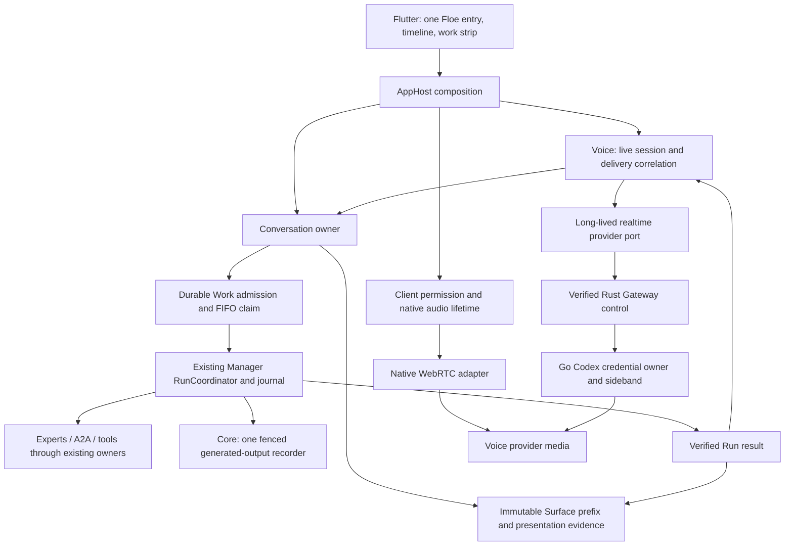
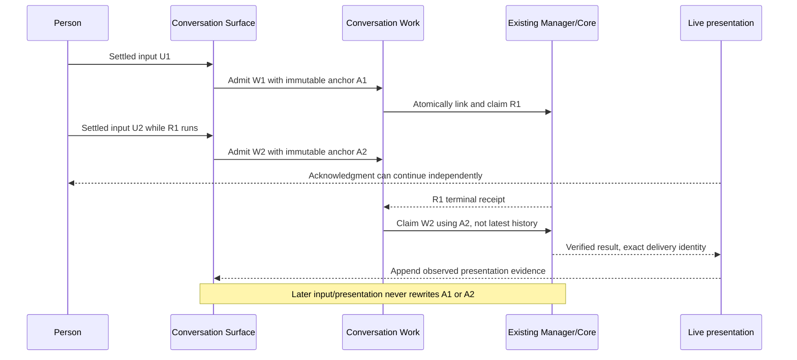

# 0036: Live Surface and durable Manager work

Date: 2026-10-16
Status: Accepted design; implementation gates are in the active execution plan.

## Context

The Person-facing Assistant must accept speech and text while the Manager is
working. The current Session revision/active-turn admission and Core recording
fence deliberately serialize Manager execution. Removing either check would
break recovery, provenance and exact-effect guarantees. A live provider is not
the Manager and may not write as its AgentIdentity.

## Decision

Conversation owns a durable **Surface** under the existing product Session ID,
independent from the Manager execution revision. Surface entries have existing
Conversation-contract MessageIds, monotonically increasing sequence and a
content-bound prefix anchor. Only settled user utterances enter durable custody;
caption deltas and audio samples do not. A provider utterance is identified by
its exact voice-session identity, never just its provider event ID.

Conversation also owns **Work admission**, distinct from an Expert Task or Run.
Admission atomically retains the input and its immutable Surface anchor. Pending
work has a bounded queue, not a lifetime message cap. The existing Manager Run
executor claims one work item per Session at a time. Claim binds an immutable
execution request to a Run inside storage, before dispatch; restart rejoins that
binding and never creates another effect-bearing execution. New Surface input
does not mutate an admitted Run's history or budget. Continue/Resume retain
existing original-input and uncertain-effect rules. A Person cancellation of
pending Work is itself ordered Surface intent; retaining its original input
without the cancellation would misrepresent the later context. Cancellation and
queue state commit together, while active execution remains Run-owned.

Generated results remain owned by Run/Task evidence. Surface presentations link
to that evidence and retain their own presentation receipts. Provider acceptance,
playback completion, interruption and unknown delivery are distinct facts. An
append acknowledgment is not proof that speech was heard. Completed Manager
output availability is appended atomically with its terminal settlement as a
canonical result reference. Availability is sufficient to retrieve text, not
proof that it was displayed/read or spoken. Later playback evidence must append
its own observation and cannot rewrite the result's original prefix.
Voice disconnect ends
capture and its provider session, not admitted Manager work. Results remain
available through the shared Assistant/Activity after hangup.

Core retains its single generated-output recorder. Surface is not a second Core
or an effect journal: it owns what the Person said/saw/heard; Core owns exact
agent execution custody. Referenced Manager results are not copied into another
authoritative result store. Surface filler is not personal-memory evidence or
permission for source access/actions.

Voice owns normalized live-session lifecycle, delegation/event correlation and
delivery state through a long-lived provider port. App composes Voice with the
Conversation owner. Client media permission and native audio lifetime are
separate; raw audio never crosses Dart JSON or the domain event journal. Codex
WebRTC and Go credential/sideband adapters implement external boundaries. No
Flutter-to-Go business route, token readback, hidden paid fallback, or second
Manager is introduced.

A user-initiated voice session authorizes its explicitly disclosed audio
processing destination; OS microphone permission is a separate prerequisite.
Neither grants Calendar/Health/Contacts or action authority. Existing ADR 0034
source processing remains unchanged. Real account/provider and device tests are
separate from synthetic owner tests; fixture success is not a live feature claim.

## Target topology

This diagram describes the accepted target, not current platform qualification.
The active plan identifies the implemented checkpoint.

## Rejected alternatives

- Loosen Core recorder identity: false authorship and concurrent writer hazards.
- Let Voice call Experts/tools directly: duplicates Manager and access policy.
- Remove Flutter's busy guard before durable admission: drops or duplicates input.
- Treat Run completion as spoken delivery: invents presentation after interruption.
- Pin a queued input to the latest history at execution: leaks future utterances.
- Keep permanent text/voice execution branches: two competing authorities.

## Cutover and verification

Implement the durable admission/anchor/receipt contract and encrypted storage
first, then migrate text admission and the shared product projection. Introduce
the Voice owner against fake provider events only after the Manager bridge has
an actual queue/recovery fixture. Integrate native capture, verified Gateway
signaling and Flutter as later gates of the same active plan. No temporary API
is advertised as complete. Stored-layout changes require a same-snapshot fresh
explicit development profile; never reset existing data automatically.
