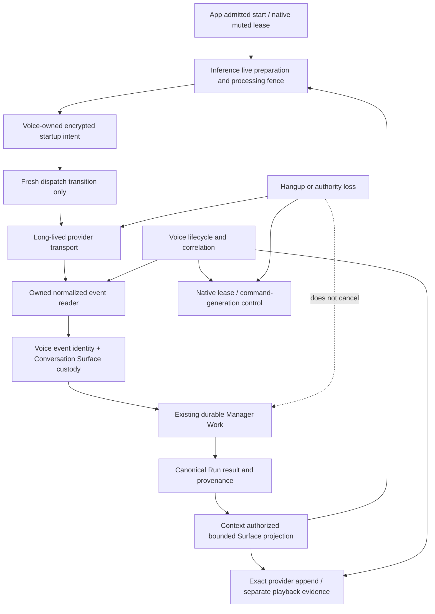

# Floe architecture refactor: target and execution contract

## Recovery of unpublished work — 2026-10-12

The previous local post-`6c358b` checkout, toolchains and verification logs were
not available in the current environment when publication resumed. Its reported
local results are not qualification for reconstructed source. Main remains the
verified published baseline; unpublished memory-capacity, lossless-compression,
Core/custody and freshness fixes require reconstruction and fresh validation.
No existing user profile is reset, and Apple QA remains paused.

The first reconstructed slice preserves candidate authorship through Memory
approval while decision/mutation actors remain User. On the published baseline,
two new owner regressions reproduced learned Create and Revise becoming User
authored; rejection and refusal of Learner self-approval passed. The fix retains
source references, prior revision attribution and serialized overview origin.
Fresh qualification passed 254 default workspace tests including doctests, 34 Conversation integrations, 8 additional Calendar/Day/process-kill regressions, production FFI build, architecture boundaries and diff checks. The standalone crash driver is intentionally ignored and exercised by the passing subprocess tests. Flutter source and wire shape are unchanged; Flutter and Apple tests were not rerun in this recovery slice. These counts qualify this reconstructed slice only, not the missing unpublished changes. Implementation and testing remain root-owned.

The next reconstruction slice reproduces provider wire rendering dropping retained
Preambles and Calendar Deny/Dismiss failing after decision admission. The wire
regression checks exact frame ordering; the real App/Vault/Access scenario checks
settlement, same-command replay, refusal of later approval and zero dispatch or
external effects. The initial Calendar test assertion did not compile because
InteractionResult lacks PartialEq; comparing its exact two fields allowed the
regression to reproduce the actual Admitted/InvalidInput failure. Fresh final gates passed 255 workspace tests including doctests, 34 Conversation integrations, 9 additional Calendar/Day/process-kill tests, production FFI build, architecture and diff checks. Flutter source and wire contract are unchanged and its tests were not rerun for this slice. No live provider or Apple behavior is inferred from these fixtures.

The Core capacity reconstruction reproduces the 4,098th append failing and a
valid set of 4,097 independent scopes making Vault reopen fail. Lifetime sequence
and startup scan quotas are separated from bounded read working sets. New real
encrypted fixtures test append/reopen/exact replay, last-scope corruption, and
129 actual settled Runs across multiple binding/receipt pages, including empty-key
corruption and validation without repair. Other owner admission limits remain
open. Fresh qualification passed all 133 Vault tests, 258 workspace tests including doctests, 34 Conversation integrations, 9 additional Calendar/Day/process-kill tests, production FFI build, architecture boundaries and diff checks. The 4,098-entry fixture includes actual encrypted reopen and exact admission replay; the multi-page fixtures retain corruption rejection without repair. Flutter/Apple/live-provider qualification is not extended by these results.

The lossless typed-history reconstruction replaces encrypted TEXT payloads with
bounded raw/zlib BLOB frames while preserving exact canonical bytes, digests,
logical budgets and duplicate-admission row identity. The new actual encrypted
storage test first reproduced TEXT storage; new cases cover exact reopen,
pre-hydration budget/header rejection and malformed compressed streams. Existing
payload-corruption fixtures now frame their deliberately damaged canonical bytes
so they still exercise evidence validation rather than failing at the new SQL
type constraint. Fresh qualification passed 140 Vault tests, 265 default workspace tests including doctests, 34 Conversation integrations, 9 additional Calendar/Day/process-kill tests, production FFI build, architecture boundaries and diff checks. Flutter 3.47.7 / Dart 3.13.5 was restored from a checksum-verified official SDK, but dependency restoration was blocked by the environment network policy for pub.dev, including the supported escalation retry; Flutter tests and analysis did not run. No client/wire source changed in this slice. Apple and live-provider qualification remain open. No existing profile is
reset; a fresh explicitly selected development profile is required for this
stored-format change. Model-context semantic compaction remains open.

The next reconstructed slice unifies complete Task replay validation and
bounds memory context selection without making saved-memory count a Conversation
failure. The actual encrypted Task regression first accepted a forged raw-message
hash; the canonical validator now rejects that and five other altered replay
fields atomically, accepts a complete canonical receipt and preserves it across
cancellation/reopen. Pure Knowledge tests reproduced the 33rd fact and statement
budget overflow failing the whole projection; the fix preserves complete facts
and marks partial coverage while continuing validation of inspected omitted rows.
A real encrypted 33-fact approval/read/reopen test verifies retention and stable
projection order. Learner queue fixtures reproduce discovery errors masking the
initial claim, and cover deferral of new discovery with partial comparison data
without any model call. Fresh qualification passed 11 Knowledge tests, 142 Vault tests, 274 default workspace tests including doctests, 34 Conversation integrations, 9 additional Calendar/Day/process-kill tests, production FFI build, architecture boundaries and diff checks. Flutter dependencies remain blocked by the environment network policy; no Flutter/Apple/live-provider qualification is claimed and client/wire source is unchanged. Review backlog
pagination, remote freshness and inherited Task continuation remain open.

Remote freshness reconstruction replaces request-start freshness with release-time
validation and rechecks recorded dependency expiry/cancellation/deadline after
I/O. The synthetic owner-port regressions reproduced rejection of a newly observed
response, acceptance of expired response data, expiry during continuity checks,
and dependency reauthorization after expiry/cancellation. The initial generated
test stub had a Rust delimiter error; after correction the five tests reproduced
the actual old-path failures. All 15 affected Context tests pass after the fix.
Fresh aggregate qualification passed 279 default workspace tests including doctests, 34 Conversation integrations, 9 additional Calendar/Day/process-kill tests, production FFI build, architecture boundaries and diff checks. Flutter dependency restoration remains blocked by environment network policy; client/wire source is unchanged and no Flutter or Apple qualification is added. These tests do not verify cryptographic
source-preview adapters, a live Gateway/provider or native behavior.

The inherited-Task Continue regression reproduced a valid carried Task result
failing normal recording. Investigation found both original-parent checks and a
collision at the stable typed Task alias. The attempted parent-normalization
change was discarded: the correct owner behavior is to rejoin the immutable
original contribution, not create a second producer or duplicate history alias.
The new private composition verifies actual lineage, complete replay and original
typed/Core proof for both live and interrupted observers. Tests cover unchanged
Task ownership, no added history rows, missing/forged replay rejection, exact
acknowledgement, restart recovery, live-driver takeover rejection and unrelated
new-turn rejection. Added deeply nested futures exposed a stack overflow in an
existing Interaction regression; boxing the transaction-composition futures
restored that unchanged test without increasing thread stack limits or weakening
assertions. Fresh qualification passed 145 Vault tests, 282 default workspace tests including doctests, 34 Conversation integrations, 9 additional Calendar/Day/process-kill tests (one opt-in case remained ignored), production FFI build, architecture boundaries and diff checks. Flutter dependency restoration remains policy-blocked; Apple/live-provider qualification remains open. This is Continue evidence, not a claim
that every interaction Resume or live-provider recovery case is complete.

Go QA restoration used the checksum-verified official Go 1.27.2 toolchain.
The first race run reproduced private-file metadata failures in synthetic storage,
catalog, HTTP and Views fixtures: testing.TempDir creates numbered children with
0777 filtered by the process umask, so a normal 022 umask produces 0755. Fixtures
now explicitly create an owner-only child with os.MkdirTemp through test support;
production ownership/mode/link checks and the global umask are unchanged. A
fixture test checks independent directories, exact 0700 mode and the production
validator. Its initial compile missed the privatefiles package alias and was
corrected before qualification. Fresh `go test -race -count=1 ./...`, `go vet
./...`, the explicitly enabled actual Rust-to-Go-to-mock-provider budget path,
architecture boundaries and diff checks pass. No live provider or Apple Keychain
behavior is claimed. Only synthetic test setup changed in the server.

The Expert-before-Manager discovery-limit hypothesis did not reproduce on the
current normalized implementation: actual Expert Task admission/start uses its
own conversation tables, not agent_sessions. A regression now verifies real
Expert input, Manager discovery at limit one and encrypted reopen; no production
query was changed for this stale hypothesis.

A separate learning-evidence regression did reproduce silent loss of a late user
negation and assistant qualification beyond 1,536 bytes. Discovery now preserves
both complete linked messages within the existing 4 KiB envelope, preflighting
framing and UTF-8 byte length. Oversized evidence returns BudgetExceeded rather
than a silently clipped observation. Later bounded candidates can still be
considered before the deferral is reported, and queued work remains first. Tests
cover complete Korean text, exact byte capacity, over-capacity deferral and queue
isolation without model calls. Fresh qualification passed 15 Knowledge tests, 146 Vault tests, 287 default workspace tests including doctests, 34 Conversation integrations, 9 additional Calendar/Day/process-kill tests (one opt-in case ignored), production FFI build, architecture boundaries and diff checks. Flutter dependency restoration remains policy-blocked; Apple/live-provider qualification is unchanged. This does not implement semantic compaction or broaden
observation limits, and the original transcript remains intact.

## Resumed direct improvements — 2026-10-13

The restored checkout starts from main 2e4ca99. Calendar display-label regression
reproduced rejection of a valid 516-byte qualified name and an exact 1,024-byte
owner-supported name. Protocol and Dart now use the Day display bound without
truncating names; resource/authority identities are unchanged. New client tests
cover event labels and source/resource coverage plus over-budget rejection.

The encrypted 101-candidate memory-review fixture reproduced whole-query
BudgetExceeded. Knowledge now returns the oldest 100 validated candidates plus a
validated sentinel-derived, required has_more flag. Display, protocol, FFI and
Dart callers migrate together; old optional/implicit page semantics are not
retained. Client decisions reload the bounded queue, and clear/failure drops the
continuation marker. The fixture verifies exact ordering, reopen, page advance
and complete drain; original candidate/decision records remain intact.
Protocol rejects missing or contradictory page metadata. Fresh validation passed 291 default Rust workspace tests including doctests, 34 Conversation integrations, 9 Calendar/Day/process-kill integrations (one opt-in case ignored), the production FFI build, architecture boundaries and diff checks. Five standalone cases executed the actual Dart memory-page decoder. Flutter dependency restoration timed out in initial diagnostics and the supported escalation returned a policy block for https://pub.dev:443; Flutter analyze, widget tests and Apple builds remain unverified. The new client tests are present but are not claimed as passed. Automatic semantic compaction remains open.

## Automatic semantic compaction — direct implementation sequence

This remains an open implementation milestone, distinct from lossless storage
compression. Conversation owns eligibility, scheduling and durable compaction
execution; Context owns live projection/coverage; the existing Agent Runtime and
Inference own model execution and selection; Vault atomically commits the exact
Core checkpoint, archive manifest and Session CAS. App only composes the service.
No Expert learning loop, new product command or external provider dispatch is
introduced by this plan.

The current archive commit accepts a caller-provided summary and has no automatic
production caller. It cannot be made automatic merely by calling a model after a
Run finishes: the model attempt must have durable intent, bounded accounting and
restart semantics before the checkpoint can be committed.

The first eligibility defect was reproduced and repaired directly: the archive
guard incorrectly required Completed/Blocked before consulting Continue, while
canonical Continue is Failed/BudgetExceeded or TimedOut/DeadlineExceeded. The
redundant contradictory check was removed; the canonical receipt validator and
all owner/session/prefix protections remain. An encrypted owner/Core regression
covers both exhaustion causes, rejection before and after reopen, executor
reactivation and exact input reuse by Continue. Qualification passed 148 Vault
tests, 292 default workspace tests including doctests, production FFI build,
architecture boundaries and diff checks. This is an eligibility correction, not
completion of automatic summarization. No new Flutter or Apple qualification was
possible; the existing dependency/platform blockers remain.

Source-selection checkpoint: a Conversation-owned `CompactionSource` and the
archive repository's `prepare_compaction` now select a bounded whole-turn prefix
through the shared Vault eligibility gate. The source pins Session/Core identity,
revision, prefix and previous checkpoint, retains a recent tail, and preserves
all source text. The normal 16-entry tail can shrink under byte pressure, with a
two-entry floor and complete turn boundaries. Count-only pressure, few large
messages, duplicate/invalid source fields, reopen, stale revision, an actual
archive commit and a successor source incorporating the prior summary are
covered by encrypted owner/Core tests. The test fixture explicitly records real
typed Manager outputs for whole-turn boundary checks; journal-only fixtures are
not treated as full transcript evidence. This source contract is the bounded
prerequisite for step 3, not a claim that automatic compaction is operational.
The frozen source checkpoint passed 151 Vault tests as part of 295 default
workspace tests including doctests, the production FFI build, architecture
boundaries and diff checks. A prior aggregate attempt overlapped a constant-name
cleanup and its doctest linked the preceding library artifact; the full frozen
snapshot was rebuilt and rerun successfully. No Flutter/Apple or live-model
qualification is claimed.

Input-capacity prerequisite for step 3: repository inspection confirmed that the
Gateway's current codec/input framing cap is 32 KiB, independently of the larger
transcript/archive guards. Source preparation therefore accepts a smaller bounded
byte allowance and never clips an oversized turn to fit it. The shared Engine
now invokes pure selected-transport preflight before durable model intent;
Inference reuses its dispatch codec and canonical request builder, with all live
Access/budget/dispatch fences preserved for actual generation. The real App/Vault
fixture reproduced a premature model-attempt journal on a pure capacity failure,
then passed with no intent, no dispatch and no redispatch after reopen. A separate
post-handoff capacity failure retains its intent and unknown usage, also without
redispatch. A compaction driver must prove the former outcome before reducing a
source allowance; it cannot infer safe retry from the error code alone.
This frozen prerequisite candidate passed 295 default workspace tests including
doctests and 58 App QA tests (one subprocess entry ignored), plus the production
FFI build, architecture boundaries and diff checks. These synthetic tests do not
qualify live model behavior or implement automatic summarization.

Summarization-journal prerequisite: Conversation now defines a source-pinned,
role-restricted journal head and recovery decision over the shared generic
execution parser. The execution identity includes the Person and exact source
snapshot; a changed source cannot reuse the journal. Only a single text Answer
per validated batch is allowed, with no tools, delegations, artifacts or
foreground finalization. The summary must be nonempty, bounded and smaller than
its source text without silent trimming. Durable intent or unknown usage never
becomes permission to repeat a model call; only an empty journal is NotStarted,
and a fully recorded answer is replayed exactly. The source selector now also
has a transaction-composable implementation for atomic job admission. Six pure
journal regressions and three encrypted source-selector regressions pass. The
frozen checkpoint also passed all 301 default workspace tests including doctests,
the production FFI build, architecture boundaries and diff checks. App QA was
not rerun for this pure-contract/transaction-extraction checkpoint. This
checkpoint does not yet persist jobs, dispatch summaries or install checkpoints
automatically; the next dependency-closed slice wires these owner rules into
Vault custody and the Conversation lifecycle.

The compaction storage extension follows the existing optional-family
pattern: absent state is initialized only by explicit owner admission, never by
open/read or repair of partial objects. A job and its sole execution journal are
bound to the active Conversation executor generation. Recovery either adopts an
empty execution or commits a recorded answer after current source/coverage/CAS
checks; an uncertain attempted execution is retired without redispatch. No
existing Run or Task meaning is reinterpreted and no stored profile is reset.
Durable custody checkpoint: admission now atomically selects and stores the exact
source, its admitted data classes, an empty journal and the active executor
fence. There is at most one pending execution per Session. Exact event replay
returns its original acknowledgement; changed source/foreground admission stops
a new intent. Result/accounting settlement does not require the old source to
remain current after handoff. A lost result acknowledgement survives reopen;
uncertain execution is retired with its journal intact. Empty work can be
adopted only by a newer executor on the original device; a replacement device
retires it instead of replaying it. Live unresolved attempts cannot be erased by
ordinary retirement. Retained rows are validated by a bounded keyset scan on
open, including malformed first keys, without repair. Reads never create the
optional family, and a partial family fails closed. Seven encrypted custody
regressions pass; the wider compaction subset passes 13 tests, alongside six
pure journal tests. The frozen custody candidate passed 308 default workspace
tests including doctests, 58 App QA tests (one subprocess entry ignored), the
production FFI build, architecture boundaries and diff checks. No new Flutter,
Apple, Go or real-model qualification is claimed. Automatic scheduling, model
projection and proof-driven checkpoint completion remain unimplemented at this
checkpoint.

The automatic cutover must use the recorded Answer's projection coverage when
installing its summary, separately from original archive-entry coverage. The
current manual archive helper conservatively merges the entire prefix; that is
not sufficient for an automatically filtered source after revocation. Revoked
source-derived content must not re-enter the summary, and stale dependency
coverage must not make an otherwise authorized new summary immediately unusable.
Compaction must not reload forgotten confirmed memories or create new learning
evidence from its summary. This does not erase the original conversation: the
accepted forget contract preserves transcripts and excludes the old evidence
from relearning, rather than maintaining a semantic blacklist.
The durable completion transaction now validates the source pin and answer
journal proof, keeps original entry coverage unchanged, and installs the exact
summary coverage. The manual helper had stored summary coverage under the last
original turn identity, although the summary already had a distinct stable
alias. All checkpoint/source/archive readers and installation now use that
summary alias; original answer coverage is unchanged. The unused caller-supplied
summary command, request DTO, preparation facade and source-revision-only replay
lookup are removed. Storage-only archive fixtures exercise the same installer
with a test-only prefix-union coverage mode, not a production authority route.
Pending/unknown model accounting cannot install an answer, and a batch with
unknown provenance is rejected. Completion and its receipt are one atomic
transaction; exact lost-ACK replay remains read-only after later foreground work
and executor movement. Committed records are checked against actual archive
manifests on reopen. Focused qualification covers next-command admission,
source movement after Output, lost completion ACK, missing archive corruption,
multiple same-revision checkpoints, and exact filtered Answer coverage without
contaminating original history. Qualification passes 316 default workspace
tests including doctests, 58 App QA tests (one ignored subprocess driver), the
production FFI build, architecture boundaries (26 nodes / 139 edges) and diff
hygiene. The focused completion cases and six pure journal tests pass. Flutter,
Apple, live-provider and Go qualification were not run for this checkpoint.

The product/model history activation gate is implemented with an explicit
ManagerHistoryView on the single normalized Vault reader. Product repository
reads choose Transcript; model admission chooses ModelContext. Original messages
and pre-checkpoint cursors remain exact, while only model history substitutes
the summary. A real encrypted-store regression covers all original entries,
earlier-page cursors, the bounded model view, reopen, and the public repository.
Restoring checkpoint substitution in the product view makes that regression fail
(red/green). Qualification passes 159 Vault tests, 309 default workspace tests
including doctests, 58 App QA tests (one ignored subprocess driver), the
production FFI build, architecture boundaries and diff hygiene. Flutter and
Apple checks remain unavailable under the previously recorded environment
constraints; this is not a UI/device qualification.
The completion cutover keeps semantic compaction out of the public Session
revision: it changes model context, not the retained product conversation. The
transaction still requires the exact Session revision, Core head and prior
checkpoint from the source pin, then advances the checkpoint and compaction-job
revision atomically. Foreground admission and maintenance cannot both commit
against a moved source. This avoids a hidden maintenance write making a user's
next command stale, without rebasing immutable commands or publishing an old Run
receipt as a new Session event. Archive identity remains
exact-prefix based; the unique source-revision restriction is removed so multiple
bounded checkpoints can complete at the same unchanged product revision. This
is a deliberate local stored-meaning change, with no automatic profile reset
or compatibility fallback. Qualification must cover both race orderings,
multiple same-revision checkpoints, exact completion replay, lost acknowledgement,
and original-message paging after checkpoint installation.

The Conversation-owned compaction model projector is implemented. It re-reads
the admitted claim around Context history authorization, preserves original User
text and complete authorized Tool/Delegation outcomes, carries retained
provenance and data classes, and loads no current memories/persona/evidence.
Five focused tests pass for role/text retention, live Unknown filtering, claim
movement/request retargeting, raw-data denial/cancellation and local-only source
processing review. This component does not yet schedule or dispatch a model.
Qualification passes 321 default workspace tests including doctests, the
production FFI build, architecture boundaries and diff hygiene. App QA remains
the preceding completion checkpoint's 58-test result; this new projection is not
yet activated by a runtime caller. Flutter/Apple/live-provider checks remain
unverified under the existing environment limits.

The next root-owned slice adds a bounded CompactionDriver using the same Engine,
live Context projector and Inference port. Actual encrypted-store fixtures cover
one execution plus committed replay, pure preflight rejection versus an
uncertain dispatched error, bounded invalid-output correction, output recovery
without even preparing a model, and retirement after source movement. The driver
creates no product Run/Expert Task and does not equate runtime_epoch with the
durable executor generation. A new large UTF-8 regression exposed the projector
packing more than the typed single-message ceiling into one frame; ordered inert
JSON fragments now preserve all bytes within the existing per-message and total
bounds. Focused checks pass six projection tests and four driver/store tests.
Final qualification passes 326 default workspace tests including doctests, the
production FFI build, architecture boundaries (26 nodes, 139 edges, no errors or
warnings), and diff hygiene. App QA is not rerun for this still-unactivated
component; its preceding 58-test result is not new driver qualification. The
component is not yet automatically called by the Conversation lifecycle. No
Flutter, Apple, Go loopback or live-provider qualification is inferred.

The capacity/lifecycle cutover is now implemented in the working candidate.
Conversation owns the trigger, a serialized maintenance driver and bounded
recovery. Vault retains the single source/installation gate, extended with a
required source-pinned `CompactionAuthority`: Idle or the exact fresh
BeforeFirstModel Run. The latter requires the matching active recorder/device,
Working state, empty durable Run journal, no continuation/resume/retry ancestry,
and unchanged Session/Core/checkpoint. Any foreground intent closes that window
before both summary dispatch and checkpoint commit. Current User input, recorder
and Run remain intact; no second user command or replacement Run is admitted.

The selected transport's typed ModelInputCapacityExceeded can trigger maintenance
only with the independent durable empty-journal proof. The same post-handoff
error does not authorize a summary or a retry. Count/byte framing ceilings report
the same input-capacity category rather than generic spending exhaustion. A
bounded model-history page now carries its uncheckpointed-earlier-prefix flag
through AdmittedTurn; the owner cannot silently present a suffix as complete
history. It compacts before inference, reloads canonical model history and
requires complete coverage after the checkpoint, or fails explicitly.

At most one summary execution, with the generic Engine's bounded correction, may
reach a provider per recovery attempt. Prefix byte proposals halve only after a
pure capacity refusal with zero durable model intents; proposals selecting the
same exact source replay the same job without another preparation or dispatch.
Maintenance is a separate durable execution budget, like Learner work, not an
unrecorded foreground attempt: token ceiling min(manager / 4, 16,384), cost
ceiling min(manager / 5, 10,000 micros), output ceiling 2,048 bytes, and at most
30 seconds within the foreground deadline. It is not included in the foreground
Run's attempt/usage projection. After its one committed summary, the foreground
request is validated again against the actual selected transport. If still too
large, it fails explicitly; no unbounded paid compression loop, truncation or
Continue/Resume relaxation is introduced.

The generation recovery pass includes bounded compaction-job pages and never
starts a new model call. It leaves a live serialized driver alone, installs
still-valid recorded output, and retires orphaned empty/uncertain or stale jobs.
Terminal receipt reads replay across executor movement while pending reads keep
the active generation fence. The new required authority field deliberately
changes local compaction payload meaning: incompatible older development jobs
fail closed; profiles are not reset, migrated or repaired automatically.

Focused real encrypted-store checks cover the fresh active-prefix window,
current-input/recorder preservation, wrong device/cancellation, and foreground
intent races before summary dispatch and commit. Actual synthetic App tests
cover capacity → summary → same foreground Run, exact product history and reopen,
pure summary refusal, both post-handoff failure boundaries and shutdown during
the summary without redispatch. The 129-turn App regression performs exactly two
model checkpoints while preserving all 258 original product messages and cursor
pages, and reopens without another provider call. Final qualification passes
331 default workspace tests including doctests, 61 App QA tests (one intentionally
ignored subprocess driver, exercised by the passing process-kill scenarios),
production FFI build, architecture boundaries (26 nodes, 139 edges, no errors or
warnings), and diff hygiene. All model/provider behavior here is synthetic, not
a paid or live-provider qualification. Flutter dependencies remain network-policy
blocked, Go loopback was not rerun for these Rust changes, and Mac QA remains
paused. This closes this bounded capacity-compaction cutover, not the entire
codebase audit or native/UI qualification.

Ordered cutover and acceptance:

1. Verify existing archive eligibility against canonical Run semantics. A valid
   Continue origin is a protected, retryable conflict, not corrupt storage. Keep
   protection for pending batches, open interactions, Resume slots, unresolved
   effects and active recorders. Reproduce budget/deadline exhaustion across
   reopen, then prove the original input can still be continued.
2. Add bounded candidate selection before a prefix reaches the model/archive
   ceiling. Select complete settled turns, retain a recent tail, and bind the
   candidate to Person, Session revision, Core branch, exact prefix digest and
   previous checkpoint. A prefix that cannot fit is not silently truncated.
3. Admit one durable Conversation-owned compaction execution per exact candidate.
   Use the existing generic Engine journal protocol, no tool/delegation catalog,
   and the same Inference primary/valid-absence fallback policy. This journal
   belongs only to the summarization execution; existing Run/Task journals remain
   the sole authority for their effects. Revalidate source processing through
   Context immediately before release. Never label unknown coverage Independent.
4. Commit only a validated, bounded summary from that execution under the pinned
   Session/Core proof. A competing new turn makes the candidate stale; discard
   that candidate's result without rewriting the new turn or retrying a paid
   attempt blindly. Retain every original transcript entry and archive pointer.
   Lost commit ACK replays the immutable receipt. A recorded unresolved model
   attempt does not cause another dispatch on restart.
5. Connect eligibility and execution to the Conversation owner's lifecycle and
   recovery. Test automatic triggering, below-threshold no-op, concurrent new
   turns, coverage revocation, cancellation, restart at intent/result/commit,
   exact receipt replay and full original-history access with scripted model
   seams. Run the Rust/App/FFI and architecture gates. No live paid-model call is
   part of qualification.

The production cutover must replace the caller-supplied-summary scheduling gap,
not add a second App timer or a client-side summarizer. Current archive APIs may
remain as the commit boundary only while their callers all enforce the same
candidate/execution proof; remove obsolete unchecked routes in that change set.

## Remaining-iteration recovery correction — 2026-10-13

Root inspection of the published `3ea60f12` snapshot reproduced R-005: after
settling a restored Tool batch with one iteration left, the shared Engine still
prepared an additional model call. The new regression failed with one preparation
where zero was allowed; the resumed Tool result had already settled. The host
correctly deducts completed ancestor batches, so the fix belongs to the Engine's
single loop condition: count the restored batch against the remaining allowance.
No new continuation state, widened limit or alternate runtime path is introduced.
Four focused cases cover last-iteration Tool settlement, one remaining fresh
attempt, a restored final Answer, and fresh execution at the same limit.
Fresh qualification passed 9 affected Engine tests, 335 default workspace tests
including doctests, 61 App QA tests (one subprocess driver intentionally ignored
and exercised by passing crash tests), the production FFI build, architecture
boundaries and diff checks. The 129-turn history/reopen regression passed in
348.80 seconds. This is synthetic owner-path qualification, not live-provider or
Apple/UI qualification. The broader audit remains open and root-owned.

## Attention history lifecycle correction — 2026-10-13

Direct owner tests reproduced R-007's error mismatch: expired/evicted Attention
observations and a disposed native host returned PolicyDenied, making ordinary
historical projection fail instead of dropping stale derived content. Context's
observation owner now reports lifecycle absence as StaleContext while rejecting
known foreign principal/device claims and malformed identities. The native adapter
maps only host CapabilityUnavailable to StaleContext; other failures propagate.
The existing history projection keeps the user's original/current messages and
omits the expired derived entry without changing the stored transcript.
Six focused registry, actual native-broker/driver and Conversation projection
cases pass, covering both clocks, bounded-cache eviction, host replacement,
process loss, identity denial and unchanged live evidence. Projection uses an
in-process registry resolver; these cases do not claim complete grant/native OS
or persisted App end-to-end qualification. Existing authority-failure projection
regressions remain mandatory. Fresh frozen qualification passed 341 default
workspace tests including doctests, 61 App QA tests (one intentionally ignored
subprocess driver exercised by passing crash tests), production FFI build,
architecture boundaries and diff checks. The full 39-case Conversation suite,
including 129-turn history and reopen, passed in 355.93 seconds. No Flutter, Apple
or live-provider qualification is added; the broader root-owned audit continues.

## Day lifetime capacity and recovery correction — 2026-10-13

Root-owned encrypted product-store regressions reproduced R-017 and R-018. With
one real manual receipt plus 4,095 valid retained refresh receipts, both a new
manual command and refresh were rejected while old exact replay still worked.
A separate fixture retained 128 completed snapshots with 64 full notes each;
shutdown and activation each decoded all 128 historical payloads.

The final ownership remains Day for command/state meaning and Vault for atomic
custody. Lifetime immutable receipts no longer consume new-work capacity; the
existing 4,096 count bounds only active nonterminal refreshes. An indexed terminal
field is written and cross-validated against the canonical payload. Executor
replacement/retirement selects only applicable nonterminal rows in 64-record
working sets and returns no unused unbounded record vector. Whole-transaction
rollback and old/new-generation fences remain. Remove the obsolete lifetime
constant/queries and migrate every repository-port implementation in this slice.
The fixed local product layout requires a fresh explicitly selected development
profile; there is no compatibility decoder, automatic reset or key replacement.

Five actual encrypted development-profile tests pass: lifetime threshold and
reopen/exact replay, zero terminal snapshot hydration, active quota release with
manual edits still available, 130-record multi-page recovery/generation fencing,
and later-page corruption rollback plus indexed/payload mismatch rejection.
These tests run with `cargo test -p floe-vault --no-default-features --features
development-storage --lib day_capacity`; default-profile tests alone do not cover
them. Frozen final qualification passed all 179 development Vault tests, 341
default workspace tests (including doctests), 61 App QA tests (one intentionally
ignored subprocess driver), the production FFI build, architecture boundaries
and diff checks. The App Conversation suite completed in 362.99 seconds.
No Apple/live-provider claim is made; Flutter dependencies remain blocked by the
previously reported environment policy and no client source changed.

## Server rotation custody and operator probe correction — 2026-10-13

Root-owned synthetic tests reproduced R-031: the token endpoint rotates after
observer cancellation, but saving with the canceled observer context loses the
replacement. Rotation and storage now share the existing bounded owner context;
pre-canceled callers cannot start new work. Tests cover recreation from the saved
replacement and failure-closed custody. No actual credentials or external model
services were read or called.

R-033 reproduced through the real provider factory, Inference service and
loopback HTTP adapter: the operator diagnostic failed with `request_rejected`
before provider IO because an intentionally non-product target lacked capability
metadata. The Inference owner now seals the exact fixed synthetic invocation in
the private resolved target. Provider registry admission checks either that exact
seal or ordinary positive product capability evidence, without inventing support
metadata. All callers use this one admission path. Product unknown remains
unknown, modified probe inputs/tools/format/identity/limits fail before HTTP,
unauthorized operators fail, and a registered target needs no purpose route.

Focused race checks passed for Codex, providers and Inference. The final
`go test -race ./...` passed all 14 packages with tests; `go vet ./...`, the
Go import-graph gate (including 16 negative fixtures) and diff checks passed.
The probe regression includes eight altered-invocation rejection subtests.
This slice does not qualify real OAuth, provider inference, Apple or GUI behavior.
Rust source remains the previously qualified Day snapshot.

## Inference lifetime configuration receipt correction — 2026-10-13

Root reproduced R-032 through the actual Configuration owner: change 65 failed
with `configuration_receipt_capacity`. The solution separates immutable history
from the live snapshot rather than raising the lifetime limit or evicting IDs.
Live receipts retain a 64-record working set; full pages are encrypted, hash-linked
and sequenced, and only a committed configuration snapshot publishes the new
archive head. Credential intents reserve their final receipt slot before effects.
History lookup is bounded-memory and linear-IO; failed/missing referenced pages
never become command absence. Unreferenced pages after rejected writes are safe,
idempotently reusable evidence, not independently published command outcomes.

Owner regressions cover 130 changes, exact replay after reopen, changed-ID conflict,
credential update after the old threshold, all archive-write failure dispositions,
rejected snapshot publication, both committed/noncommitted acknowledgement loss,
missing/unavailable/corrupt/sequence-mismatched history, and observer cancellation.
Actual encrypted storage plus the Configuration owner and provider factory also
perform 130 changes, recreate the owner, recover old receipts and delete the target
without an old replay resurrecting it. Storage tests cover exact immutable retries,
hash mismatch, path/size bounds, encrypted bytes and obsolete snapshot preservation.
No real credentials, model calls or connected-account changes are involved.

Focused owner/storage race tests and the final `go test -race ./...` passed
(all 14 packages with tests). `go vet ./...`, the import graph including 16 negative
fixtures and diff checks passed. Stored layout changes require an explicitly
selected fresh development profile; no existing profile is reset. Rust remains
unchanged, so its prior frozen gates are retained rather than rerun.

## Shared credential generation retirement correction — 2026-10-13

Root reproduced R-044 in the actual Inference lease and Configuration cleanup
path. A blocked generation-2 request retained a credential through a route-only
generation 3; rotating it then deleted the slot because cleanup checked only the
idle generation 3. Cancellation had not settled the earlier provider request.

The service now supplies one retirement barrier over all leases at or below the
recorded generation. Configuration cleanup uses that barrier; no second credential
lease registry is introduced. The regression forces cleanup while the old request
is blocked, verifies the slot remains, then releases it while keeping a generation-4
lease alive and verifies cleanup completes. This establishes lifetime ordering,
not a claim of actual provider failure or credential disclosure in the old code.

Focused Inference race checks and final `go test -race ./...` pass (all 14
packages with tests), along with `go vet ./...`, the import graph including
16 negative fixtures and diff checks. No stored meaning or profile layout changes
in this slice.

## Microsoft Calendar bound identity correction — 2026-10-13

Root reproduced R-035 through `NewCalendar` with a real connection-scoped
`CredentialSlot`: comparing that hashed slot with the bare Calendar namespace
incorrectly disabled required identity verification and omitted `openid profile`.
The runtime now selects the identity policy from its immutable credential namespace,
while credential reads and exact release checks retain the full connection slot.
Mail/Teams profiles retain their distinct policy; no identity admission is weakened.

Actual constructor and OAuth-token/metadata/JWKS adapter tests use only loopback
HTTP, in-memory synthetic credentials and locally generated RSA signatures. They
cover valid identity, nonce/audience/issuer/expiry/signature rejection, missing
ID token, exact slot/identity release, token gating and re-verification after runtime
recreation. This is not Microsoft live OAuth or full hosted-connection/GUI QA.
Focused race tests and final `go test -race ./...` pass (15 packages with
tests), along with `go vet ./...`, the import graph with 16 negative fixtures
and diff checks. No persisted-layout change is introduced by this correction.

## Pairing complete reservation custody correction — 2026-10-13

Root reproduced R-034 by failing attempt storage after the receipt-index write:
recreated operations could neither inspect nor replay the retained reservation.
The owner now constructs/signs the full immutable challenge before reservation
and atomically stores that payload with its index entry. Until explicit mutation
publishes the identical attempt and clears the reservation, the index payload is
its sole authority. Attempts cannot advance while this handoff is incomplete.
Queries remain read-only; no second challenge or activation is created by recovery.

Fault regressions cover missing attempt storage, index/attempt/clear acknowledgement
loss, rejected clear, request cancellation, owner recreation, exact start replay,
changed-identity conflict, new-ID blocking, explicit Cancel/Reject followed by new
pairing, unequal attempt rejection and preservation of old missing evidence that
cannot be reconstructed. Synthetic signing and in-memory credential custody are
used; no device was paired and no real credentials were handled. The existing
32-KiB index/record and 128-receipt guards remain; this does not claim unlimited
pairing-history capacity or actual macOS Keychain process-crash qualification.

Focused Pairing/credential-adapter/HTTP race tests and final `go test -race ./...`
pass (16 packages with tests), along with `go vet ./...`, the import graph and
16 negative fixtures, and diff checks. This extends private reservation custody
without changing the public pairing wire contract or automatically modifying data.

## Post-audit correctness work — 2026-10-12

The static audit is a set of hypotheses, not runtime qualification. Reproduce each affected owner path before claiming a defect fixed. This work is performed directly in the root checkout; implementation, review and verification are not delegated.

The accepted product decisions are immediate removal of explicitly identified memories (including prevention of relearning from the same old evidence), and compression before destructive history pruning. Forgetting a memory does not implicitly delete the original conversation. Storage compression and model-context summarization have distinct contracts.

Ordered cutover:

1. Repair normalized Manager learning evidence and Manager/Expert recorder retirement. Knowledge continues to own learning admission; Conversation Core remains the sole transcript custody path; uncertainty accounting must survive writer retirement.
2. Implement exact-target forgetting under Knowledge ownership with provenance-based relearning exclusion and live projection invalidation. Clarify ambiguous user targets; do not preserve forgotten content in a semantic blacklist. Preserve unrelated original transcripts and uncertain external-operation evidence.
3. Add bounded compression and align storage/read admission limits, then resolve the remaining reproduced boundary, recovery and capacity findings.
4. Run affected-owner regression tests during iteration, then the single final workspace/architecture gate. Apple/native qualification remains explicitly pending while Mac testing is unavailable.

First checkpoint: replace transactional learning validation of the obsolete inline Session message vector with bounded normalized Manager transcript evidence under the same Vault transaction. Discovery, enqueue and staging must retain Person, Session, revision, turn membership and dependency-coverage checks. Remove the obsolete evidence path instead of restoring inline messages. Verify explicit remember, rejected foreign turns, stale revision, reopen/idempotent enqueue and non-independent evidence. Search learning callers for residual inline-history dependence and update the runtime architecture description with the verified path.

Checkpoint 1 landed as `d55f069bce541e54a66e04568852146ce59748a4`: normalized learning evidence and canonical Expert source-review settlement. Both defects were reproduced before the fixes. Root verification passed 133 affected-owner tests, 235 default workspace tests including doctests, 32 development-profile Conversation integration tests, production FFI build and architecture/diff checks. The initial integration invocation combined storage profiles and failed compilation; the corrected command used `--no-default-features --features qa-fixtures`. No Apple/Flutter GUI qualification is claimed.

Checkpoint 2 separates terminal writer custody from unresolved model accounting. Authenticated terminal state fences subsequent writes; current close or stale-generation retirement releases the exclusive writer once non-model contributions settle. Original unknown accounting and archival protections remain. Terminal retained recorders must be discoverable by recovery. Regressions cover cancellation, restart, a subsequent explicit Manager request, late-output rejection, exact receipt replay, late Task settlement, retained-custody discovery, Expert assignment reuse, and refusal to release unsettled non-model work. This supersedes older plan prose that makes model accounting uncertainty alone retain an exclusive recorder forever.

Checkpoint 3 (`79a9194eb4e57f8f43707f40081f1d45c36e9093`) implements the exact-target `memory.forget` product command, immediate settings action, immutable success/negative replay, evidence-turn relearning exclusions and model memory-revision fences. Original transcripts remain. A fresh explicit statement is eligible again. At that checkpoint the Manager Tool port remained disabled: direct code review found that adding a mutating Tool now would need atomic local-effect receipt recovery in Conversation Core; shipping a tool that can strand custody after a lost result is not acceptable. That conversational entry point remains separate unfinished work, not part of this checkpoint's completion claim. Compression also remains pending. Root verification passed 245 default Rust workspace tests including doctests, 33 development-profile Conversation integration tests, the production FFI build, and 105 Flutter tests (including an immediate-forget settings widget test). Architecture and diff checks passed. Flutter 3.47.7 / Dart 3.13.5 analysis reports 129 existing diagnostics (0 errors, 2 warnings, 127 informational); a separate untouched `b5fe75e` client checkout produced the exact same normalized diagnostic set, so analysis is not claimed clean. The encrypted schema requires a fresh development/QA profile; no existing profile was reset. Apple build and interactive screen QA remain unqualified.

Checkpoint 4 implements conversational forgetting through a narrow Manager Tool and authenticated local-effect receipt recovery. The actual durable Run/Tool intent, current executor and exact target/revision fence Knowledge mutation; recovery cannot redispatch. Result journal, typed Tool evidence and Core custody settle atomically. Regression scenarios cover committed deletion with lost result, pre-dispatch crash without deletion, cancellation, stale executor, active-driver rejection, late-mutation rejection, fault rollback and exact replay. Tool classification now identifies mutation correctly, and fresh delegating batches pin live projected memories rather than the initial Run snapshot. Root verification passed 251 default workspace tests including doctests, 34 development-profile Conversation integration tests, the production FFI build, and 105 Flutter tests. All 8 additional Calendar Conversation/Day/process-kill regressions passed; the ignored subprocess entry is invoked by both passing crash tests. Architecture/diff checks passed. Flutter analysis retains the exact 129-diagnostic baseline (0 errors, 2 warnings, 127 informational), not a clean result. The new App scenario verifies that an unprojected target is denied and original transcript retained; actual positive deletion and crash recovery are exercised by encrypted Vault and Manager port tests. These are synthetic/local tests, not live-model intent interpretation. Compression and remaining audit findings are still open. No Apple or interactive screen qualification is claimed.

Next compression/capacity work keeps two boundaries explicit:
- Vault storage compression is lossless and occurs inside the encrypted owner store. Canonical uncompressed payloads, logical byte budgets, content digests, provenance and immutable replay identities retain their meaning. Decoding must reject invalid format, oversized declared output, truncated/corrupt streams and output beyond the caller's logical budget before unbounded hydration. Fresh profiles replace obsolete local stored meanings; no automatic data reset or deletion is authorized.
- Model-context reduction is a derived projection, not original-history removal. Summaries/selections must preserve source coverage and exact retained-prefix identity; live/uncertain effects and their recovery/deduplication receipts cannot be evicted to make space. Capacity failures must be reproduced at their actual producer/reader boundary rather than hidden by raising unrelated constants. The saved-memory projection overflow and undrainable review backlog are next targeted admission/read-path checks.

## Active P3 implementation update — 2026-10-09

P3 implementation and caller cutover is now present on the exact verified base commit `98c463ec3ce80ff329119dcacbf0f37975e5a710` (parent `b871c89a7d5ac8ec59e5eb445d77d89443f49465`; base tree `246ebfc1fc5d42a9d38ab559c2d092959aa7799a`). Calendar Operations owns immutable effect normalization, identity, dispatch intent, provider receipts, uncertainty and reconciliation. Access owns immutable operation subjects, policy, review and decision receipts. The existing encrypted Vault composes operation and Conversation approval-interaction admission atomically; dispatch intent and Access receipt consumption are later committed with current local checks, while external source continuity remains an adapter fence. Conversation publishes and resolves the approval interaction and resumes the same operation without submitting its effect again. Day calls through its inward port without holding its local admission lock across external work; direct Day commands retain actor/source/OS authority independently of Expert Allow/Ask/Deny policy. The four product route groups are Conversation, Connections, Day and Memory. Conversation routes include `conversation.calendar_policy.get/set`, `conversation.calendar_proposal.submit`, `conversation.interaction.resolve/refresh` and `conversation.experts.*`; Day routes include `day.calendar_destinations` and `day.external_calendar_operation.*`. Runtime/native control routes remain separate. No `access.*`, `actions.*`, top-level `experts.*` or top-level Calendar Operations namespace is exposed.

P3 implementation and the actual caller cutover are complete on this candidate. Calendar Operations owns immutable effect normalization, identity, dispatch intent, provider receipts, uncertainty and reconciliation; Access owns the operation authorization subject, policy, review and decision receipts. The existing encrypted Vault composes owner transitions, including Conversation approval publication, in the same immediate transaction. Access decision consumption and dispatch intent commit with live local checks; external-source continuity remains an adapter fence. Conversation presents and resumes the exact existing operation from canonical owner receipts. Day calls through its inward external-operation port without holding its local lock across external work; direct manual Day commands preserve actor/source/OS authority independently of Expert Allow/Ask/Deny policy.

History projection now omits a derived historical entry only when its individual dependency reauthorization returns `StaleContext` or `AccessReviewRequired`. Ambiguous authority, corrupt proofs, source acquisition failures, storage errors, and current-turn required-source failures retain their failure semantics. Each typed history entry retains its own coverage, ToolExchange removal stays atomic, the linked Resume retains the original input in `current_turn`, and live operation status remains honest through Unknown/Executing/Succeeded. The current scripted Calendar Operations/Conversation matrix passes 4/4 and direct Day matrix 2/2; the exact linked approval/Resume scenario passes with the lost-decision-ACK crash cut point and post-write stale-history check. The full Conversation integration passes 30/30 on the final candidate (403.77s). `CARGO_INCREMENTAL=0 cargo test --workspace --no-fail-fast`, eight FFI QA tests, production and QA FFI builds, the 26-node architecture boundary check, its negative-fixture test, formatting, and `git diff --check` pass. The original retry/ACK-loss failure logs remain in the review archive. Flutter format/analyze/tests produced no result because Dart/Flutter initialization was denied while attempting to write `/home/agent/.dart-tool`; that path was not retried or redirected. Rust tests are not screen/macOS QA or CI evidence; neither is claimed.

This update governs the P3 candidate only. The following earlier active-stage and dated execution records are retained as historical context; their branch baselines and validation results do not describe this P3 candidate.

## Active execution update — 2026-10-09

This section is the single current sequence for remaining work. The dated R0–R3 and bounded-slice records below remain historical evidence and do not describe the current production cutover status where they say Manager callers are disconnected. This update supersedes overlapping old stage-order, Session-import and Actions-retention language below; preserved owner and custody invariants remain mandatory. Historical validation is not proof for the active candidate.

**Active source baseline:** exact commit `8d0f7f72913a1a6c5f38ed67ebf7fc831c5183e4`, tree `01c2f238d4417d113e74b7acd4b5dab8798b2d3f`, fetched and verified in a clean worktree. The earlier 1,172-file ledger belongs to the October 2 baseline and does not establish exhaustive reading of this snapshot. For each implementation scope, read affected bodies and reconcile caller, import and deletion paths before editing.

### R4 — functional production Manager Conversation cutover (2026-10-09)

**Active scope decision:** follow current `AGENTS.md` fresh-development-profile policy. Do not implement the older standalone frozen Session import/activation branch: it is not a prerequisite for this cutover. Do not add backward compatibility for obsolete local profiles, migration chains, permanent old decoders, dual reads/writes, automatic reset/import or key/database deletion. Existing incompatible profiles stay untouched and fail closed. Remove inert legacy preparation code and tests once no supported route uses them. The existing layout/version checks remain the explicit compatibility boundary.

Conversation owns Manager product admission, Run lifecycle, interactions, cancellation and recovery. Core owns neutral transcript integrity and recorder custody. Vault commits owner changes, typed entries, Core custody and evidence links in one transaction. Run journals remain the only effect and Task execution journals. Continue and linked Resume reuse the exact original User input while admitting fresh Run and recorder identities; New appends one User entry. Preserve command identity, exact ACK receipt replay, bounded Session metadata/CAS and busy rejection. Continue keeps an exact pending batch, cursor and model pin through empty or batch-only ancestors until a child claims that cursor. A linked Resume retains its source/input and interaction lineage and begins fresh model work. Preserve source revocation and explicit cancellation direction.

The default Manager has a stable per-Person identity, independent of Run/Task IDs and Expert registry revision. Pin definition `manager-role` at `MANAGER_ROLE_REVISION` (currently 8). Persist the exact Session-to-Conversation/branch binding; a definition policy change selects a new conversation. Replace the live growing `AgentSession.messages` route with normalized typed history plus the bounded owner shell. Connect Session head, reverse and exact reads to normalized storage and stable public aliases. Missing, ambiguous, stale or mismatched aliases are explicit; no message is skipped or duplicated. Include evidence hydration in byte limits. Preserve textless Interaction and structured Delegation evidence. Manager-only learning discovery reads a bounded normalized history suffix in its owner transaction; scoped Expert Sessions stay outside Manager learning.

Record every supported Manager-produced contribution with deterministic contribution and alias identity, actual Task/interaction proof, and owner/Core transaction ordering. For blocked publication and late recovery, commit owner publication, typed recording and terminal/custody settlement in the required order. A narrow Core recovery contribution is authorized only for the exact authenticated TaskResult under its existing open recorder after terminal recovery has committed; a separate unresolved model attempt may keep that recorder in custody. Do not fabricate Working state or grant general post-terminal output authority. If another real Core contract gap appears, stop that path and report it rather than weakening proof rules.

Compaction is an exact committed prefix and summary with live coverage; it must not prune payloads in this milestone or rewrite Unknown coverage as Independent. Protect Continue origins, pending batches, open interactions, Resume slots, uncertain effects and archive references. Preserve new-profile cursor and archive behavior. Existing Expert execution remains a genuine Task owner and Manager evidence source. The next functional milestone is persistent isolated Expert conversations plus Task-to-Run/history-pin cutover; do not add Expert learning or change A2A into a lifecycle owner.

**Acceptance gate for this slice:** run real App/Conversation/Engine/Vault integration with scripted external model/source seams for a text turn, normalized multi-turn history across reopen, New/Continue/Resume input reuse, delegated Task result, blocked textless interaction, cancellation/uncertain recovery, exact ACK replay, bounded cursors and the combined first-insertion late Task result with unresolved model accounting. Follow with Rust/App/FFI and architecture checks, residual searches proving old Manager history routes are gone, and one final aggregate build/test gate. Report GUI, macOS, provider and native QA limits plainly; no premium model or real-provider dispatch. Keep exact base/candidate trees, complete patch, raw logs, manifest and SHA-256 hashes in the reviewable Library archive. No commit or push before root review.

### R5 — persistent isolated Expert Task conversations

**Owner and identity contract:** Experts remains the sole Task lifecycle and execution owner. One admitted `TaskExecutionKey` opens exactly one fresh logical Expert Run segment in Conversation Core; Task's existing journal, terminal receipt, executor generation and recovery remain the only execution authority. Core records transcript custody only. It does not create a second Task/Run journal, scheduler, cancellation authority or dispatch route. Persist a unique mapping from the complete `TaskExecutionKey` (Task ID, execution ID and Task executor generation) to its Core `RunId`, exact Person, Expert Core identity, Conversation/branch and input reference. A different Task ID for the same verified Person, registry instance, installation, assignment, package kind/ID/version and definition revision continues that assignment's exact conversation after prior custody settles. A changed identity field, package/version or definition revision selects new conversation custody. Task ID, Manager Run ID, A2A peer ID, mutable registry revision and model environment digest never select or merge conversation identity. Package version must be checked against the admitted installation and included in the definition identity. Existing Tasks keep their recorded identity and pin.

**Admission and history pin:** store the canonical host Expert execution input with the immutable Task record: exact `TaskExecutionKey`, original `request_digest`, delegated message, input coverage/provenance, Expert conversation identity, Task-to-Run mapping, input message/command IDs, and the exact pre-input Core head (empty head is revision zero plus the Core empty-prefix digest; otherwise exact `TranscriptReference`, head revision and prefix digest). Vault issues a separate immutable `ExpertTaskAdmissionReference` from a domain-separated commitment over that complete local input and persists its canonical receipt atomically with Task admission. The reference binds the exact Task execution, request digest, logical Run, conversation/branch, pin and host-input commitment; it is not part of `delegation_request_digest`, so parent/A2A requests do not fabricate local transcript state. `TaskAdmission::Created` and `Existing` return the unchanged TaskRecord plus that owner-issued reference. Lost admission acknowledgement readback returns the stored canonical reference, never a reconstruction from mutable input JSON or today's head. Working CAS requires the exact reference. Replay, history and terminal receipt verification resolve the same canonical owner evidence and fail closed for missing/mismatched evidence. For a Task ID already stored, resolve its immutable record, owner admission receipt and terminal receipt before consulting today's Directory, conversation head, binding or enable state; exact replay returns that receipt and never repins. For a new Task, one Vault transaction verifies/creates the assignment binding, checks there is no competing reservation for that conversation, pins the current head, reserves the conversation, and admits `Submitted`. The reservation prevents a second Task from pinning the same head until the first Task's Core custody has settled. Do not reopen a terminal Task, including `Blocked`; a later Task ID starts one fresh Core Run segment and may continue the settled assignment transcript.

**Working and output custody:** preserve `Submitted -> Working`. The existing Working CAS transaction verifies the supplied reference against the canonical admission receipt, request digest and current input commitment; it then revalidates the stored reservation and pinned prefix, appends the exact delegated input as `Host` provenance with the host-input commitment linked in Core evidence, and opens its `TaskExecution` recorder atomically before any endpoint/model dispatch. Output, successful or failed ToolResult, typed payload, Core entry/receipt, Task journal watermark and contribution link are one Vault owner transaction. Exact journal replay may return its original revision after terminal state or generation fencing only after verifying the existing typed/Core proof; changed payload or missing proof fails without repair. Blocked terminal state, Task receipt, any textless blocked evidence, recorder close/retirement and reservation release compose in the terminal owner transaction. Task proof is resolved from the actual Task record, canonical admission receipt, complete bounded Task journal, terminal receipt and durable Task executor generation in that transaction; never infer it from caller digests. `HostRun` proof guards remain unchanged. A never-started Submitted Task recovery releases only its exact proven reservation and does not append input, open a recorder or invent output. Unknown Task/model outcomes keep their Task receipt accounting and conversation custody until an authentic owner settlement or Task-generation fence proves the old writer cannot act; timeout, observer cancellation and screen disposal are not proof.

**Bounded history and authorization:** read only the exact pinned prefix under one Vault snapshot. The owner/Core resolver verifies the chained prefix and performs entry-count plus cumulative byte accounting over Core envelopes, typed references, typed payloads and current owner coverage before payload hydration. Enforce both `MAX_AGENT_MESSAGES` and `MAX_MODEL_CONVERSATION_BYTES`; never build an unbounded message vector first. The Engine receives the bounded typed history for its own assignment only. Context reauthorizes every historical coverage record against current source/grant/processing authority before projection; revoked or `Unknown` derived evidence is omitted and cannot be converted to `Independent`. Person-originated historical input may remain. Do not import the Manager transcript, another Expert's history, or Manager-only learning. A2A remains a request/receipt transport and identifier mapper, not a Task/Conversation lifecycle owner.

```mermaid
flowchart LR
  Host[Verified host Task input] -->|new Task: exact identity + message| Admission[Vault admission transaction]
  Admission -->|canonical admission receipt + pinned head + reservation| Submitted[Task Submitted]
  Submitted -->|Working CAS requires exact receipt| Working[Task Working]
  Working -->|same transaction: Core input + TaskExecution recorder| Engine[Expert Engine]
  Engine -->|bounded pinned typed history| Context[Context live coverage reauthorization]
  Context --> Engine
  Engine -->|tool/output journal + typed/Core receipt| Vault[Vault Task owner transaction]
  Vault -->|terminal Task receipt + close/fence + release| Settled[Settled assignment transcript]
  Settled -->|new Task ID, same verified assignment/definition| Admission
  A2A[A2A mapping] -. request/receipt only .-> Host
  Manager[Manager Run] -. authenticated Task receipt only .-> Host
```



```mermaid
sequenceDiagram
  participant T as Experts TaskCoordinator
  participant V as Vault Task owner
  participant C as Conversation Core
  participant E as Expert Engine
  T->>V: Admit(TaskRecord proposal, host input)
  V->>V: Exact Task replay lookup before mutable identity/head checks
  V->>C: Pin bounded head/prefix and reserve exact assignment
  V->>V: Persist canonical admission receipt with request and host-input commitment
  V-->>T: Unchanged Submitted TaskRecord + owner-issued input reference
  T->>V: Submitted -> Working CAS with exact input reference
  V->>C: Append committed Host input + open mapped TaskExecution Run
  V-->>T: Working Task and recorder fence
  T->>V: Resolve bounded history at stored pin
  T->>E: Execute once with that history
  E->>V: Journal events; typed/Core writes share each owner transaction
  T->>V: Settle terminal Task and immutable receipt
  V->>C: Verify Task proof; close or retain/retire custody by owner evidence
  V-->>T: Stored immutable Task receipt
```

**Cutover and deletion gate:** add the Experts-owned history/input/recovery ports over the existing Task owner; add the Task-specific Core proof path without routing through `floe-conversation`; compose admission/reservation, Working/input/open, journal/typed/Core and terminal/custody changes at the encrypted Vault transaction boundary; then replace the Engine's empty history with the exact bounded assignment history. Migrate real App wiring and owner tests, then delete any unpinned/empty-history fallback. Keep Manager Session/learning callers and A2A mapping unchanged. Fresh development profiles are the supported scope; incompatible stored Task/profile meaning is untouched and fails closed, with no automatic reset or migration.

**Required behavior evidence:** two terminal Tasks on one assignment see the correct prior history; different Person, assignment, installation, package/version or definition is isolated; exact Task replay after head advance preserves its original pin/receipt; duplicate and concurrent admissions cannot reserve one head twice; lost admission, Working, journal-output and terminal acknowledgements recover without duplicate dispatch/contribution; cancellation and old-generation recovery preserve uncertainty; a Blocked Task remains terminal and a later Task starts a new Run; revocation/Unknown history is filtered and byte/count limits reject before hydration; no Expert learning is invoked. Use real App/Experts/Engine/Task/Vault paths with scripted model/source seams only. Preserve Manager integration cases. Do not invoke premium models, real providers, deployment or native GUI QA in this executor.

**Current checkpoint — verified 2026-10-07:** P1a's five owner-path Conversation cases now run alongside real Schedule Expert/tool-source and Day refresh/query cases over the opt-in Linux Calendar fixture: 7 passed, 0 failed in the final focused target. External model/acquisition facts are synthetic; Connections, Access, Context, Inference, owner journals and encrypted storage are real. The shared-grant consumer bug, repeated full model-budget reservation, and divergent acquisition/commit Calendar inventory were corrected at their owning contracts. This closes the bounded T1 fixture happy path, not the entire P1/P6 matrix. Process-crash recovery, full owner-level denial/race cases, T2 cross-process client/server transport, real LLM and native-platform qualification remain open.

### R0 — integrated session-payload and model-catalog changes (2026-10-08)

**Base and sources:** the new integration is based on `43430bf338b4aa1be9b3fdf8087e5f46f59b593b` (`codex/owner-command-dispositions`). It combines `codex/session-payload-limit` through `d0640ddfbea85c0498616ad79918d46a46c3b61d` (including `6109e8bd2360eb5ee2baf8c6349356d7b98be748`) and `codex/model-catalog-data` through `fa3dfad27cac2d965b2d6d463d2450326c7fc43e` (including `6e1e182a8999f4cbe263331056bd346d1f510b1c`). Their production paths apply cleanly and match the approved branch tips; no `main` merge or conflict-driven production edits were needed.

- **Vault session payload:** Conversation owns the semantic Session lifecycle. Vault supplies encrypted session custody and storage through its existing ports, retaining key custody and the compare-and-swap path. Reads and writes enforce `AgentBudget.max_session_bytes` against serialized UTF-8 bytes: exactly 2 MiB is accepted, 2 MiB plus one byte is rejected as `BudgetExceeded` before JSON decoding or write. A bounded 64-message history above the former 256 KiB query threshold now loads and updates through the same store.
- **Model catalog:** `server/internal/modelcatalog` owns validated, descriptive suggestion data; provider configuration, selected models, credentials and capabilities remain with their current owners. Reloads publish only validated revisions after persisting last-good data. Local install/rollback preserves previous and pending snapshots, advances rollback revisions monotonically, and recovers an interrupted rollback at startup. These file operations require the existing private profile and do not replace profile data or keys.
- **Existing command guarantees:** the owner-command disposition base remains the parent. Conversation, Day, Actions, Knowledge/Memory and Experts receipt/replay classification remains covered by the workspace and App QA tests. No command identity or key-custody implementation was replaced.
- **R1 design context only:** Expert is a conversational agent, not a Tool or module boundary. Hosted Manager and Expert share Conversation/Runtime/Context implementation while keeping isolated records and authority. Agent identity, Conversation, Run and A2A Task have distinct lifetimes. Self-improvement is Manager-only: there is no separate Expert learning loop or autonomous Expert prompt change. The parent designs R1 directly; this integration does not implement R1–R6.

**Validation on the integrated source tree:** Rust 1.93.0 passed `CARGO_INCREMENTAL=0 cargo test --workspace --no-fail-fast` (37 passed), the explicit Vault target `cargo test -p floe-vault --tests` (10 passed), App Linux QA `CARGO_INCREMENTAL=0 cargo test -p floe-app --no-default-features --features qa-fixtures --tests --no-fail-fast` (28 passed, including 19 Conversation integration cases), and FFI QA `CARGO_INCREMENTAL=0 cargo test -p floe-ffi --no-default-features --features qa-fixtures --tests --no-fail-fast` (7 passed). Both `cargo build -p floe-ffi` and `cargo build -p floe-ffi --no-default-features --features qa-fixtures` passed. Go 1.25.0 passed `go test ./...`, `go test -race ./...`, and `go vet ./...`; a fresh `go test -json -count=1 ./...` run counted 44 passed tests across 3 packages. Flutter 3.47.6/Dart 3.13.5 passed lock-enforced dependency resolution and `flutter test` (22 passed); `flutter analyze` exited 1 with 151 info-level lints and no warning/error diagnostics. Dashboard dependencies installed from the frozen lockfile with pnpm 11.19.0 (39 locked entries), and `node --test` passed all 9 tests. `python3 tools/architecture/check_boundaries.py`, `rustfmt --edition 2024 --check crates/adapters/vault/src/vault.rs crates/adapters/vault/src/vault/registry.rs`, `gofmt -d` on changed Go files, and `git diff --check` passed.

**Environment limits:** Flutter and dashboard QA used workspace-local HOME, XDG, Dart pub cache and pnpm store paths; no user profile data was read or modified. The Flutter analyzer remains non-clean because it exits 1 on 151 info-level lints. The bundled Linux GUI build and visible GUI startup remain unqualified because this executor lacks CMake, Ninja, GTK 3 development files and a display. No prior binary was used as GUI evidence; GUI qualification remains outstanding.

### R1 — conversation contracts and A2A boundary (2026-10-08)

**Status:** parent-reviewed bounded contract slice only; this does not complete the broader R1 production work or R2. `floe-conversation-contract` contains role-neutral identity, message, admission, transcript, checkpoint and content-addressed evidence-reference values; `floe-conversation-core` owns deterministic New/Continue, replay/conflict, FIFO inbox, single-writer and completed-prefix checkpoint transitions and the future store port. Core admission queues inbound work for a Run; it is not an assistant/Tool output-recording API. A message's delivery digest includes its evidence reference. Checkpoints reject active/pending input and regression while allowing a completed prefix with a later queued tail. Fixtures exercise Manager and Expert identities through the same transitions while keeping their conversations and message provenance isolated. Their per-Core in-memory command map cannot prove repository-wide uniqueness; the encrypted Vault command receipt later binds each Person's CommandId across this new Core owner. A changed definition revision selects a new conversation. Existing `floe-conversation`, Expert execution, Run journals, V1 Task receipts and stored sessions are not migrated or connected; no production persistence or Expert resume behavior is claimed. Existing owner receipt families stay unchanged pending explicit R2b migration.

`floe-a2a` is a separate transport-neutral exchange/mapping module that depends on neutral Agent and Conversation contracts, not Conversation Core, Experts, Vault or Manager Conversation. It owns version/extensions, peer-scoped identifiers, explicit peer/local mappings, remote Task observations, bounded cancellation requests that return observations, and ports to the peer binding and host Task owner. Inbound mapping commits all artifact semantics to a role-neutral evidence digest and validates the full host admission before use. `HostedTaskAdmission::validate` gives a future host Task adapter the check needed before evidence storage; no production host adapter is connected in this slice. Provisional part-count, aggregate artifact and serialized envelope limits are framing guards, not product context or user-content budgets. A2A has no production dependency on Conversation Core, owns no authoritative Task state and implements no remote HTTP or standard conformance. The existing `floe-agent-contract` AgentCard/AgentMessage remain unchanged. Directory/discovery, host Task lifecycle and A2A binding stay distinct. Model roles and identity values are not authenticated origins or grants. Learning remains Manager-only; generic Runtime/Conversation has no learning hook, no per-Expert Learner is introduced, and Expert prompts/roles/tools do not self-change.

**Required future work:** connect Conversation persistence and session migration; implement Expert conversation resume; integrate host-owned Task authority/lifecycle without duplicating it in A2A; and add fault, restart, replay, and recovery tests over those connected production paths. Remote HTTP binding and protocol conformance are also future work.

**R1 validation on this follow-up candidate:** focused contract/Core/A2A tests passed (21 tests). `CARGO_INCREMENTAL=0 cargo test --workspace --no-fail-fast --quiet` passed; App QA passed 9 unit and 19 Conversation integration tests; FFI QA passed 7 tests; production and `qa-fixtures` FFI builds passed. `python3 tools/architecture/check_boundaries.py` passed with 26 nodes, 134 edges, no warnings/errors, and no A2A-to-Core edge; the negative architecture fixture suite passed all five forbidden-path cases. Changed Rust files pass `rustfmt --edition 2024 --check`; `git diff --check` passed. The repository-wide `cargo fmt --all -- --check` still reports one unrelated pre-existing formatting difference at `crates/adapters/vault/src/repositories/connections.rs:480`; this R1 slice leaves that file unchanged. Workspace compilation emits existing warnings in unrelated packages. No Flutter, dashboard or GUI checks were run for this non-UI slice. The contracts remain unconnected to production Conversation callers, durable storage, session migration, Expert resume, or remote HTTP and do not replace or reinterpret existing Task receipts or Run journals.

### R2a — encrypted Conversation Core storage port (2026-10-08)

**Status:** parent-reviewed and approved as an adapter-only R2a storage slice. The Core-owned port and encrypted Vault adapter store each validated message as an independent ordered row and keep the head, message/command receipts, FIFO pending inputs, active writer fence, completed writer receipts and checkpoint in separate normalized tables. Admission, claim, completion and checkpoint behavior reuses Conversation Core's bounded pure transitions. Pages are sequence-cursor based with a 128-entry cap and a 4 MiB UTF-8 message-byte cap; an item larger than the requested budget fails without advancing the cursor. Admission atomically records the inbound message, head, Task link, pending marker and idempotency receipts. A Person's CommandId is globally unique across this new owner and binds to its original agent/conversation/branch/message/evidence delivery; exact replay is recognized before mutable revision checks, and changed target or body conflicts. MessageId remains conversation-local. Rollback failures are reported as not committed; post-commit acknowledgement loss is reported as unknown. Bounded read-only writer observations recover one exact Run receipt alongside the current head, active claim and executor generation, distinguishing absent, current-generation active, interrupted and completed states without releasing claims or authorizing dispatch. These are scoped storage observations, not permission to restart effects; absence in one target branch is not evidence of global nonexecution.

The Conversation Core family is encrypted and independently versioned. Candidate schema revision 1 was experimental and unshipped. Revision 2 makes CommandId unique by Person across Conversation Core scopes; it does not drop, migrate or reinterpret any present revision-1 family, and schema-family verification fails closed on a version mismatch. Layout-3 Vaults without this family remain openable without startup DDL; the new family is initialized only when the new storage port is first used. Existing Session rows, keys, Run journals and legacy V1 Task/owner receipts are not migrated, rewritten or deleted. Open-time validation checks exact stored identities, each message and chained prefix commitment, receipt/pending/writer links, and completed-prefix checkpoint state in an O(number of stored Core entries and receipts) full integrity scan. This startup scan is separate from the bounded hot-path reads used for admission, transcript pages, claim, completion and exact writer observation.

**Scope:** this is an adapter capability, not production Manager session migration/caller cutover, generated assistant/Tool output recording, Expert resume or Run-journal dispatch recovery. The port admits inbound work only and cannot enqueue output as a new Run. Checkpoints accept a caller-provided summary but perform no model summarization. No per-Expert learning loop is introduced. R2b/R4 must bind recovery to the actual owner Run lineage and journal; a target-scoped absent receipt cannot prove that an effect did not execute elsewhere. Existing production paths and records remain on their current implementations until later cutover work.

### R2 follow-up — generated output and contiguous-prefix custody (2026-10-08)

**Status:** parent-reviewed and approved generic Core/Vault slice. Generated assistant, Tool or host output is recorded against the exact active `WriterClaim`, with explicit entry kind and producer Run, in the same ordered transcript as inbound work. It does not enqueue a Run or create a Person-global CommandId receipt. Exact output receipts recover lost acknowledgements before mutable writer checks; new output still requires the current writer fence. Completion advances the checkpoint-eligible boundary to the contiguous settled prefix, keeping active and queued inputs unfinished even when output follows them.

The encrypted Vault keeps Core schema revision 2 and adds a separately marked normalized output extension. Existing entries remain implicit inbound/v1 and retain their original prefix commitments; new entries use v2 commitments binding entry kind and producer Run. Extension creation, output entries, metadata and receipts are transactional. Full workspace and focused encrypted Vault/Core tests, App QA (28), FFI QA (7), both FFI builds, architecture boundary/negative-fixture checks, Rust formatting and diff checks passed on the reviewed candidate.

**Scope:** this is generic Core custody only. Production Manager/Conversation and Expert caller cutover, legacy Session migration, and Run-journal effect authority remain future work with their existing owners. It adds no per-Expert learning behavior and does not change inference or model-profile policy.

### R3a — bounded model budget profile and execution selection pin (2026-10-08)

**Publication base and acceptance:** the initial candidate began at `b5a028c3006296fa72bd3172cab6c70e260c73a8`, retaining the reviewed R2 output-custody tree. After parent publication advanced `main`, the candidate was reconciled onto verified `main` `d3b2d4521b7c7aa04c0deebec7c0c8a03e9d038d`; the parent-reviewed source tree is `211de261e29e425635231e7dac9d7a8f156efe8a`. Parent review is complete and accepts this bounded R3a slice for direct normal fast-forward publication to `main` after the focused final gate below. No new branch, reset, force push or production deployment is part of publication.

The candidate carries schema-1 non-secret budget profiles through Go inference inventory schema 3, Rust `PreparedModelPlan` and the canonical provider request. Catalog facts and provenance remain descriptive, operator limits are separately versioned, and unknown provider limits remain unknown. Token estimation keeps its explicit UTF-8-byte method and uncertainty; existing byte, message, tool, output and request caps remain in force. Profile input preflight runs before Access dispatch consumption. The selected provider/model configuration and existing Primary/fallback policy remain unchanged.

The first acknowledged `ModelIntent` pins the opaque provider target/revision commitment, caller, purpose, consumer, capabilities, processing boundary, Access binding digest and exact effective profile for the logical Agent execution. Runtime compares every later preparation before Context projection or provider handoff. Manager Run and Expert Task journals own separate pins. Continue restores a pin with pending-batch lineage; explicit Resume and Continue without pending work start fresh; finalization inherits the work pin. Historical plans without complete evidence remain readable, preserve their old serialized bytes and cannot start another model attempt; an already validated pending batch remains replayable. Selection digests correlate a plan and do not grant dispatch authority.

The candidate adds contract/journal/continuation selection tests and a mock Calendar Expert flow for independent Manager/Task pins and same-budget model-revision drift before a later handoff. Run and Task append owners reject incomplete or changed `ModelIntent` selections before commit; the Vault Run owner check runs in the same immediate transaction as its journal append and retains the pin across a simulated lost ACK. A real Vault Continue fixture reprojects a persisted tool result from the parent's pending batch, replays it through the child's cursor, accepts the inherited selection and rejects a changed selection. Finalization tests keep that settled observation while denying handoff to a changed model; Unproven selection stops before model preparation.

**Previously reported validation on the initial `b5a028c3006296fa72bd3172cab6c70e260c73a8` candidate:** the full `cargo test --workspace --no-fail-fast` gate passed with Rust 1.93.0; App QA (`--no-default-features --features qa-fixtures --tests`) passed 9 unit and 20 integration tests, including `manager_rejects_same_budget_model_change_before_second_dispatch`; FFI QA passed 7 tests. Both `cargo build -p floe-ffi` and the QA-fixtures FFI build passed. Go 1.25.0 `go test ./...`, `go test -race ./...`, and `go vet ./...` passed. `TestSchema3GatewayBudgetPreflightAndMockProviderPath` passed through the Go HTTP handler, Rust Gateway transport and HTTP mock provider, with no paid model call. Changed Rust and Go files passed `rustfmt --check` and `gofmt -d`; dashboard tests passed 12 cases with Node 24; `git diff --check HEAD` and `python3 tools/architecture/check_boundaries.py` passed (26 nodes, 136 edges, no warnings/errors). These are historical results for the initial candidate and do not qualify the reconciled d3 tree.

**Continuation ancestry follow-up (2026-10-08, based on `d3b2d4521b7c7aa04c0deebec7c0c8a03e9d038d`):** Conversation recovery now uses one pure oldest-to-newest `ResumeLineageFold` for pending batches and model selection. Vault's transactional Run append owner validates every child→parent identity, session, device, executor-generation and continuation-level link, then applies that same fold across all ancestors under a 512-entry aggregate journal guard. The carried pin survives empty or batch-only intermediate Runs until a child claims the exact batch/cursor. That child's execution pin remains through batch completion while the carry pin resets for later work. Vault regressions cover A pending→B empty→C claimed and A pending→B batch-only→C claimed; unchanged target acceptance, changed target rejection before commit, and malformed unpinned intermediate-link rejection are checked against real encrypted test Vaults.

**Previously reported full validation on the parent-reviewed d3 tree (not rerun as the final publication gate):** `CARGO_INCREMENTAL=0 cargo test --workspace --no-fail-fast` exited 0. App QA passed 9 unit and 20 integration tests; FFI QA passed 8 tests; production and `qa-fixtures` FFI builds passed. Go 1.25.0 `go test ./...`, `go test -race ./...` and `go vet ./...` passed. The no-paid-call `TestSchema3GatewayBudgetPreflightAndMockProviderPath` passed across the Rust Gateway transport, Go HTTP handler and mock provider. Dashboard `pnpm test` passed 12/12 on Node 24. `rustfmt --edition 2024 --check` passed for all 26 changed Rust files; `gofmt -d` passed for all 22 changed Go files. The architecture boundary check reported 26 nodes, 136 edges, zero warnings/errors, and `git diff --check HEAD` passed. The workspace build reported unused-import/dead-code warnings in existing unrelated files.

**Fresh final focused revalidation on the exact reviewed tree:** `cargo test -p floe-conversation --tests` exited 0 (6/6), including `shared_lineage_fold_carries_pin_across_unclaimed_runs_and_resets_after_claim`; `cargo test -p floe-vault --lib model_selection_owner_tests -- --nocapture` exited 0 (4/4), including the empty and batch-only A→B→C ancestry cases and malformed intermediate-link rejection. Complete stdout/stderr and both exit codes were captured in a separate Library log. No workspace-wide suite was rerun for this final gate. The reviewed tree is accepted for direct fast-forward publication from `d3b2d4521b7c7aa04c0deebec7c0c8a03e9d038d`; no paid model was called.

The follow-up still has no single end-to-end test through `finalize_exhausted_run`; finalization inheritance is covered by owner tests. Later published bounded ordinary-parent finalization evidence is recorded under “Bounded P1 follow-up — exhausted parent finalization” below; it qualifies ordinary parent only. Child pending-Continue with no local Manager intent and historical Unproven cases remain unqualified today. The candidate does not alter Conversation Core or the conversation-contract schema. The only Vault file touched is the Run journal append owner for transactional model-selection validation; R2 custody/schema code remains unchanged.

### Manager custody target and implementation contract

**Current status:** this section is the active Manager contract and replaces the earlier import-based root proposal. The exact active base and scope decision are recorded under R4 above. Prior R1/R2/R3 review records remain historical; their statements that Manager callers are not cut over do not describe this candidate.

#### Authority and transaction boundary

Conversation owns product admission, Manager Session/Run lifecycle, command identity, interaction status and links, cancellation, recovery, and terminal disposition. Neutral Core owns transcript integrity, typed recorder custody, contribution identity, checkpoints and bounded transcript reads. Vault composes owner and Core transitions in one bounded local transaction. Model, provider and source I/O occur outside it. Run journals remain the sole authority for model-effect accounting and Task execution; Core does not schedule work, dispatch effects or duplicate Task journals.

A Manager identity is deterministic for each Person, with distinct instance, assignment and pinned definition identity. The default definition is `manager-role` at `MANAGER_ROLE_REVISION` (currently 8), not the mutable Expert environment revision. Persist one exact Session-to-Conversation/branch binding. Definition changes choose a new identity-bound conversation and never reinterpret the old transcript.

#### Admission, history and contribution behavior

Preserve product Session IDs, command IDs, bounded owner metadata and compare-and-swap behavior, exact ACK replay, busy rejection and explicit cancellation direction. New appends one User input. Continue and linked Resume resolve their exact original User input, append none, and admit a fresh Run and recorder. Continue carries a pending batch, cursor and model selection only through exact lineage until a child claims it; empty and batch-only intermediates preserve that pin. Continue without pending work and linked Resume start fresh model work. No retry redispatches a settled effect or an uncertain effect.

The Manager Session row is a bounded shell, not a second transcript. Store typed User, Assistant, Capability, Delegation, Interaction and Compaction records in normalized history with stable public aliases, owner links and neutral Core entries. Use exact producer/Task evidence for Delegation, preserve textless Interaction records, and derive contribution/alias identities deterministically. Existing supported Expert Task execution remains a genuine Task owner and source of Manager evidence.

Head, reverse and exact reads resolve normalized storage. Reverse cursors are pinned and exclusive; absent, ambiguous, stale or cross-target aliases return explicit errors. Enforce entry and byte caps over the Core envelope, typed payload, owner evidence and live coverage before returning a page. Do not hydrate a full stored message vector before paging.

#### Settlement, recovery and archive custody

Record each supported Manager-produced contribution with its owner journal or interaction change and its typed Core entry in the same Vault transaction. Blocked publication writes owner interaction evidence, typed contribution and Core entry before final terminal/custody settlement. Late Task recovery verifies the actual TaskResult against the producing Run's journal and Task receipt. The explicit recovery contribution rule permits that first TaskResult insertion while existing recorder custody remains open for a separate unresolved model attempt, including a terminal or pending-terminal Run. It is fenced to that exact Task evidence and current custody; it cannot create Working authority or settle the unrelated uncertainty. Close or stale retirement still requires its distinct owner proof.

Compaction commits an exact completed Core prefix, summary, current merged coverage, archive manifest and Session CAS. Archive reads resolve the exact normalized entries and validate the archive pointer. Protect active turns, pending batches, open interactions, Continue origins, Resume slots, uncertain effects and archive references. Do not physically prune transcript payloads here. Coverage Unknown remains Unknown, and source revocation remains effective for summaries.

#### Fresh-profile scope and next milestone

Follow the repository's fresh-development-profile policy. Do not import or activate obsolete Session vectors, migrate old profiles, retain a permanent legacy decoder, add dual read/write paths, automatically reset, or delete a database/key. An incompatible profile remains untouched and fails closed through existing stored-meaning/version validation. The legacy snapshot preparer and its tests are removed when unused by supported paths; the frozen-import proposal is not an activation prerequisite.

The next functional milestone is persistent isolated Expert conversations keyed by verified Person, instance, assignment and definition. Pin the exact admitted history reference/head and digest in Task execution input and replay identity; preserve the original Task producer and sole Task journal. Do not reopen terminal Tasks, add Expert learning, or make A2A a lifecycle owner. Multi-segment Task and later-Task assignment-continuation policy remain design gates for that next milestone.

#### Current implementation and aggregate acceptance

The Manager caller cutover connects the real Conversation repository, Session/history and archive adapters, Vault owner/Core composition, ReadyGeneration identity and Manager configuration, and recovery callers. Evidence must exercise real App/Conversation/Engine/Vault paths with only external model/source seams scripted: normal text; multi-turn and reopen history; New and Continue/Resume input reuse; actual delegated result and blocked textless interaction; cancellation and uncertain recovery; exact ACK replay; bounded cursor paging; and the first-insertion late TaskResult with unresolved model accounting. Then run the dependency-closed Rust/App/FFI and architecture checks, old-route residual searches, and one final aggregate gate. Unqualified GUI/macOS/provider/native scenarios remain explicitly unqualified. No paid provider dispatch, commit or push is part of this cutover.

#### Historical prerequisite evidence (2026-10-08)

**Bounded typed-evidence custody prerequisite (2026-10-08, accepted):** Conversation now owns the canonical versioned `AgentMessage` envelope/reference, and the optional normalized Vault V1 family resolves one encrypted payload by trusted Person/Session/owner namespace plus the opaque Core digest through a unique scoped digest index. The resolver validates stored metadata and the complete payload-plus-reference budget before hydration, then returns current owner coverage. This completes only the storage/resolver prerequisite: production caller cutover, Session projection migration, dual writes, and historical snapshot import remain pending.

### Bounded checkpoint — shared transactional linked Resume composition (2026-10-08, local candidate)

On exact base `20593b58b007d2332dc71bffd0a6687cfc35ece7` (tree `b07a0e94acced9b9d0ff95e14ebe250e53fc036a`), Vault now has one transaction-scoped linked-Resume owner implementation: the existing public `claim_conversation_resume` wrapper and internal Core composer both invoke the extracted public claim transaction body. It retains persisted request/group validation, device/person/session/origin/lineage checks, slot uniqueness, current-generation admission, Session CAS, claimed-child replay and durable supersession. The Core path requires the origin Run's exact persisted owner/Core binding and retained input receipt; it does not synthesize source evidence from caller digests. For composed custody, the child Run, Resume slot, owner/Core binding, zero-append input replay and fresh recorder receipt commit in one Immediate transaction. A stale request's `Superseded` state commits before the composer returns its typed outcome. Exact claimed-child replay recovers the immutable owner, input and recorder receipts after reopen and Session/generation changes.

The bounded Vault tests use real encrypted test Vault APIs and a minimal synthetic resolved-interaction fixture. They cover successful Resume composition; injected post-commit acknowledgement loss with reopen and exact recovery of the child, slot, retained input and original recorder receipt after Session/generation changes; concurrent replay; rollback after owner/slot writes; Session/device/group/source-binding denial; committed supersession after real New or stale Session state; legacy owner-only Resume without Core retrofit; and no duplicate User input or child dispatch. The standalone owner-only API remains supported. No Manager or Expert production caller was moved; this checkpoint does not import history, advance settled prefixes, add queue UI, redesign Task journals, take over pending Continue work, or claim completion of the full custody refactor.

Validation on the candidate: `cargo test -p floe-vault --tests` passed 54/54; `CARGO_INCREMENTAL=0 cargo test --workspace --no-fail-fast` passed, including doctests and default example compilation; `python3 tools/architecture/check_boundaries.py` passed with 26 nodes, 136 edges and no errors or warnings; changed Rust `rustfmt --check` and `git diff --check` passed. `cargo fmt --all -- --check` exited 1 only on pre-existing formatting drift in untouched `crates/adapters/vault/src/repositories/connections.rs`. Parent review accepted this bounded candidate for publication; validation applies to the reviewed source.

### Bounded checkpoint — Core/Vault transcript reads (2026-10-08, parent-reviewed implementation)

On main `b3bcc916671f36a22008e23eeed98b2f73e6dda8` (tree `2960c61ece2026efbc8e0b58acab8e70050742a4`), Conversation Core and encrypted Vault now provide a read-only exact head boundary, exact MessageId or TranscriptReference lookup, and reverse sequence paging. A boundary pins the exact current head reference (or an empty transcript); the reverse cursor carries that boundary and an exclusive `before` reference. Pages are returned oldest-to-newest, and a later append cannot enter the pinned read. Vault scans at most the requested entry cap plus one sequence key, bounded to 128 entries, and loads only records needed for the page. Entry and encoded-byte budgets are independent; bytes count each serialized `TranscriptEntry` envelope, including its message and stored Core/evidence references, but exclude cursor metadata and hydrated owner evidence. An oversized first record fails without advancing; a later oversized record ends the page. Exact MessageId absence and stale or mismatched references are typed outcomes. Reads require the existing Core family and do not initialize or repair it; no schema, index, or family-version change was made.

Generated Task entries continue to undergo exact producing Run, Task and execution-receipt validation. Separately, that validator can read the producing Run and its journal (512 entries, bounded by `MAX_RUN_RECORD_BYTES` and `MAX_JOURNAL_ENTRY_BYTES`), plus the Task record and its journal (512 entries, bounded by `MAX_TASK_RECORD_BYTES` and `MAX_TASK_JOURNAL_ENTRY_BYTES`) and validates the Task output under `MAX_OUTPUT_BYTES`. The chain runs for at most one point-read entry or 128 reverse-page entries; these owner-validation reads and payloads are excluded from the transcript envelope byte count. This does not claim that hydrated historical evidence fits that budget. This prerequisite does not cut over Manager Session projection or product paging, import historical Session data, or finish typed history migration. Combined-tree validation passed Core tests (10), focused encrypted Vault read tests (6), the Vault library suite (60, including Resume and compaction), the full workspace gate, the 26-node/136-edge architecture boundary check, changed-file Rust formatting and `git diff --check`. Workspace formatting still reports only the existing unrelated drift at `crates/adapters/vault/src/repositories/connections.rs:480`.

### R2d — owner-to-transcript binding prerequisite (2026-10-08, candidate on exact base `c025a6fdd820615b38dc81ee208c546a7b32db0d`)

**Status:** accepted for publication after root review. It is based directly on the exact fetched base; it does not reuse the separate unpublished hydrated-reader candidate. The optional, explicitly marked owner-custody-v1 family leaves neutral Core v3 and output v2 meanings unchanged. Its named unique Core-input key maps an exact inbound transcript reference to the owner Session, retained User message and original admission Run. A Person/Run point-key table lets New, Continue and Resume Runs share that immutable mapping without scanning prior Run bindings. The family is created only by the composed owner/Core write. Exact replay validates the original map; an unbound legacy row is not retrofitted. A disposable cross-version harness built from exact c025 source verified that its layout inspector rejects a fixture containing this family as `catalog/unexpected_object`, and old Vault open returns UnsupportedVersion. The fixture writer and its `host.lock` were released first; database bytes and the complete schema catalog matched before and after. The harness is kept as review evidence rather than permanent production code.

The owner writer composes typed payload, Core output/receipts and a separate immutable evidence link in one owner transaction. The link binds the full typed reference and digest, exact transcript entry, owner Session/turn, logical contribution, first producer and original Task receipt separately from any current replay recorder. The composer derives the Core digest and Task reference; Delegation must match the actual Task snapshot, execution receipt and parent Run journal. Its current live writer supports Assistant, Capability and Delegation only. It rejects User, Preamble, Compaction and Interaction, even though the typed codec preserves all variants; no textless Interaction write path is provided here. Re-recorded contribution replay validates the original link and producer and returns the original receipt without rewriting either identity. A Delegation replay from Continue revalidates the original receipt under the first producer, rejects a substituted Continue Run Task, and preserves the original transcript/payload/link and contribution counts. Bounded reverse-input and exact-entry proof helpers do not create schema. New inbound mappings deliberately do not create typed evidence. No production Manager/Expert caller, importer, profile mutation, provider call, scheduler or second journal authority is added. The mapping and typed composer implementation now live in `vault/owner_custody.rs`; focused owner-custody regressions are in a separate test submodule and reuse the existing Core Scenario fixture.

Focused regressions cover indexed reverse lookup with unrelated owner Runs; retained New/Continue/Resume mappings; rollback after input-map, typed-payload, Core-receipt and link writes; exact mapping and typed-output replay after reopen/ACK loss; wrong turn/kind, unrelated same-Session payload and cross-Session digest rejection; actual Task snapshot/receipt mismatch; original producer preservation on contribution replay; and no read/open schema mutation. Final validation on this exact candidate passed `cargo test -p floe-vault conversation_core::tests::owner_custody:: -- --nocapture` (11/11), `cargo test -p floe-vault --tests` (81/81), and `CARGO_INCREMENTAL=0 cargo test --workspace --no-fail-fast` (160 test cases across all targets, zero failures). The architecture boundary checker reported 26 nodes and 136 edges with zero warnings/errors; changed Rust files passed `rustfmt --edition 2024 --check`, and `git diff --check` passed. Workspace compilation emitted unused/dead-code warnings for existing and still-unconnected internal APIs. No publication has occurred.

### Bounded terminal-output writer completion (2026-10-08, candidate on exact base `8ce83984a35bf3007435c77f1724e55f226b4c24`)

This writer-only completion extends the same owner-custody-v1 transaction/link shape; Core v3, output v2 and owner-custody-v1 markers retain their meanings. Interaction output requires the current validated owner row via `read_interaction`, matched to the producer Person, Session, Run/turn and kind. It writes a textless Host transcript record and retains the typed reference, but never copies Interaction status or grants a decision. Replay reads today's owner state. Unadmitted Delegation output requires exactly one matching DelegationIntent/DelegationResult pair in the first producer Run journal, a validated Unadmitted TaskReceipt, matching Task ID/principal/selected agent/definition/snapshot, and no Task owner record. Its typed snapshot preserves the attempted Task ID with `execution_receipt=None`; Core output has neither a producing-Task reference nor `task_id`. Admitted Delegation retains its stronger actual Task snapshot, execution receipt and parent-journal checks. User, Preamble and Compaction remain outside this generated terminal-output slice. Continue replay preserves the original link and first journal producer. No production caller cutover, import/activation, real-profile mutation, provider call, scheduler or push is included.

Verification on this candidate: `cargo test -p floe-vault conversation_core::tests::owner_custody:: -- --nocapture` passed 13/13; `cargo test -p floe-vault --tests` passed 83/83; `CARGO_INCREMENTAL=0 cargo test --workspace --no-fail-fast` exited 0 across all targets; `python3 tools/architecture/check_boundaries.py` reported 26 nodes, 136 edges, zero warnings/errors; changed Rust files passed `rustfmt --edition 2024 --check`; `git diff --check` passed. Workspace compilation reported existing unused/dead-code warnings. The exact command log summaries and patch are included in the review handoff; publication remains with root review.


### Accepted prerequisite — atomic Run Output composition (2026-10-08)

Vault shares one transaction-taking Run journal append path for public appends and owner composition. The owner composer commits the validated `Output` event, typed Assistant entry, Core receipt and immutable owner link together. Exact ACK replay recovers the original Output revision and receipt only within the same owner Run, with text and artifact equality; partial or mismatched evidence conflicts. Production Manager/Expert caller cutover remains follow-up; this prerequisite does not switch production callers.

### Final-state decisions

- Keep `floe-app` responsible for composition, verified request admission, runtime lifetime and one typed stateless product router. Do not remove lifecycle correctness merely because it remains in App.
- Product command/query groups converge to Conversation, Day, Connections and Memory. Native-host callbacks and runtime readiness are explicit non-business control/observation contracts. No public Calendar Operations, Experts registry or Vault lifecycle namespace.
- Re-scope and rename Rust Actions to Calendar Operations. Existing Access owns a bounded operation-policy/approval subdomain. Calendar Operations owns exact immutable effects, dispatch intent, receipt validation and lookup-only uncertainty recovery. Day keeps its projection/local-command role.
- Distinguish source/processing grants, one-operation consent and direct product-user intent. Ordinary Gateway LLM invocation does not gain an approval prompt. Direct Day edits must not depend on the unrelated Expert calendar-create policy revision.
- Keep operation consent and effect aggregates in the same encrypted Vault custody. The storage adapter applies owner-defined transitions in one local transaction for live local policy/consent checks and dispatch intent. External source/OS continuity retains separate preflight/native fences; it is not globally transactional.
- Conversation owns interaction display/correlation and linked Run continuation, not a second approval truth. Resume/approval never resends an uncertain external effect.
- Preserve command/request identity, admission disposition, generation fences, CAS, signed Gateway identity, source authority and lookup-only recovery. No automatic data/key reset, compatibility wrapper, restored product CLI or production test backdoor.

### QA layers and the first executable slice

1. **T1, primary regression:** real Conversation/RunCoordinator/Engine/Experts/Inference/Access and temporary encrypted Turso/Vault; scripted external model provider and source/tool I/O only. No GUI, real provider account or Go process required.
2. **T2, transport:** real Rust and Go pairing/authority/HTTP/provider decoding, with external LLM/source endpoints mocked. T1 does not certify these wire paths.
3. **T3, limited UI:** production Flutter widgets/controllers and FFI for a few startup/conversation/approval/Day scenarios, headless or actual desktop.
4. **T4, macOS:** EventKit, TCC, signing and production Keychain; no iOS/Android expansion in this checkpoint.

**P1a contract:** make the existing `ModelProvider` boundary object-safe with boxed prepared transports; retain actual `InferenceService` and Access admission. Freeze a required model-provider factory in App open options through VaultBridge/ReadyGeneration. Production constructs CompositeModelProvider and test composition supplies a scripted provider through the same installation/activation path. No global mutable hooks, environment model overrides, fake ModelPort/ConversationOwner/repository, or FFI injection knob.

**P1a initial cases:** persisted text turn; primary error without fallback; cancellation at a model barrier; close/reopen without redispatch; unsupported Manager tool rejection where the current output contract supports it. Run the completed slice with `cargo test -p floe-app --no-default-features --features development-storage --test conversation_integration`.

**P1b:** real Expert delegation/tool-source path with a scripted external acquisition host. Current Manager uses `NoManagerTools`; do not grant it tool powers just to make a test pass. `ExpertTools` and Context policy/journal logic remain real. Operation approval cases follow the P3 contract rather than blocking P1 on a not-yet-implemented target.

### Linux QA fixture and desktop contract — 2026-10-07

The user requested an explicit Linux-only fake Calendar connector and visible QA in dot's desktop environment. This is a bounded P1b prerequisite, not a claim that Linux production support or Floe GUI qualification is complete.

- **Connector identity:** reuse `calendar.fixture` / `CalendarProvider::Fixture`, visibly labeled synthetic QA data, with a distinct device-bound `fixture:<device-id>` execution owner. Never impersonate EventKit, an Apple owner or a paired Gateway.
- **Authority path:** real Connections review/configuration, Access source/processing grants, Context selection/provenance/dependency reauthorization and Expert bindings remain mandatory. Native/local Calendar connector/provider/owner classification must be coherent across these owners; a non-EventKit source must not accidentally enter the remote Gateway branch. No raw-SQL authority seeds or allow-all fixtures.
- **External seam:** deterministic synthetic catalog/events and permission outcomes belong to the provider adapter. Platform availability facts belong behind an external adapter contract, not compile-target checks inside a business owner. Preserve current Apple support limits and source/person/device/revision/subject fences. This slice does not simulate external write effects.
- **Opt-in:** use an explicit Linux `qa-fixtures` build feature tied to development storage. Ordinary production builds must not expose or activate the fixture backend. Existing shared enum values do not by themselves authorize or provision a source. Do not add a mutable FFI switch, environment authority override or product test CLI.
- **Qualification:** require actual connection/resource selection/read, denied/no-payload and unselected-resource exclusion before claiming the fixture foundation complete. Then test real Schedule Expert delegation/tool reads through Conversation, with scripted model requests bound to consumer/run/task/attempt. Keep T1 distinct from HTTP, actual Flutter GUI and native-platform evidence.
- **Desktop host:** add a minimal Flutter Linux runner and same-snapshot `libfloe_ffi.so` bundling. Preserve product UI and existing Apple behavior. Debug QA uses encrypted development storage; release/Profile must not silently select weaker storage. The runner and fixture changes have disjoint implementation scopes and require root review before integration.
- **Execution environment:** root performs actual GUI/server QA in the visible dot Linux desktop under its existing user environment. Preserve its HOME and XDG configuration; do not copy credentials or create a second login context. Toolchain/cache files and explicit Floe test profiles may remain project-scoped. Cloud implementation-task builds are not desktop GUI evidence.

**Status — 2026-10-07:** root qualified the fixture implementation through `fa780647d3802852b513daca02eb4255c7c061ee` plus same-snapshot formatting, lockfile resolution and qualified Calendar-label test expectations. Focused Rust checks passed: Conversation/Day 7, budget 4, Context 2, provider 5, protocol 1, QA FFI 1, and the supported-product-Calendar mapping in both ordinary and QA configurations. Ordinary development FFI also type-checked after the final shared-inventory correction. Flutter's two parser/presentation tests passed. Whole-client analysis reported 157 informational lints with no errors/warnings, so it is not a clean lint gate. The final opt-in Linux bundle built successfully; its Rust library hash matched Cargo's artifact. On the visible desktop, real Connections setup, team-only resource selection and DeviceOnly processing review succeeded; after an orderly restart, October 7 showed synchronized empty coverage and October 8 displayed the fixed event at 19:00–19:30 in UTC+09. October 9 remained synchronized and empty with the private sentinel calendar unselected. Existing synthetic note data survived. This does not qualify real pairing, inference, Apple permissions or external writes. Browser dashboard inspection remains blocked and is not required for these checks.

Browser-free dashboard QA is separately published at `93855fe2825a82478e42accf1bbc375d85636fcf`: eight actual HTML/JavaScript DOM scenarios passed with mocked fetch, and in-process real Go HTTP/Trust/Pairing tests passed, including signed enrollment approval and host/origin/session/CSRF failures. `go test -race ./...` and `go vet ./...` passed. Browser cookie enforcement, visual layout, and Go reject/recovery scenario expansion remain unqualified.

### Remaining ordered slices

Where P0-P6 would otherwise cut over production Manager/Expert Run custody, import Session history, change Core compaction, or remove a legacy Conversation path, apply the ordered gates in the root-proposed Conversation custody contract above first. Keep unrelated P0-P6 work in its existing order; this clarification changes no slice status.

#### P0 — 기준과 계약 고정

코드 이동보다 먼저 최종 owner·제품 계약·원자성의 경계를 고정한다.

Prerequisite: current source and accepted target.

- **단일 계획:** 기존 docs/plans/2026-10-02-architecture-refactor.md의 남은 실행 순서를 현재 a31 기준으로 갱신한다. 새 계획을 또 활성화하지 않는다. 과거 1,172개 baseline 읽기 기록은 이번 snapshot 전수 읽기 증거로 재사용하지 않는다.
- **제품 계약:** conversation / day / connections / memory 네 제품 경계와 별도의 runtime readiness/native-host lane을 확정한다. request_id·command_id·disposition·CAS·cursor는 제품 의미이므로 유지한다.
- **권한 계약:** source/processing grant, operation consent, 직접 사용자 명령을 별도 타입으로 둔다. Access operation authorization과 Calendar Operations는 동일 암호화 Vault에 저장한다. local policy·consent 검증/사용과 dispatch intent를 단일 transaction에서 확정한다.
- **수명 결정:** Vault를 UI에서 숨기되 암호화 owner generation은 유지한다. 수동 외부 Calendar 변경도 준비된 runtime을 사용한다. locked 상태에서도 쓰기 위해 별도 평문 저장소나 두 번째 실행 경로를 만들지 않는다.
- **실행 전 파일 대조:** 아래 파일 앵커와 실제 caller/import를 기준으로 이관 표를 확정한다. 아직 개별 body가 미검토인 영향 파일은 읽기 전 구현 대상으로 넘기지 않는다. 범위가 달라지면 root가 판단하고 계획에 반영한다.

**Source anchors and disposition:**

- `docs/architecture/modules.md` — 각 owner의 최종 책임과 수명 수정
- `docs/architecture/authority-recovery.md` — operation 승인·dispatch·recovery 불변식 명시
- `tools/architecture/module-dependencies.json` — 새 Calendar Operations와 허용 의존 방향 설계
- `docs/plans/2026-10-02-architecture-refactor.md` — 기존 활성 계획의 남은 단계만 현재 기준으로 개정

**Delete after caller cutover:** 이전 계획을 근거로 새 설계를 덮는 설명; 별도 active migration plan / 진행 원장 중복

**UI impact:** UI 변경 전후를 구현 전에 해당 slice에 기록한다. 기존 카드·기능을 단순화 명목으로 삭제하지 않는다.

**Completion evidence:**

- 각 상태·판단의 owner가 하나로 지정됨
- 모든 slice에 caller 이관·폐기·완료 조건이 있음
- 그대로 둘 코드와 변경할 코드가 구분됨

**Constraint:** 계획 완성도를 구현 완료율로 표현하지 않는다. 이 HTML은 설계/실행 초안이며 새 commit이나 실제 QA 통과가 아니다.

#### P1 — 화면 없는 Conversation 통합 테스트

LLM/provider와 tool의 외부 경계만 mock하고 실제 Conversation 실행·권한·저장·복구를 반복 검증한다.

Prerequisite: P0.

- **실제 owner graph:** 실제 ConversationService·RunCoordinator·Engine·Experts·Inference·Access와 임시 encrypted Turso/Vault repository를 함께 사용한다. App/ReadyGeneration의 공통 조립 helper에 외부 adapter 입력만 주입하며 테스트용 별도 domain graph를 만들지 않는다.
- **LLM mock 위치:** Conversation의 ModelPort 전체를 성공 stub으로 바꾸지 않는다. 실제 InferenceService 아래 ModelProvider / PreparedModelTransport에 scripted adapter를 넣어 primary/fallback·capability·Access dispatch를 그대로 통과시킨다. provider JSON/HTTP codec은 다음 T2 계층에서 검증한다.
- **Tool mock 위치:** 현재 Manager는 NoManagerTools로 direct tool을 거부하고 ExpertTools가 source read를 담당한다. 생산 경로에 없는 manager tool 실행을 테스트 때문에 열지 않는다. 실제 Experts/Context/권한/CalendarOps를 통과시킨 뒤 OS·remote source·외부 effect I/O만 fake한다.
- **시나리오와 기록:** 텍스트 응답, 실제 Expert 위임/tool 결과, 허용되지 않은 tool, invalid output, budget/cancel, provider failure와 valid absence의 차이, 중복 command·중단·reopen을 검사한다. run/task/attempt별 모델 요청과 tool attempt/effect ledger를 둔다. 전역 응답 큐로 Learner/Expert 응답이 섞이지 않게 한다.
- **시간과 crash:** sleep 추측 대신 barrier·bounded deadline을 사용한다. orderly close와 process kill을 별개로 검증하고 provider 상태는 client 재시작과 독립시킨다. 승인/CalendarOps의 새 target 시나리오는 P3 계약 구현과 함께 추가하며 미구현 case를 통과로 세지 않는다.
- **반복 실행 단위:** 새 테스트는 crates/app/tests/conversation_integration.rs 및 support에 배치하는 안이다. cargo test -p floe-app --no-default-features --features development-storage --test conversation_integration 으로 GUI/Go/OAuth 없이 실행하는 것을 첫 완료 조건으로 둔다. mock은 외부 adapter만; synthetic authority fixture는 owner contract로 구성한다.

**Source anchors and disposition:**

- `crates/modules/conversation/src/application/service.rs` — 실제 owner/Run/interaction 실행 경로 유지
- `crates/modules/conversation/src/application/manager_policy.rs` — NoManagerTools 제한과 금지 tool 회귀 확인
- `crates/modules/inference/src/ports/model_provider.rs` — scripted ModelProvider/PreparedModelTransport 구현
- `crates/modules/inference/src/application/service.rs` — 실제 selector·projection·Access dispatch 보존
- `crates/modules/experts/src/application/engine_endpoint.rs` — 실제 ExpertTools와 journal 경로
- `crates/app/src/ready_generation.rs` — 외부 adapter만 주입하는 공통 조립 helper
- `crates/app/src/composition.rs` — 실제 임시 development installation 경로
- `crates/adapters/vault/src/vault/agent_actions.rs` — 실제 transaction/replay/recovery adapter
- `crates/app/Cargo.toml` — 격리 integration-test target/dev dependencies

**Delete after caller cutover:** Conversation 결과를 통째로 돌려주는 fake owner; 권한을 무조건 허용하는 fake; model 출력으로 direct-user intent 위조; 테스트마다 실제 클라이언트/Go/OAuth 기동을 요구하는 조건; 테스트용 제품 CLI / 두 번째 domain 실행 경로

**UI impact:** 제품 UI 변경 없음. 자주 반복할 검증을 Rust 통합 테스트로 옮겨 사용자와 GUI를 병목에서 뺀다. Flutter headless/desktop은 이후 소수의 화면-계약 연결 시나리오에 사용한다.

**Completion evidence:**

- 실제 Conversation+Inference+Access+Vault가 실행된 텍스트/위임 경로 증거
- 예상하지 않은 model/tool 요청은 fail, 금지 경로는 zero I/O
- command replay·cancel·reopen에서 상태/ledger 일치
- GUI·Go server·실사용 OAuth 없이 반복 가능
- provider protocol·UI·native OS 미검증 범위를 별도로 표기

**Constraint:** P1a 및 P1b의 Schedule/source·Day 기본 경로는 위 검증 범위까지 통과했다. P1 전체의 실패·경합·강제 종료 복구 행렬이 완료된 것은 아니다. orderly close/reopen 통과를 강제 종료 복구나 외부 효과 exactly-once 증거로 사용하지 않는다. 도구 설치와 Flutter desktop sample 성공은 실제 Floe GUI 통과 증거가 아니다. 전체 legacy suite 재작성과도 구분한다.

**Bounded P1 follow-up — exhausted parent finalization (2026-10-08, parent-reviewed and published bounded coverage, base `6b2d2ad5012f9fe454cf896a0ca0d5ee6903bef6`):** a five-call App integration scenario now completes one real Schedule delegation with an Independent no-payload result, then has the external `PreparedModelTransport` return `BudgetExceeded` on the next Manager dispatch. The encrypted Conversation journal records the failed attempt's `ModelResult` with conservative unknown accounting before `FinalizationStarted`, demonstrating that this transport error settles the attempt and reaches `finalize_exhausted_run`. Stable Manager selection returns a final reply; changed finalizer model target/binding, catalog-provenance-only profile drift, and a structurally valid operator-configured context/output/reservation drift all fail closed before a finalization `ModelIntent` or provider handoff. Connections, Experts, Conversation, Engine, Inference, Access, accounting, and encrypted Vault remain real; only external model and Calendar I/O are scripted. The QA journal readback helpers are gated with Linux `qa-fixtures`. App QA passed 9 unit and 24 integration tests; the four focused finalization cases passed; production and QA `cargo check`, changed-file rustfmt, architecture boundaries (26 nodes/136 edges, no errors/warnings), and `git diff --check` passed. This is ordinary parent finalization only: pending-batch Continue with no local Manager intent and historical `Unproven` evidence remain untested and are not qualified by this checkpoint. No workspace-wide gate was run.

#### P2 — 앱 준비와 제품 Router 정리

Vault 내부 lifecycle을 숨기고 transport 독립 제품 dispatch를 한 경로로 만든다.

Prerequisite: P1.

- **공유 client bootstrap:** `main._start`는 `ClientAppBootstrap.openDefault`만 호출한다. 기존 `AppRuntime.openDefault`가 support directory·library resolution의 canonical path로 남고, OS reader construction은 platform acquisition adapter가 맡는다. Production/headless/desktop QA가 같은 registration·runtime preparation·close 경로를 사용한다. Floe Linux runner는 제한된 QA host로 유지한다.
- **Rust 준비 수명:** VaultBridge/ReadyGeneration의 create/open/activate/retire/drain을 App runtime 내부로 둔다. callback host 준비 뒤 기동하며 준비 상태·실패·진단 ID·허용 복구 행동만 Flutter에 제공한다. 자동 reset은 없다.
- **Typed Router:** crates/app/src/api.rs에 transport-neutral ProductCommand/Query/Outcome를 정리하고 새 router.rs가 host admission 뒤 owner API로 dispatch한다. FFI는 DTO 구조 검증·변환·메모리/ABI만 담당한다. App이 serde wire DTO나 FFI에 역의존하지 않는다.
- **한 dispatch 경로:** Conversation/Connections의 FFI 직접 owner 호출과 나머지 App *_services forwarding을 차례로 동일 router로 이관한다. routing 검증 이후 기존 중복 enum/trait/scope 생성 경로를 제거한다. 새 forwarding facade를 겹치지 않는다.
- **Flutter 분리:** VaultController/AgentVaultGateway 대신 RuntimeReadiness 관찰 모델로 교체한다. NativeCommandDisposition 의미는 product-level CommandOutcome로 이동해 feature가 NativeTransport 구현 타입을 import하지 않게 한다.
- **Memory 제품화:** knowledge.memory.*를 memory.* 제품 의도로 교체하되 overview/review/decide 의미·불명 command identity를 보존한다. 기존 소비자를 함께 이관한다.

**Bounded checkpoint 1 — shared Flutter bootstrap (2026-10-07):** the candidate adds `app/bootstrap.dart` as the owner of the real `AppRuntime`, Day gateway and startup-created native callback services. Production enters through `AppRuntime.openDefault`; `platform_acquisition_services.dart` keeps the existing OS reader evidence checks and platform selection at the native boundary. Applicable callback registrations run before the one nonblocking Vault start. Optional registration failures are diagnosed and disposed independently. Shutdown closes local runtime admission, observes all native disposals concurrently for at most five seconds, then always awaits `AppRuntime.close`; an observation timeout is not evidence that native retirement drained. Focused native-lifetime tests cover coalesced start, optional-service failure cleanup, close during a registration barrier, start-after-close rejection, disposal attempts and repeated close. They do not stand in for `ClientAppBootstrap` runtime-unwind or desktop startup qualification; root performs same-snapshot desktop startup and retention qualification separately. This checkpoint does not complete P2.

**Root qualification — bootstrap checkpoint (2026-10-07):** reviewed the candidate and corrected an unintended whole-app wait for Vault preparation, the native adapter’s dependency on AppRuntime, start/close races, and swallowed shutdown errors. The final native collection exposes only native transport/device inputs; bootstrap starts Vault asynchronously after registration so Day retains independent availability. `flutter test` passed all seven currently reconstructed Flutter tests (five native-collection lifetime tests and two synthetic-Calendar presentation/parser tests). `flutter analyze` reported 152 info-level lints, no warnings/errors, and exited 1; this is not a clean lint gate. The Linux `qa-fixtures` Debug bundle built successfully. The actual rebuilt Floe client and development Go server ran on the visible desktop with the existing profile: `qa-note`, the selected synthetic team calendar and active Use with Floe state survived startup, and the fixed Oct 8 synthetic event was displayed after a completed Calendar sync. The unchanged bundled Rust library SHA-256 remained `c022c50ad5b85cd65384e1be623479eb53402f91f33ba31b8410d730a34f6b5d`. No data/key reset or browser-based dashboard test was used. Full bootstrap failure-unwind/timeout behavior and a complete new-build shutdown/reopen cycle are not qualified by the native-collection unit tests or this startup observation. macOS/native permission checks and the full P2 readiness/router cutover remain pending.

**Bounded checkpoint 2 — Rust-owned preparation, implemented contract (2026-10-07):**

The next cutover removes the client's physical storage decisions without replacing the existing encrypted generation, serialized lifecycle queue or durable receipt store. This is a complete Runtime control slice; the general product router and Memory namespace remain the following checkpoint.

- **Owner and path:** `ClientAppBootstrap` registers native callbacks, starts the one app-lifetime readiness observer asynchronously, and returns the independent Day UI. The observer requests Runtime preparation; Rust alone chooses create versus open inside the existing serialized queue after inspecting storage presence. A healthy current generation is a no-op. A sealed generation is fenced and drained before reopening. Missing keys, malformed data, incomplete creation and access errors never authorize replacement keys or reset.
- **Runtime wire boundary:** add Runtime variants beside Product and NativeHost in the existing admitted AppWire envelopes, not a second C ABI. Commands are `runtime.prepare` and `runtime.preparation.acknowledge`; queries are `runtime.readiness` and `runtime.preparation.get`. Runtime commands use the same client UUID-v4 identity requirement as Product commands. The independent native callback lane must still reject non-native requests.
- **Current state versus historical result:** readiness projects `ready`, `preparation_required`, or `unavailable` with a typed owner failure. Physical Missing/Locked states are private. A preparation result carries its operation identity, pending/completed state and optional typed failure; it does not prove that the current generation is ready. After settling an old receipt the client must query current readiness. Queries neither create/open a generation nor acknowledge a receipt.
- **Acknowledgement and uncertainty:** preparation retains its original UUID across timeouts, malformed responses and lost acknowledgements. A pure get may read its exact immutable archive when it is absent from the bounded cache; it never re-executes work. Only an explicit retry of the same prepare command may recover an unknown admission. Acknowledge only a durable completed receipt, remains idempotent after cache eviction, and does not execute or retire a generation. Foreign Person/device/runtime-epoch references fail closed. Keep bounded pending/cache capacity, archival-before-ack and shutdown retention.
- **Storage meaning:** new preparation jobs have one immutable `prepare` intent even when their internal physical action is create or open. Existing historical lifecycle receipts and their original key custody stay intact. Historical create/unlock/lock payloads may remain readable as archived facts, but no API or queue path may execute those old client commands. Do not add a migration chain, reset or a second table merely to rename this infrastructure artifact.
- **Failure ownership:** one Runtime preparation/readiness projection determines safe preparation recovery. Intrinsic VaultLocked/VaultUnavailable failures crossing Conversation must retain that physical readiness projection; `conversation_wire::failure_dto` currently overwrites it with a Turn-domain failure, which `VaultController.reportFailure` then ignores. Ordinary provider/storage/turn errors must not be relabeled as shared readiness loss. Preserve correlation, incident, admission disposition, reload and seal flags. A permanently failed lifecycle worker must not advertise another prepare on the same unusable host; diagnose that state without an infinite reopen button.
- **Flutter boundary:** replace `features/vault`, `AgentVaultGateway` and `VaultController` with app-runtime readiness observation and a narrowly scoped preparation gateway/observer. `OwnerOperationObserver` currently has only the Vault gateway as a consumer; do not turn it into a generic product orchestrator. Replace its obsolete 15-field physical failure decoder with the existing strict OwnerFailure contract. Move generic owner request exceptions out of the Vault-named file and migrate their actual callers, with no compatibility alias. A failure from a later feature observation must invalidate an older successful startup observation. Closing app admission prevents late results from re-enabling features.
- **UI:** normal startup, Calendar cards, pairing and navigation stay unchanged. Do not introduce profile setup, a manual Vault unlock flow or a whole-app readiness gate. Shared unavailable/retry presentation exposes safe reason/incident and explicitly permitted preparation/reobservation, not physical create/unlock/lock choices. Screen disposal remains observation disposal, not Run cancellation.

**Checkpoint 2 file order and deletion gate:**

1. `crates/app/src/vault_lifecycle.rs`, `vault_services.rs`, `ready_generation.rs`, and `crates/adapters/vault/src/repositories/lifecycle_receipts.rs`: define the internal Prepare queue operation, current-readiness projection, exact archived observation and explicit acknowledgement. Keep retirement, owner activation ordering and budgets; make old physical lifecycle commands inaccessible to callers.
2. `crates/app/src/api.rs`/a focused runtime-control module and `lib.rs`: expose only transport-neutral Runtime control/readiness contracts and the canonical App composition methods. Do not add serde/FFI dependencies or a forwarding-only compatibility trait.
3. `crates/bindings/protocol/src/dto/{commands,queries,errors,agent,mod}.rs` and a Runtime DTO module: separate Runtime from Product, validate its complete tagged shapes and remove `dto/vault.rs`, Vault result variants and legacy physical failure DTOs. Preserve shared wire version identity; this is a coordinated same-snapshot local cutover, not a dual decoder.
4. `crates/bindings/ffi/src/app_wire.rs`, `conversion/owners.rs`, and `conversation_wire.rs`: translate Runtime values and errors mechanically, preserve command admission evidence, and preserve physical readiness failure projection for both command failures and Run-report issues. Native callback routing is unchanged.
5. `apps/client/lib/app/{bootstrap.dart,runtime/*}` and `features/{vault,conversation,connections,actions,experts,knowledge}` callers: install the shared readiness observer, migrate generic errors and safe recovery consumers, and delete the old Vault workflow. Retain command IDs, feature observation generations, session barriers, disposal fences and diagnostic records.
6. `crates/app/tests/{conversation_integration.rs,support/mod.rs}` and `crates/app/examples/local_model_smoke/learner.rs`: use the same preparation entry for fresh and existing profiles; no test-only physical command route. Reconstruct focused Runtime/FFI and Flutter-observer tests against the canonical contracts. Update current runtime/authority documentation only after the behavior changes.

**Checkpoint 2 required evidence:** fresh create and existing reopen through one prepare intent; duplicate prepare with the same ID; completed archive replay after cache acknowledgement without current-generation mutation; stale completion never asserting readiness; malformed response and lost acknowledgement retaining identity; wrong Person/device/epoch and non-v4 client IDs rejected; key/incomplete-creation failures preserving data; poisoned/permanently failed worker not offering impossible recovery; shared readiness invalidation from Conversation without reclassifying a provider failure; query and screen disposal performing no preparation/cancellation; final old-symbol/namespace search across App, protocol, FFI, Dart, examples and tests. Run dependency-closed checks, actual Linux startup/retention and the available platform gates; explicitly distinguish never-run failure/native scenarios.

**Root qualification — Runtime preparation checkpoint (2026-10-07):** the local candidate moves preparation ownership to the App Runtime queue and moves Flutter to an app-runtime observer. The serialized Rust lane owns create/open, generation retirement and drain; preparation uses one immutable `prepare` receipt with UUID-v4 identity, while current readiness stays a separate query. The existing encrypted receipt store is retained with archive-before-ACK and idempotent explicit acknowledgement. Conversation projects intrinsic Vault readiness failures to Runtime without promoting provider/storage/turn failures. The old product lifecycle DTOs, App lifecycle service, Flutter Vault controller/gateway and physical-unlock UI were removed. Focused Rust integration/unit tests and Flutter observer tests cover same-ID replay, acknowledgement, healthy no-op/readiness separation, reopen of a persisted profile, scope and ID validation, uncertain-admission identity retention, malformed responses, and provider-failure isolation.

The candidate was based on `0493793a3f19832fba3d01593c6079e6f8875572`; its original final local review snapshot is `9047b0a03e7335fcd312bc14e38fe17c4b2f51c7`, now qualified separately below. `cargo test --workspace --no-fail-fast`, `cargo build -p floe-ffi`, Flutter's 16 tests, the architecture boundary check, changed-Rust-file formatting, and `git diff --check` were the implementation gates for that snapshot. A workspace-wide `cargo fmt --all -- --check` also reported formatting differences in unchanged Vault connection/Conversation files; the changed Rust files passed the targeted check. `flutter analyze` had 153 info-level lints and no analyzer errors or warnings, and exited 1; this is not a clean lint gate. Native GUI startup/retention was not run in this executor: Flutter Linux build was blocked because CMake was unavailable, and the installed Flutter SDK did not expose a macOS build target. At that original review snapshot the poison-worker, injected key-loss and incomplete-creation preservation cases had not yet been exercised end to end; the worktree-based test follow-up is recorded below. No data/key reset or mobile-platform expansion was performed.

**Root GUI qualification — source snapshot `9047b0a03e7335fcd312bc14e38fe17c4b2f51c7` (2026-10-07):** the parent reports a Linux `qa-fixtures` Debug bundle built from this exact source commit, with client SHA-256 `146c1ae1469cf0cc25132677b29f5d0b89ff0efdf1d5f18b7f85876ed4351842c` and bundled FFI SHA-256 `cf081a86b4c59837d19b828a6532be46f304bdb6fed19523c5ea4a481fd65462`. At 09:00 UTC it ran in the visible dot desktop with a separate client data profile: Day displayed, Settings → Experts loaded its owner list, and the UI saved synthetic note `qa-runtime-retention-9047`. At 09:03 UTC the exact app window closed and returned the terminal prompt; relaunching the same launcher/profile displayed Day and the saved note. This is orderly startup, close, reopen and local retention evidence for snapshot `9047b0a` only. No data/key reset or production credential/provider was used. It does not establish process-kill recovery, an actual poisoned worker thread, Keychain behavior or pairing success, and it does not cover the later test-only source changes below.

**Lifecycle test follow-up — source changes based on `9047b0a` (2026-10-07):** the changed Rust files pass targeted `rustfmt --edition 2024 --check`. With Rust 1.93.0, `cargo test -p floe-app --no-default-features --features development-storage --lib runtime_preparation::tests -- --nocapture` passes 5/5, and `cargo test -p floe-app --no-default-features --features development-storage --test conversation_integration` passes 6/6. These development-storage commands intentionally exclude the default OS-keyring feature. The added owner tests cover archived replay and rejection after a test-injected terminal `Worker.health` flag (no worker panic, poison or thread crash), missing-key and incomplete-creation file preservation, a delayed archive across caller-budget timeout through actual retirement completion, and same-host recovery through `execute()`: the test seals only `Published.current`, submits a new UUID under the same caller epoch, observes old admission fenced while the execute-path drain is paused, then verifies successful old-generation drain before the replacement becomes ready. The archive/drain gates and shorter shutdown budget are test-only; production shutdown behavior is unchanged. The default-feature `CARGO_INCREMENTAL=0 cargo test --workspace --no-fail-fast`, `cargo build -p floe-ffi`, and `python3 tools/architecture/check_boundaries.py` also pass on this follow-up source state. This follow-up does not upgrade GUI evidence from snapshot `9047b0a` to the later source snapshot.

**Review follow-up — Runtime controller and wire lanes (2026-10-07):** every readiness application is fenced by the observer operation epoch, feature-failure revision and close/dispose state. An invalidation that arrives during another operation leaves a queued pure readiness query, which runs after the older observer settles. Recovery captures owner-approved Retry before clearing the displayed error. A failed archived receipt is retained in diagnostics while the post-ACK readiness snapshot remains the current-state truth. RuntimeCommandDto and RuntimeQueryDto are separate AppWire lanes beside NativeHost and Product, keep the existing `runtime.*` wire kinds, and dispatch directly to the Runtime API after AppHost admission; the native callback lane rejects both Runtime types. Flutter tests cover these barriers and recovery paths; Rust protocol/FFI tests cover lane serialization and callback rejection.

**Bounded checkpoint 3 — typed product router and Memory namespace (2026-10-07, local candidate):** `HostRequest` now exposes a stateless typed App router for product commands, queries and bounded observations after AppHost admission. Conversation, Connections, Day, Memory, Actions and Experts share it; Actions and Experts remain supported through this same router until their planned P3/P4 owner cutovers. This is an interim single dispatch path, not final four-product convergence. Day still calls its owner independently of ready-generation readiness. Runtime and NativeHost stay in their separate lanes. FFI converts product DTOs around the typed App API; product API types do not depend on serde DTOs, protocol or FFI. The client command outcome moved to the AppWire contract so feature callers do not import the native transport implementation. Product protocol routes use `memory.*`; old `knowledge.memory.*` spellings have no decoder alias. Validation on the exact `00850f04149b442f646ff356e3ff0d5a25d16589` base passed `CARGO_INCREMENTAL=0 cargo test --workspace --no-fail-fast`, `cargo build -p floe-ffi`, the 11-case App router integration target, FFI observe conversion tests, targeted changed-Rust rustfmt, architecture boundaries (23 nodes/126 edges, zero errors or warnings), changed-Dart formatting, and Flutter's 16 tests. `flutter analyze` reported 153 info-level lints, no warnings/errors, and exited 1; this is not a clean analyzer gate. The supplied WIP bundle could not be materialized after the supported Library transfer returned 403, so this candidate was reconstructed from the exact published base and current task contract; its bytes/checksum were not verified here. The candidate remains unpublished pending root design review.

**Focused reviewer evidence — typed failures and admission (2026-10-07):** `typed_connections_observe_command_reaches_connections_owner_after_admission` verifies route-level `NotApplied` and `NotAdmitted`. `product_command_disposition_survives_ffi_and_app_wire_projection` covers lossless `NotAdmitted`, `NotApplied`, `Admitted` and `Indeterminate` serialization. `vault_failure_and_model_provider_failure_keep_distinct_owner_projections` verifies Vault lock remains Vault-domain/reobserve while model-provider unavailability remains a turn-local transient without session reload/seal. `runtime_caller_scope_fails_closed_for_person_device_and_epoch` covers foreign person, device and epoch; `app_host_rejects_a_product_request_before_admitting_a_nil_request_identity` verifies nil request rejection and the admitted request identity. The full workspace test suite and these focused tests pass on the follow-up source state.

**Checkpoint 3 review fixes — validation (2026-10-08):** the strict interaction DTO now uses Flutter's `target_digest`; the Linux fixture test routes Day refresh, polling and snapshot through `HostRequest`; Day snapshot dispatch has a 30-second owner deadline under the 35-second Flutter query timeout; and client pending-command recovery follows AppWire disposition rather than owner error-code heuristics. Rust protocol, FFI, router and Flutter regression tests were added. `CARGO_INCREMENTAL=0 cargo test --workspace --no-fail-fast` passed; `cargo test -p floe-app --no-default-features --features qa-fixtures --test conversation_integration` passed all 13 tests; `cargo build -p floe-ffi` passed; the targeted protocol and FFI interaction-resolve tests passed; and `flutter test` passed all 22 tests. Changed Rust and Dart formatting, `python3 tools/architecture/check_boundaries.py` (23 nodes, 126 edges, no warnings/errors), and `git diff --check` passed. `flutter analyze` could not start because the analysis server tried to create `/home/agent/.dartServer`, which this environment mounts read-only; no home-directory redirect was used. Parent desktop GUI QA remains pending. The Linux `qa-fixtures` matrix is explicit because the default workspace gate does not compile that Linux-only test.

**Checkpoint 3 owner-command disposition correction — validation (2026-10-08, local candidate):** on branch `codex/owner-command-dispositions`, based on `2dd4a1d27157b5877309ec8f6e6fb3a95586ac1b`, the Conversation, Day, Actions, Knowledge/Memory and Experts owners now classify command results from receipt/occupancy and transaction evidence. The stateless App router and FFI preserve those owner variants in AppWire; Connections and Session Start keep their existing typed contracts. Exact receipt replay precedes mutable preconditions where the command is already occupied; `NotApplied` requires proven absence and a clean precommit/rollback boundary, while uncertain commit or rollback remains `Indeterminate`. A direct-owner example caller was migrated, and weak per-command lock maps prune dead keys after a bounded threshold. Regression coverage includes a lost Conversation ACK with in-flight Run replay and changed-body reuse, corrected intent after a definitive stale-revision rejection, Day receipt replay before body validation, Actions authority receipt replay before revision validation, Experts conflict and receipt replay, and Knowledge-owned Memory rejection. Validation passed: `CARGO_INCREMENTAL=0 cargo test --workspace --no-fail-fast`; the explicit Linux `qa-fixtures` Conversation integration target (19/19); full App QA package (9 unit + 19 integration tests); FFI QA tests (7/7); `cargo build -p floe-ffi`; Vault's `development-storage` target; targeted changed-Rust formatting; `python3 tools/architecture/check_boundaries.py` (23 nodes, 126 edges, no warnings/errors); and `git diff --check`. No Flutter sources changed, so Flutter gates were not rerun. This branch remains local pending parent design review; no merge or deployment occurred.

**Review follow-up — Actions command-ID race (2026-10-08, local candidate):** `ActionsService` now holds a weakly indexed owner command lock from before the initial replay lookup through submit source/policy validation, durable admission and projection. Submit, decision, reconciliation and authority mutation share the same Person-local command-ID lock namespace; submit digest failures for valid IDs remain `Indeterminate` until a receipt lookup can prove otherwise. The Actions regression pins and polls the actual `ActionsService::submit` future once while a fake repository semaphore holds an authority write before its durable receipt; it uses no sleep or scheduler yield. That exact test, with only the test module hook and test file added in an isolated worktree at pre-fix `01d344cc` and no baseline production edits, returned before the authority receipt and failed the `Pending` assertion. The candidate passes; after the gate opens, the changed-body cross-family collision returns `Indeterminate(Conflict)`. The direct Vault conversation-turn entry point now rejects linked-resume mode as `Indeterminate` for valid command IDs; production linked-resume retries continue through the atomic `claim_resume` path. Focused Actions tests passed on the candidate; earlier focused Vault tests, the explicit Linux Conversation integration target, and the full workspace gate passed. The changes remain local for parent review; no push occurred.

**Base reproduction:** a temporary test against archived commit `19e3af41b972818e5dc770563a191a05cbbe3bbb` confirmed that the existing `interaction_resolve.json` request fails protocol deserialization. Running the baseline Linux `qa-fixtures` target with a fresh Cargo target exited 101: it could not import `DayCommands`/`DayQueries` or find the removed `refresh_day`, `get_day_refresh` and `read_day` methods. That compile also exposed the base's missing test-helper `LIFECYCLE_TIMEOUT`; the candidate defines it as 60 seconds, matching App's lifecycle limit.

**Still pending in P2:** root design review and parent-owned desktop QA for this router/namespace candidate. Runtime readiness and Flutter projection are implemented in checkpoint 2; the known qualification gaps recorded above remain distinct from this product-router checkpoint.

**Source anchors and disposition:**

- `apps/client/lib/app/bootstrap.dart` — production과 QA가 공유할 runtime/native-resource bootstrap
- `apps/client/lib/infrastructure/native/platform_acquisition_services.dart` — 실제 OS reader 및 callback-service boundary
- `apps/client/lib/main.dart` — bootstrap 호출 및 FloeApp 구성만 유지
- `crates/app/src/api.rs` — 제품 intent/outcome canonical 계약
- `crates/app/src/host.rs` — verified request admission 유지
- `crates/app/src/owner_handles.rs` — scope/actor/generation 전달의 단일화
- `crates/app/src/runtime_preparation.rs` — Rust-owned prepare queue, readiness, retirement, drain and receipt handling
- `crates/app/src/runtime_control.rs` — transport-neutral Runtime readiness/result contract; later product dispatch remains separate
- `crates/app/src/router.rs` — 한 typed product dispatch path; `Day` readiness independence and bounded observation scope
- `crates/app/src/{action_services,day_services,expert_services,knowledge_services}.rs` — forwarding modules deleted after router cutover
- `crates/bindings/ffi/src/{app_wire,product_wire,conversation_wire,connections_wire,actions_wire,experts_wire,memory_wire}.rs` — DTO validation/conversion around App APIs; no owner dispatch in FFI
- `crates/bindings/protocol/src/dto/{commands,queries}.rs` — `memory.*` public routes, no old namespace decoder
- `crates/bindings/protocol/src/dto/runtime.rs` — Runtime control DTOs; Runtime stays separate from Product dispatch
- `apps/client/lib/app/runtime/app_runtime.dart` — readiness observation owner
- `apps/client/lib/app/runtime/runtime_controller.dart` — readiness observation and preparation identity retention
- `apps/client/lib/app/runtime/app_wire_transport.dart` — product `CommandOutcome` and transport-neutral AppWire errors
- `apps/client/lib/app/runtime/owner_operation.dart` — stable caller command identity and AppWire envelope construction
- `apps/client/lib/app/startup_view.dart` — 준비·실패·다시 확인 제품 projection

**Removed by checkpoint 2:** product vault.create/unlock/lock/status/read_result routes; Flutter `features/vault`, `VaultController` and `AgentVaultGateway` workflow. **Removed by checkpoint 3 candidate:** App product forwarding modules and duplicated FFI owner routing; old `knowledge.memory.*` protocol routes. Actions and Experts public DTOs and callers remain until their planned P3/P4 redesign.

**UI impact:** 앱은 자동 준비. profile 설정이나 수동 Vault unlock을 정상 onboarding으로 요구하지 않는다. 실패 화면은 데이터 보존, 이유·진단 ID·가능한 재시도를 안내한다. Memory 기능과 기존 navigation은 유지한다.

**Completion evidence:**

- fresh install·reopen·startup failure·retirement·재시도 QA 통과
- UI disposal이 owner cancellation을 만들지 않음
- 삭제 namespace를 protocol/Dart/FFI caller에서 찾을 수 없음
- 진단·indeterminate command 재관찰이 보존됨

**Constraint:** App의 lifetime 코드 자체는 삭제 대상이 아니다. owner publish 전에 callback과 custody를 준비하고, 종료 때 admission fence를 먼저 닫는다.

#### P3 — 권한·일정·대화 승인 완결 slice

Actions를 역할에 맞게 재편하고 수동/에이전트 일정 경로를 하나의 안전한 실행 owner로 모은다.

Prerequisite: P2.

- **Owner 재편:** crates/modules/actions를 calendar_operations로 바꾸고 effect normalization·operation identity·dispatch·receipt·Unknown/reconcile은 남긴다. authority 정책·검토 결정은 기존 Access의 operation_authorization 하위 책임으로 이관한다.
- **권한 aggregate:** Access의 OperationSubject/ApprovalRef/DecisionReceipt는 exact operation ID·effect digest·actor·policy revision·expiry에 묶인다. Calendar Operations가 만든 불변 subject와 owner-defined 검증을 사용한다. UI/model이 approved=true나 임의 JSON으로 권위를 만들 수 없다.
- **원자적 저장:** Vault adapter가 owner별 순수 transition을 같은 Immediate tx에서 적용한다. initial operation+review 연결, approval 결정 replay, live local policy 재검증+approval 사용+dispatch intent CAS를 각각 명시한다. 외부 OS/source의 연속성 검사는 preflight/실행 adapter fence로 별도 보존한다.
- **수동 Day 명령:** Day에 external calendar command용 inward port를 두고 Calendar Operations가 구현한다. Day가 concrete CalendarOperations crate를 import해 역방향 cycle을 만들지 않는다. Day mutex/transaction을 놓은 뒤 외부 owner를 호출한다. tool/model registry는 direct-user 진입점을 노출하지 않는다.
- **Conversation interaction:** OperationApproval target과 receipt correlation을 추가한다. Conversation은 보여주기·decision command ID·재개 연결을 소유하고 승인 상태는 Access를 읽는다. 승인 후 같은 operation을 이어가며 linked fresh Run이 write를 재제안하지 않게 한다.
- **직접 명령 정책 분리:** 직접 Day 편집은 agent calendar_create Allow/Ask/Deny revision에 매이지 않게 한다. actor·대상·source/OS 권한 검사는 유지한다. 단순 정책 toggle이 이미 승인된 수동 작업을 무관하게 중단시키는 결합을 제거한다.
- **미완결 상태 처리:** spawn 실패·pre-dispatch 오류가 Approved에 고착되지 않도록 durable outcome 또는 동일 command 재관찰 의미를 명시한다. dispatch 이후에는 취소·timeout을 미실행으로 단정하지 않는다.

**Source anchors and disposition:**

- `crates/modules/actions/src/application/submit.rs` — 불변 intent는 CalendarOps, authority 분기는 Access로
- `crates/modules/actions/src/domain/transitions.rs` — 순수 approval transition과 effect transition 분리
- `crates/modules/actions/src/application/execution.rs` — dispatch/Unknown/lookup-only recovery 유지
- `crates/modules/actions/src/ports/repository.rs` — operation repository와 policy/approval repo 분리
- `crates/modules/access/src/lib.rs` — operation_authorization 모듈 공개 계약 추가
- `crates/adapters/vault/src/vault/agent_actions.rs` — 동일 DB의 cross-owner atomic commit 구현
- `crates/modules/conversation/src/domain/interaction.rs` — OperationApproval typed target
- `crates/modules/conversation/src/application/interaction_resolution.rs` — 결정 receipt 검증과 재개 correlation
- `crates/modules/conversation/src/application/resume.rs` — 기존 effect와 fresh Run 연결
- `crates/modules/day/src/application/mutations.rs` — 수동 external operation 제품 진입점
- `apps/client/lib/features/actions/presentation/agent_proposal_card.dart` — Conversation interaction card로 이관
- `apps/client/lib/features/day/presentation/personal_day_screen.dart` — day 제품 gateway로 전환
- `crates/bindings/ffi/src/actions_wire.rs` — caller 이관 후 product wire 제거

**Delete after caller cutover:** floe-actions crate 및 ActionsService 일반 명칭; product actions.*와 새 calendar_operation.* 공개 API; 독립 Actions UX/직접 approval API; 기존 CalendarActionFacade와 LocalOwnerGateways.actions 직접 사용

**UI impact:** 대화에서 제안·승인·거절·진행·결과 불명 상태가 한 interaction 흐름으로 보인다. 수동 Day 편집은 추가 agent 승인 카드 없이 실행 상태를 보여준다. 일정 변경 확인 정책은 기능 설정으로 옮기며 일반 Gateway LLM 호출에는 prompt를 추가하지 않는다. 취소 가능한 시점과 이미 실행 여부가 불명인 상태를 UI에서 구분한다.

**Completion evidence:**

- Allow/Ask/Deny, stale review/policy/source/event, 중복 클릭·변경된 digest 거부
- 승인 commit 전후·dispatch 전후·effect 후 ACK 유실 crash matrix 통과
- 금지/거절은 zero write, 허용된 단일 작업은 attempt/effect ledger로 중복 없음 확인
- update/delete receipt 부재는 Unknown 유지
- manual command가 agent policy와 독립이며 Day↔CalendarOps compile cycle 없음

**Constraint:** 새 approval DB나 분산 reservation protocol을 추가하지 않는다. 같은 custody를 이용한 transaction 계약이 성립하지 않으면 이 slice를 완료 처리하지 않는다. provider create marker·crypto domain separator는 의미 검토 없이 문자열 rename하지 않는다.

#### P4 — Expert·Context 제품 경계 정리

제품에 필요한 기능은 남기고 내부 registry·source 해석·native 의미를 숨긴다.

Prerequisite: P3.

- **Expert 제품 projection:** Expert package/installation/binding을 내부에 유지하고 Conversation의 assistant feature 설정으로 기능 on/off·사용할 자료를 노출한다. 설정 한 번이 여러 불완전 mutation으로 갈라지지 않도록 owner command를 사용한다.
- **Common model 확인:** built-in도 공통 package/runtime 계약과 immutable Task receipt 경로를 사용하는지 대조한다. 이미 동작하는 registry/task 기반을 다시 만들지 않는다. 외부 marketplace·remote A2A 배포·plugin sandbox 확대는 범위 밖.
- **Context→Access 정리:** Context의 revoked/paused grant 해석은 Access classification/read contract로 이관한다. Context는 획득·projection·증거를 소유한다. Context가 DayRepository 전체를 직접 받는 대신 필요한 bounded evidence/read port로 좁힌다.
- **Native completion 분리:** context_services의 People/Wellbeing/Attention payload·Health transform 의미 검증은 Context/source adapter로 옮긴다. App은 verified caller/runtime epoch 전달·host 등록/retire만 맡는다. Flutter native callback lane은 유지한다.
- **Learner와 event:** Knowledge가 scheduling을 계속 소유한다. Conversation commit 후 signal은 필요가 확인되면 작은 typed hint로 넣고 evidence 재탐색을 진실의 근거로 유지한다. 범용 event bus/Event Sourcing 전환은 이번 필수 조건으로 만들지 않는다.

**Source anchors and disposition:**

- `crates/app/src/expert_services.rs` — 제품 route cutover 뒤 forwarding 삭제
- `crates/bindings/ffi/src/experts_wire.rs` — 직접 제품 namespace 폐기
- `crates/bindings/protocol/src/dto/experts.rs` — 내부 registry DTO를 제품 feature projection으로 대체
- `apps/client/lib/features/experts/application/agent_registry_controller.dart` — assistant feature controller로 소비 경계 전환
- `crates/modules/context/src/application/expert_sources.rs` — 권한 상태 해석을 Access로 이동
- `crates/app/src/context_services.rs` — completion 의미 검증을 source owner/adapter로 이동
- `crates/app/src/local_context.rs` — 등록·수명과 source semantics 분리
- `crates/modules/knowledge/src/lib.rs` — Learner owner 수명·발견 경로 보존
- `crates/modules/experts/src/lib.rs` — 공통 package/task 계약과 feature projection 정리

**Delete after caller cutover:** experts.* public command/query와 registry를 복제한 UI; Context의 독자 grant 상태 해석; App의 source-specific payload/transform 판단; 단지 위임만 하는 새 service locator

**UI impact:** Expert라는 backend 용어 대신 사용 가능한 기능과 자료 선택을 보여준다. 기능 on/off·source 선택·권한 검토를 삭제하거나 하나로 뭉개지 않는다. macOS Calendar connection 카드는 유지한다.

**Completion evidence:**

- feature enable/binding command가 원자적으로 반영되고 기존 Task selection 불변
- Context source drift·revocation·transform failure closed 유지
- App에 source별 의미 분기가 남지 않음
- product experts.* 제거, feature UX 동작 확인

**Constraint:** Knowledge polling 자체를 결함으로 취급하지 않는다. Health transform 구현 경로는 검토하지만 이번에 iOS build/실행 확대는 하지 않는다.

#### P5 — Go owner·adapter 완결 slice

실제 View 한 개에서 의미·권한·저장·HTTP 타입 경계를 완성한 뒤 같은 구조로 확장한다.

Prerequisite: P4.

**Bounded Trust/Integrations implementation candidate (2026-10-09):** on the
verified base `7a7099222ba8e85110dae56f005096496e1b2616` (tree
`75f084c9ac7b0acbf2892d72ca0abd98a2c1c6bb`, parent
`f6384b1f67c8b37e8f91cd2c364aa131dc2c257b`), Trust and Integrations now depend
on owner-defined typed repository ports. `adapters/storage` retains the existing
encrypted filenames and JSON shapes while owning strict read, encoding, and file
replacement. Trust retains all-or-nothing fresh bootstrap and partial-profile
refusal; Integrations retains whole-snapshot adoption and separate runtime/vault
cleanup journals. The credential adapter accepts the typed connection binding,
and connector runtimes receive an exact-slot scoped store. The Go import gate now
rejects both owners' direct storage, credentials, and adapter imports through
positive and negative `go list` fixtures. This is a bounded P5 candidate, not P5
completion: Inference.ConfigRepository, HTTP/model typed-result migration,
authority/View expansion, and connector/model/OAuth relocations remain later work.
Validation on this candidate: focused Trust/Integrations/adapter/Node/HTTP/View
tests passed; `go test -race ./...`, `go vet ./...`, and `go build ./...` passed.
The Go import-graph gate passed with one positive and 11 negative fixtures;
changed Go files are gofmt-clean and `git diff --check` passed. Review logs and
the exact candidate tree/patch are captured outside the repository for root
review. No commit or push was made.

**Bounded Inference configuration-port candidate (2026-10-09):** implemented on
the exact base `d702d09c0018f3f226100eebe44e5b4e68a2d9ea` (tree
`30652d0f195147dfc76cfd8c983df38e9f32afcd`, parent
`7a7099222ba8e85110dae56f005096496e1b2616`). Inference now defines a typed
whole-snapshot `ConfigRepository` and a provider-only credential capability;
`adapters/storage` retains the existing `inference.json` path, bounded strict
JSON, and encrypted atomic replacement, while `adapters/credentials` accepts
only `FLOE_KEY_*` provider references. Node composes both adapters. Inference
retains semantic target/route validation, bounded deep clones, prepare-before-
commit, full-state adoption after confirmed commit, and engine denial on
indeterminate or integrity failures. The Go import gate now includes Inference
with the same positive and negative owner-to-adapter checks.

This port move intentionally preserves the existing split-store gap: provider
credential writes precede configuration commit, and target/provider removal
leaves its credential slot. A bounded follow-up for parent design review should
be owned by Inference and use one pending provider-credential transition in the
existing full snapshot, with one operation ID, exact old/new references, and the
candidate config. Cut points are: persist intent; write the new unique slot;
read back that exact slot if the write outcome is uncertain; commit the active
snapshot; then adopt the prepared engine. A restart resolves that single intent
before enabling inference and remains unavailable if the exact slot cannot be
resolved. Deletion similarly commits config without the target plus an exact
cleanup reference, drains the retired provider generation, performs idempotent
exact-slot deletion, then commits cleanup completion. Tests should crash/reopen
after each commit/write/adoption boundary, cover present/absent/unavailable
readback and retryable deletion, assert old live config is retained or denied
until settlement. At that earlier port checkpoint this design was recorded for
review only. The bounded lifecycle implementation is recorded below; it uses
the existing complete snapshot rather than a generic new journal.

Focused Inference/storage/credential adapter and Node/HTTP tests passed. The
final server gate passed `go test -race ./...`, `go vet ./...`, `go build ./...`,
gofmt on changed Go files, and the Go graph gate with one positive and 15
negative fixtures. `git diff --check` passed. This remains one bounded P5
candidate; HTTP/model typed-result migration, authority/View expansion, and
connector/model/OAuth relocations remain later work. No commit or push was made.

**Bounded Inference credential lifecycle follow-on (2026-10-09):** implemented
on the exact requested base `e97027a483f154ba7a4141996f2fbd887aca0dad` (tree
`98022b1c2ed29927fed7f42b0bb8ebbf7afdfc0a`, parent
`d702d09c0018f3f226100eebe44e5b4e68a2d9ea`). Inference's existing complete
snapshot now carries schema-2 bounded transition intent, candidate, receipt,
owner-created slot and cleanup state. It persists intent before a create-only
credential operation, verifies exact-slot readback, commits candidate plus
cleanup metadata before engine adoption, and refuses changed command retries or
capacity eviction. Recovery distinguishes confirmed absence, matching value,
read failure, digest mismatch and ambiguous persistence. No key bytes enter
snapshot state or diagnostics. Generation leases span provider readiness and
the synchronous executor call; canceled requests retain their lease until the
call returns. Cleanup deletes only an exact retired owner-created slot after
durable reference removal and generation drain. Startup resolves pending work
and cleanup before engine configuration. Schema-1 inference snapshots fail
closed without reset or automatic credential replacement. HTTP update/delete
commands now require stable UUID operation IDs; the dashboard stores the ID and
non-secret recovery context across page recovery and retains an in-flight key
only in page memory. A `no_record` observation keeps the ID because a delayed
request may still arrive; same-page recovery replays the immutable payload, and
reload recovery requires explicit key re-entry when the saved command used one.
Recovery refreshes preserve newer unsent form edits.

Fault evidence covers intent/write/candidate-commit acknowledgement outcomes,
recovery and reopen, engine adoption failure, unavailable/mismatched exact
readback, exact retries and changed-body conflicts, pending-operation exclusion,
receipt capacity, invalid config before writes, shared legacy references,
cancel-versus-drain, and exact cleanup/reopen. All credential values and model
executors used by these tests are synthetic. Final validation passed
`go test -race ./...`, `go vet ./...`, `go build -buildvcs=false ./...`,
`go test -tags=floe_dev ./internal/credentials ./internal/adapters/credentials ./internal/inference`,
`GOFLAGS=-buildvcs=false python3 tools/check_import_graph.py`, changed-Go
`gofmt -d`, `node --check` for the dashboard, and `git diff --check`. Plain
`go build ./...` could not obtain Git VCS status in this worktree and exited
with Go's documented `-buildvcs=false` hint; the build passed with that
stamping option disabled. Raw command output is saved in
`/tmp/floe-inference-lifecycle-e970-logs`. This is a bounded follow-on, not P5
completion. HTTP/model typed-result migration,
authority/View expansion, and connector/model/OAuth relocations remain later
work. No commit or push was made.

**Dashboard recovery/draft follow-on (2026-10-09):** the management console now
treats `no_record` as an unresolved observation, retains the operation ID and
non-secret command context in session storage, and keeps the immutable original
payload only in page memory. Same-page recovery replays that exact ID/body after
`no_record`; after reload, a key-bearing command requires explicit re-entry of
the same key. Completion refresh preserves newer unsent form edits, provider
navigation asks before discarding a draft, and double submit is guarded. The
headless dashboard suite passes all 19 tests; `node --check`, the HTTP Go tests,
`go test -race ./...`, `go vet ./...`, `go build -buildvcs=false ./...`, and
`git diff --check` pass. Plain `go build ./...` still fails only while obtaining
Git VCS status (`exit status 128`, with Go's `-buildvcs=false` hint); no Git
security setting was changed. Raw command output is saved in
`/tmp/floe-inference-lifecycle-dashboard-e970-logs`. No commit or push was made.

**Bounded P5 model-capability evidence candidate (2026-10-10):** implemented on
the exact requested base `48ce5e5e3b28ec6f8b0a710eab52c8f4bef36c1f` (tree
`3a07b52bd1696c224a7840d8c30d7d5639b047ee`). Inference now resolves explicit
`supported`/`unsupported` facts and absent-as-`unknown` through a typed metadata
snapshot port. Node composes the model-catalog adapter; the owner has no import
of catalog storage or provider adapters. Evidence is a separate version-1
contract keyed by exact provider, model, and canonical endpoint, with required
provenance. Existing catalog v1 suggestion capabilities remain descriptive.
The request commitment binds effective states from the same snapshot used for
resolution; provenance, suggestion fields, and descriptive limits do not enter
that commitment. Schema-2 manual assertions are discarded in an explicit
validated schema-3 rewrite that preserves selection and resolves pending
credential transitions. Dashboard assertions are rejected, and the UI displays
read-only derived states. The synthetic local catalog example and validated
install/reload/rollback flow are documented in
`server/internal/modelcatalog/README.md`.

Coverage includes exact custom-endpoint matching, protocol-vs-model support,
unknown and unsupported states, effective revision drift before dispatch,
single-snapshot resolution, provenance-only revision stability, catalog
install/reload/rollback, removed suggestions with retained selections, schema-2
configuration and pending credential recovery, immutable operation replay after
metadata changes, and dashboard pending/recovery/draft/navigation behavior.
The Go import boundary passes with one positive adapter-to-owner fixture and 16
negative fixtures; all 19 dashboard tests pass. The standard Go race/vet/build
gates and the same three commands with `-tags=floe_dev` pass, as do the focused
package suite, JavaScript syntax checks, `git diff --check`, and changed-Go
`gofmt`. Raw logs are saved under
`/tmp/floe-p5-capability-logs`. The optional Rust-Gateway-to-local-mock E2E
fixture could not run because its Cargo invocation attempted to fetch uncached
`serde` metadata from crates.io and network access failed; no provider or paid
call was made. No commit or push was made.

**P5 parent-review correction (2026-10-10):** this note supersedes the
schema-2 rewrite/migration statement above without editing that recorded
candidate text. Chat is a model capability and requires exact versioned
evidence; absent chat facts stay unknown, and execution requires supported
chat plus each requested feature. Adapter protocol support only limits the
result. Endpoint identity retains escaped path semantics, including escaped
slashes and percent signs; trailing literal slashes are equivalent because
the provider URL builder removes them before appending its API path. Schema-2
and other unsupported inference snapshots are now left byte-for-byte untouched
and fail closed with an explicit unsupported-version error. QA uses a fresh
isolated profile. No live provider claims, calls, migrations, or publication
are included.

- **의존 DAG 먼저:** Trust는 identity/principal/custody port, Authority는 signed enforcement, Views는 parse/read/validate workflow. 공유되는 SourceReference/Snapshot/Bounds 등 순수 값만 contracts/source로 옮긴다. authority는 views application을 import하지 않고 Views가 자신의 Authority port로 협력한다.
- **첫 View:** authority.SourceService의 Preview/Admit/Read/Release orchestration을 views/application으로 이관한다. Engine의 issue/claim/stage/release 검증은 authority에 남긴다. canonical query bytes·proof binding·one-use release·fence를 그대로 보존한다.
- **Repository 역전:** Trust.Repository, Integrations.Repository, Inference.ConfigRepository와 실제 필요한 credential capability port를 owner가 정의한다. owner transition/원자적 commit 의미는 남기고 파일명·JSON 저장·암호화 mechanics만 adapters/storage로 이동한다.
- **Typed result:** Catalog/authorization attempts/pairing/View 결과를 (TypedResult,error)로 반환한다. transport/http만 JSON DTO와 HTTP status를 만든다. 공통 error category는 유지할 수 있다. core response map과 Value any는 폐기한다.
- **외부 adapter 이관:** connectors/* → adapters/integrations/*, provider/Codex → adapters/models/*, OAuth runtimes → adapters/oauth/*, credentials/storage → adapters/credentials·storage. Node에서 구현체를 조립한다. import 역전과 함께 cutover하며 이전 경로 wrapper를 남기지 않는다.
- **동일 구조 확장:** Calendar View 이후 Communication/Work/Logistics와 connector caller를 이관한다. 모델 capability는 provider/model metadata에서 계산해 사용자 체크박스 의존을 제거하고 explicit unknown/unsupported를 표시한다.
- **Go gate:** go list import graph에 owner→concrete adapter / authority→views application / core→HTTP 금지 규칙을 적용한다. 테스트 fixture로 금지 edge를 넣으면 실패해야 한다. 기존 Rust Cargo gate를 Go 검증으로 세지 않는다.

**Source anchors and disposition:**

- `server/internal/authority/source_service.go` — View workflow를 views service로 이동
- `server/internal/authority/authorization.go` — authority enforcement와 neutral source contract 사용
- `server/internal/authority/ports.go` — View reader 계약과 authority fence 구분
- `server/internal/views/contracts.go` — 순수 shared source 값 추출, View query/result는 유지
- `server/internal/trust/service.go` — storage.Files 의존을 Repository로 역전
- `server/internal/integrations/service.go` — typed 결과와 Repository/credential capability
- `server/internal/integrations/state.go` — persistence mechanics를 adapter로 이동
- `server/internal/inference/config_store.go` — ConfigRepository adapter로 이관
- `server/internal/operation/result.go` — Value any 및 Accept(any) 사용 제거
- `server/internal/node/integration_factories.go` — 이관된 adapter 주입
- `server/internal/transport/http/source.go` — typed ViewsService 소비와 DTO mapping
- `server/internal/transport/http/connectors.go` — typed integration 결과 mapping
- `server/internal/transport/http/web/app.js` — 모델 capability 수동 선택 UI를 metadata projection으로 교체

**Delete after caller cutover:** authority의 View workflow/reader 선택; owner의 concrete storage·credential import; operation.Result.Value any와 core 응답용 map[string]any; 이전 connector/provider 경로의 compatibility wrapper

**UI impact:** 대시보드 기능을 유지하며 사용자가 모델별 tool/JSON 지원 여부를 선언하지 않게 한다. 서버 연결·pairing 단계가 다시 늘어나지 않게 한다.

**Completion evidence:**

- Preview→admit→proof→read→stage→release happy/negative/replay 검증
- Trust activation/credential readback/cleanup 중단·재시작 의미 보존
- HTTP contract·typed result caller 전부 이관
- Go dependency gate positive/negative fixture 통과
- 구체 provider는 같은 protocol fixture에서 동일 결과

**Constraint:** storage별 commit을 무작정 잘게 쪼개지 않는다. pairing/trust/credential의 현재 복구 계약을 repository port가 표현해야 한다. 외부 protocol JSON과 동적 schema의 adapter-local map은 제한적으로 허용한다.

**Bounded external-adapter relocation follow-on (2026-10-09):** implemented on
the exact required base `746c24bfe1954fa96f3cd10c96b37a7eee9c7cef` (tree
`9ac962898a0dc1b622f9467ba755ece640d0c506`, parent
`e97027a483f154ba7a4141996f2fbd887aca0dad`). Concrete connectors and lifecycle
setup now live in `adapters/integrations`, shared OAuth runtimes in
`adapters/oauth`, Codex and inference provider runtimes in `adapters/models`,
and credential/private-file implementations under `adapters/credentials` and
`adapters/storage/privatefiles`. Existing owner repository adapters remain in
`adapters/storage`; Node is the composition root. Pairing defines typed
operations for its receipt index, attempt receipts and pairing tokens. The
credential adapter derives and validates those exact slots; Node injects this
narrow adapter instead of the full credential vault. Old implementation
packages and compatibility wrappers were removed after caller cutover.

All 50 moved Go implementation/test files match the base after only import-path
rewrites and `gofmt`. All 19 moved connector protocol fixtures retain their
original Git blob hashes. The same Ollama mock-response and Codex output-budget
tests passed on both base and candidate. The Go graph gate covers Authority,
Contracts, Inference, Integrations, Operation, Pairing, Trust, Views and nested
packages; it permits the pure `views/contracts` dependency and adapter-to-owner
edges while rejecting owner-to-adapter/HTTP edges, Authority-to-Views-application
edges and cycles. Its positive fixture and 13 negative fixtures pass.

Final server validation passed `go test -race ./...`,
`go test -race -tags=floe_dev ./...`, `go vet ./...`,
`go vet -tags=floe_dev ./...`, `go build ./...`,
`go build -tags=floe_dev ./...`, the graph gate, changed-Go `gofmt`, Python
syntax compilation of the gate, and `git diff --check`. macOS cgo is not
compiled by this Linux run. Raw output is saved under
`/tmp/floe-p5-external-adapter-logs`. No commit or push was made.

**Pairing credential-boundary review correction (2026-10-10):** Replaced the
initial generic `Get/Put/Delete(slot)` Pairing port with typed record operations
for its fixed index, operation-keyed attempt receipts, and pairing-keyed token.
The adapter constructs those slot names and validates UUID references before
backing-store IO; arbitrary provider or integration slots are not expressible
through the Pairing port. Node supplies this adapter rather than the full vault.
Synthetic adapter tests verify exact slot mapping and that invalid or
non-Pairing references produce zero backing-store calls. Existing synthetic
activation, token readback, cleanup, receipt reload and reopen flows remain the
behavior evidence. This is a boundary-only correction; it does not alter slot
names, crypto, retry, activation, or recovery behavior. Follow-up validation
logs are recorded separately under `/tmp/floe-p5-pairing-port-logs`.

#### P6 — 폐기 확인과 통합 검증

구조·행동·UI·복구 증거를 한 snapshot으로 묶고 리팩토링을 종료한다.

Prerequisite: P5.

- **폐기 검색:** 사용하지 않는 Actions/Experts/Vault product API, 예전 adapter import, duplicated Router와 owner forwarding을 검색한다. crypto domain separator·provider marker 등 의도적으로 유지하는 문자열은 이유를 별도로 기록한다.
- **계층별 통합:** T1 Rust Conversation 통합을 주 회귀로 삼고, T2 실제 Rust/Go+mock HTTP, T3 소수 Flutter UI 연결, T4 macOS 실제 OS 경계를 순서대로 확인한다. GUI 앱을 매 테스트마다 띄우지 않는다.
- **회복/오류:** 동일 command replay, 중복 결정, stale revision, source 변경, model 오류, 화면 닫기, process kill, server restart, native receipt cache loss를 실제 통합 경로로 점검한다.
- **빌드·구조 gate:** 완료 slice의 format/compile을 모아 실행하고 최종 구조에서 Rust/FFI·Flutter·Go 전체 compile/build를 한 번 확정한다. 최소 QA smoke와 행동 검증 이후 필요한 테스트를 새 owner 구조에 맞게 순차 재작성한다.
- **문서 정합성:** current architecture·dependency policy·제품 wire 목록·native 경계·run-local 개발/production custody를 실제 코드와 맞춘다. 남은 platform gap은 명시한다.

**Source anchors and disposition:**

- `tools/architecture/check_boundaries.py` — Rust 새 topology 검사
- `tools/architecture/module-dependencies.json` — 이관된 실제 허용 edge 반영
- `scripts/run-local.sh` — 같은 snapshot client/server 기동 경로 점검
- `docs/architecture/README.md` — 최종 책임과 current source 링크
- `docs/architecture/modules.md` — owner별 실제 배치 확정
- `docs/architecture/authority-recovery.md` — 검증된 원자성·Unknown 계약 반영

**Delete after caller cutover:** 임시 dual path; 전환용 nullable state; 동작 검증 없는 완료 주장; 미사용 development harness/설정이 production에 포함되는 경로

**UI impact:** 현재/목표 UI 차이를 side-by-side로 최종 점검한다. 원하는 기능을 잃은 채 단순화됐다고 완료하지 않는다.

**Completion evidence:**

- 13개 과제별 구조 증거·동작 증거·잔여 제한을 기록
- 전체 compile/build 성공
- macOS client+server 대표 사용자 시나리오 성공
- 되돌릴 수 없는 삭제·보안 설정 변경은 별도 승인 범위 준수

**Constraint:** iOS/Android 수평 확대는 보류한다. Linux mock QA는 실제 EventKit/TCC/Keychain/서명을 인증하지 않는다. 단위 테스트 숫자나 파일 이동량으로 진행률을 부풀리지 않는다.

**P6 integrated review candidate — 2026-10-10 (not a closure declaration):** The earlier P6 candidate `f85636be1036ad030d4cf9d1792cc142662076e5` was based on `7a4a41d613e2475e317fe944ed1247aef48b4c7f` (`bc973dae1f0fa6dbf2b24a6e95fd106d84bd8475`). It was integrated on published `origin/main` commit `a89ecc2bd7fbb123a6d89748a7ce91df2010b132`, tree `dd89411c73da37dfd05ae7ffb29f273a3ef9a8c6`, and published as commit `5190b3ea2437e9d27669e26453289086c88a0c9e`, tree `53d0ad1b62137b918d6aa5c872dbfe0722707d9c`. Rows distinguish behavior on that exact P6 snapshot from the small import-cleanup follow-up now in progress; the separate repair/base run remains separately identified.

| # | Area | Structural evidence | Behavioral evidence | Limitation |
|---|---|---|---|---|
| 1 | Actions product routes | `crates/app/src/api.rs` admits Conversation, Connections, Day and Memory command groups; `crates/bindings/protocol/src/dto/commands.rs` has no `actions.*` wire variant. Current Calendar Operation DTOs are in `dto/calendar_operations.rs`. | Rust workspace and T1 18/18 passed on exact 5190; architecture boundary check passed. | Remaining `Action*` DTO/value names identify persisted transaction records, not a top-level product route; no route-specific negative test is inferred. |
| 2 | Experts product routes | Assistant feature and proposal commands are under `conversation.*`; the product group DTO has no Experts group. Expert Registry and Task remain internal owner concepts. | Rust workspace and T1 18/18 passed on exact 5190. | Product-group absence is structural evidence; Expert Registry and Task remain internal owner concepts. |
| 3 | Vault product routes | The product command/query DTOs expose no `vault.*`; Vault remains the encrypted persistence adapter and Runtime has no feature route to reset it. | Rust workspace, T1 18/18 and QA FFI 6/6 passed on exact 5190. Exact main `e74efbfd` UI qualification also used a fresh isolated profile and preserved its synthetic encrypted state. | No existing user profile was reset or migrated; no production Keychain was accessed. Persistence remains local and encrypted. |
| 4 | Router ownership | `crates/app/src/router.rs` contains the single stateless product router (`route_command`, `route_query`, `route_observation`); FFI converts into the App API. | `tools/architecture/check_boundaries.py` passed on exact 5190 (26 nodes, 139 edges, no errors/warnings); Rust workspace and default/QA FFI builds passed. | No distinct same-snapshot full user-navigation proof is inferred from these gates. |
| 5 | Flutter owner forwarding | Removed `OperationAuthorizationFacade`; `AppRuntime.owners` constructs the wire gateway and passes it through the single `LocalOwnerGateways` scope. `FloeApp` and `PersonalDayScreen` require that scope. | Flutter 29/29 passed on exact 5190; formatter reported 0 changes; static scan confirmed every `FloeApp` entry supplies `ownerGateways` and no old facade or duplicate injection argument remains. | The suite and static scan do not establish complete Calendar Operation navigation or native lifecycle behavior. Analyzer result and import cleanup are recorded below. |
| 6 | Obsolete adapter paths | Renamed `VaultActionsRepository`, `repositories/actions.rs`, Vault's `agent_actions.rs` store module and `expert_actions.rs` reader module to Calendar Operations/proposal names; renamed the App composition and protocol DTO modules. FFI's converter was already named `calendar_operations_wire`. Searches found no old repository/module/facade imports in current source. | Architecture boundary check, Rust workspace, T1 and QA FFI passed on exact 5190. | Existing SQL family/table names and `actions_*` storage helper identifiers remain paired with durable stored records. |
| 7 | Dual paths and nullable state | Removed the duplicate Flutter operation-authorization field and the forwarding-only wrapper. `LocalOwnerGateways.operationAuthorization` remains optional for preview-only empty scopes; production `AppRuntime.owners` supplies it. The Day owner’s weak optional Calendar Operations port remains the documented cycle break. | Flutter 29/29 and static call-site scan passed on exact 5190; production owner scope supplies one gateway. | The optionals remain intentional lifecycle/preview boundaries; complete operation navigation, process-kill and native behavior remain unqualified. |
| 8 | Generic source Views | All four source domains (`calendar.timeline`, `mail.communication`, `work.context`, `life.logistics`) register typed readers/descriptors and flow through `views.Service`; HTTP dispatches `/v1/views/{domain}` to that service. | Same-snapshot `go test -race ./...` passed, including preview/admit/read/stage/release/replay, wrong-source fencing, source drift, concurrent at-most-once read, and public HTTP envelope tests. | Synthetic Go authority/readers and HTTP fixtures do not authenticate real providers or live accounts. |
| 9 | Calendar Mirror | `views.CalendarMirrorService` remains a distinct product-specific workflow with its own permit and release contract; it is not another source-reader path. | Go tests passed for page continuation binding, one-use release, proof retry, source drift, cleanup and close races. | This is Go service evidence, not a Rust client-to-server integration run or native EventKit qualification. |
| 10 | Docs, dependency map and stable markers | Updated architecture/module/dependency, product wire, native-boundary, Go Views and run-local custody docs. Preserved `floe.actions.*` crypto domain separators, the versioned proposal media type, SQL `actions_*` family/receipt identity and `floe://calendar-action/{person}/{execution}` provider marker. | Same-snapshot architecture boundary, Go import graph and Go behavior checks passed. Documentation itself is not behavioral evidence. | No native receipt-cache loss, TCC, Keychain or signing result is inferred from these checks. Historical plan statements above remain intact. |
| 11 | T1 Rust owner integration | Candidate QA harnesses use `AppHost`, isolated encrypted fixtures, `ScriptedModel` and `ScriptedCalendarExecutor`. Coverage includes exact receipt replay (`conversation_retry_replays_receipt_before_session_validation_and_preserves_uncertainty`), single exact decision (`conversation_operation_approval_consumes_the_exact_review_once_and_resumes`), stale source/review (`conversation_review_rejects_stale_target_policy_and_source_without_dispatch`), synthetic model failure (`primary_observation_failure_never_invokes_fallback_or_generate`) and orderly close/reopen (`closing_and_reopening_profile_preserves_result_without_model_redispatch`). | **PASS on exact commit `5190b3ea`, tree `53d0ad1b`: T1 18/18.** Exact main `e74efbfd` also passed T1 18/18 and its Rust workspace suite (233 passed); snapshot details follow the matrix. | T1 result does not establish all user-visible navigation, native boundary, process-kill, or native receipt-cache-loss paths. |
| 12 | T2 Rust Gateway → Go mock HTTP | `TestSchema3GatewayBudgetPreflightAndMockProviderPath` exercises the Go HTTP handler and synthetic local provider; the opt-in Rust subprocess was exercised. | **PASS on exact commit `5190b3ea`, tree `53d0ad1b`: actual Rust↔Go T2 synthetic loopback.** Exact main `e74efbfd` also passed the actual Rust↔Go synthetic loopback with a local `floe_dev` server. | Synthetic loopback only; no real provider or paid call. |
| 13 | T3 Flutter integration, dashboard QA and final build gates | Flutter tests cover AppWire transport and command outcome recovery; they do not establish complete Calendar Operation controller/widget navigation. | On exact `5190b3ea`/`53d0ad1b`: Rust workspace passed; default and QA FFI builds passed; QA FFI 6/6; Go race tests/vet; dashboard JS tests 22/22; Node 22.4.1; Flutter 29/29. The Go tagged build and import-graph checks also passed in the integrated worktree with `-buildvcs=false`; the macOS debug build and limited preview smoke are detailed below. Exact main `e74efbfd` additionally passed Flutter resolver 7/7 and full Flutter 36/36, dashboard JS 22/22, Go race/vet, default and QA FFI builds (QA FFI 6/6), and an unsigned Xcode app-bundle build. A separate ad hoc signed sandboxed Debug app was used for actual UI qualification. | Analyzer on `5190b3ea` exited 1 with 131 infos, 3 warnings, 0 errors; one warning was the unused import removed in this follow-up. The other 2 warnings and 131 infos were left untouched; analyzer was not rerun after this import-only cleanup. On exact `e74efbfd`, analyzer exited 1 with 131 infos, 2 warnings and 0 errors. Full interaction/fault injection and actual EventKit/TCC/production Keychain/production signing remain open. Default Go build/import-graph invocations in the linked worktree failed while obtaining VCS status; checks passed with `-buildvcs=false`. |

**Latest bounded qualification — exact main `e74efbfd0981b20f29d79f3dc3e30423c80193f3` (tree `3a8dfdedd7fe34abcb63dad12954afbd4f3d6583`, parent `4d8136364dfdd39eae96130bcc42fba201167d35`):** the only product behavior delta from `4d813636` is Debug support-root selection shared by Runtime and diagnostics; it does not change Rust storage validation, authorization or recovery. The exact-snapshot Mac report records Rust workspace 233 passed, T1 18/18, QA FFI 6/6, default and QA FFI builds, actual Rust↔Go `floe_dev` synthetic loopback, Go race/vet, dashboard JS 22/22, Flutter resolver 7/7 and full Flutter 36/36. Flutter analysis exited 1 with 131 infos, 2 warnings and 0 errors. The unsigned Xcode app-bundle build passed (the linker produced an ad hoc executable); a separate ad hoc signed sandboxed Debug app was used for UI qualification.

An invalid support path was visibly rejected before profile opening. On the successful explicitly configured Debug run, a valid fresh support root isolated Runtime and diagnostics. Earlier unintended launches reached the platform-default profile, so this qualification does not claim that every attempt avoided existing-profile access; no existing profile was reset or migrated. The actual Flutter/Rust client paired to the loopback development server through the browser Guest dashboard using the matching user-visible code, administrator approval and success confirmation. Basic navigation reached Day, Tasks, Notes, Activity, Connections and Settings in the empty isolated profile. Memory showed no pending or saved items; Conversation opened empty with no loading or error state, and no message was sent. The macOS accessibility tree exposed only the window container, and coordinate clicks returned `AXError.failure`; keyboard navigation enabled visual inspection. This was an accessibility tooling limitation, not a product behavior failure. The app, server and browser Guest session were stopped, and synthetic encrypted state was preserved. No live provider/model, TCC or production Keychain access occurred. This bounded navigation does not qualify Memory review, conversational execution, retained-command recovery, source switching, error scenarios, native receipt-cache loss or provider behavior.

Separate Linux evidence remains on its own snapshots: Conversation `qa-fixtures` passed 32 tests on `26b16`; Calendar Operations passed 4/4 and Day 2/2 after exact linked-Resume test synchronization published in `575ef`. The original typed-failure scenario remains unproven and is not represented as a production fix. Two synthetic actual-SIGKILL cases added at `4d813636` exercise scoped child cleanup, `UnknownResponseLost`, no blind redispatch and exact-receipt reconciliation. They do not prove native cache loss or provider behavior. These Linux results are not transferred to `e74efbfd`. P6 remains open; this is bounded latest evidence, not a completion declaration.

**Published schema-3 compatibility repair — repair/base evidence, not P6 proof:** Main commit `a89ecc2bd7fbb123a6d89748a7ce91df2010b132` (parent `7a4a41d613e2475e317fe944ed1247aef48b4c7f`, tree `dd89411c73da37dfd05ae7ffb29f273a3ef9a8c6`) changes `crates/adapters/providers/src/gateway/inference.rs`, `crates/adapters/providers/src/gateway/inference_wire.rs`, and `crates/modules/inference/src/ports/model_provider.rs`. The parent reports independent Castle5 verification: workspace suite 233 passed; T1 18/18; actual Rust↔Go T2 passed; QA FFI 6/6; both FFI builds passed; Flutter 29/29; and a macOS debug build passed with signing disabled. Flutter analysis reported 131 info-level items, 2 warnings and 0 errors. Actual TCC, Keychain and signing remain unqualified. The repair addresses the confirmed schema-3 contract failure: Rust's closed inventory rejected Go's newly added `capability_states`, causing fixture decoding failure and T2 `InvalidInventory`. This remains separate repair/base evidence; exact `5190b3ea` P6 results are recorded in rows 11–13 and below.

**Exact `5190b3ea` qualification — tree `53d0ad1b`, parent-reported and verified against exact-snapshot logs:** The Mac qualification reports a Rust workspace pass, T1 18/18, actual opt-in Rust↔Go T2 synthetic loopback pass, default and QA FFI builds, QA FFI 6/6, Go race/vet, dashboard JS 22/22, Node 22.4.1, and Flutter 29/29. Flutter analyze exited 1 with 131 info-level items, 3 warnings and 0 errors; one warning was the P6-introduced unused `calendar_action_gateway.dart` import at `personal_day_screen.dart:26`. This follow-up removes only that import after confirming no references. The two pre-existing warnings and 131 infos are outside this fix; analyzer was not rerun after the one-line removal. A macOS debug build passed with signing disabled. An in-memory preview appeared in the app window and a screenshot was captured despite a Flutter foreground error; this was a launch/screenshot smoke only and was stopped afterward. Actual TCC, personal Calendar access, persistent Keychain and production signing remain unqualified. Full interaction and fault-injection coverage also remains open, including end-to-end navigation/close, process-kill/restart distinctions and native receipt-cache loss. Exact `5190b3ea` test results do not automatically transfer to this follow-up tree.

**Root Firefox dashboard QA — exact candidate binary, 2026-10-10:** The parent reports a pass on Firefox 140.17 using source tree `a90ac42e3f1f827644c3995b9d51f0e8da787d77` and binary SHA-256 `4a936feb055e89f5fb96696abb45b99a8f9d36ce91179cdde4a28c5a62a4e8b8`. The isolated synthetic profile and catalog survived restart. The saved synthetic model showed Supported; editing its model to `-unknown` immediately changed the state to Unknown, displayed the unsaved identity warning, and disabled “Test saved route.” Restoring the exact model, then changing the endpoint to `/v1-other`, likewise showed Unknown and disabled the action; restoring the exact endpoint restored Supported, provenance and the enabled action. The parent did not invoke Test, and no provider call occurred. The corrected encrypted-token CLI guidance and platform-neutral credential label were visible. This is bounded browser/dashboard evidence for that exact binary, not Flutter integration, Rust/FFI behavior, a real-provider test, or macOS qualification. Minor observed copy issue: empty, unconfigured purpose rows already use the unsaved endpoint/model identity wording before an edit; this remains a small follow-up, not a broader closure claim.

The integrated-worktree Go, JS, boundary, format and static-call-site logs are retained in `/tmp/floe-p6-integrated-logs/`. Exact `5190b3ea` Mac results above were independently checked against the prior exact-snapshot logs by a fresh worker; they are reported separately from this follow-up's local formatting/static checks. Repair/base counts remain separate evidence. The Firefox result above is the parent's direct QA report; no automated browser trace is included here. P6 completion remains open pending full interaction, fault-injection and native-boundary checks.

### Validation cadence and publication

No per-file compile/format/test loop and no repeated full workspace builds. Validate at a dependency-closed slice. The newly requested T1 integration harness is explicit early behavior validation, not wholesale legacy-suite reconstruction. Use focused tests for the completed scope; complete final structure compilation/build and subsequent test reconstruction under the repository verification skill. Do not mark skipped/unimplemented target cases passed.

Root owns design and review. Implementation workers receive bounded contracts and return changes for integration. Preserve unrelated user work. Commits use the authorized user identity. Do not infer credentials, reset or irreversible-delete approval from this sequence.

### UI and behavior carryovers

- UI baseline evidence is the pre-refactor `3f4b407f8079d611224cd7adbef121f9e7e75e8e` snapshot. The prior restoration log is [historical evidence](https://github.com/syi0808/floe/blob/45fe41af7c5d19a8c5675ecc342f1990ef6ebc00/docs/plans/2026-10-04-flutter-ux-restoration.md), not a second active execution plan.
- Preserve the Calendar connection card, normal Remote server flow, owner-driven machine pairing proof and administrator approval; do not restore the extra client code-confirm button or per-model invocation consent.
- Future-calendar inclusion is a distinct persisted policy, not selecting today's inventory. Global assistant Calendar preference and per-Expert binding must not silently widen grants. These choices need explicit semantics before implementation.
- Remaining UI qualification includes Memory/Settings/detail/error states, bounded-history cursor recovery, retained-command recovery, source switching while a review is pending, active Observe, Calendar write/recovery and the full-screen comparison. Source changes alone do not close these gates.
- Production Keychain/signing identity and actual native permission behavior remain separate platform checks, even though encrypted development profiles and server encrypted private files are implemented.

### Historical evidence

The previous cutover task sheets, command gates, review reports and progress logs were retired from active documentation. They remain in [the pre-cleanup Git snapshot](https://github.com/syi0808/floe/blob/45fe41af7c5d19a8c5675ecc342f1990ef6ebc00/docs/plans/). The [legacy behavior evidence](../testing/legacy-behavior/README.md) is retained for reconstructing meaningful tests; old assertions are evidence, not automatic target requirements.

Model quality is a separate qualification dimension: deterministic provider mocks do not prove grounded real-model answers. Preserve ADR 0033/0034's strict Primary corpus/rubric and separately reported fallback safety floor for the later real-provider qualification; do not revive old checkpoint order or infer a pass from T1 mocks.

**Latest bounded Flutter controller evidence — exact main snapshots `6b5727b5325daf60434c82ed388e15a29d031687` (tree `04704c53af28bb5275001ec96c14117c4abfca9e`) and `6f2f2e61a7c7debeaa85f15c6dfffb745f6ce887` (tree `61f7ba380221a3c3e452b98d8cc6bef48c23b913`, parent `6b5727b5325daf60434c82ed388e15a29d031687`; 2026-10-10; evidence only, P6 remains open):** At `6b5727b`, `apps/client/test/features/knowledge/agent_memory_review_recovery_test.dart` passed its focused 10 tests and the full Flutter suite passed 46 tests. At `6f2f2e6`, `apps/client/test/features/conversation/conversation_controller_history_test.dart` passed 10 focused tests and the full Flutter suite passed 56 tests. The Conversation slice exercises the actual Flutter `ConversationController`, `AppWireConversationGateway`, `AppReadModel` and `RuntimeController` using synthetic AppWire transport/readiness replies. It verifies exclusive-page prepends/cursor advancement, malformed or foreign pages, overlap rejection, session/runtime invalidation, disposal and detach/attach. It is not full user navigation, Rust integration, native OS, provider, model or permission qualification.

The Conversation regression reproduced a pre-fix bad page: with rendered messages `[m5, m6]`, cursor `m5`, and returned page `[m1, m6]`, the controller used to prepend `m1` while silently dropping `m6`. The owner resolves `before_message_id` to its transcript sequence and reads strictly earlier entries (`sequence < before`); the controller now rejects overlap with any rendered message. Duplicate IDs within a page are already rejected by `AgentSession.fromJson` when the AppWire gateway decodes it. Changed-file Flutter analysis for the Conversation controller/test was clean; the prior global analyzer baseline remains 131 infos, 2 warnings and 0 errors, with no global analyzer rerun claimed here. The actual pairing/navigation evidence remains bound to the previously recorded exact `e74efbfd0981b20f29d79f3dc3e30423c80193f3` snapshot (tree `3a8dfdedd7fe34abcb63dad12954afbd4f3d6583`) and does not transfer to `6f2f2e6`. These bounded Flutter results do not close full interaction/fault injection or native-boundary gaps.

**Bounded Calendar Operation review evidence — local candidate based on `f4982f2d1b1cc27c1412d999606b77b011e82c60` (2026-10-10; P6 remains open):** `apps/client/test/features/actions/calendar_operation_review_recovery_test.dart` exercises the production `ConversationController`, `AppWireConversationGateway`, `AppWireConversationClient`, `AppReadModel`, `RuntimeController`, and `AgentInteractionCard` over a synthetic AppWire transport. Its six cases cover same-ID controller/runtime replacement, duplicate approval taps, exact command-ID/body retry after an indeterminate response, source-change stale review rejection, close/reopen reconciliation, and late completion after runtime retirement or controller disposal. The controller-replacement case failed before the widget fix because the replacement controller never loaded the same-ID review; `AgentInteractionCard.didUpdateWidget` now reloads when its controller changes. Focused Flutter tests passed 6/6 and the full suite passed 69/69; changed-file analysis reported no issues, and formatting plus `git diff --check` passed. This is synthetic client-side evidence only; it does not qualify Rust owner decisions, live Calendar source switching, EventKit/TCC, native receipt recovery, or Mac behavior.

**Bounded Rust Calendar Operations recovery evidence — exact `main` snapshot `ad34e26515c30594dad8232ced6d3f92c1690e1c` (tree `26e090d6db682db0244f8b72ca7786599fbe468d`, parent `afc11fe2a95085f5dc801b0f06ddbabfd4b5de86`; 2026-10-11; P6 remains open):** On this exact snapshot, `cargo test -p floe-calendar-operations --features qa-fixtures --lib application::owner::tests::committed_submit_failures_keep_admitted_disposition_and_replay_same_id -- --exact` passed 1/1, and `cargo test -p floe-calendar-operations --features qa-fixtures` passed all 4 library tests (0 doctests). The boundary regression uses a synthetic source and fake repository that stores the action and pauses before `admit` returns; shutdown, cancellation or deadline is then injected, and a fresh scope replays the same ID. The synthetic executor stops at preflight with `ScheduleConflict`; this covers disposition and same-ID recovery before dispatch, not native effect execution or proof against duplicate native side effects. **Earlier selected integration evidence, run on the pre-publication candidate based on `f4982f2d1b1cc27c1412d999606b77b011e82c60` and not rerun on `ad34e265`:** `qa::conversation_allow_and_deny_use_the_real_vault_operation_owner`, `qa::direct_day_operations_reject_stale_event_revision_and_source_before_dispatch`, and `qa::ask_approval_records_pre_dispatch_failure_and_post_dispatch_ack_loss` each passed 1/1. GitHub reported 0 check runs at publication. Mac work remains paused; P6 remains open pending the broader interaction, fault-injection and native-boundary gates.

### Latest bounded non-Mac qualification — 2026-10-11

The published code snapshot is `3fd51846dae218071a69d8504d19551ef3ad8aff`, tree `869993f6ccff5b1efacfe9727eb88ad4fcc03b47`. The final Cloud qualification used a clean detached checkout of this exact commit. This section records completed non-Mac gates, not P6 closure.

**Flutter Activity and manual Calendar recovery:** The Activity change published at `3f354e310e2fd8ff1c9da74dd89d96b8b150c909` keeps per-operation receipts monotonic, rejects divergent status/collection values at the same revision, and fences old completions while clearing rows, cursors, busy state and errors on gateway replacement. Its 10 focused tests and then-current full suite of 79 passed. `AppWireDayGateway` takes `AppWireTransport` directly; production bootstrap supplies the same runtime transport. This enables tests of the real widget and gateway over a synthetic boundary.

The subsequent composer/gateway change at `3fd51846` guards destination reloads and save completions by lifecycle generation and protects retained commands from late acknowledgements/errors belonging to an older request. Create/update/delete retries preserve the exact command ID and body for admitted or indeterminate outcomes. A reconstructed event with the same logical ID, revision and Calendar target preserves the draft and pending save; a different target, revision, gateway or initial start retires the old view work. The normal application opens the composer with an app-scoped gateway and fixed event; replacement cases qualify widget reuse, not a demonstrated normal-navigation replacement path. Close/reopen with the same gateway is reachable. The final composer suite passed 21/21 and the full Flutter suite passed 100/100 on the exact published source tree. Scoped analysis found no issues. New test-file formatting and `git diff --check` passed; whole-file formatting of existing source files still exposes unrelated baseline formatting, which was not included in these fixes. These are synthetic client-side tests, not native effect or provider qualification.

**Final supported non-Mac gates on exact `3fd51846`:**

| Gate | Command / result | Scope and limits |
|---|---|---|
| Rust dependency boundaries | `python3 tools/architecture/check_boundaries.py`: 26 nodes, 139 edges, 0 errors, 0 warnings | Manifest edges, not a proof of source-level semantic ownership |
| Go import graph | From `server/`, `GOFLAGS=-buildvcs=false python3 tools/check_import_graph.py`: positive fixtures and 16 negative fixtures passed | Import boundaries and synthetic checker fixtures |
| Rust workspace | `CARGO_INCREMENTAL=0 cargo test --workspace --no-fail-fast`: 233 passed, 0 failed, 0 ignored, including doctests | Default workspace configuration |
| App QA integrations | `CARGO_INCREMENTAL=0 cargo test -p floe-app --no-default-features --features qa-fixtures --tests --no-fail-fast`: 53 passed, 0 failed, 1 ignored | Calendar Conversation 4, Day 2, actual synthetic process-kill 2, Conversation integration 32, App unit 13; ignored entry is the subprocess driver invoked by both passing crash tests |
| FFI QA | `CARGO_INCREMENTAL=0 cargo test -p floe-ffi --no-default-features --features qa-fixtures --tests --no-fail-fast`: 8 passed | Synthetic QA features |
| FFI builds | `CARGO_INCREMENTAL=0 cargo build -p floe-ffi` and `CARGO_INCREMENTAL=0 cargo build -p floe-ffi --no-default-features --features qa-fixtures`: both passed | Linux default and QA builds |
| Rust Gateway to Go | From `server/`, `FLOE_R3A_RUN_RUST_E2E=1 go test ./internal/transport/http -run '^TestSchema3GatewayBudgetPreflightAndMockProviderPath$' -count=1`: passed in 120.4s | Actual Rust subprocess against local synthetic Go/mock-provider handlers; no live provider |
| Go concurrency and static checks | `go test -race ./...`: 12 packages passed, 21 had no test files; `go vet ./...`: passed without diagnostics | Local/synthetic tests |
| Dashboard | Offline frozen-lockfile dependency resolution and `pnpm test`: 22 passed, 0 failed, 0 skipped | JavaScript tests, not an additional browser run |

The final Cloud batch reused the independently reported 100-test Flutter result on the same source tree rather than rerunning it. Rust compilation emitted existing unused/dead-code warnings, including Linux-excluded native bridge and test-support code. No global Flutter analyzer pass is claimed: the older full analysis baseline of 131 infos, 2 warnings and 0 errors belongs to `e74efbfd`, while the later scoped analyses above cover only their changed files. GitHub reported 0 check runs when the code snapshot was published.

Mac QA is paused at the user's request and must not resume merely because the computer reconnects. Actual EventKit writes/recovery, TCC, production Keychain/signing and live-provider/model behavior remain unqualified. Synthetic process-kill recovery proves only its isolated fixture scenarios. P6 remains open pending the broader interaction and native-boundary completion evidence.

### Post-audit committed source reduction completion (R-016)

The canonical Connections completion gate distinguishes a durable Access
reduction from fresh authority expansion. Local source identity/revision/authority
CAS remains mandatory, but already committed Disconnect/Pause completion no
longer depends on provider/OS preview availability. The existing cleanup adapter
replays the exact retained operation and Gateway/provider-revision expectation;
review apply still compares fresh evidence. No new wire, persistence format,
permission, cleanup target or alternate retry path is introduced.

Four owner-port regressions cover deleted remote source after uncertain cleanup,
Pause permission loss, local CAS drift/absence, and review freshness/error
propagation. The first two reproduced CapabilityUnavailable/PolicyDenied before
the correction. These synthetic completion-gate tests do not qualify real HTTP,
encrypted cross-store recovery or native permission UI. R-015 initial reduction
admission and R-045 interrupted pre-Access reduction recovery remain separate
open work; this change does not claim offline initial disconnect is complete.
Final frozen gates passed 345 workspace tests (including doctests), 61 App
QA-feature tests with one intentional process-kill child ignored, production FFI
build, architecture boundaries and diff checks. No Flutter source or wire
contract changed; Flutter/Apple/live-provider qualification is not extended.

### Local source reduction cutover (R-015 / R-045)

Access owns a typed grant reservation: observed evidence for reviewed admission
and configuration invalidation, or only the exact durable operation/source
identity for Pause/Disconnect. Minimal reduction reservations cannot grant or
expand permission. Connections reserves against its local source CAS before
Access mutation, and resumes a missing reduction receipt from that retained
identity after interruption. No external observation is needed to reduce grants.

Remote cleanup remains a separate Connections-owned effect. After durable local
revocation, Connections may acquire the exact remote cleanup target and persist
it once before dispatch. The target survives uncertainty and cannot be replaced;
retries use it without previewing an already deleted source. Failure to acquire
or settle cleanup retains the source fence and cannot restore local grants.
Reviewed expansion and configuration keep their fresh evidence checks. The
cutover migrates Access, Connections, Vault, Conversation receipt consumers and
the Gateway cleanup adapter together, deleting the old reduction-evidence path.
Stored receipt/operation shapes change in place: use an explicitly selected
fresh development profile; do not reset existing profiles or add old decoders.

Seven real encrypted two-store regressions pass: offline Pause and replay after
close/reopen, local revoke before unavailable cleanup, exact cleanup retry after
response loss/reopen, interrupted Pause and Disconnect reservation recovery,
abort exclusion, cross-device rejection, and rejection of a forged reduction
that tries to reactivate a grant. These are real Connections/Access owners and
repositories with synthetic external ports, not a native process-kill, live
Gateway, credential or OS-permission qualification. Seven Connections owner
regressions additionally cover strict review freshness, local CAS drift,
immutable target preparation and bounded cleanup data even for 4,096 preview
resources. The operation journal keeps its 16 KiB bound: it stores only Gateway
binding/provider revision, not a duplicate preview resource list.

Two App aggregate attempts exposed `Indeterminate(StorageBusy)` at the common
`start_turn` test helper, first in retained-history pagination and then in the
summary-shutdown scenario. The helper now follows the supported admission retry
contract only for NotAdmitted/Indeterminate StorageBusy: identical command ID,
body and expected revision, bounded by the original scope deadline. It does not
retry semantic rejection, regenerate an ID, rebase a revision or suppress a
persistent failure. Exact Run/history and no-redispatch assertions remain.
Final frozen qualification after the test-harness correction passed 348 workspace tests (including doctests), 61 App QA-feature tests with one intentional process-kill child ignored, production FFI build, architecture boundaries and diff checks. The seven development-storage owner regressions also pass. Existing profiles were not reset; Flutter/Apple/live-provider qualification remains unextended.

### 2026-10-13 R-046 Calendar admission rejection fence (qualified)

- Reproduced a prepared submission delayed before its repository transaction while a same-ID delivery fails current destination preflight with `NotApplied`; the delayed delivery subsequently admits. A process-local preparation lock is not durable whole-command exclusion.
- Target: Calendar Operations owns a first-writer-wins positive or negative submission receipt in its existing shared command namespace. Only a durably committed exact-identity rejection proves `NotApplied`; unknown storage outcomes preserve `Indeterminate`. Direct and Conversation-composed admission must settle rollback rejection through the same receipt owner. Existing positive admission wins over a late attempted rejection.
- Cutover: add the typed negative admission result and repository settlement, migrate both SQL admission paths and owner preflight, then remove provisional rollback/preflight `NotApplied` from submission. No provider I/O in SQL transactions, no new external/FFI authority and no alternative command journal. Receipt schema meaning changes require a fresh explicitly selected development profile; do not reset existing data or keys.
- Verification: deterministic delayed-admission barrier, encrypted-store reopen/exact replay/changed intent/positive-first/composed rollback, followed by workspace, App QA, FFI and architecture gates. Real EventKit/provider and macOS QA remain separate.

- Completed canonical cutover: `OperationAdmissionResolution` and exact `Rejected(AgentFailure)` store proof use the existing command receipt primary key. Owner preflight, direct SQL admission rollback and Conversation-composed publication rollback converge on that journal. A negative receipt never overwrites a positive receipt; changed digests/other command families and unreadable receipts preserve uncertainty. Temporary storage errors and observer cancellation/deadline do not pin a terminal rejection. No additional public AppWire shape or provider dispatch path was added.
- Before/after evidence: the deterministic delayed-admission regression failed with one stored action after `NotApplied` before the fix and now records zero admissions/zero executor prepares. Six Calendar owner tests pass (including existing custody tests and seven transient-failure variants inside one same-ID retry test). Six new encrypted-store tests pass: exact negative replay after reopen, positive-first replay, invalid prepared admission rollback, composed publication rollback, foreign person/other Calendar family, and corruption/unavailable storage. Reopen closes and opens real stores; this is not OS-process-kill or live EventKit qualification.
- Final frozen-source gates: `CARGO_INCREMENTAL=0 cargo test --workspace --no-fail-fast` 348 passed; App QA-feature tests 61 passed/one intentionally ignored platform test; `cargo build -p floe-ffi`, architecture boundaries and `git diff --check` passed. Focused owner and development-storage suites separately passed six tests each. Existing unrelated compiler warnings remain. No Flutter/macOS/native/provider qualification was added; Flutter dependency acquisition remains blocked in this environment. Receipt schema cutover still requires an explicitly selected fresh development profile, not automatic data/key reset.

### 2026-10-13 R-029 Manager Session resume selection (qualified)

- Both real encrypted-store regressions fail: a newly created pristine Session loses to old bound history, and a newer short bound Session loses to an older longer Session because resume orders by aggregate revision.
- Current product selection is the explicit New-session gesture. Preserve its order in the existing immutable Session Start receipt, independently of transcript revision, background settlement, wall-clock changes and UUID order. Resume selects the newest compatible product-created Session, including pristine sessions; it never rebinds a different Manager identity. Replaying an older Start acknowledgement must not steal selection.
- Canonical owner/path: Conversation Session Start writes a monotonic selection ordinal atomically with its existing creation receipt. Resume remains a read-only consistent transaction over that receipt plus exact Manager binding or verified pristine state. No new focus service, duplicate selection journal, query-side writes or Flutter fallback. Existing retained receipt capacity and positive replay proof remain unchanged. Schema meaning changes require a fresh explicitly selected development profile without resetting existing data/keys.
- Verify pristine and short-session reopening, old Start replay, incompatible identity, foreign person, unbound non-pristine history and invalid ordering; then run workspace/App/FFI/boundary gates.

- Completed the single receipt-owned ordering cutover. Start allocates the next positive unique sequence atomically; retained receipt count/max validates dense immutable ordering before new allocation or resume. Exact Start replay preserves its original order. Resume uses a read-only transaction, bounds the selected Session payload before JSON inspection, and validates its pinned identity or truly pristine state. Revision/UUID/hidden-rowid ranking and bound-first/pristine-only-if-no-bound fallback were removed. Product Start receipt and AppWire response shapes otherwise remain unchanged.
- Five encrypted-store regressions pass: newer pristine selection even after an older Run settles; newer short bound history versus old high revision plus old Start replay; exact definition/foreign-person isolation without observation writes; non-pristine unbound rejection; corrupt ordering rejected independently by Start and Resume without repair. The first two failed before the fix. An initial combined corruption fixture was split because the first integrity failure correctly retired the Vault, preventing the second entry point from reaching storage; the final tests use independent stores rather than relaxing that fail-closed behavior.
- Final gates: workspace 353 passed; App QA-feature tests 61 passed/one intentionally ignored platform test; FFI build, architecture boundaries and diff whitespace passed. No live macOS/Flutter/provider qualification was added. The existing 4,096 retained Session Start capacity remains a separate unchanged policy. Use a fresh explicitly selected development profile for the new receipt schema; no automatic profile/key reset or compatibility decoder was added.

### 2026-10-13 R-001 completed invalid model-output correction (qualified)

- Real App → Inference → Runtime regression with a synthetic transport confirms that a trustworthy completed response carrying invalid output fails after one accounted attempt, instead of reaching the already bounded correction loop.
- Canonical contract: `ModelResponse` preserves completed output as accepted steps or a closed typed output rejection alongside the exact attempt/accounting. Inference still returns ordinary errors for transport/envelope uncertainty, authority loss, timeout and unrelated failures. Only completed model-output rejection reaches Runtime's existing one-correction path; every correction has a new attempt/projection under the same selected plan and normal source/budget checks.
- Migrate provider alias validation, Inference, Runtime, synthetic fixtures and direct diagnostic consumers together. Unknown capabilities remain inert; no Tool/Expert invocation may happen from rejected output. Preserve terminal accounting before correction, no fallback on failure, no uncertain transport redispatch and no new user/FFI/storage authority.
- Verify rejection then valid answer, repeated invalid output stops after one correction, uncertain transport and authority failure never retry, distinct attempt identities/accounting, codec unknown aliases, and existing recovery/budget gates. Synthetic ports do not qualify a live paid provider invocation.

- Completed the typed `ModelOutputRejection` cutover across Inference, Runtime, provider codec, synthetic fixtures and diagnostic examples. Trusted completed output rejection carries the settled usage and exact attempt ID; all ordinary generate errors retain the terminal no-reissue path. Unknown Tool/Expert aliases are invalid proposals, not dispatched capabilities. Correlation/accounting mismatches terminate outside correction. The correction keeps the existing selected plan, creates a fresh attempt and projection, and remains bounded to one correction per batch.
- Before/after: the App-level regression failed after one completed invalid response before the fix; it now finishes after exactly two accounted attempts and reopens without redispatch. Separate regressions prove repeat-invalid rejection after two attempts, invalid-output transport errors and timeouts stop after one dispatch with conservative accounting, and completed authority denial stops after one observed charge. Codec tests reject unknown aliases and retain known revision binding. The strict scripted planner was corrected to allow repeated generate calls on one prepared plan, while still rejecting an unexpected replan or task/run binding.
- Frozen-source qualification: 356 workspace tests (including doctests), 63 App QA-feature tests with one intentionally ignored platform test, default-feature diagnostic example compilation, production FFI build, architecture boundaries and whitespace checks passed. An earlier no-default-features `--examples` command matched no feature-gated targets and was not counted; the default-feature command compiled the actual examples. No paid provider call, Flutter/Apple runtime or process-kill qualification was added; existing unrelated compiler warnings remain.

### 2026-10-13 R-003 restored model-batch grammar (qualified)

- Confirmed a validation divergence: the only production batch constructor in Runtime checks sixteen-step/eight-tool grammar, but the shared stored batch contract accepted up to 1,024 steps without grammar. A synthetic malformed resume with a Tool followed by a Preamble executed the Tool before this change. This demonstrates the recovery boundary gap, not evidence that the current authenticated fresh writer naturally emits the malformed batch or a live product incident.
- Canonical owner/path: move the existing pure grammar to the Agent contract; both fresh Runtime validation and stored batch validation use it. Journal parsing already invokes stored validation; Engine request validation does so before any checkpoint or dispatch. Preserve current limits, revision/coverage/source checks and fail-closed recovery. No migration decoder, repair writes, new protocol shape, duplicated validator or additional service.
- Focused tests cover valid Answer/Tool/delegation boundaries, mixed kinds, misplaced preambles, duplicate final answers/delegations and excessive Tool/total-step counts. Runtime recovery rejects malformed stored batches before any Tool, model or journal operation; both durable-prefix and recoverable journal projection reject them while accepting an otherwise identical valid batch. Existing restored answer/Tool execution and iteration tests remain green.

- Initial aggregate verification exposed eight older Vault fixtures using shapes the fresh Runtime has always rejected: two delegations in one batch and a mixed Tool/Answer batch. Corrected the shared fixture to emit sequential one-delegation batches, each with its own attempt and exact cursor/checkpoint; both Task receipts, unresolved nested accounting, typed-history identity and all original recovery assertions remain. The continuation fixture now uses two legal Tool steps, records the remaining exact Tool intent/result before cursor advancement, and keeps its ancestry/selection assertions. The final two-batch recovery checkpoint advances to iteration two rather than pretending both delegations were one iteration. This does not widen production grammar or suppress failing tests.

- Final frozen-source gates passed: 359 workspace tests including doctests and all 179 Vault tests, 63 App QA-feature tests with one intentionally ignored platform test, production FFI build, architecture boundaries and diff whitespace. Focused shared grammar tests (two matrix tests), Runtime tests (ten) and selection-owner tests (four) passed. Initial failing aggregate and interim fixture logs are retained as evidence. No live provider, Apple/Flutter runtime or process-kill coverage was added; no existing profile or key was reset.

### 2026-10-13 R-002 required model-plan proof (qualified)

- Confirmed the obsolete stored-format compatibility: `PreparedModelPlan` decodes absent/null selection commitment or budget profile and only rejects new dispatch later. Current constructors always emit both. The added negative decode regression fails on the old missing-field acceptance.
- Canonical cutover: make both proofs required for every prepared/stored plan, remove the permissive optional decoder and dispatch-only validation split, and migrate current constructors and all selection consumers together. Explicit unknown provider limits remain valid inside `ModelBudgetProfile::unknown()`; they are not absence of the profile. Complete existing bytes retain the same serialization and review-digest semantics. Incomplete older local bytes are unsupported; use an explicitly selected fresh development profile without automatic data/key reset or deletion of uncertain external-operation evidence.
- Preserve the distinct current `Unproven` state. A batch-only continuation can lack its parent's selection lineage even when every real plan is complete; such a projection may replay its existing validated batch but must not infer a model target from a later plan. Keep exact ancestry reconciliation, authority checks and no-fallback/no-uncertain-redispatch behavior.
- Verify absent/null proof rejection, complete plan and blocked Task receipt round-trip, stable selection and corruption rejection at Manager/Expert owners, current unproven lineage, compaction admission, encrypted stored-byte non-repair and all workspace/App/FFI gates.

- Completed the single required-proof contract across constructors, Context projection, Inference, Runtime, Manager/Expert owners and diagnostic fixtures. Removed `validate_for_dispatch` and optional-selection recovery; the negative legacy JSON fixture is retained only to assert rejection. Current batch-only `Unproven` lineage protections and exact review-receipt serialization remain tested. A real encrypted-store test injects an incomplete historical intent, verifies rejection before new append, and reads the unchanged stored bytes rather than repairing or resetting them.
- Final frozen-source qualification: 360 workspace tests including doctests/default example compilation, 63 App QA-feature tests with one intentionally ignored platform test, production FFI build, architecture boundaries and whitespace passed. The focused four-package suite, all ten contract tests and four encrypted Manager selection-owner tests passed. Unknown-limit profiles remain valid; missing/null proofs, zero commitments, invalid profiles and nil plan identity are rejected. No Flutter/macOS/live-provider or process-kill qualification was added; no profile/key reset or paid model call occurred.

### 2026-10-13 R-024 repeated Expert source observations (qualified)

- Reproduced real builtin Communication finalization with two synthetic Mail pages: both payloads and cited handles are valid, but generic `read_one` rejects the second Ready observation. This is a package finalizer regression, not live Mail/provider qualification.
- Target semantics: non-pageable tools expose their latest full-snapshot outcome; pageable Mail/Calendar retain separately requested pages/queries, with a repeated exact normalized query replacing only its own prior outcome. A failed reread must not silently resurrect an earlier success for that same query. Validate retained views independently at finalization, preserve original source handles and conservative expiry, deduplicate overlap without inventing a complete combined provider view, and reject contradictory equally dated evidence rather than arbitrarily selecting it.
- Mail judgments need plural observed-source provenance instead of the existing singleton result source. Migrate the builtin result and registration contract together; no compatibility alias or fabricated aggregate source authority. Source coverage acknowledged by the model remains required and is never upgraded by deduplication. Keep existing per-read, Task-observation and output budgets.
- Verify both Mail programs over two pages, refined overlapping queries, exact-query refresh, successful/failed reread ordering, unknown citations, expiry/conflict/bounds and provenance; then test repeated snapshot and Calendar handling plus full gates. No additional Expert self-improvement loop or source grant is introduced.

- Implemented shared observation selection and an exact Mail/Calendar evidence index. Full snapshots use the last actual outcome; page identity is normalized JSON input. Retained payloads retain the common output-byte bound, each view retains its source limit, and the Task observation cap is now one shared constant. Repeated unavailable outcomes supersede only their own query; overlapping evidence selects a newer observation or rejects equal-time disagreement. Communication result provenance is plural and its result contract revision advances; all seven affected package definitions advance without rebinding existing admission/history pins.
- Thirteen focused synthetic finalizer regressions passed, including both Mail programs, Calendar overlaps and cross-domain collision rejection, exact refresh and failure ordering, changed evidence provenance, stale/unknown evidence rejection, two bounded pages totalling 200 items, snapshot refresh, source/output budgets and package registration contracts. These are package boundary tests, not live provider qualification.
- Frozen-source qualification passed: 373 workspace tests including doctests, 63 App QA-feature tests with one intentionally ignored platform case, production FFI build, architecture boundaries and whitespace checks. Existing compiler warnings remain. No live Mail/Calendar provider, Flutter/macOS GUI, new credential or paid model call was used.

### 2026-10-13 R-038 Keychain diagnostic storage (qualified on Linux)

- Extracted the diagnostic's actual storage steps into a shared helper and reproduced `UnsupportedVersion` against the real encrypted engine using isolated development keys. The initial fixture root needed the same private 0700 mode as the native diagnostic; that setup error was corrected before recording the actual regression.
- Replaced obsolete inline Session messages with canonical Manager/Core input admission, exact admission replay and Session/Run readback across checkpoint/reopen. A preliminary metadata-only CAS was rejected by pristine-Session validation, so it was discarded rather than relaxing that invariant. The final helper uses the real owner admission path and advances executor custody in its disposable Vault without dispatching models or Experts.
- Focused regression passes and additionally verifies mismatched persisted expectations fail, legacy inline writes remain rejected, and the valid record stays unchanged. Native Keychain key-loss and exact temporary cleanup checks are retained. Linux verification does not qualify Mac signing, Keychain access or native cleanup; no existing profile/key was touched.
- The first full App gate exposed an intermittent pre-existing Calendar process-kill reconciliation failure: the product response was `Indeterminate` / Day `Storage` before the expected receipt. The unchanged scenario passed a standalone retry and twelve further two-scenario runs; no test assertions or production behavior were weakened. The generic Day error does not establish a root cause such as storage contention. This remains a separate investigation, with the initial failure log retained; a full App rerun is pending. Workspace (373), host example compilation and FFI gates passed.
- Final unchanged-source App rerun passed all 64 tests with one intentionally ignored subprocess entry; both parent process-kill scenarios passed. The focused diagnostic, 373 workspace tests, host example compilation, FFI, architecture and diff gates pass. Keep the earlier intermittent failure open as a separate unconfirmed-cause investigation rather than calling it fixed. Mac-specific code is not compiled/executed by a Linux host example build; its extracted storage helper is the portion exercised here.

### 2026-10-13 R-012 completed Manager learning discovery (qualified on Linux)

- Reproduced the encrypted owner path: an explicit remember turn followed by an ordinary completed turn produced zero eligible learning inputs. Latest-Session row limits also exclude old pending sources. Current Task-owned Expert conversations do not insert Manager Session rows; the old audit's specific Expert-row displacement claim does not apply to the current implementation, as the existing production Expert fixture already confirms.
- Added identity-only durable discovery entries to the same Manager terminal transaction. Exact normalized input/output reads replace latest-suffix discovery, and selected terminal source revisions replace mutable current Session state as evidence pins. Current source coverage, memory authority and forget exclusions remain live checks. No Expert learning loop or model fallback was added.
- Queue admission/consumption is atomic with job insertion. Non-requested/forgotten sources drain through a Knowledge command; temporary/oversized cases defer. Queue reopen is paged and checks terminal receipt and job links; existing owner rollback snapshots now include the discovery entry. No automatic profile/key reset occurs.
- Initial focused tests pass for later ordinary turns, 65 newer Sessions, reopen, exact enqueue replay, ignored-request rejection, later active Session activity, archived original evidence, deferral fairness, forgotten-source text exclusion and corruption on the second queue page. Full qualification is still pending. A previous full iteration failed only the old assertion that consumed work should remain discoverable; it now asserts consumption and separately verifies retained original transcript bytes. No regression assertion on authority, duplicate effects or original-history retention was removed.
- The first final App run exposed a real contention edge: a foreground `StorageBusy` escaped while a terminal publication was still uncommitted, and recovery subsequently classified the orphan as `Interrupted`. A separate 129-turn diagnostic was interrupted by the execution environment and is not counted as a pass. The subsequent complete run passed the 129-turn original-history test but failed the capacity-refusal case with `Interrupted` instead of its original no-dispatch result. A standalone retry passed; this did not establish a fix.
- Added bounded pre-dispatch memory-observation retry using the existing Conversation helper, without substituting empty memory or retrying model/tool execution. A deterministic real encrypted-store regression then reproduced the missing terminal-write handling by holding the journal writer for 60 ms: publication incorrectly returned `StorageBusy`. Journal append and terminal/blocked receipt publication now share the adapter's existing bounded exact-local-write retry policy. Only proven Busy rejection/read contention is retried with the same payload/CAS; uncertain commit, authority, cancellation and other failures escape unchanged. Recovery and durable terminal identity remain authoritative. Final qualification for this expanded change is pending.

- Strengthened the existing Knowledge foreground lease instead of assuming cancellation immediately stops SQL work: acquisition now fences new background jobs and awaits the active retained Learner lease under the same owner scope. Cancellation/close wakes and releases pending foreground admission. Conversation keeps the lease through outer error settlement as well as execution; the local-model diagnostic uses the same async contract. Two deterministic scheduling tests verify draining and cancellation/close cleanup. This addresses a real scheduling overlap; it does not by itself prove the cause of every intermittent integration failure.
- The remaining approval-suite failure was localized to the test fixture's direct Connections disconnect returning supported `StorageBusy`, before the intended approval assertions. The fixture now retries only non-negative Busy outcomes with its original command ID, source revision and scope deadline, matching the existing StartTurn fixture contract. It does not retry `NotApplied`, replace IDs, bypass Access or relax any approval/effect assertions. A separate pre-drain scheduling iteration timed out waiting for a synthetic summary handoff; that initial failure log is retained.

- Final qualification passed: 385 workspace tests including doctests/default examples; 64 App QA-feature tests with one intentionally ignored subprocess entry; production FFI build, architecture boundaries and diff whitespace. The App suite also passed a preceding post-drain full run, and its forty short Conversation cases passed five additional unchanged repetitions (200 case executions); both full runs retained the 129-turn/258-original-message/compaction/reopen check. Focused encrypted terminal-contention and bounded exact-write retry regressions pass, as do both foreground-drain tests and both pre-dispatch retry tests. Intermediate failures and environment-interrupted diagnostics remain recorded rather than counted as passes.
- No live provider/model, Flutter GUI, native Apple Keychain/EventKit or OS-process qualification beyond the existing synthetic App subprocess suite was added. The prior separate Calendar process-kill intermittent failure (R-050) is not declared root-cause-resolved by these passes. Schema changes still require an explicitly selected fresh development profile; no existing data/key reset or compatibility fallback was introduced.

### 2026-10-13 R-036 Gmail query-selected index (qualified with synthetic HTTP)

- The current adapter applies a configured Gmail query only during bootstrap, then merges mailbox-wide history additions/label changes. This can add outside-query metadata and retain messages that age out without a history event. Gmail's official `users.history.list` has no arbitrary `q` filter; `users.messages.list` does. Sources: https://developers.google.com/workspace/gmail/api/reference/rest/v1/users.history/list and https://developers.google.com/workspace/gmail/api/reference/rest/v1/users.messages/list . This is a latent adapter defect; the production verified-account identity gate must remain closed where unsupported.
- Canonical target: each refresh enumerates the same bounded configured query and atomically replaces the encrypted derived snapshot only after every selected metadata read succeeds. Remove mailbox-history-as-membership and the obsolete delta checkpoint path, retain the existing 500-item refusal rather than silently truncating/calling a partial fetch complete, and validate exact selected message/thread identities and pagination progress. No email bodies or broader provider scope are added. Query-selected enumeration is observational, not an atomic Gmail point-in-time transaction.
- Persist query/content-derived snapshot proof and use it for view provenance, so equal mailbox history cannot alias different queries or relative-time memberships. Old index schema requires an explicitly selected fresh development profile; do not automatically delete or reset existing cache/credentials. Test local synthetic HTTP fixtures for out-of-query additions, aging without mailbox history changes, query change/reopen, failure atomicity, identity mismatch and pagination bounds, then run Go race/vet/import gates. No live Gmail account or token is used.

- The real adapter/local HTTP regression first failed with two indexed messages and one metadata request outside the configured query. After the single query-snapshot cutover, it passes with only the selected message. Seven focused tests cover membership aging without history changes, changed query/metadata provenance and reopen, eight failed-fetch/cancellation/pagination cases preserving prior encrypted bytes, three unsupported/corrupt proof cases without reset, unobserved-index refusal and exactly 500 items with enumeration-order-independent identity. No old delta/checkpoint/bootstrap branch remains; per-message provider history IDs remain ordinary metadata, not membership authority.
- Descriptor version advances to 1.1.0 and removes the unused mail.changes operation; the matching descriptor fixture is updated. Schema-2 query/content proof is verified on reopen. The production Gmail factory still supplies no verified identity provider and the existing resolver refuses unsupported identity; this change does not silently enable Gmail account access.
- Final gates: uncached `go test -race -count=1 ./...` passes all seventeen test-bearing packages; `go vet ./...`, server import/source boundary checks with sixteen negative fixtures, repository architecture boundaries and whitespace checks pass. No Rust/Flutter source changed in this slice, so their earlier qualified gates are not rerun. The canonical refresh intentionally pays for a fresh bounded query enumeration plus metadata reads; efficient metadata reuse requires separate proven freshness and must never restore mailbox history as membership authority. This correctness cutover is not live Gmail latency/quota qualification, and an over-budget/provider failure returns an error rather than publishing a partial or stale-query view.

### 2026-10-13 R-022 current installation reference (documentation reconciled)

- Re-read native installation admission, App composition/storage-profile selection, encrypted product creation/open and purpose-separated key custody. The installation reference still described a plaintext Day store, removed debug Vault preflight and automatic archive/reset manifests. Replaced those obsolete instructions with current encrypted product custody, explicit build-selected isolated development root, existing-only validation and all-build preservation. Legacy reset markers remain incomplete and are not resumed automatically. Runtime architecture wording now describes explicit fresh-root selection rather than implying a shipped reset action. Its remaining schema-2 inference invocation statement now matches the current shared schema-3 DTO contract and explicit rejection of schema-2 peers; current durable credential intent/cleanup text was already reconciled by prior changes.
- This is a documentation-only correction; no executable behavior, recovery authority or user installation changed. Verified paths/symbols and creation/open ordering against current source, checked residual stale current-policy claims and whitespace. Existing Rust/App qualification remains applicable; no additional test run or native Keychain execution is claimed. Historical ADR/checkpoint prose is not rewritten as if it described current behavior.

### 2026-10-13 R-050 crash-QA reconciliation observation (Linux harness qualified)

- The original intermittent failure remains an unclassified underlying Day Storage result, not proven `StorageBusy`. Its typed command disposition was `Indeterminate`; the crash harness incorrectly required the first explicit reconciliation observation to return a positive receipt. Updated only the harness to retry that exact immutable reconciliation command within its existing observer window. It never changes operation ID/revision/command ID, retries a definitive/non-indeterminate result, or issues provider dispatch itself. Existing assertions still require one external effect/dispatch and one authorized receipt lookup.
- A focused helper test covers uncertain-then-acknowledged identity, all non-indeterminate dispositions and expired retry windows. This is validation of the supported replay contract, not a claim that the original underlying storage cause has been identified or fixed. No production error classification is changed.

- Final qualification: 385 workspace tests, 65 App QA tests (one intentionally ignored subprocess entry), and twenty additional process-kill suite repetitions all pass. Each repetition preserves both crash-window scenarios and the exact-command observer test (60 case executions total). Architecture and whitespace gates pass. This qualifies the harness replay behavior only; the original intermittent underlying Storage result remains unclassified, and native macOS/live-provider qualification is separate.

### 2026-10-13 signed Context freshness arithmetic (Linux qualified)

- Direct review of the audit's unresolved timestamp hypothesis reproduced a debug panic in the actual People view validator for observed `i64::MIN`, expires `1`, now `0`. Remote JSON decodes signed timestamps before the shared mail/work/logistics/calendar validators; native personal projections use the same signed envelope policy. Valid ordering alone does not make signed subtraction representable. In unchecked-overflow builds a wrapped negative lifetime could also evade an upper-bound comparison; that consequence is source-derived, not a separately executed release test.
- Replaced signed lifetime subtraction with checked subtraction in Personal (People/Attention/Wellbeing), Calendar, Communication, Confirmed Interactions and Portfolio (Work/Logistics) envelopes, retaining existing classification, TTL bounds and timestamp semantics. Trusted personal observation retention also rejects an unrepresentable duration before mutation. No schema, authority, source access, accepted TTL or fallback changes. Unsigned native-view subtraction is separately guarded by observed <= now < expires and does not have this signed-overflow condition.
- Regression matrix covers extreme signed endpoints, exact five-minute maximum, one millisecond above it, future observations, expiry at now, reversed intervals and existing bounded pre-epoch behavior. A separate registry test verifies no retention on overflowing duration. Focused Context and contract tests pass. Full workspace/App/FFI qualification remains pending.

- Final qualification passes: 387 workspace tests, 65 App QA tests (one intentionally ignored subprocess entry), production FFI build, architecture boundaries and whitespace checks. No Flutter or native Apple execution is claimed. The original debug-panic regression log is retained; the test-only matrix covers five actual envelope entry points sharing the signed policies, and the registry regression verifies rejection before retention.

### 2026-10-13 failed server assembly cleanup (Linux development profile qualified)

- Directly reproduced the remaining startup-lifetime hypothesis with the actual Node and an isolated development encrypted profile: an authenticated invalid Integrations payload fails after Inference Configuration starts its cleanup worker. Three startup attempts returned the expected Integration failure but left three Configuration workers alive, even after their storage/runtime dependencies were released.
- Added failure-only Configuration teardown immediately after successful open, preserving reverse construction order and transferring ownership to existing Node.Close only on successful assembly. No provider access, credential/profile reset or new public lifecycle abstraction. A development-tagged test uses real encrypted storage, verifies three failed reopens, unchanged invalid owner payload and no retained Configuration workers. A second test checks successful startup retains its worker until idempotent Close. Both focused race tests pass; the original three-worker leak failure log is retained. Full Go gates remain pending.

- Final qualification: uncached production-tag Go race suite passes seventeen test-bearing packages, development-tag race suite passes eighteen including real Node lifecycle tests, and both go vet variants pass. Both Node cases pass ten additional repetitions. Server import/source gate (sixteen negative fixtures), repository architecture and whitespace checks pass. The initial import-gate command selected the host non-Go executable; rerunning with the verified Go toolchain path passed. Rust/Flutter are unchanged; native Keychain startup and actual provider access are not claimed.

### 2026-10-13 native personal acquisition epoch retention (Linux broker/adapter qualified)

- Direct review reproduced the audit's host-identity handoff hypothesis in the real Personal broker/driver/ObservationRegistry: after old-host acquisition and new-host registration, commit reread the live host and accepted the old projection as new-host evidence. The focused regression expected StaleContext and received Ok. This is an in-process broker/adapter reproduction, not native Contacts/HealthKit execution or a claim of a reproduced OS data leak.
- The inward personal-source port now requires the acquisition epoch. Both People and Wellbeing reads pin it before awaiting acquisition and carry it through all continuity checks to commit. The adapter compares it with the current broker host and stores the original pin; it never substitutes a newly observed identity. Existing Health transform epoch/time proof checks remain. Even a takeover after the final live check cannot relabel retained evidence: later lookup requires the original epoch. No FFI/OS wire or stored schema changes.
- Focused regressions cover late old-host rejection, valid same-host evidence, stale lookup after replacement, preservation of the original proof on rejected replay and new-host admission. Full Rust/App/FFI gates remain pending; Apple acquisition is separately unqualified.

- Final qualification passes 389 workspace tests, 65 App QA tests (one intentionally ignored subprocess entry), production FFI build, architecture boundaries and whitespace checks. Both affected People/Wellbeing callers use the pinned epoch; there is one PersonalSourceDriver implementation and no old commit signature/caller remains. Native Contacts/HealthKit, Flutter and Apple process handoff remain separately unqualified.

### 2026-10-14 Day observation clock refresh (Flutter unit qualified)

- Direct controller regressions reproduced the retained-clock defect: new reads, source refresh, automatic invalidation after midnight and task mutation continued to use the screen's original `DayQuery.now`. Six clock-controlled cases failed against the unchanged behavior before the fix. This can leave owner-computed current/next events, overdue counts and the presentation's current-time marker based on an old observation time.
- PersonalDayController now samples its injectable device clock for new observations and command admissions. The selected civil date and both day-boundary offsets remain fixed, including a 25-hour DST day. Explicit Today navigation uses the same device clock. The existing automatic refresh interval and source-acquisition policy are unchanged; midnight alone does not move the selected date.
- An unresolved refresh retains its exact admitted query and command ID. A new refresh queued behind another date's retained command samples time when it is actually admitted. Immutable mutation/refresh receipts retain their historical timestamps; the independent display read uses the current clock and existing generation/date fences. The AppWire mutation gateway continues retaining the original serialized request for unresolved replay; no wire, persistence or Rust owner contract changes.
- Qualification: all seven new controller tests pass, including delayed completion, exact uncertain retry, DST, midnight, date navigation and a queued different-date admission. Full Flutter suite passes 119 tests. Flutter analysis reports zero errors with the existing two unused-import warnings and 128 informational diagnostics (exit 1, not a clean lint gate). Architecture boundary and whitespace checks pass. This is Linux-hosted Flutter test qualification; the affected macOS application build and native screen execution remain unverified for this change. Castles reset/run-local's original failure still requires its error output and is not claimed fixed by this slice.

### 2026-10-14 local deadline presentation and narrow Calendar coverage (Flutter widget qualified)

- Task list deadlines were decoded as UTC instants but formatted using their raw hour/minute fields; task detail labeled every non-null deadline Today. Four separate list/detail widget cases reproduced the incorrect presentation before the fix. Both surfaces now share a device-local date-and-time formatter with the year visible. UTC owner data is unchanged, and missing deadlines retain the explicit unscheduled state.
- Added nine task presentation cases across 390/1200-pixel viewports, midnight/year-boundary instants and missing deadlines. Separate Asia/Seoul and America/New_York processes pass all nine; the latter exercises both daylight and standard offsets, including January 1 UTC rendering as December 31 locally. This does not replace native Apple execution.
- The narrow tests also exposed a separate existing Calendar coverage-card overflow: the non-flex action column took the full intrinsic link width and starved the message column. Its dedicated regression failed at 390 pixels with both normal and doubled text. The card now uses its actual available width, stacks bounded message/actions when narrow, and bounds both columns when wide. All four dedicated layout/action cases pass at 390/1200 pixels and 1x/2x text; refresh and connection actions remain usable. No warning clipping or exception suppression was added.
- Final qualification: all 132 Flutter tests pass. Analysis remains zero errors, two pre-existing unused-import warnings and 128 informational diagnostics (exit 1). Whitespace checks pass; no Rust, FFI, stored/wire format or server changes. macOS build and native Apple screen QA remain unverified for this slice.

### 2026-10-14 preview feedback lifetime correction (Flutter widget qualified)

- Four direct widget regressions reproduced retained edit state after Clear feedback and setState-after-dispose when Markdown/JSON clipboard writes completed after detachment. Clear now removes pins and the current selection/editor state atomically; old Save/Delete callbacks see no active draft.
- Annotation editing uses a stable in-memory identity rather than a mutable list position. Removed pin callbacks cannot edit a new pin that occupies the same visible number. Screenshot completion updates only the exact saved annotation revision it captured, so an older capture cannot replace a newer saved revision's screenshot. These identities are preview-local and do not change the exported feedback schema. Both clipboard paths recheck mounting after the platform await.
- Six lifecycle regressions pass: edit-clear-save/delete, removed pin callback, reversed screenshot completions and both clipboard/disposal paths. Full Flutter suite passes 138 tests. Analysis remains zero errors, the existing two warnings and 128 informational diagnostics (exit 1); whitespace checks pass. Screenshot and clipboard boundaries are controlled test doubles; native macOS clipboard/screenshot QA is not claimed. Production agent/runtime contracts are unchanged.

### 2026-10-14 diagnostic persistence backpressure (Flutter/file-system qualified)

- Three real temporary-file regressions reproduced the diagnostic queue defects: failed initialization later replayed all 2,000 records despite the 500-record memory window, healthy burst writes retained a separate future for every record, and filesystem write failures discarded every attempted record without a retained recovery spool.
- AppDiagnostics remains the sole owner. One latest-500-record spool now covers initialization, failed storage and producer pressure. One scheduled drain writes at most 32 records before yielding to queued export/delete barriers; it holds at most one additional in-flight record. Oldest queued records are dropped on overflow with an explicit count. Write failure pauses persistence without a busy retry loop; explicit initialize retries the bounded spool. Ordinary healthy history remains governed by journal rotation rather than the queue cap. These are record-count bounds, not per-record byte limits.
- Clear advances a drain generation before deleting old journal files; stale queued/in-flight work cannot consume records admitted after that barrier. Export snapshots memory and drop/availability counters inside the serialized writer lane, merges persisted history without double-counting retained records, and remains finite while new records enter the bounded spool. The removed per-record future path has no remaining caller. No owner, provider, authority, FFI or agent-context limit changes; diagnostic export adds explicit persistence metadata.
- Eight focused cases pass: initialization failure/recovery, 2,000-record healthy burst, obstructed-file write failure/recovery, queued and in-flight clear barriers, export under renewed producer pressure, file rotation and 1,000 healthy historical records without queue truncation. Full Flutter suite passes 146 tests; analysis remains zero errors, two pre-existing warnings and 128 informational diagnostics (exit 1). Architecture boundaries and whitespace checks pass. Filesystem tests use disposable Linux directories; export's temporary-directory lookup is a controlled platform-channel stub. Native Apple diagnostics/clipboard and the macOS application build remain unverified.

### 2026-10-14 Expert Calendar policy command recovery (Flutter qualified)

- Three controller regressions reproduced the remaining correlation defect: 150 distinct definitive NotApplied/first-submission NotAdmitted failures exhausted the old 128-entry cache, and reloading a current policy allowed a different command while the earlier result remained unresolved.
- Replaced the payload-keyed accumulation map with one immutable unresolved policy command per gateway identity. Target mode, original observed revision and UUID survive controller disposal/recreation and pure reload. A second different change cannot bypass that intent. Settings now exposes an explicit exact-retry action even after Reload clears its displayed error, while disabling new policy edits until settlement. No reload implicitly retries or rebases a command.
- The shared disposition predicate now accepts the typed outcome directly, so transport and translated owner failures use one rule. All existing callers were migrated without changing that rule. Definitive NotApplied or first-submission NotAdmitted retires correlation only for the matching latest submission; a late failure cannot release a newer overlapping attempt. Unknown, admitted, indeterminate and malformed outcomes remain correlated. A validated historical receipt settles the original command without regressing a newer policy observation; contradictory same-revision receipts remain failures. Access remains the policy authority and its wire/CAS semantics are unchanged.
- Fourteen regression cases pass, including both 150-command sequences, all uncertain dispositions, a later NotAdmitted, controller recreation after revision advance, malformed/contradictory receipts, overlapping late failures, disposal, gateway isolation and the actual Settings reload/retry interaction. Full Flutter suite passes 160 tests. Analysis remains zero errors, the existing two warnings and 128 informational diagnostics (exit 1). Architecture boundaries, whitespace and obsolete-map/key-path residual checks pass. No Rust/FFI/server changes; native Apple application/build qualification remains separate.


### 2026-10-14 bounded native callback retention (Flutter qualified)

- R040 source investigation traced the Flutter payload-keyed `_pendingCommands` map through FFI `native_lane::native_command_request`, `NativeHostLane` and the shared native acquisition broker. The native lane does not consume envelope command IDs for replay; completion/failure uses the owner-issued registration plus the single outstanding acquisition request. Retaining full result JSON after a failed callback provided no owner recovery and leaked raw Calendar/Attention/Personal data across later jobs.
- Final topology remains Flutter native transport → dedicated FFI callback lane → LocalContextHost → existing native acquisition broker. No Rust/FFI DTO, product receipt, provider-effect or authority changes. Replace the unbounded payload cache and request map with three fixed host slots containing registration and identity-only current request binding. A new owner-admitted request is the retirement proof; empty polls and local deadlines cannot manufacture settlement. Join concurrent registration, reject stale-generation poll replies, and clear only the matching identity on delayed acknowledgements. Remove the old JSON-key/replay path rather than impose an arbitrary eviction limit on uncertain product commands.
- Eighteen initial regression cases reproduced twelve failures in the old implementation across all three host kinds. Thirty-nine focused cases now pass: large result/lost acknowledgement, 100 consecutive failed jobs per kind, empty-poll retention, multi-job rejection before partial admission, replacement, failed completion/failure and eventual acknowledgement, disposal failure/retry, late old polls, concurrent registration and delayed completion. Additional cases cover malformed acknowledgements, late disposal against a replacement host, and foreign request/Person/device/epoch rejection before dispatch. Full Flutter gate passes 199 tests. Analysis reports zero errors, two existing warnings and 111 informational diagnostics (113 total, exit 1; reduced from 130 by deleting duplicated callback branches). Architecture boundaries, whitespace and removed-cache residual checks pass. Apple native build/runtime remains unverified in this Linux environment.


### 2026-10-14 Day collection recovery action (Flutter qualified)

- Reproduced R021: restored Activity with `Succeeded + collection_pending` exposed only pure status queries, although Calendar Operations `reconcile_direct` already admits recovery and its `recover` path calls collection directly for Succeeded without invoking the effect executor. Three widget regressions failed before the change.
- Expose `Update Day` for that owner-described state through the existing reconciliation command, exact operation identity and observed revision. Preserve `Reconcile` for Unknown, per-operation duplicate-tap exclusion, gateway-generation isolation and monotonic receipt checks. Do not report collection complete merely because recovery was admitted. No new route, Rust/FFI change, provider write or automatic retry.
- Eight added tests cover reopening persisted pending success, admission followed by a separate settled status read, transient error/duplicate taps/current-revision retry, and all six owner statuses. Test transport rejects every unexpected command; only the existing reconciliation route is submitted. Full Flutter gate passes 207 tests. Analysis remains zero errors, two existing warnings and 111 informational diagnostics (113 total, exit 1). Architecture boundaries and whitespace pass. Actual Apple/provider crash-recovery acceptance remains unverified.

### 2026-10-14 Session interaction pagination (Rust/Flutter qualified)

- R028 confirmed in source: a Session query reads all Run interaction states with `LIMIT 65`, then incorrectly applies the per-Run 64-row storage budget to lifetime Session history. Terminal reviews can therefore prevent current review cards from loading.
- Final state: Conversation owns a bounded, explicit Session interaction page. Pending/Resolving records precede terminal history; each group is newest-first with a deterministic creation-time/identity cursor. The cursor carries the ordering group so a later terminal transition cannot reinterpret the page boundary. Each read is a live page, not a cross-page frozen snapshot; client merges by identity/revision and reload restarts discovery. Every stored interaction/decision/replay proof remains intact; exact-reference reads continue independently of list pagination.
- Cutover sequence: typed owner cursor/page and indexed Vault keyset read; App/FFI DTO conversion; Dart typed page and explicit load-more UI; multi-Run terminal-history/current-review regression plus page/identity/race tests. Delete the lifetime Session cap and unpaged list contract, retaining per-Run publication limits and the 64-item per-read limit. No automatic drain of all history, SQL offset pagination, hidden truncation or bulk removal.
- The additional inbox index changes fixed Vault schema qualification: use a same-snapshot fresh development profile while preserving any older profile and uncertain-operation evidence. Do not reset an existing profile automatically. Verification must include affected Rust tests, final default workspace gate, FFI build and full Flutter gates; unavailable Apple build/native runtime remains explicitly unverified.

- Reproduction/qualification checkpoint: the real encrypted Vault fixture with 64 terminal reviews in one Run plus a pending review in a second Run failed `BudgetExceeded` before the cutover. The replacement returns a 64-item active-first page plus one-row terminal tail, preserves exact-reference reads, and excludes a foreign device. A second real Vault fixture uses nine Runs with eight active reviews each, then expires the page-boundary interaction: the next page retains all eight remaining active reviews before the transitioned terminal record. Both targeted storage tests pass. FFI query conversion verifies every typed cursor field. Sixteen new Flutter cases cover explicit paging, response bounds/scope/cursor validation, live-page duplicate merging, retry without sealing Conversation, generation fencing, real load-more/retry controls and exact-reference cards outside the first page. Known proposal approval status refresh uses its exact interaction reference rather than rediscovering it in the first inbox page. Full Flutter passes 223 tests. The default final Rust workspace gate passes 392 tests with zero failures or ignored tests, including doctests; production FFI build passes. Analysis reports zero errors, two existing warnings and 111 informational diagnostics (113 total, exit 1). Architecture boundaries and whitespace pass. The separate development-storage App integration gate passes all 20 tests, including 129-turn history paging and profile reopen (598 seconds). Apple build/runtime remains unverified.

### 2026-10-14 exact Calendar proposal observation (Rust/Flutter qualified)

- R030 source confirmation: a restored proposal card selects the first approval sharing its Manager Run, ignoring the exact Task execution receipt and artifact. The card also lists generic Day destinations rather than destinations authenticated for that proposal. Calendar Operations already owns `proposal_preview`, which resolves the exact immutable receipt/artifact to an existing operation or evidence-scoped choices without admitting an effect.
- Final path: Conversation product preview query → existing Conversation service admission → Calendar Operations exact proposal preview. Flutter observes by the exact receipt/artifact for both initial review and refresh, including operations that never required an approval interaction. Remove same-Run inference, generic Day destination discovery and interaction-list rediscovery from proposal cards. Preserve immutable submit/retry identity, owner proof/source checks, revision monotonicity and stale-screen fences. No persistent format change, provider write or automatic command retry.
- Verify two proposals in one Run, reopen/existing operation, scoped destinations, stale selection/query completions, owner failures, exact wire fields and pure-query behavior. Complete affected Rust/FFI/Flutter gates and document unavailable Apple qualification.

- Qualification checkpoint: restoring the previous same-Run selection branch makes the new widget regression fail because the unrelated approval hides Review proposal. The exact-query implementation passes ten new Flutter cases (233 full-suite tests): wrong same-Run approval, two artifacts, persisted operation without an interaction, exact refresh, wrong-operation rejection, late artifact reply, revoked-evidence failure, malformed wire input/output and Session/runtime/disposal fencing. The real App/Vault QA flow now uses the product preview route for authenticated destinations and observes the existing exact operation after profile reopen/lost admission acknowledgement; the focused owner test passes. Nine FFI tests pass, including all execution-receipt and artifact fields. Analysis remains zero errors, two existing warnings and 111 informational diagnostics. The final default workspace gate passes 393 tests, zero failed/ignored, including doctests; production FFI build, architecture boundaries and whitespace pass. Apple execution remains unverified.

### 2026-10-14 EventKit observation fingerprint convergence (portable Swift qualified; Apple gate pending)

- R023 source confirmation: the macOS Calendar reader fingerprints a flat `kind: timed` schedule and a trimmed/defaulted title, whereas native update/delete checks fingerprint externally tagged `Timed` plus the raw title. Day's observed-event domain already preserves empty/whitespace titles, and the accepted native contract requires raw native observations. An unchanged event can therefore fail native source-change checks.
- Canonical final state is one Foundation-only observation payload/schedule helper compiled into the Runner reader and EventKit effect library. It preserves raw title, exact fractional UTC instants, native timezone spelling, optional modified time and the accepted externally tagged fingerprint shape, while keeping the flat transport DTO separate. Remove reader title rewriting and both independent payload constructors. Existing native capability restrictions, exact target comparison, source fences and check-to-write race semantics remain intact. No provider write, stored evidence rewrite or relaxed fingerprint comparison; old mismatched observations require a fresh read.
- Verify the shared Swift payload directly with timed/all-day, empty/whitespace/Unicode titles, timezone and modified-time distinctions, plus source/build wiring. Full EventKit compilation and actual macOS SDK effects remain a separate Apple gate.

- Direct source tracing confirms the active Flutter `floe/calendar` → `readAcquisition` reader passes its normalized title and flat schedule hash into Day, while the effect-library reader/precondition uses the accepted raw/externally-tagged encoding. All three paths now compile the same helper. Shared all-day normalization explicitly pins the Gregorian calendar timezone and replaces the two old helpers.
- Qualification: Swift 6.3.3 compiled the actual production helper with warnings-as-errors on Linux; all 15 assertions pass, including the old payload mismatch, Unicode/empty/whitespace titles, exact fractional instants, modified/zone distinctions and a 23-hour DST civil day. Both affected Apple source sets pass Swift syntax parsing. Source/build inclusion, architecture boundaries and whitespace checks pass. Full macOS typecheck/link/EventKit execution remains unverified; no source permission or Calendar effect was invoked. Older mismatched reader observations need a fresh read, not a relaxed comparison or automatic stored-evidence rewrite.

### 2026-10-14 bounded complete sleep-window aggregation (portable Swift qualified; HealthKit gate pending)

- R039 source confirmation: HealthKit sleep acquisition reads only 100 category samples with no overflow proof, excludes samples ending after the observation window, and sums unclipped sample durations. Partial reads can appear complete and boundary-crossing sleep can be over- or undercounted.
- Keep the existing 36-hour observation window and local Health transform boundary. Query overlapping samples with a bounded 4,096-record budget plus one overflow sentinel; any overflow or malformed sample result is unavailable, never a partial aggregate. A Foundation-only helper clips asleep intervals to the requested window and unions overlapping/duplicate sources before summation. No raw samples leave acquisition, and this does not infer whether HealthKit has hidden samples due to read authorization.
- Verify clipping at both boundaries, duplicate/overlapping sources, awake-only/empty results, more than 100 segments, exact budget/overflow, malformed intervals and invalid windows with actual Swift execution. Keep iOS HealthKit SDK/runtime qualification separate.

- Qualification: the actual acquisition helper compiled with Swift 6.3.3 warnings-as-errors and passed 17 synthetic checks, including 200 segments, 4,096 complete records, 4,097-record rejection, both boundary clips, overlapping-source union and malformed input. Swift parses the iOS-target provider/helper source set; static inspection confirms the sleep query's overlap predicate, sentinel limit and fail-closed cast. The separate quantity-statistics predicate remains unchanged. Architecture boundaries and whitespace pass. Full iOS SDK typechecking, HealthKit permission/query execution and native UI remain unverified; no actual Health data or model invocation was used.


### 2026-10-15 R-050 reconciliation writer-contention investigation

- Fresh checkout of published `be7ff40` and restored Rust 1.93.1; the previous executor's unpublished logs/toolchains were unavailable. Temporary classification-only instrumentation reproduced the original product symptom in the unchanged reconciliation path: `BEGIN Immediate` returned `StorageBusy`, the owner retained `Indeterminate`, and Day erased the cause into generic `Storage`. Four such observations occurred across 100 repetitions of both process-kill scenarios; exact-command harness retry made the suite green. An additional 100 runs with phase logging did not reproduce, demonstrating timing sensitivity rather than proving an absence of contention. No raw SQL payload, credentials or provider data were logged; temporary tracing is removed from the final implementation.
- A deterministic real encrypted Vault test isolates a concrete defect: after the exact reconciliation receipt commits, holding an unrelated write transaction makes replay fail `Indeterminate(StorageBusy)`. The same fixture passes after changing receipt observation to a Deferred snapshot. A missing receipt ends that read and follows the existing Immediate path, including a second complete receipt/digest/actor/state/revision check. No external effect or model is retried by this change, no schema changes, and no request identity rebasing.
- Additional regressions retain genuine first-admission contention and exact retry, verify replay after encrypted reopen and operation revision advance, and reject altered revision/device/action/origin/Person and another command family. Day preserves a bounded `storage_busy` reason without changing command disposition or treating other failures as contention.
- Qualification: `cargo test -p floe-vault --no-default-features --features qa-fixtures --lib` passes 210 tests; the affected Calendar Operations default owner gate passes four tests. `CARGO_INCREMENTAL=0 cargo test --workspace --no-fail-fast` passes 394 tests including doctests, zero failed/ignored. `CARGO_INCREMENTAL=0 cargo test -p floe-app --no-default-features --features qa-fixtures --tests --no-fail-fast` passes 65 tests, with the standalone crash-driver entry intentionally ignored and exercised by its parents. Production `cargo build -p floe-ffi`, architecture boundaries, changed-file rustfmt and whitespace checks pass. After the fix, 100 further two-scenario process-kill repetitions (200 cases) pass with zero indeterminate observations and the existing single-dispatch/single-effect/single-receipt-lookup assertions intact.
- Flutter 3.47.6/Dart 3.13.5 was restored from the official SHA-verified SDK. Dependency restoration could not complete: the runner explicitly blocked network access to pub.dev; the supported escalation failed before executing because of an executor filesystem permission error. Flutter tests/analyze and macOS/iOS builds/native/provider behavior are therefore unverified for this slice. Client source, DTO shape and lockfiles are unchanged; only the existing Day metadata carries a more specific error reason. No data/key reset, weaker hash check, dependency-version substitution or network-policy bypass was used.
- The historical raw failure is unavailable, so the reproduced contention path is identified and its unnecessary replay writer reservation is removed; this does not retrospectively classify every prior or future generic Storage error. Genuine first-admission writer contention remains a possible uncertain result and retains exact-command retry semantics.


### 2026-10-15 R-050 macOS qualification follow-up

- A separate QA-only checkout on Castles verified source `5cdb15c47540e3cd1ae14d187069b985219cc444`, with no product-source or lockfile changes. Flutter 3.47.6 / Dart 3.13.5, Rust 1.93.1, Go 1.26.5, Xcode 26.0.1, macOS SDK 26.0 and Swift 6.2 were observed.
- `flutter pub get --enforce-lockfile` passes. `flutter test` passes all 233 tests with exit 0; `flutter build macos --debug` passes with exit 0 and produces an arm64 app. `flutter analyze` exits 1 with the existing two warnings and 111 informational diagnostics, zero errors. Earlier disconnected runs lacked a terminal result and were not counted; the later runs retained both logs and explicit exit-status records. An initial unsupported `--no-codesign` invocation exited 64 and was replaced with the supported Debug command, without changing signing accounts.
- The macOS reset script passes Bash 3.2 syntax validation and a synthetic test with canonical `/private/tmp` HOME: two fake entries move to the fake Trash and remain recoverable. Normal sandbox process inspection failed; approved read-only escalation enabled the process check. A synthetic `/tmp` HOME is correctly refused because `/tmp` is a symlink. These results do not justify removing the process-safety or symlink guards and do not establish the user's historical failure cause.
- `scripts/run-local.sh -d macos --no-pub` starts the loopback Go server and Debug app using fresh isolated client/server roots, a sanitized environment and an empty environment file. Expected development-store markers/directories and the Dart VM service are observed. Cleanup confirmed no remaining Flutter/Xcode/Floe app/server processes and a closed port. No real profile/Keychain data was modified, provider permission accepted or external effect issued.
- Actual screen QA remains unverified: CUA app binding timed out twice, so process startup is not visual qualification. Original user `run-local` failure text is still unavailable; the isolated current run did not reproduce it. iOS builds and live Calendar/Health/Contacts behavior remain separate gates.

- macOS Swift 6.2 compiled the Foundation-only Calendar observation helper and Health sleep-window helper with warnings-as-errors; compile/run exit statuses were zero, with 15 and 17 assertions respectively. The supported Swift module-cache option selected temporary QA storage after the default cache location was denied. No native provider or real personal data was used.
- Follow-up CUA inspection confirmed a macOS target, no exposed Floe window after cleanup, unavailable `cua.listWindows`, and app-binding error `-10005: timeoutReached`. No permission prompt surfaced and no accessibility/screen-recording/TCC settings were changed. The app was not relaunched into another identical failed binding attempt. Screen rendering/navigation, iOS build and live EventKit/HealthKit remain unverified; these tool limits do not invalidate the completed build/test gates or identify a product defect.

## Voice extension — authorized 2026-10-16

The user requested design refactoring and implementation from the supplied
2026-10-14 voice handoff. Baseline is published 4059929e. Existing Apple screen,
iOS and live-provider gates remain unverified; this authorization permits the
new implementation sequence without representing those gates as closed.
Root performs source work directly. ADR 0036 fixes the ownership target.

1. Conversation-owned durable Surface/input/Work admission with immutable
   anchors, exact replay, independent revisions and encrypted reopen tests.
2. Atomic queue claim through the existing Manager Run path, text caller and
   projection cutover, cancellation/recovery/late-result tests. Preserve Core
   recorder fences; remove the busy-input rejection only with this cutover.
3. Provider-neutral Voice session and fake-provider integration: concurrent
   speech/delegation, duplicate event/digest conflict, ambiguous metadata,
   hangup without work cancellation and unknown playback receipts.
4. Separate native permission/audio and verified Rust/Go Codex control adapters;
   provider-specific wire remains at the edges. No live account call or paid
   fallback is implied by offline implementation.
5. Flutter shared timeline/work/dock integration and same-snapshot Rust/Go/FFI/
   Flutter gates. macOS signed/native/live proof and later iOS qualification are
   explicitly separate from owner fixtures. Update current architecture only
   as each runtime cutover lands; retire old paths in the same change.

Current checkpoint: source inspection confirms Session active_turn admission,
Core single-recorder custody and UI active-Run gating. The original handoff is
recovered; no voice code existed at baseline. An independent Surface revision
and durable Work admission are required, rather than relabeling the current
Run as a Voice session. Provider protocol claims will be verified before adapter
implementation; no undocumented route is treated as a stable official contract.


### 2026-10-16 Voice V1 admission/dispatch checkpoint

- Conversation now owns a separate input prefix and Work receipt. Vault keeps
  one row per settled input, exact command/digest/origin identity, a monotonic
  anchored prefix and a FIFO queued/linked state. It retains Core's single
  recorder. Atomic text admission writes input and work together; voice input
  can be retained before a metadata-only delegation requests work. The pending
  queue bound does not cap retained history. New encrypted layout objects require
  a same-snapshot explicitly selected fresh development profile; no old profile
  or key is reset or migrated automatically.
- Read-only exact replay precedes fresh writer reservation. Storage checks
  Session/Person, voice-session binding, full immutable receipt, prefix membership,
  command-family collisions, pending capacity and FIFO before linking a real
  Manager Run. Startup scans bounded keyset pages without repairing corruption.
- The existing generation recovery driver observes pending work and uses the same
  RunCoordinator/Engine. Link and Run/Core admission commit atomically; a linked
  work item is never dispatched again by queue discovery. Later input and later
  Manager output cannot enter an earlier work's input prefix. Runtime shutdown
  and existing uncertain-effect recovery retain their original semantics.
- During development, two real claim regressions exposed a normal refusal
  dropping the journal guard before explicit rollback. The composed path now
  settles the guard on refusal; FIFO/wrong-text rejection leaves the Vault usable.
  Four domain tests and ten encrypted storage tests passed, covering retained
  prefixes, exact replay/reopen, unrelated writer, corruption, queue limits,
  atomic text rollback, active Manager/Core custody, FIFO and claim replay.
- A real App/Conversation/Vault/Engine test with a scripted model passes: first
  work blocks at transport, second work queues while another final voice input
  is retained, work executes serially, the second model context excludes that
  later input and first result, and reopen/exact replay retains two dispatches.
  Initial fixture compilation lacked its direct contract dev-dependency; the
  next fixture declared only one expected model call. Both fixture definitions
  were corrected without relaxing owner assertions. No live model was invoked.
- Product cutover is deliberately not complete: Flutter still uses StartTurn;
  Surface result/presentation custody, Surface-aware semantic compaction,
  queued-work cancellation, protocol/UI cutover and Voice/native/provider layers
  remain. Core compaction is not reused as a shortcut for Surface context. The
  temporary direct New entry retires with text/projection cutover, not as a
  permanent compatibility path. Whole-workspace/current-snapshot gates are in
  progress; earlier 217-test Vault results predate the final owner wiring.

Next V1 cutover constraints (not implemented by the admission checkpoint):

- Replace the input-only Surface storage with one canonical ordered entry
  envelope before exposing it as the product timeline. Person input, verified
  Run-result publication and observed Voice output have different provenance.
  A Manager result is referenced, not copied into a second authoritative body.
- Presentation observations append evidence instead of rewriting a previous
  prefix. A playback receipt arriving later cannot retroactively alter the
  context available to an already admitted work item. Published text, provider
  acceptance and observed audio playback retain different meanings.
- Reuse the Conversation compaction owner against exact Surface prefixes and
  live evidence coverage. Do not inject a current Core summary into an older
  Surface anchor or silently treat a truncated input suffix as complete.
- Migrate Flutter/protocol New input to atomic Work admission only after shared
  history/presentation and cancellation are ready. Continue/Resume preserve
  original input and effect lineage. Remove the product direct-New entry in the
  same cutover; internal owner fixtures are not a second product route.

- Final checkpoint qualification: `CARGO_INCREMENTAL=0 cargo test --workspace
  --no-fail-fast` exits 0 with 408 passed, zero failed/ignored, including doctests.
  `CARGO_INCREMENTAL=0 cargo test -p floe-app --no-default-features --features
  qa-fixtures --tests --no-fail-fast` exits 0 with 66 passed and one intentionally
  ignored standalone crash-driver entry exercised by its parent tests. The 42-case
  Conversation suite, including the new queue fixture and 129-turn/reopen case,
  completed in 854.46 seconds in this fresh cloud environment. This is an observed
  duration, not a cross-environment performance comparison. Production `cargo build
  -p floe-ffi` exits 0. Architecture boundary checks, new-file rustfmt and whitespace
  checks pass. Flutter, Apple native and live voice/provider behavior were not
  exercised by this internal owner checkpoint; their gates remain open. No live
  model, account credential, microphone or actual provider data was used.


### 2026-10-16 ordered Surface and completed-result publication

- Replaced the input-only table/API with one ordered `SurfaceEntryReceipt` envelope
  and `surface_entries` page query. Entries are original input or references to
  canonical completed Manager Run output. Conversation family version 11 requires
  a fresh explicitly selected development profile; no migration/reset is automatic.
- Completed Surface-origin Run settlement publishes the result reference in the
  same transaction as its existing owner/Core settlement. Result body and coverage
  remain in the original Run, not another output store. The distinct publication
  command/message IDs are derived from the Run and share the product command
  collision checks. Reopen, rollback and exact terminal replay preserve one entry.
  A text-availability entry is not a read/playback receipt and cannot be delegated
  as Person input. Continue/Resume lineage uses the original Work lookup.
- Manager history now resolves only the admitted ordered prefix, including earlier
  published results. The first real owner regression correctly dropped results
  when their new presentation IDs lacked recorded Context coverage. Projection now
  uses the canonical Run evidence identity, preserving the existing fail-closed
  reauthorization instead of manufacturing coverage. The expanded three-work test
  passes: prior results stay absent from an older anchor and become visible to a
  later work item, with no duplicate dispatch/publication after encrypted reopen.
- Focused domain, encrypted storage and actual App owner tests passed. The storage
  regression injects an owner/Core failure after terminal application and verifies
  that result publication rolls back too, then tests exact retry and rejection of
  result-as-input. A further self-consistent forged-reference case checks canonical
  output verification, not merely prefix checksums. Final gates for this checkpoint
  pass: default workspace including doctests 412 passed/zero failed/ignored;
  App QA integration 66 passed/zero failed/one intentionally ignored standalone
  crash driver (exercised by its parent tests); production FFI build exit 0.
  The 42-case Conversation suite completed in 1,024.77 seconds, including the
  129-turn/reopen case. Boundary, changed-file rustfmt and whitespace checks pass.
  These counts belong to this exact checkpoint; no live provider or Apple QA was
  run by this internal storage/projection change.
- Remaining V1 gates: Surface-aware semantic compaction, queued-work cancellation,
  product text/protocol/UI cutover, incomplete/blocked outcome presentation, and
  append-only audio delivery evidence. No live microphone/provider integration is
  represented by this completed-result checkpoint.


### 2026-10-16 pending-work cancellation and Surface compaction cutover

- Pending cancellation uses a distinct exact command, with its canonical receipt
  in the ordered Surface. A small target index points at that receipt; it does
  not store a second payload. Queue state, cancellation entry/index and prefix
  advance commit in one transaction. Original input stays addressable. A later
  model projection receives the normalized Person cancellation intent and exact
  target input ID; current Work state cannot rewrite an earlier pinned prefix.
- A linked Run is a determinate refusal for this pending-only command. Existing
  Run cancellation remains the execution authority. Claim and cancellation
  serialize on the same storage boundary; no implicit hangup/disposal cancel.
  Focused storage (15 cases, including four concurrent claim/cancel races), domain
  and actual App/Vault/Engine fixtures cover exact replay, writer contention,
  encrypted reopen, missing-proof corruption and a cancelled queued item causing
  no model call. Final checkpoint qualification passes: default workspace with
  doctests 417 passed, zero failed/ignored; App QA 66 passed, zero failed, one
  intentional standalone crash-driver ignored and exercised by its parents;
  production FFI build exit 0. The 42-case Conversation suite completed in
  1,168.58 seconds, including 129-turn/reopen verification. Architecture boundaries,
  affected/new-file formatting and whitespace checks pass. No live provider,
  microphone or Apple screen behavior is qualified by these owner tests.
- Next compaction change reuses the existing single CompactionDriver, journal,
  budget and Context reauthorization. Source custody must be explicitly typed:
  Core execution prefix versus Person Surface prefix. Do not cast Surface IDs
  into Core identities or substitute a latest Core checkpoint.
- Surface checkpoints are derived immutable prefix references backed by the
  existing compaction execution. Selection must stay at/before the Work anchor
  and strictly before its selected input. Later Surface appends do not invalidate
  that source or authorize including future context. Original entries remain
  retained; archive recovery must resolve the corresponding source kind.
- The Core-specific Manager source path remains bounded to the existing direct
  text caller until product cutover. Retire that caller with shared text/protocol
  migration; this is not permission for a second Compaction runtime. Test Core
  custody independently from user-facing Surface history.


### 2026-10-16 Surface-aware semantic compaction qualification

- Implemented typed Core/Surface compaction source custody in the existing
  CompactionDriver and journal. Surface checkpoints reference committed jobs,
  retain original entries, protect the selected input and use exact Work anchors.
  A bounded prefix can include one prior summary; no recursive chain hydration,
  second runtime or disguised Core identities are introduced.
- Normal model projection and archive recovery resolve canonical input/result/
  cancellation evidence under a read snapshot and retain Context reauthorization.
  Typed archive groups reject mixed owner kinds. Conversation schema 13 requires
  an explicitly selected fresh development profile, never automatic deletion.
- Reproduced a committed-compaction replay taking an unnecessary writer and
  returning StorageBusy under an unrelated writer. Exact committed replay now
  observes its verified receipt read-only. First installation still requires
  the writer and remains pending on contention. Lost-ack fixtures reopen the
  sealed Vault generation before observing the receipt; no fence was weakened.
- Focused qualification passes: Conversation 34, Core compaction regressions 29,
  Surface storage 16, typed archive contracts 3 and Context archive filtering 1.
  An actual App/Context/Inference/Vault/Engine test passes with new input arriving
  during blocked summarization: neither summary nor foreground sees future
  input; originals survive, and encrypted reopen does not redispatch the Work.
  The 130-input storage case covers bounded prefix, archive, restart, lost ACK,
  writer contention and corrupt-checkpoint refusal.
- Final qualification passes: default workspace 423 tests including doctests,
  zero failed/ignored; App QA 67 passed, zero failed, one intentional standalone
  crash-driver ignored and exercised by its parent tests; production FFI build
  exit 0. The 43-case Conversation suite completed in 1,326.21 seconds, including
  129-turn/reopen verification. Architecture boundaries, affected-file format
  checks and whitespace checks pass. No live provider or Apple QA is claimed.
- Public text/protocol/UI cutover, incomplete/blocked outcome presentation and
  audio delivery evidence remain V1 gates. Live/native voice behavior is not
  qualified by synthetic owner tests.


### 2026-10-16 terminal outcome and partial-result cutover

- Extend the same Surface envelope with canonical non-completed Run outcome
  references. Bind terminal state/issue/output/review custody without copying
  source or review payloads. Status context contains only Run ID, state and
  partial-output availability, under its own independent evidence identity.
- Partial Failed output remains separately referenced, explicitly partial and
  source-covered. Terminal transaction writes status before partial body; a
  rollback publishes neither. Working/pending-terminal states remain excluded.
  Completed Runs alone enqueue learning discovery. Interaction remains the
  blocked-review owner; hangup and observation disposal still do not cancel Work.
- Stored meaning uses Conversation schema 14 with an explicitly selected fresh
  development profile, no reset or compatibility decoder. Focused domain tests
  pass 39 cases; encrypted Surface storage tests pass 18, including rollback,
  exact replay, reopen, canonical-reference corruption and retained output bounds.
  Actual App failure-context, blocked-review and concurrent queue cases pass
  together (3 cases), including Work recovery through the owner page API.
  Additional custody checks reject a canonical terminal Run whose Surface Work
  linkage is missing. Final focused/aggregate qualification is in progress.
- Added bounded Work pages for product restart recovery. Canonical admission
  commands pin membership and the exclusive older-page cursor; current queued/
  linked/cancelled custody is observed separately. Exact lookup and paging share
  the same decoder and one read snapshot. Tests cover intervening admission,
  cancellation, unrelated writer contention, invalid cursor/owner and reopen.
- The next product cutover must replace direct StartTurn/New and the client's
  single active-turn admission assumption with Work receipts and shared Surface
  rendering. Continue/retry are explicit execution controls and must preserve
  original-input, source lineage and uncertain-effect checks. Do not disguise
  not-yet-claimed Work as a Run or silently treat a retry as a new unlinked text.
  These public/client changes are not implemented by this owner checkpoint.


### 2026-10-16 post-voice-gate Connections publication contention

- The initial expanded owner gate passed 430 workspace tests, but full App QA
  failed two existing Calendar cases during synthetic Connections setup with
  StorageBusy. New Surface tests and the 129-turn history case passed. FFI and
  publication were held; this full App run is not counted as a pass.
- Classification-only diagnostics reproduced `prepare_observe_review` returning
  `Admitted(StorageBusy)` after Access saved the review. The next Connections
  product publication hit `BEGIN Immediate` contention. Two preceding short
  suite runs passed; the third reproduced it. Fifty isolated setup/day-refresh
  runs passed and did not establish a fix. No raw payloads or credentials were
  logged, and temporary adapter phase tracing has been removed.
- A deterministic encrypted-store test holding an unrelated writer for 60 ms
  failed before the fix and passes after it. Product-record insertion now shares
  the existing bounded exact-local-write helper with Conversation, and reads
  exact existing publication without a writer before a fresh transaction.
  The writer recheck uses the same custody verifier. Tests preserve sustained
  Busy, changed intent, conflicting negative receipt, altered row metadata and
  encrypted reopen. No review/grant/provider action is retried by this helper.
- A separate diagnostic Day submission encountered genuine first-admission
  `Indeterminate` with `reason_code=storage_busy`. Its test now exercises bounded
  exact-command recovery without changing the event revision, intent or ID.
  A regression rejects retry of other errors/dispositions and limits attempts;
  original provider effect/unknown-receipt assertions remain intact.
- Post-fix short-suite repetition and fresh aggregate qualification are pending.
  Earlier source blobs do not mean this change is committed or published.

The post-publication-fix short suite passed twice (47 cases each), then hit an
independent Expert setup `StorageBusy`. A stage-labelled diagnostic repeat
confirmed `configure_assistant_feature: Indeterminate(StorageBusy)`, and also
observed `apply_observe: Admitted(StorageBusy)`, session-start contention and an
indeterminate corrected Conversation command. These are not evidence that the
Connections immutable-publication fix failed: the failed operations are distinct
and the owners preserve admission uncertainty. The test clients previously
collapsed these dispositions into an unconditional success expectation.

The affected fixture operations now retain one immutable request and observe its
exact command at most four times (25/50/100 ms between attempts). Expert configure
and observe-grant application retry only Admitted/Indeterminate StorageBusy;
session start also permits its typed NotAdmitted StorageBusy. The corrected-turn
case keeps its already chosen new command ID and original revision/text and
retries only Indeterminate Conversation StorageBusy. No whole setup workflow,
model/tool execution, review creation or revision rebase is retried. Dedicated
client-helper tests assert identical requests, bounded exhaustion, nonretryable
failures/dispositions and immediate stop at success. This is test-client recovery,
not a claim that production contention is eliminated. Concurrent short suites and
a fresh aggregate workspace/App/FFI qualification remain pending.

The exact-client stress suite passed five 49-case repetitions, then exposed a
real linked-Resume failure before dispatch. A stage-labelled reproduction proved
`journal phase=intent: StorageBusy` after the adapter's short local retry window;
projection did not report the failure. The child had no journal entries or model
attempts. Temporary projection/journal diagnostics were removed after capturing
that evidence. The runtime now waits for that same immutable intent under its
existing execution scope rather than failing a still-live Run merely because
175 ms of adapter-local backoff elapsed. This applies at the shared model/tool/
delegation intent boundary; it never restarts external execution. Focused tests
cover contention beyond the local retry window, identical event identity,
nonretryable uncertainty/semantic failures, cancellation and deadline. Expert
review preparation's observed Indeterminate(StorageBusy) also uses the same
bounded exact-request test-client recovery as configure. Final qualification is
still pending; this paragraph does not claim a successful full suite or publish.

The intent-admission focused tests passed (3/3). The first three subsequent
49-case concurrent repeats passed, including the previously failed linked Resume.
The fourth exposed the Surface-capacity test's own one-shot Work submission
expectation under writer contention. Both shared Surface test submit helpers now
keep their original SubmitTextWork command/input/anchor and use bounded exact
recovery for typed NotAdmitted/Indeterminate/Admitted StorageBusy; they never
refresh the anchor or retry NotApplied Conflict. A fresh ten-repeat short gate
followed by full workspace/App/FFI gates is running against frozen Rust inputs.

The next concurrent pass exposed two further fixture assumptions, not provider
redispatch: an already-admitted interaction refresh returned Admitted(StorageBusy)
and Calendar observe-review preparation returned Indeterminate(StorageBusy).
The existing refresh loop now rejoins the same command for both uncertain and
admitted Busy. Calendar setup uniformly preserves each individual command's exact
arguments across bounded NotAdmitted/Indeterminate/Admitted Busy recovery; it does
not restart the workflow or retry negative receipts. A typed predicate regression
was added. The affected Conversation suite and exact-client tests passed (44 + 3)
after this fixture correction; the full ten-repeat and aggregate gate is pending.

Further stress found an approved Calendar operation with five native preparations
but no dispatch. A deterministic QA-only pre-CAS fault (five Busy admissions)
reproduced the old worker's Blocked(ExecutorUnavailable) after its four-retry cap:
`/tmp/floe-calendar-admission-before.log`. This is a runtime failure, not a fixture
success expectation. Calendar drive now retains the same operation within its
45-second job scope, rechecking the canonical Approved fence before re-running
full preparation. Executing/Unknown remain lookup-only. Transient Busy source
observations now propagate as contention instead of being flattened into
SourceChanged. A focused observation-classification regression was added; default
Calendar owner unit tests passed (5). The forced-contention real-owner approval,
lost-ACK, reopen and Resume test is still being qualified. Its single-dispatch /
single-effect / exact-review assertions remain intact. An unrelated positive
assistant-feature fixture command now also retains its exact typed request when
observing an Admitted/Indeterminate Conversation(StorageBusy), with sync-helper
identity/exhaustion tests. No aggregate final gate has yet completed after these
changes, and main is still unchanged.

The forced five-Busy real-owner Calendar approval/lost-ACK/reopen/Resume regression
now passes (1, 9.17 seconds; `/tmp/floe-calendar-admission-after.log`), where the
pre-fix run failed after five preparations and zero dispatches. QA-feature owner
unit tests, a fresh ten-repeat concurrent pass and final workspace/App/FFI gates
are next; this focused pass alone does not qualify publication.

Post-fix concurrent qualification passed ten consecutive repetitions of 51 cases
(3 Day + 44 Conversation + 4 exact-client recovery), with no failures. The forced
Calendar admission contention remains enabled in every approval/Resume run.
QA-feature Calendar owner tests also passed (8). The final workspace gate has
started; long-history App qualification and production FFI build follow only on
success. No short-suite result is substituted for those final gates.

Final workspace qualification completed successfully: 440 passed, zero failed,
zero ignored, including doctests/default example compilation (exit 0,
`/tmp/floe-terminal-requalified-workspace.log`). The App QA gate is running the
45-case Conversation target, including the 129-turn persisted-history/reopen
regression. Production FFI is still pending; main publication remains held until
both complete against the same frozen inputs.

This terminal-Surface/Work-recovery and contention-correction checkpoint is fully
qualified on the Linux root workspace: final workspace 440 passed/0 failed/0
ignored; App QA 74 passed/0 failed/1 intentional process-kill child-driver ignored
(the parent crash-cut tests exercise it), including all 45 Conversation tests and
the 129-turn history/reopen test (Conversation target 1256.08 seconds); production
FFI build passed in 2m34s. All three final commands exited zero against the frozen
579 Rust/Cargo inputs. Ten preceding concurrent 51-case runs and the deterministic
before/after Calendar contention case are separate evidence, not substitutes.
Boundary, focused formatting and whitespace checks pass. No Apple, Flutter UI,
live Voice provider, microphone or real-provider effect is claimed by this gate.
The next cutover remains safe public Surface projection, current Work descendant
observation, coordinated App/FFI/Flutter admission and then Voice provider/native
integration. Main publication uses the verified complete tree and a non-force
expected-parent update; publication verification is recorded in the conversation.

Next cutover (after 90f08fe), in progress and not yet published:

- Conversation owns a bounded, safe Person-facing Surface snapshot. Vault joins
  the immutable prefix and canonical Run/Work records in one Deferred snapshot.
  Original bodies remain whole; immutable older anchors and a 2 MiB page budget
  bound reads without provider utterance/session identifiers or another result
  store. Core execution journals are not folded for each displayed body.
- One typed immutable Continue/Resume successor receipt replaces Resume-only
  slots. An indexed canonical parent independently detects missing forward proof.
  Work retains its original claim and derives its current Run descendant through
  bounded verified edges; no mutable copy of execution status is introduced.
- Continue now retains cumulative Resume depth. The canonical continuation
  reference, intent digest, exact admission checks and coordinator validation all
  bind that depth, preventing alternating Resume/Continue from renewing the
  existing Resume limit. Both forward and reverse Work lineage use this invariant.
- Stored meaning is Conversation schema 15. Use a fresh explicitly selected dev
  profile; no automatic migration, reset or credential replacement is performed.
- Focused evidence: Conversation unit tests 47 passed; Surface storage 20 passed;
  Resume 13 passed; Continue 11 passed, including real mixed Resume→Continue,
  reopen and corrupted-depth rejection. The whole Vault regression is running.
  New real App-owner display/paging/reopen assertions are being qualified.
- App/FFI/Flutter admission/timeline cutover, explicit retry-linked Work semantics,
  FIFO controls and Voice provider/native integration remain pending. No live
  microphone, Apple UI or provider proof is implied by these owner tests.
- Complete workspace, App QA and production FFI gates are required on the next
  frozen publication tree. A zero-match test filter is not qualification evidence.

The real generation-owned App queue/display regression passed (1): original
Surface text, latest/older pinned pages, no provider utterance identifiers,
current linked Run IDs and exact reopen/replay without redispatch. The initial
short exact selector matched zero tests; only the fully qualified passing case
is evidence. Whole Vault iteration exposed an existing startup error contract:
corrupt continuation ancestry must report VaultUnavailable at open, while live
reads report StorageUnavailable. The new successor validator now preserves that
startup distinction without flattening Busy/policy/key failures. Its unchanged
ancestry regression passes, and all 20 Surface storage tests pass after this fix.
Final workspace → App QA → FFI qualification has started against 585 frozen
Rust/Cargo inputs; this is still pending and does not imply publication.

The next-checkpoint final workspace gate passed: 451 passed, zero failed, zero
ignored, including doctests/default examples (exit 0). The 212-case Vault suite
includes the unchanged corruption regression and long retained-history/reopen
cases. App QA is now running, with production FFI queued after its success. No
publication or client/native Voice-completion claim is made while those gates
remain pending.

App QA found another positive fixture caller that assumed a policy update could
not return Indeterminate(StorageBusy). The policy owner correctly preserved its
command as uncertain; the test client now observes the exact same command, mode
and revision using the existing bounded typed-recovery helper. It additionally
asserts one policy revision advance, retaining all allow/deny and single-effect
assertions. This does not retry an external dispatch or relax a negative check.
The earlier full App run is not a pass; focused Calendar/exact-recovery tests and
new final qualification are required after this test-client change.

This display/current-lineage checkpoint is now fully qualified on the Linux root
workspace after the exact policy-response recovery correction: final workspace
451 passed/0 failed/0 ignored; App QA 74 passed/0 failed/1 intentional process-kill
child-driver ignored, including all 45 Conversation cases and the 129-turn
history/reopen regression; production FFI build passed (2m17s). All three commands
exited zero against the same frozen 585 Rust/Cargo inputs. Boundary and whitespace
checks pass. This qualifies owner/storage/display foundations, not the pending
App/FFI/Flutter Surface admission cutover or live/native Voice integration.


### 2026-10-17 Voice recovery and shared prefix checkpoint

- Executor recovery exposed a filesystem without the later unpublished Voice
  working copy. Restored published `faabeb72` from GitHub and verified every
  tracked blob, the tree and commit identity. Historical unpublished test
  counts are not validation of reconstructed source. A partial external archive
  preserves three delivery fragments; it is not a complete buildable checkpoint.
- Reconstruct coherent slices from this published base. First move the exact
  `SurfaceAnchor` value into the Conversation contract for shared live-context
  proofs, retaining link advancement and membership checks in Conversation.
  All four entry families use the same owner-private link function. No wire,
  stored schema, hash meaning, admission authority or public client route changes.
- Verify fixed published empty/link digest vectors, invalid identities, overflow,
  forged empty prefixes and all affected owner tests. Focused contract/owner
  tests pass 52 cases on the reconstructed source. The final workspace gate
  passes 455 tests, App QA passes 74 with one intentional crash-driver ignore,
  and the production FFI build passes. Architecture (26 nodes/139 edges),
  changed-file rustfmt and whitespace checks pass. These results cover this
  shared-prefix slice only; they do not restore or qualify the missing Voice
  implementation, Flutter or native/provider behavior.
  Continue with coordinated text/Work admission, live selection/context fences,
  durable Voice custody, native/control adapters and client integration in the
  existing sequence. External checkpoints accompany the reconstructed source.


### 2026-10-17 reconstructed text/Work product cutover

- Replace public `conversation.start_turn` and owner `StartTurn` with atomic
  text/Retry Work admission and a Continue-only owner-reference command. New
  Work flows through the existing FIFO/Manager/Core path. Retry verifies the
  canonical original text, actor/device/session and terminal source, including
  after intervening Work claims and encrypted reopen. Stored Work origin meaning
  uses schema 16 and fresh explicit development profiles; no automatic reset.
- App/FFI project bounded Surface pages, Work pages/current descendants, exact
  receipts and pending cancellation. Work labels/retry text are projected from
  canonical input custody in the same read snapshot, not stored on Work. The
  client renders one Surface timeline plus separate execution details; pure
  polling does not start/cancel work or resubmit unresolved admission.
- A new replay test exposed a mutable command-receipt revision: admission returned
  revision 3 but replay after settlement returned 4 for the same Continue. Fixed
  projection to derive the immutable admission stamp from the existing Run
  record. Run status continues to expose its current revision. The regression
  now passes with one original User input and no replay dispatch.
- The synthetic provider's initial post-dispatch failure has unknown usage and
  consumes the remaining Work cost allowance. The test originally expected the
  child to complete; inspection established conservative cumulative accounting.
  It now asserts the retained BudgetExceeded outcome and exact cumulative known/
  unknown usage, without raising budgets or removing production checks.
- Protocol testing exposed unknown-field acceptance on internally tagged unit
  variants. Empty struct variants now enforce rejection of injected provider
  metadata; all 13 protocol unit tests pass. The historical T0 wire fixture is
  retained unchanged as evidence; the current Work fixture has its own feature
  fixture path and a live round-trip test.
- Focused evidence: Conversation owner 49 passed before the Continue-only API
  replacement; encrypted retry/rollback/reopen fixture passes; typed App exact
  Work replay passes; Continue admission/replay/accounting fixture passes. The
  Surface Dart codec passes 20 SDK-only checks and single-file analysis. These
  are not whole-snapshot or Flutter/native qualification. Final workspace, App,
  FFI and Flutter checks remain required; no live Voice call is claimed.
- Further executor recovery again exposed a filesystem without recent edits.
  Recovered the published shared-prefix checkpoint and verified all 1,328 source
  files from the external archive. Subsequent in-progress changes and available
  logs are checkpointed outside that executor before wider compilation. The
  disconnect cause is unverified; reduced compiler concurrency is a precaution,
  not a diagnosis or a change to assertions, deadlines, profiles or RUSTFLAGS.

- Client qualification on the reconstructed cutover: full `flutter test --no-pub
  --reporter expanded` passes 237 tests. `flutter analyze --no-pub` exits 1 with
  0 errors, 2 existing unused-import warnings in `connector_screen.dart` and 91
  info-level findings; no new conversation-file findings remain. The existing
  agent interaction/session files retain their unrelated lint baseline. Frozen
  lockfile resolution succeeded with Flutter 3.47.6 / Dart 3.13.5; lockfile and
  generated/platform source are unchanged. These are Linux synthetic tests, not
  an Apple bundle, microphone or provider-call qualification.
- Runtime/UI regressions now cover an explicit Run observer not following a
  different queued Work, exact retained-command recovery after synchronous
  readiness failure, accepting later input while a Manager is working, queued
  cancellation, and a stale in-flight Surface read arriving after positive Work
  admission. The latter retains the admitted prefix as a lower bound before
  enabling the next send, without inventing a head or automatically rebasing
  uncertain intent. View detach stops polling timers without cancelling work;
  composer text clears only on admission and does not cross controller identity.
- The final unchanged-input Rust workspace gate, including doctests, passes
  462 tests. App QA-feature, production FFI and boundary gates are still running;
  publication follows their actual results. macOS/iOS/native and live Voice
  gates remain open.

- The broader App gate exposed a cutover regression: the private submit guard
  allowed non-Work input only for Continue, accidentally rejecting the existing
  owner-only interaction Resume driver. Calendar review completion and Expert
  binding recovery therefore retained their requests without admitting a child.
  The guard now requires Work exactly for New and permits the existing Continue/
  Resume modes without new Work. No public Resume route or caller-supplied new
  input is added. The existing failing linked-Resume regression additionally
  checks one Surface input, one Work and the exact resumed descendant. The prior
  462-test workspace result predates this fix; new frozen qualification is
  required. This failure was a deterministic admission regression, not evidence
  that the earlier separate intermittent Calendar storage issue is resolved.

### Next live-session cutover: ownership and teardown constraints

This is the implementation target for the next dependency-closed slice, not a
claim that a Voice runtime, provider transport or native microphone is present.
Use the existing Conversation Surface/Work path; Voice is a live presentation
owner, not an Expert, tool executor or second Manager.

- Inference remains the sole model-selection/processing-fence owner. Generation
  and live selection must share the Primary-valid-absence/local-fallback rule;
  transport, inventory, credentials, authority and quota failures never enable
  fallback. Live capability/limits belong in neutral model contracts rather than
  encoding a live call as a generation attempt with fake tool/context values.
- Startup has an immutable encrypted intent before provider handoff. Only the
  fresh transition to Dispatching consumes a prepared transport. Replay, restart
  or an unknown response cannot issue the same call again. Provider route and
  credentials remain in adapters; product callers receive no bearer token.
- One active native media lease is bound to Person, device, runtime epoch and
  voice-session identity. Start is muted. Provider readiness cannot unmute the
  microphone. Every unmute/release must validate that same live authority, and
  authority loss stops capture independently of blocked control I/O.
- Local capture/render termination and remote session finalization are different
  facts. Confirmed local stop releases the media lease; an unconfirmed native
  stop blocks another capture lease. Missing remote terminal evidence remains
  durable Unknown, not proof of playback, zero usage or successful remote close.
  Keep unknown usage conservatively charged against its reserved ceiling; a
  history of unresolved remote receipts must not masquerade as an active mic or
  prevent local shutdown/Vault sealing. New-call budget admission still accounts
  for those unresolved charges. Never retry an unknown append to obtain an ACK.
- The control reader belongs to the live owner and outlives screen/query windows.
  Native stop does not discard already received events before encrypted custody.
  Bound cleanup/finalization observation, retain its uncertainty, and separate
  ingress, authority revalidation and result-delivery progress so one stalled
  stream cannot suppress revocation or already completed Manager results.
- Preserve provider final-utterance identity at the adapter boundary. Partial
  transcript events are not settled User input. A delegation with only text is
  a lookup hint: ambiguous or absent exact input cannot create a fabricated User
  message. Confirmed input custody precedes event acknowledgement and Work
  admission. Manager results are point-read from their canonical receipt and
  Context-authorized before exact append; acceptance and playback stay distinct.

Source constraint: inspected [Codex frameless parser](https://github.com/openai/codex/blob/0df4aa67781ae45a3c97befa4db48b734afe46d9/codex-rs/codex-api/src/endpoint/realtime_websocket/protocol_frameless_bidi.rs)
and its fixtures expose `turn.done` identity but the parser discards it. Inspected
[writer methods](https://github.com/openai/codex/blob/0df4aa67781ae45a3c97befa4db48b734afe46d9/codex-rs/codex-api/src/endpoint/realtime_websocket/methods.rs)
send close and close the socket; that client behavior does not establish a
provider terminal-usage/playback receipt, nor prove the backend lacks one.
Public Realtime API semantics cannot silently be assigned to this distinct
Codex control protocol. Adapter work must verify its exact supported events.

Qualification will use fake native/control boundaries plus real encrypted
Conversation/Vault custody: duplicate/changed event, ambiguous delegation,
revocation during blocked I/O, unknown startup/append/close, local stop with
remote uncertainty, and hangup preserving admitted Manager work. Actual Apple
permission/WebRTC/audio/provider behavior remains a separate required gate.

### Reconstructed text/Work cutover final qualification

After fixing the owner-only Resume guard, the same frozen Rust inputs pass:

- `CARGO_INCREMENTAL=0 cargo test --workspace --no-fail-fast`: 462 passed,
  0 failed, including doctests and default example compilation.
- `CARGO_INCREMENTAL=0 cargo test -p floe-app --no-default-features --features
  qa-fixtures --tests --no-fail-fast`: 76 passed, 0 failed, 1 intentional ignored
  crash-process driver. Calendar review Resume and Expert binding Resume pass
  in this aggregate run as well as their focused reproductions. The original
  129-turn history/reopen case and its assertions remain unchanged.
- `cargo build -p floe-ffi`: Linux production-feature build passes.
- `python3 tools/architecture/check_boundaries.py`: 26 nodes, 139 edges, no
  errors/warnings. Changed Rust files formatted; `git diff --check` passes.
- Flutter 3.47.6 / Dart 3.13.5: full tests 237 passed on the final Dart source;
  analysis exits 1 with 0 errors, 2 unchanged connector-screen import warnings,
  91 infos. Exact lockfile retained. Earlier focused protocol/FFI/Dart codec
  tests are supplementary, not replacements for these aggregate gates.

The immutable command receipt, text/Retry FIFO admission, Continue/Resume,
Surface/Work AppWire and Flutter cutover are qualified within that synthetic
Linux scope. No macOS/iOS bundle, real screen/audio/permission, Go live-control
or provider-call qualification is claimed. Voice owner/native/control/runtime
integration and the separate intermittent Calendar storage-recovery follow-up
remain open. The next live-session design above defines the next slice; it is
not an implemented feature claim.

### Live selection/context reconstruction in progress

The published text/Work slice is `dd0dcfd8` (tree `ba4e6aa9`). A subsequent
executor reset removed its local checkout/toolchains. Retained publication
contents over the verified base reproduced that exact tree before publication;
raw final prior-executor logs were not restored, so they must not be fabricated.
The observed counts above belong to that same verified tree. Individual Git
blobs plus one matching tree/commit and non-force expected-head update completed
publication after two large combined-tree calls were cancelled. CI reported no
check runs; this is not a CI-green claim.

The next work extracts the one Primary-valid-absence selector for generation and
live planning and introduces neutral live capabilities/confirmed limits. Existing
generation callers retain their actual profile and transport, not a compatibility
route. Live preparation pins actor/epoch, selection commitment, Gateway target,
capabilities and preparation lifetime in a non-clone handle. It does not start a
call or authorize capture, source access or result release. No App/FFI/live-provider
start route exists yet. Durable startup dispatch, Context proof/revalidation,
long-lived control/event custody and native integration remain the next steps.
Focused selection/contract/owned-handle tests pass on this in-progress source;
generation adapter compilation/regressions and wider gates remain pending. Do not
attribute the published text/Work validation to these new files.

- Added the provider/OS-independent Voice lifecycle policy with exact binding and
  native command generations. Stop intent does not claim actual capture/playback
  termination. Provider loss requests native stop; confirmed native stop can
  release a local lease while remote close stays Unknown. No transcript, Manager
  cancellation, provider start, native permission or billing result is invented.
  Eight lifecycle tests and nine Inference plus three model-contract tests pass;
  generation provider regressions pass 18 tests (the opt-in real Rust-Go smoke
  was not enabled and its default-return test must not be claimed as live proof).
  App QA tests/examples are being compiled after signature migration. This is
  in-progress source, not a composed Voice feature or a new all-green snapshot.

- Shared binding digest, selection commitment and processing-boundary values now
  have one neutral model-contract definition with unchanged generation wire.
  Live plan snapshots live there too, so Context need not import the Inference
  owner. Agent contracts reexport the same values, not translated duplicates.
  Focused neutral checks pass Agent 13, Inference 9, Model 4 and Voice 8 cases;
  App QA tests/examples compile after the signature and identity cutover.
  Voice's binding explicitly names the Person-facing `surface_session_id`, not
  an Agent Core conversation ID. Neither these checks nor the earlier lifecycle
  policy are proof of composed event persistence or provider/native behavior.


### Live planning/lifecycle foundation qualification

The frozen foundation inputs pass `CARGO_INCREMENTAL=0 cargo test --workspace
--no-fail-fast` (483 tests, including doctests) and the existing App QA-feature
aggregate (76 passed, one intentional crash-driver ignore). Production Linux
`cargo build -p floe-ffi` passes. Architecture checking reports 27 nodes and 142
edges with no errors or warnings; changed Rust formatting and whitespace checks
pass. Existing unused/dead-code warnings remain, including prepared live transport
fields awaiting the next dispatcher. App QA examples/tests also compile.

No Flutter/Go/native source or public AppWire command changed in this foundation.
The preceding 237-test Flutter result is historical same-Dart evidence, not a new
Flutter execution on this snapshot. No live provider, native audio, durable Voice
journal, Context live projection, App composition or Apple bundle is qualified.
The foundation is neutral model identity/capability/selection plus pure Voice
lifecycle policy. Next integrate Context and exact encrypted startup/event
custody before exposing a provider start or microphone command in the product.

### Calendar known-outcome custody follow-up (in progress)

The earlier intermittent-storage item is separate from the fixed Conversation
Resume admission regression. A root-run App/Conversation/Calendar/Vault fixture
now reproduces a concrete receipt-loss path: after the synthetic provider returns
Committed, injecting one local settlement StorageBusy produces Unknown /
NativeReceiptUnavailable. The driver discarded its already-known outcome and
entered external receipt lookup. The original failure log is retained; no test
wait or production deadline was increased to make it pass.

The driver now separates pre-dispatch errors from a received outcome. Once a
provider returns, only the exact immutable local settlement is retried on Busy,
with bounded backoff inside the existing owner scope/cancellation. Non-Busy errors
are not retried, and custody failure cannot fall back into preflight or provider
lookup. Explicit later recovery of genuinely unresolved persisted intent retains
its existing semantics. Shutdown leaves uncertainty rather than fabricating
success, cancellation or absence of an external effect.

Three real App/Vault-backed synthetic-provider regressions pass: transient local
Busy without lookup; a lost local commit ACK followed by exact replay and Day
collection; and sustained Busy interrupted by owner shutdown with one external
fixture effect and no lookup/redispatch. The known-receipt retry remains scoped,
not an infinite task. A separate encrypted-store test is being added for exact
settlement replay while an unrelated writer is held, including reopen, later
collection revision and changed/foreign request rejection. Whole-snapshot gates
remain pending. No real Calendar account or Apple-native effect was exercised.

- The physical encrypted-store regression also failed before correction:
  replaying an already committed settlement while another writer was held
  returned StorageBusy. Settlement now follows the existing two-phase receipt
  pattern: read/validate exact custody first, then recheck under the writer only
  for a genuinely missing receipt. The test passes after encrypted reopen and
  later Day collection, and rejects changed outcome/foreign Person while the
  writer remains held. No schema, key, wire, permission or deadline changes.
- An executor restart interrupted the first attempted store test; it had no
  terminal result. Files/toolchains survived and were checked before resuming.
  A default-feature filtered command selected zero tests because these fixtures
  require development-storage; it is not counted as a pass. The corrected
  no-default-features/qa-fixtures command selected one test and reproduced then
  passed the exact failure. Compiler concurrency is now one as a resource
  precaution; no OOM diagnosis, profile/RUSTFLAGS change or timeout relaxation
  is claimed. Full final gates are pending on the now-frozen corrected source.


### Calendar known-outcome custody qualification

The corrected frozen snapshot passes:

- `CARGO_INCREMENTAL=0 cargo test -p floe-vault --no-default-features --features
  qa-fixtures --lib vault::calendar_operations_store::admission_tests`: 10 passed,
  including physical writer contention, exact positive/negative custody, changed
  request rejection, and encrypted reopen. This is the selected store suite,
  not a claim that all 235 feature-gated Vault tests were executed.
- `CARGO_INCREMENTAL=0 cargo test --workspace --no-fail-fast`: 483 passed,
  including doctests, 0 failed.
- `CARGO_INCREMENTAL=0 cargo test -p floe-app --no-default-features --features
  qa-fixtures --tests --no-fail-fast`: 79 passed, 0 failed, one intentional
  process-kill driver ignore. All three new received-outcome regressions pass
  in the aggregate run as well as the focused run.
- Production Linux `cargo build -p floe-ffi`, architecture boundaries (27 nodes,
  142 edges) and whitespace checks pass. Changed code is formatted; the edited
  store function was formatted without churning unrelated existing code.

This closes the two reproduced local-contention defects: loss of an already-known
Calendar outcome through provider re-lookup, and writer contention during exact
settlement receipt replay. It does not certify every possible Storage error,
real native Calendar behavior, or the user's historical reset/run-local failure.
No Flutter/Go/native source changed or new platform/provider run was performed.
Voice startup/event custody, Context live projection and native/control/App
composition remain the next separate work; this correction preserves known
results for those future asynchronous flows too.

### Next Voice integration slice: prepared model to durable events

This is the next implementation sequence, not a claim that a production voice
call can be opened. The live foundation is published; Context/ingress/startup
composition is still being built by the root.



- Provider-neutral live I/O contracts belong beside Inference's live planning,
  with pure event/limit values in model contracts. Voice consumes the normalized
  session and owns its lifecycle/correlation; it does not select another model
  or add a generate-loop exception. This avoids an Inference↔Voice dependency
  cycle. Provider/Go/native adapters retain wire and credential details.
- Context owns the projection and source-processing review. The existing review
  value has moved to the Context contract, and generation's static processing
  checks have been extracted for actual reuse rather than a second Voice policy.
  Focused Agent/Context checks pass 13/21 on that in-progress extraction. A live
  projection, its canonical source reader and production dispatch are not yet
  implemented or covered by those checks.
- Startup must persist immutable actor/plan/context/media-binding intent before
  provider handoff. Only a fresh Applied dispatch transition consumes a prepared
  transport. Lost response/restart cannot create the call again. A known startup
  result that encounters local Busy is retained for exact local settlement,
  applying the same phase distinction established by the Calendar correction.
- A continuously owned reader retains an event until encrypted local custody;
  screen polling/cancellation does not own this reader. Real utterance/delegation
  identity is scoped to its voice session. Partial captions never become durable
  User input. Ambiguous metadata cannot manufacture another User message.
- Final input and delegation must join the existing Surface/Work admission path.
  Durable work outlives hangup and keeps its original anchor. A provider event
  cannot decide source reviews or external action approvals. Cancellation of
  selected work remains an explicit separate Conversation command.
- Manager-result delivery point-reads the canonical result and current provenance
  before projection. A known append result retries local custody only; unknown
  transport acceptance is not a reason to resend. Provider acceptance, native
  playback and unknown delivery remain different observations. No transcript or
  internal Source proof should be serialized wholesale as a provider payload.
- Authority revalidation, input ingress and result delivery must progress
  independently. Revocation stops native capture without waiting for stalled
  append/poll I/O. An unconfirmed native stop retains its lease fence; remote
  finalization uncertainty stays in durable history/accounting rather than
  pretending the microphone is still active or final usage is zero.

Next acceptance is a real encrypted Conversation/Work fixture with a fake live
provider and fake native boundary, covering duplicate/changed event, concurrent
input while Manager works, ambiguous delegation, local Busy/lost ACK, authority
loss, hangup, and later result availability. It must not be described as actual
WebRTC, microphone, platform permission, account or paid-provider validation.

- The normalized live event/append contract now distinguishes ephemeral captions
  and activity from final-utterance/delegation identities. Metadata-only delegation
  is valid; it does not synthesize User text. IDs remain session-scoped, whole
  logical appends retain host correlation, and no idempotent provider resend or
  playback proof is implied. Debug formatting omits transcripts, hints and IDs.
- Clarified the formerly named LiveModelLimits as LiveTransportLimits. These are
  explicit prepared adapter/host bounds, including local session duration, not
  claims about undocumented provider context capacity, remote expiry or billing.
  Real provider capacity can remain unknown; a transport bound is not a model
  token-window estimate. No persisted or public AppWire shape used this new type.

- Live context binding now records the exact actor/epoch, selected plan/binding,
  Voice session, immutable Surface prefix or result identity, source coverage and
  memory revisions. Its correlation digest includes the exact payload, but never
  grants processing or microphone authority. Provider-facing text is bounded and
  separately held; the complete provenance object is not serializable. Focused
  Context-contract 4 and Model-contract 10 tests passed. Canonical live source
  reads, projection assembly and production transport dispatch are still pending.

#### Live contract slice qualification (2026-10-17)

The exact 601 Rust/Cargo input snapshot passes workspace tests including
doctests (492 passed, 0 failed), App QA-feature tests (79 passed, 0 failed,
one intentional process-kill driver ignore), production Linux FFI build,
and architecture boundaries (27 nodes, 144 edges). Whitespace checks pass.
The extra edges are Context contracts depending on the neutral Model and
Conversation identity contracts; no module cycle or Voice dispatch authority
is introduced. Existing compiler warnings remain.

This qualifies normalized live values and Context binding/review extraction.
It does not qualify production live source assembly, streaming transport,
encrypted Voice event custody, WebRTC, microphone permission or Apple UI.
No Flutter/Go/native source or persisted schema changed in this slice.

### Canonical Manager result to live Context projection (in progress)

The next slice now has a Context-owned LiveResultReader port and an encrypted
Vault implementation. It point-reads a published result inside the requested
immutable Surface prefix, verifies its Conversation publication against the
canonical Run, and returns its original body, completeness and coverage in one
Deferred snapshot. It neither follows a newer active Run nor treats a Person
input or provider caption as a Manager result. No writer reservation is needed.

Context prepares a provider-facing result payload containing only the result
kind, partial flag and text. Actor/plan/Voice/Surface identity and source lineage
remain in the separate projection binding. Unknown lineage is denied; current
source withdrawal and storage failures retain their error semantics, and the
shared source-processing checks can return an exact processing review. Actual
Inference dispatch/release still needs its own live authorization fence.

This path reads an already-published result, not newly retrieved saved memory.
Startup-prefix projection, semantic compaction scheduling, live transport and
Voice event/delivery custody are not implemented by this result-only path.

Focused checks pass: four Context projection tests and one real encrypted Vault
fixture that also calls the Context projector, covers a newer input, wrong
Person/input/prefix, held writer contention and reopen. These are synthetic data
and model-plan fixtures; no actual provider, microphone or Apple run occurred.
An initial reader query used the wrong result discriminator and failed NotFound;
the fixture caught it and the query now uses the actual published_result kind.
A review fixture initially used a non-view resource and was corrected to the
existing connection-qualified Calendar view format rather than weakening policy.
Full snapshot qualification is pending for this slice.

#### Aggregate-discovered direct Day admission contention

The result-projection snapshot passed workspace 497, but aggregate App QA failed
one existing direct Day pagination scenario with Indeterminate / StorageBusy at
the external Calendar command boundary. The log did not identify the exact SQL
statement. Two deterministic real-App fixtures then reproduced the same failure
at positive admission: pre-write Busy and a committed local admission with lost
ACK. The initial call returned immediately rather than rejoining its exact local
command. This is a separate phase from the earlier received-provider-outcome fix.

Submission now retries only local preparation/custody StorageBusy within the
existing caller deadline/cancellation and owner shutdown checks. Preparation
retains the same user intent and command. Once prepared, the exact admission
record is frozen across retries; provider driver admission stays outside both
loops. Other errors and definitive command dispositions are not retried. A wait
failure preserves admitted/indeterminate certainty rather than inventing absence.
Three local policy tests and eleven Calendar Conversation integration tests pass,
including transient Busy, lost ACK, cancellation followed by exact command reuse,
no pre-admission external dispatch and one effect after successful admission.

A physical held-writer test additionally reproduced needless writer reservation
when replaying an already committed submission. Admission now checks canonical
positive/negative receipts through the existing Deferred lookup; only an absent
receipt enters Immediate and rechecks the shared namespace. Changed request
identity remains an error, and an actually fresh contended write remains
Indeterminate. Physical store and refreshed aggregate gates are still pending.

#### Refreshed result/admission qualification

The unchanged 604 Rust/Cargo input snapshot now passes workspace 500 tests
including doctests; App QA 82 passed, 0 failed and one intentional process-kill
driver ignore; production Linux FFI; and architecture boundaries (27 nodes,
145 edges). The selected development-profile encrypted Calendar admission suite
passes all 11 tests, including the new held-writer replay regression. This does
not mean all feature-gated Vault tests were executed. The originally failing
Day pagination scenario also passes five additional isolated executions of the
same final test binary. Whitespace checks pass; existing compiler warnings remain.

The earlier aggregate failure and all deterministic pre-fix failures are retained
as evidence, not overwritten by a passing rerun. No checks were relaxed or
removed. This qualifies the canonical live-result projection and the two local
admission-contention corrections. Voice startup-prefix projection, durable live
event/delivery custody, provider/native transport and actual Apple/audio QA remain
open. No Flutter/Go/native source, persisted schema or existing profile changed.

### Live startup-prefix Context preparation (in progress)

Live startup now has a separate canonical prefix reader. It verifies the exact
Surface anchor in one Deferred snapshot, reuses only a verified existing semantic
checkpoint within that prefix, and preserves actual Surface message identities.
It never fabricates a current User/Core turn to satisfy generation-only types.
The original Work reader retains its protected-input checkpoint constraint; the
shared lookup now accepts an explicit maximum checkpoint sequence.

A bounded read explicitly reports an incomplete prefix. Context returns a typed
NeedsCompaction outcome for incompleteness or payload pressure, rather than
silently sending a suffix. An empty original prefix is valid and stays empty,
even after later conversation activity. A trusted role-owner instruction frame
that cannot fit the selected adapter/host startup byte limit fails capacity
rather than requesting impossible history compaction.

The startup payload distinguishes user, assistant, status and summary text,
keeps source proof/identities separate, and reports omitted unknown or currently
unauthorized derived blocks. Existing source coverage projection and processing
review policy are shared with other Context paths. Original archived/product
history is not mutated; this path does not acquire new saved memories.

Focused tests cover empty history, bounded/oversized input, host byte pressure,
unknown derived text, summary labeling, malformed/foreign snapshots and the
existing result-projection checks. Real encrypted fixtures also exercise a
130-entry prefix before/after checkpoint installation and reopen, excluding a
later input and preserving the original Surface identity. The startup Context
path is being joined to the real reader in the result fixture. Aggregate gates
are pending. NeedsCompaction is a preparation requirement, not an implementation
of the pending live-host compaction scheduling, provider start or media path.

#### Startup-prefix slice qualification

The exact 606 Rust/Cargo input snapshot passes workspace 505 tests including
doctests, App QA 82 passed plus one intentional process-kill driver ignore,
production Linux FFI and architecture boundaries (27 nodes, 145 edges). The
real encrypted fixture now drives both the empty original prefix and a published
User/result prefix through Context startup projection. Checkpoint reopen and
late-input exclusion pass in the aggregate suite too. No assertions were relaxed.

The cloud Go compiler was restored from the official Go 1.27.2 Linux archive,
with its release-list SHA-256 verified. The unchanged server passes go test ./...
(17 tested packages) under an isolated environment/cache with no account
credentials inherited. This is a server regression check, not a live-provider
or audio test. Flutter, native audio and Apple behavior were not rerun here.
Live-host compaction scheduling, provider startup, durable Voice event/delivery
custody and native/App composition remain pending.

### Next durable Voice owner slice

The next target is one Voice-owned journal in the encrypted Vault, not a second
Conversation/Core or provider wire store. Voice owns call lifecycle, native-lease
custody and normalized event/delegation correlation. Conversation still owns
Surface input and Work; Inference still owns selected planning and live source
processing fences. The physical adapter may atomically compose these owners'
existing admission functions, as other cross-owner Vault transactions do.

- Persist immutable actor/epoch/Surface/media-lease/plan/context binding before
  provider handoff. Only a fresh Dispatching transition may consume a prepared
  transport; replay and restart cannot create another remote call.
- Retain the existing VoiceSession as the single lifecycle policy. Its storage
  representation validates reachable state and exact native command identity.
  Reopening state does not restore microphone permission or a live driver.
  Input/output activity remains ephemeral and is not restored as current fact.
- Native Stop confirmation releases only the local lease. Remote uncertainty and
  unknown usage remain separate durable facts. The unfinished reader may drain
  already received events into custody without becoming permission for new work
  after a stop request. Host/native recovery must fence a different runtime epoch.
- Final Person utterances retain their exact voice-session/provider identity;
  changed duplicates conflict. Original input custody uses Conversation Surface,
  with no fabricated Core turn or provider hint promoted to User text.
- Delegation correlates to an exact admitted input. Ambiguous/missing hints need
  clarification. Repeated delegation of the same settled input rejoins its
  existing Manager Work rather than executing the whole utterance twice.
- Partial captions and raw audio stay outside the durable domain journal.
  Provider acceptance, actual playback, interruption and unknown delivery remain
  distinct. Source-processing and external-action reviews retain their owners.

The bounded first gate is fake provider/native behavior through the real encrypted
Voice/Conversation owners: exact replay, changed/foreign identity, concurrent
input during Manager work, rollback/lost ACK, Busy, reopen, stopping and preserved
Manager Work. Stored-layout additions require a same-snapshot fresh explicit test
profile; no existing profile/key is reset or migrated automatically.

The lifecycle storage consumer and event admission now exist in the encrypted
Vault. Eighteen physical journal/ingress tests pass, including cleanup-only
new-epoch recovery and historical event replay. Ten pure lifecycle tests pass.
VoiceService and App composition now retain custody independently of observation
cancellation and notify the existing Conversation owner after storage finishes.
Two real App integration tests pass: the same Manager FIFO completes admitted
Voice Work after hangup while new input remains possible; caller cancellation
does not abandon owned custody, and retirement waits for it. Duplicate/alias
delegations never create another Run.

The final same-source gate covers 613 Rust/Cargo inputs: workspace tests and
doctests 525 passed; App QA 84 passed with one intentional ignored process-kill
case; Linux FFI built; architecture boundaries passed with 27 nodes/153 edges;
whitespace checks passed. These are synthetic owner/transport tests, not real
microphone, WebRTC, account or Apple qualification. Go and Flutter source was not
changed in this slice. No existing profile or key was reset. Actual live media,
provider start, append delivery and usage settlement remain unfinished.

The next transport slice must keep native privacy Stop independent of DB writes,
retain one provider reader across UI timeouts, and distinguish append write,
provider acceptance and actual playback. It must connect the prepared Inference
selection with source revalidation/budget reservation and exact non-repeatable
start custody. The present journal records ordering/reservation metadata only;
it does not start or reconstruct a provider transport or settle live usage.


### Codex live transport edge in progress

The next concrete adapter now implements source-pinned Codex call creation,
separate sideband join, preserved final turn IDs, normalized delegation metadata,
UTF-8 append batching, one-shot writes and explicit local close uncertainty.
Credential mutation/shutdown fences active and pending transport operations.
Known call identity is retained after a malformed answer, without enabling media
or repeating create. No arbitrary Location is followed. The official paid Live
API is not a fallback and its token-based append limit is not applied to Codex's
source-verified 500-byte framing.

Local HTTP/WebSocket fixture tests under the race detector pass, as does a shared
Go/Rust normalized-event fixture. Final qualification pins 798 inputs (613
Rust/Cargo, 184 Go/module and one shared fixture): workspace/doctests 526 passed,
App QA 84 passed plus one intentional ignore, Linux FFI built, Go full race tests
passed in 17 tested packages, go vet and architecture/whitespace checks passed.
Fourteen focused live-adapter test groups cover the transport edge. All remote
behavior was a local synthetic HTTP/WebSocket fixture; no actual account or audio
was used. This is an adapter foundation: live-purpose selection, source/budget fences, per-client Gateway
control handles and retained delivery, Rust control/Inference ownership and native
WebRTC/Flutter still need composition. No new public HTTP route is exposed by this
slice. The existing server credential owner remains the only credential holder.


### Owned live dispatch and accounting in progress

The borrowed Access dispatch fence has been migrated, including generation
callers, to one owned fence with the original cancellation/deadline. The live
start path now joins exact Voice/Vault dispatch custody with that same source
policy and Execution budget reservation. A retained guard fences a returned
transport on post-handoff failure, later revocation, owner retirement or deadline;
accounting never becomes an implicit native Stop receipt. The retirement fixture
first reproduced a stalled source-read delay; retirement now interrupts that
check rather than waiting for its timeout.

Voice now stores immutable terminal accounting, retains known receipts across
ACK loss, and permits only conservative unknown recovery in a retired old epoch.
Focused Inference/Access/Execution and physical Vault checks pass; the real App
Voice/Inference claim fixture includes immutable settlement and native-stop
separation. The Go adapter also fences the captured credential expiry, including
a prepared capability that expires before dispatch.
Final qualification covers 804 frozen inputs (617 Rust/Cargo, 184 Go/module,
one shared event fixture, two architecture-validation files): workspace and
doctests 541 passed; App QA 85 passed plus one intentional ignore; Linux FFI
built; boundary/whitespace checks passed (27 nodes, 154 edges). The identical Go
source snapshot passes all race tests in 17 tested packages and go vet. Fifteen
Go live-adapter test groups include captured credential expiry. Twenty Inference
unit cases cover planning/selection plus live source/lifetime/accounting. The
causal source failure is recorded before cancellation/local fencing so a later
cancellation cannot hide the review/expiry reason; that publication ordering has
a regression fixture too. All transport/native observations are synthetic. No
real account, microphone or public live Gateway route was used.

Next: own the continuous reader and append delivery without exposing the raw
transport; retain cumulative source/memory lineage for all transmitted context;
register the long-lived controller before start so shutdown can drain known
settlement after closing public admission. Then compose Gateway live selection,
per-client control/delivery and native media. Do not mistake the current startup
resource guard for that completed controller or actual audio qualification.


### Voice settlement admission correction

A cancellation fixture reproduced a lost terminal usage receipt when observer
cancellation occurred during settlement's initial journal read: the mutation had
not yet entered owned custody, and shutdown drained no settlement task. The
complete read/compare/mutate sequence now enters the existing bounded custody
owner before the first read. New requests after retirement remain rejected;
accepted requests drain without converting accounting to native Stop evidence.
This closes the already-admitted settlement gap, not controller registration or
admission of future terminal events after shutdown. The fixture uses a delayed
journal with canonical lifecycle policy and a real App Conversation owner;
final qualification passes on 622 frozen Rust/Cargo/architecture-tool inputs:
workspace/doctests 541 passed, App QA 86 passed plus one intentional ignore,
Linux FFI built, dependency validation passed (27 nodes, 154 edges), and
whitespace checks passed. The delayed-read regression failed before the fix
(zero writes) and passes afterward with exactly one retained receipt. This does
not qualify actual audio, native permissions or a provider account.


### Generation-owned Voice driver registration

The next controller prerequisite uses VoiceService's existing bounded owned-task
set, with one active registration per exact saved Voice binding. Registration
precedes invocation of the driver future and validates that the call has not
started/stopped/settled. A borrowed, non-cloneable controller capability retains
only exact-call accounting plus its child cancellation and identity; it does not
reopen public admission after retirement or expose storage. The shared settlement
function remains the single read/compare/mutate path. Driver return/drop fences
its child lifetime and failed finalization remains visible to shutdown even when
the observer is gone. Pending custody lock acquisition observes owner retirement.

Focused fixtures cover duplicate/foreign registration, observer cancellation,
late known usage after retirement, shutdown waiting for delayed custody, native
Stop separation and failure visibility across repeated drain. The earlier
already-admitted usage regression remains in the suite. Final qualification on
622 frozen Rust/Cargo/architecture-tool inputs passes: workspace/doctests 542,
App QA 88 plus one intentional ignore, Linux FFI, boundaries (27 nodes, 154 edges)
and whitespace checks. Driver exit explicitly drops registration before reporting
completion; the final gate was rerun after this ordering change. No concrete
provider reader, append driver, Gateway route or native microphone has been added
by this prerequisite.

For cumulative live append, do not use a merged Unknown coverage to erase prior
known dependency obligations: Device-local calls permit Unknown coverage, but
must still revalidate all previously transmitted known sources and memory
revisions. Conflicting revisions or exhausted provenance capacity must end or
restart the call explicitly rather than silently dropping earlier obligations.


### Continuous Go sideband custody

Successful exact-call attachment now starts the canonical owner reader. The old
public pull-based Next path is removed; Observe/ACK retains the head across UI or
HTTP cancellation and exact replay. A bounded queue backpressures the provider
reader, retaining one already-received tail if cancellation arrives while full.
Local Done is independent of delivery drain, so native Stop need not wait for
ACK. Retained delivery still checks the captured account generation/expiry; it
cannot cross logout/rotation. No crash-persistent delivery or provider acceptance
is claimed, and there is no automatic call creation or reconnect retry.

Synthetic HTTP/WebSocket and queue fixtures cover independent pumping, cancelled
observation, ACK ordering/replay, retained tail at close, bounded backpressure,
mutable-pointer isolation, debug redaction and credential rotation. Final Go
qualification passes on 186 frozen Go/module inputs: default race tests in 17
packages, development-tag race tests in 18 packages, and go vet for both builds.
There are 18 focused live-adapter test groups; an earlier focused run repeated the
suite three times under race detection. Rust/Cargo/architecture inputs remain
identical to the prior qualified controller snapshot. Authenticated per-client
Gateway routing and Rust source-authorized custody composition remain pending.


### Guarded Rust live delivery observation

Prepared live sessions now require the retained event transport, with no parallel
control-only session path. The selected Inference guard validates sequence/content
and source release, retains the pending delivery across observation loss, and
advances only after exact ACK. Terminal usage remains known despite denied source
release or guard drop; journal settlement still belongs to the registered Voice
controller, not transport ACK or native-stop inference.

A focused dropped-observer regression first failed with Interrupted: the bounded
revalidation future reused the call's cancellation scope. Observation now derives
child scopes, including nested Access resolver/Gateway revalidation, preserving
both original cancellation parents and deadlines. Deterministic polling fixtures
cover cancellation during post-delivery source checks and after remote ACK but
before its response. Other fixtures cover source revocation, invalid sequence,
repeated receive/ACK, known usage on drop and independent request cancellation.
Focused Access/Inference tests pass; final aggregate qualification is recorded
with the Calendar collection correction below.
Cumulative append provenance, concrete Voice event handling and authenticated
Gateway/native/Flutter composition remain open.


### Calendar collection ACK contention found during live regression gate

The first aggregate App run for guarded delivery failed one existing Calendar
case at Succeeded/collection Pending; a target rerun passed. That occurrence did
not retain the exact failed storage phase, so it is not by itself proof of every
intermittent Storage failure's cause. Inspection found that a known Day receipt's
final Vault acknowledgement was attempted only once, unlike provider-receipt
settlement. A deterministic injected ACK Busy regression failed with one attempt,
confirming this liveness defect independently of the original flaky run.

The existing bounded known-local-custody retry policy now covers that exact
CollectionAck without rebuilding its ticket revision, repeating Day collection,
looking up the external receipt or redispatching the provider effect. New real
App fixtures exercise Busy, lost commit acknowledgement and shutdown while Busy.
The pending-status diagnostic now includes the collection-ACK attempt count.
All 14 focused Calendar integration tests passed three consecutive runs after
the fix. Final combined qualification passes on 622 frozen Rust/Cargo/validation
inputs: workspace and doctests 550, App QA 91 plus one intentional ignore, Linux
FFI, boundary validation (27 nodes, 154 edges), and whitespace checks. The 186
Go/module inputs are unchanged from the qualified continuous-reader checkpoint.
Generic Day storage error classification is not changed by this fix.


### Concrete registered Voice stream to canonical Manager Work

VoiceController now consumes the opaque admitted Inference call, retaining final
utterances/delegations through the existing encrypted journal/Surface ingress and
Manager wake path before ACK. Ready records remote readiness without Unmute;
partial captions/activity are not durable User inputs. Inference erases only its
private transport/Access generic types, so Voice does not import source-policy
ports or create another authority layer.

The driver retries exact transient ACKs without reprocessing ingress. Persistent
ACK failure closes conservatively while retaining canonical Work and unknown
usage. Terminal accounting, including observed budget overrun, is persisted before
terminal ACK; actual native Stop is never inferred. A shared Voice-local retry
helper preserves failure classification and immutable CAS requests for completed
Busy results, without cancelling in-flight custody at the retry-window boundary.

Five focused App dispatch cases pass: the prior startup case plus normal retained
stream, lost ACK replay, observed overrun, and unavailable ACK. They use real
Vault/Conversation/Manager owners with synthetic provider/native edges and assert
one Manager Work, no extra User input from partial/filler events, no call recreation,
and no invented native Stop. Inference/Voice unit tests pass. Final aggregate
qualification passes on 624 frozen Rust/Cargo/validation inputs: workspace and
doctests 552, App QA 95 plus one intentional ignore, Linux FFI, boundaries
(27 nodes, 154 edges), and whitespace checks. The 186 Go/module inputs remain
unchanged from their qualified default/development race and vet snapshot. No real
account, microphone or public live route was used; result append, authenticated
Gateway and native/Flutter composition remain open.

### Preserve the causal live failure across observer cancellation

A new regression reproduced source revocation while a retained delivery read was
waiting: the monitor stored StaleContext, but receive returned the derivative
Interrupted caused by fencing that read. The guard now returns its first recorded
cause from receive/revalidation failures and cannot revive a failed call after a
concurrent successful authorization read. Owner retirement is classified as
Interrupted consistently with the independent monitor. The focused Inference
suite passes all 28 tests. Final qualification passes on 624 frozen Rust/Cargo/
validation inputs: workspace and doctests 553, App QA 95 plus one intentional
ignore, Linux FFI, boundaries (27 nodes, 154 edges), and whitespace checks.
Provider/native edges remain synthetic; live append and real media integration
are not claimed by this correction.

### Cumulative live append authority foundation

Inference's retained call now accepts a Context-owned canonical SurfaceResult
projection for one-shot append. It never accepts a second arbitrary text value
alongside that projection. Whole-batch limits and pure codec preflight precede a
fresh Voice custody claim; exact actor/call/plan/Surface identity and all old plus
incoming source obligations are checked again before provider I/O.

The initial source fence is retained unchanged. A bounded cumulative known-source
and memory-revision manifest backs the additional fence, including after a later
independent result. Unknown initial Device history cannot erase later known
obligations through DependencyCoverage::merge. Conflicting source/memory revisions
and aggregate proof capacity fail before a new write; no old proof is discarded
or remote context silently relabelled. The independent monitor revalidates both
fences without a transcript reader. No new Voice-to-Access dependency is added.

Append has no automatic transport retry. A returned write completion proves only
local write completion, not provider acceptance or playback. A failed/partially
written batch is uncertain and fences the call. Dropping the write future also
fences it through RAII while its durable intent remains unresolved. Voice's
custody implementation must correlate the exact canonical result/Work/delegation
and reject duplicate logical delivery even under a different request UUID.

Six added Inference regressions cover exact replay, uncertain write, revocation
while waiting for custody, cumulative memory revocation after a later independent
result and unknown initial history, preflight rejection, conflicting revision,
aggregate memory capacity, foreign call identity, and dropped write fencing. The
focused suite passes 34 tests. Final qualification passes on 625 frozen Rust/Cargo/
validation inputs: workspace and doctests 559, App QA 95 plus one intentional
ignore, Linux FFI, boundaries (27 nodes, 154 edges), and whitespace checks. The
186 Go/module inputs are unchanged from their qualified race/vet snapshot. This checkpoint
adds the guarded transport/custody contract only: persistent Voice outbound rows,
result availability scheduling, real Gateway transport and native audio remain
open. The existing App stream fixture explicitly rejects unexpected append I/O.

### Voice outbound intent and canonical Manager result custody

The registered controller now exposes deliver_result through the guarded
Inference append. Voice persists an encrypted one-shot intent with exact
Work/delegation/result binding, then an immutable Written, NotSent or Uncertain
local receipt. Stable logical identity prevents replay under a fresh UUID.
Canonical result encoding has one Context-owned implementation, reused by Vault's
binding check. Fresh claims require the current active call; existing intents and
late receipts remain readable/settleable after Stop without authorizing more I/O.
The owner records NotSent only after its own fresh claim, never over an unresolved
older intent or a lost claim acknowledgement. No receipt claims playback.

Three focused encrypted Vault cases cover all receipt outcomes, unresolved intent
reopen, exact replay after Stop/reopen, forged payload/new operation UUID rejection,
immutable settlement, and valid-looking receipt corruption rejected on read and
reopen. Two new registered App cases use a real Manager result and real journal to
prove one write despite replay and uncertain-write retention without retry. Their
input prefix/result timing is explicitly orchestrated by the fixture; this is not
yet automatic production result scheduling or real provider/native media QA.
The five existing App live dispatch cases also pass. Final qualification passes
on 627 frozen Rust/Cargo/validation inputs: workspace and doctests 562, App QA
97 plus one intentional ignore, Linux FFI, boundaries (27 nodes, 154 edges),
and whitespace checks. The 186 Go/module inputs remain unchanged from their
qualified race/vet snapshot. The Voice schema family changed pre-stably: no migration, automatic
reset, or modification of an existing real user profile was performed.

### Configured Go live model observation and provider bridge

Go's existing Inference configuration now selects an optional live_presentation
purpose with distinct long-lived capabilities/host limits. The configured Codex
adapter binds the exact gpt-live-1-codex model to the existing credential runtime,
checks identity around preparation, performs pure whole-start preflight, and
caps the owned transport lifetime. No generation invocation or hidden paid route
is used. Live-only targets cannot enter the generation diagnostic. Unsupported
live accounts are rejected before configuration persistence.

Authenticated GET /v1/live-model exposes availability and a revision-bound
experimental profile without preparing/starting a call, returning credentials,
or admitting microphone use. The optional dashboard field is Codex-only,
retained by exact provider form replay and does not carry generation effort or
token overrides. Host limits are explicitly different from provider quota,
context capacity and remote expiry. Existing generation contracts remain separate.

Qualification passes on 204 frozen Go/module/dashboard inputs: default race
17 test-bearing packages, development-tag race 18, both vet runs, and 23
headless DOM tests. The 627 Rust/Cargo/validation inputs are unchanged from the
qualified workspace562/App97/FFI snapshot. A new HTTP fixture checks paired auth,
explicit absence, active profile, no account disclosure, origin/query/method
rejection and no generation probe for live-only targets. DOM QA is not visual
browser QA; actual Firefox render/interaction qualification remains open.
At this checkpoint, call control, Rust Gateway bridge, automatic result
scheduling and native/Flutter composition remained open. The following control
slice uses process-bound tickets with existing durable client Voice intent,
rather than introducing another durable Go business journal.


### Process-bound live call control

The existing Go Inference owner now issues single-use process-local tickets and
serves paired prepare/start/status/list/release routes. Preparation never creates
a provider call. Exact Start retries share one handoff; changed payloads and
expired/prior-process tickets cannot recreate it. Authentication and exact
client/Person/device binding protect signaling and release. Request cancellation
does not cancel admitted work; principal/configuration drift and host shutdown
fence the retained transport without requiring status polling. Late handoffs
cannot publish an answer after retirement. Local release is not remote completion.

Synthetic tests cover concurrent duplicate Start, prior-process rejection,
principal revocation, canceled observation, changed answer, bounded preparations,
released configuration leases, shutdown timeout/late completion, real Trust
pairing scope separation and large-body admission pressure. No real account,
provider call, microphone, Apple runtime or Firefox visual qualification is
established. Event observation/ACK, append/close, Rust Gateway consumer, automatic
result scheduling and native/Flutter remain pending.

Final server qualification passes on 198 frozen Go/module inputs: default race
17 test-bearing packages, development-tag race 18, both vet runs, and architecture
boundaries (27 nodes, 154 edges). The unchanged dashboard/Rust snapshot retains
its prior qualification; no browser or native qualification is inferred from it.


### Authenticated retained live event custody

The existing process ticket now supports bounded GET event observation and exact
POST ACK. The server retains the transport head until the client explicitly ACKs
its observed sequence/digest after Voice persistence. Exact ACK retries do not
re-consume it; another paired client cannot read or ACK it. Read cancellation is
observation-only; local transport failure retains queued finals while the original
authority still permits release. Event reads have a one-per-call bound, independent
of status/release, and source checks bracket data release. A twenty-second empty
observation is distinct from provider failure or owner/request cancellation.

Synthetic owner cases cover retained final drain, exact read/ACK replay, rejected
unseen/wrong proofs, observer pressure/cancellation and changed head detection.
The real Trust HTTP fixture additionally verifies foreign-client event/ACK denial.
Rust Gateway/native transport and actual audio qualification remain open.

Qualification: default/development full Go race suites (17/18 test-bearing
packages) and both vet runs pass on 200 frozen Go/module inputs. Focused event
owner cases also pass three race-enabled repetitions. No Rust/dashboard source
changed in this slice; prior qualification remains scoped to that unchanged tree.


### Live append and graceful-close transport evidence

The existing ticket now admits one-shot append and close operations, exposes
read-only operation status and keeps exact identity/payload replay checks. There
is one append writer, a non-evicting 256-operation host limit and one close intent.
Request cancellation cannot cancel an admitted write. Pure preflight precedes
admission; after Send, incomplete evidence remains uncertain and fences new writes.
Written means local frame completion only. Close prevents new append admission,
attempts one bounded close frame and preserves received-event custody until local
release/expiry; it is not provider finalization or a native Stop receipt.

Synthetic cases cover concurrent exact replay, changed payload rejection,
observer cancellation, bounded writer/identity admission, partial-write uncertainty
without retry, and one-shot close. HTTP uses real paired Trust scope and tests
append/status/close replay plus cross-client receipt denial. Rust Gateway consumer,
automatic result scheduling, native/Flutter and real audio remain open.

Final qualification passes on 203 frozen Go/module inputs: default race 17
and development-tag race 18 test-bearing packages, plus both vet runs. The
focused live owner suite also passed three race-enabled repetitions before the
final identity-capacity case, which is covered by both complete final suites.
Rust/dashboard inputs are unchanged; their prior results do not qualify audio.


### Rust Gateway live control bridge and native signaling boundary

The provider adapter now implements live observation/preparation and the existing
Inference live transport ports over the paired Go control routes. Credential and
binding checks remain in the existing Gateway reader. A new private native port
looks up only the exact already-prepared muted media lease; offer/answer cannot
unmute or request permission and never enter Dart JSON or persistence. Actual
projected data classes are carried through CanonicalLiveStart rather than invented
by the transport. There is no new model invocation fallback or local live backend.

The adapter posts one Start and polls only its exact ticket, retains event/ACK
proofs, polls exact append receipts, and bounds best-effort close/release cleanup.
An independent status watcher fences native media while event polling is absent.
Cached event replay rechecks server authority; provider confirmation/usage is not
fabricated from local disconnection. Generation's 96-KiB default request ceiling
is unchanged; the live caller supplies its separately bounded framing limits.

An explicit Rust-to-real-Go-HTTP cross-language fixture uses real Go Trust pairing,
synthetic provider transport and a synthetic native lease. It exercises a 125-KiB
initial context, SDP offer/answer, retained event replay, exact ACK replay, append
replay and one-shot close, asserting one underlying start/ACK/append/close. This
is transport qualification, not the full registered Voice/Access flow, an Apple
WebRTC driver, microphone permission or actual provider/audio qualification.
Product composition and automatic Manager-result scheduling remain open.

Native implementation follow-through must verify the exact shipped SDK before
claiming physical capture/Stop behavior. Candidate research (not an installed or
qualified dependency): LiveKit's [WebRTC Swift package 150.7871.03](https://github.com/livekit/webrtc-xcframework/blob/150.7871.03/Package.swift)
pins the official binary checksum
`5727a03c32ed902da570b699e3983e3fb4bfe853ab4da045af70912a7db44557`.
The [upstream audio-device interface](https://github.com/webrtc-sdk/webrtc/blob/main/sdk/objc/api/peerconnection/RTCAudioDeviceModule.h)
exposes recording/playout control and actual engine state, but a main-branch
header is not proof that a released binary implements that exact interface.
[LiveKit's RTC isolation implementation](https://github.com/livekit/client-sdk-swift/blob/main/Sources/LiveKit/Core/RTC.swift)
explicitly separates blocking libwebrtc proxies/destruction from cooperative and
serial execution. Floe's immediate fence must not synchronously wait for those
proxies; physical Stop remains independently observed. No SDK was downloaded,
installed, executed or added to Apple build dependencies by this research.

Final qualification passes on 633 frozen Rust/Cargo/validation inputs: workspace
and doctests 565 passed plus the explicitly invoked cross-language test ignored
in the default run; App QA 97 passed plus its intentional subprocess-entry ignore;
Linux FFI build and architecture boundaries (27 nodes, 154 edges). The final
Rust-to-Go transport gate passed three race-enabled Go runs against the same
source. On 204 Go/module inputs, default/development full race (17/18 test-bearing
packages) and both vet gates also pass. The Go cross-language fixture is explicitly
skipped unless requested, not counted as implicitly exercised by the default Go
suite. Existing platform-only warnings remain; no Apple/browser/audio completion
is inferred from these results.


### Automatic Manager-result discovery and live delivery

The one registered Voice consumer now multiplexes retained input with bounded
round-robin discovery of results for its admitted delegations. The existing journal
point-reads original Work, current Run descendant and exact published Surface
result; an existing append intent suppresses every automatic reissue, including
unknown/uncertain outcomes. There is no copied result body, new durable queue,
second Manager or new model invocation to discover a result.

Context's LiveResultProjector uses the real Vault reader and current dependency
resolver. App composes it and Voice directly depends on the Context owner for this
real projection responsibility (one new allowed architecture edge). Inference
provides only a zero-budget bounded child read scope and retains final source
admission. Required source review/compaction remains fail-closed, not automatic
processing expansion or lossy suffix delivery. Conversation retains non-result
Work outcomes; native permission/Stop and product UI composition are still open.

Two new registered App cases drive the actual Manager, encrypted journal, Context
projector and Voice consumer without manually waiting for or constructing the
Manager result. They verify automatic single delivery and immutable uncertainty
without reissuing Work. Existing cancellation, ACK loss, terminal usage and manual
exact-receipt regressions remain active. The synthetic transport now consistently
honors its advertised ContextAppend capability when a result races an already
queued terminal event; the original failure/usage/ACK assertions remain intact.

Final qualification passes on 634 frozen Rust/Cargo/validation inputs: workspace
and doctests 565 plus the explicit cross-language ignore, App QA 99 plus its
intentional subprocess-entry ignore, Linux FFI and architecture boundaries
(27 nodes, 155 edges). The nine focused live App cases passed three repetitions;
the final Rust-to-Go synthetic transport gate also passed three race-enabled Go
runs. All 204 Go/module inputs remain identical to their qualified full race/vet
snapshot. No Apple device, physical audio, real provider or browser visual gate
is claimed by this automatic-result checkpoint.

### Remaining product/native coordinator gates

Do not wire a cosmetic Start button directly to Go or to an arbitrary prepared
transport. The Voice application coordinator must own these remaining boundaries:

- A user Start command needs stable call identity and read-only exact replay;
  a response timeout cannot replan/recreate a provider call. UI status queries
  must not allocate server preparation tickets or unmute a device.
- Physical native process ownership must be established separately from a Rust
  runtime epoch. An empty in-memory registry is not, by itself, a durable Stop
  receipt. A new process may retire prior native leases only with platform-backed
  ownership/absence evidence; same-process generation retirement must drain actual
  Stop independently. Neither path proves provider termination or zero usage.
- Orphan Go ticket cleanup may use only the authenticated client's list/release
  surface after exclusive client-process ownership is established. It cannot
  resume an old call, affect another paired client, or create replacement work.
- The UI observes the actual Voice/native receipt state. Closing a screen does not
  abandon owned teardown or cancel Manager Work. Stop intent, immediate local fence
  and physical Stop confirmation remain distinct and truthful in presentation.
- Source-review/compaction and non-result Work outcomes need explicit product
  handling. They cannot be converted into fabricated speech results, implicit
  permission or truncated context merely to keep the call running.

These are remaining coordinator acceptance gates, not claims that native recovery
or the product voice UI has been implemented. Apple access/build and microphone
behavior must be qualified on a real supported host before that cutover.

### Cloud Flutter baseline restored

The root cloud SDK is pinned to official Flutter 3.47.5 commit
`6a19cca56475dbfba1478ee68d7bd0c2ef891da1` (Dart 3.13.4). Tool state and
package caches use writable isolated HOME/XDG locations; analytics is disabled.
Locked dependency installation succeeded without changing the project lockfile.
All 237 Flutter tests pass on 153 frozen Dart/test/manifest inputs. Removing two
unused Connector-screen imports leaves analyzer errors/warnings at zero, with
91 informational lints still reported and a nonzero analyzer exit status. This
is headless client qualification, not Firefox visual or Apple microphone QA.

### Server shutdown drain bound correction

Direct review found the old Node Close awaited active HTTP work before entering
its bounded live drain. A request ignoring cancellation could therefore wait
forever. The regression reproduced this before the fix by exceeding six seconds.
Close now fences admission immediately and reports incomplete shutdown after its
five-second observation bound. A retained cleanup tail closes storage only after
actual active work and effects drain, including late completion; a second Close
cannot erase the original incomplete evidence. SIGINT/SIGTERM fences the Node
before HTTP shutdown waits. The regression also checks new-request rejection and
that shared storage remains usable for the admitted task until real drain, then
is closed. Focused node/CLI race tests pass three repetitions.

The shutdown correction passes the full default/development Go race suites
(17/18 test-bearing packages) and both vet gates on 204 frozen Go/module inputs.
All 634 Rust/Cargo/validation and 153 Dart/test/manifest inputs are unchanged
from the qualified automatic-result and Flutter snapshots; no unrelated native
or UI qualification is implied by the shutdown test.

### Product Start admission cutover

The next cutover moves the user command admission before model preparation. The
current durable `VoiceStartIntent` already binds the selected plan and projected
context, so it cannot alone deduplicate a retry that reaches the application
before those values exist. Retain that dispatch intent and its existing receipt;
do not reinterpret it as a user command or allow a status query to prepare a plan.

Voice will own a stable Start command receipt keyed by the caller's command ID
and exact Person/device/Surface identity. The encrypted Vault will atomically
admit the command before any planning or native effect. Exact replay observes
that original command and any bound call; changed input conflicts. A command
admitted before a crash or lost response is not permission to replan. The owning
controller must be registered before preparation, and an incomplete command must
remain explicitly incomplete until conservative recovery settles it. Concurrent
requests cannot each acquire a preparation/dispatch authority. The canonical
Voice call journal remains the sole authority once the command binds a call.

Verification must include concurrent identical Start commands, changed Surface
replay, observer cancellation before and after admission, lost commit ACK,
restart between command admission and plan binding, and late preparation after
Stop. Assert provider preparation/start counts as well as durable receipts.
Status/replay queries must have zero preparation/native effects. Native Stop
confirmation and platform-backed old-process evidence remain separate gates;
this command receipt cannot manufacture either.

### Canonical startup projection composition

App now composes one `LiveContextProjector` with real Vault prefix/result readers
and the current dependency resolver. The former result-only projector is removed;
both projection operations share the same authorization error classification.
Registered live App tests now obtain initial context from the actual canonical
Surface prefix rather than constructing synthetic startup payloads. Result
presentation continues through the same Context owner and durable Voice custody.
This composes startup projection only; the Start command admission cutover above
and native/product coordinator are not yet implemented.

On the restored Linux toolchain, Context 30 and Voice 12 unit tests pass; actual
Vault Voice-journal tests pass 20 and focused App voice cases pass 14. The final
634-input snapshot passes workspace/doctests (565, one explicit ignored test),
App QA (99, one intentional subprocess ignore), Linux FFI build and architecture
boundaries (27 nodes, 155 edges). Existing platform-only warnings remain. The
initial Vault filter matched zero tests and is not counted; the corrected
`vault::voice_journal::tests::` selection provided the 20-case result. Apple build
was attempted on Castles but blocked before build by checkout/cache permissions;
no new Apple, microphone, browser or real-provider qualification is claimed.

### Start command custody implementation

The pre-planning command record is now implemented at Voice/Vault. `command_id`
is the stable eventual call ID; exact Person/device/Surface replay is read-only
and never fresh. Vault atomically binds the selected dispatch intent to the
original preparation, or retains explicit cancellation. Existing lifecycle and
App live fixtures now establish preparation before their dispatch intent; the
live App path reserves before Inference preparation. New regressions cover
concurrent admissions, changed/foreign requests, read-only replay under a writer,
late binding after cancellation and lost ACK/reopen into a new runtime epoch.

This checkpoint is durable command custody, not the finished product Start
controller. Owning actual preparation across cancellation and native teardown,
UI Start/status and Apple physical process/Stop evidence remain open. This stored
layout intentionally requires a matching fresh development store; no existing
data or key is reset by this change.

This custody snapshot passes the final 636-input Rust gate: workspace/doctests
570 plus one explicit cross-language ignore, App QA 99 plus one intentional
subprocess-entry ignore, Linux FFI build and architecture boundaries (27 nodes,
155 edges). The 25 Voice-journal tests passed twice and the focused App voice
selection passed 14. No Apple/native/browser/provider qualification is inferred.


### Retained Start preparation controller

Voice now registers the whole user-command/preparation/binding/driver lifetime in
one custody task. `run_start_controller` replaces the post-binding
`run_controller`; the App retained-stream fixture now prepares its actual model
and canonical Context prefix inside that task. Task-borrowed preparation binds
once to the exact command/actor/Surface and becomes the existing live controller.
Exact replay invokes neither planning nor native/provider work. Explicit
pre-binding Cancel fences its registered lifetime; a post-registration read closes
the earlier cancellation race. Late planning remains drain-owned and cannot bind
after cancellation/retirement. Completed unbound preparation is cancelled in the
canonical journal; bound Stop and usage remain owned by the existing call path.

The retained-stream and accounting fixtures have migrated; no old controller
entry remains. Regressions cover observer cancellation before admission and during
preparation, read-only replay while preparation runs, explicit Cancel, retirement
while planning ignores cancellation, rejected changed identity/Surface, failed
preparation and error persistence through drain. A compile-fail contract prevents
preparation capability escape into a detached task. Native physical Stop/process
ownership, application/FFI/Flutter Start/status composition and actual provider or
Apple audio qualification remain separate outstanding gates.

Native follow-through evidence: the official LiveKitWebRTC 150.7871.03 release
archive was downloaded for header inspection on Linux and its SHA-256 matched the
pinned Package.swift checksum above. The shipped macOS and iOS-device audio-module
headers are identical (SHA-256
`2c3a3e27be6b2cc2410fb964e907d16268652871d6188f00bce1ed3ced7c18c3`).
They actually declare recording/playout stop methods, engine availability,
engine-running/input/output readback and always-prepared recording controls;
these are no longer inferred solely from a moving upstream header. No binary was
executed, Apple package dependency changed or physical Stop behavior qualified.

The next native cutover must retain one process-owned audio factory/lease authority,
keep all blocking SDK work and destruction off cooperative or immediate-fence
paths, disable restart/recording availability before teardown and produce Stop
receipts only from exact-lease completed backend observations. The existing
installation file lock is not sufficient evidence for same-process generation
replacement: it is held by Vault, whereas native SDK lifetime must outlive runtime
epochs until actual teardown. A new process identity plus exclusive installation
ownership must remain distinguishable from same-process native lease retirement.

The controller snapshot passes all 636 frozen Rust/Cargo/architecture inputs:
workspace including doctests 571 passed with one explicit cross-language ignore;
App QA 104 passed with one intentional subprocess-entry ignore; Linux FFI build,
architecture graph (27 nodes, 155 edges) and diff checks pass. Focused App Voice
coverage passes 19 cases. The first new changed-Surface assertion incorrectly
expected NotAdmitted; inspecting Vault's transaction-result contract established
that it preserves Indeterminate(Conflict), and the exact assertion was corrected
without changing or weakening the production rejection. Apple build remains
blocked before compilation by the reported checkout/Flutter-cache permissions.
No physical audio, real provider or browser qualification is implied.


### 2026-10-20 process-scoped native media lease authority

`floe-native` now owns a `ProcessLiveMediaRegistry` intended to be retained by
the native host across Rust Runtime generations. It accepts one exact prepared
lease at a time, rejects foreign binding/runtime-epoch lookups, and fences a
retiring generation without waiting for storage. A Stop request runs in a
host-runtime task after its observer drops. The registry marks the exact Stop
issued before crossing the backend boundary and, after uncertain completion,
only observes; it does not resubmit physical Stop. A host-instance-bound Stop
receipt requires separate backend evidence that capture and playback have both stopped.
That receipt remains attached to its lease until the caller has committed the
matching durable Voice NativeReceipt and acknowledges it.

Focused tests cover exact lease replay, foreign epoch rejection, late admission
after generation retirement, single active lease admission, Stop-observer
cancellation, incomplete capture/playback observation, no repeat physical Stop
after uncertainty, exact receipt replay and post-ACK release. The Gateway live
adapter fixture now exercises this real registry instead of a test-only map.
`cargo test -p floe-native --lib` passes 15 cases. The final
`CARGO_INCREMENTAL=0 cargo test --workspace --no-fail-fast` run completed 65
test suites with 573 passed, 0 failed and 1 ignored; the ignored case is the
explicit Go/Rust live fixture. `cargo test -p floe-provider-adapters --tests`
also passed 20 with that one fixture ignored. The explicit
`FLOE_LIVE_RUN_RUST_E2E=1 go test ./internal/transport/http -run
TestRustLiveControlToGoSyntheticTransport -count=1` gate passed in 5.1 seconds.
Its initial cold attempt hit the Go fixture's 5-minute timeout while its nested
Cargo build was compiling dependencies; rerunning against the already-built
workspace Cargo target reached and passed the fixture. Rust formatting,
`git diff --check`, and the architecture boundary check passed (27 nodes, 155
edges, no errors or warnings).

This is the native owner contract plus synthetic Rust qualification. App does
not yet construct/inject the registry or compose `GatewayLiveModelProvider`; no
Swift/LiveKit WebRTC backend, OS-backed prior-process evidence, Flutter/FFI
Start/status path or App shutdown drain is composed with the registry. The
registry cannot produce a physical Stop receipt without backend readback. No
Apple SDK build, physical audio, real provider or Apple device behavior was
exercised in this cloud run.


### 2026-10-20 App media custody and Voice product controls

`FloeCore` now owns one `ProcessLiveMediaRegistry` outside Runtime-generation
lifetime. A generation composes `GatewayLiveModelProvider` over the current
Connections credential view, dependency resolver and that registry. The App
lease-registration seam verifies the caller actor, exact Voice/lease/plan
binding, active Start call and pending muted-preparation command before the
registry accepts a lease. Generation retirement fences it synchronously. Stop
tasks start before Vault journal I/O; App persists the exact Voice Stop intent,
waits for capture and playback readback, persists the matching `Stopped`
NativeReceipt and only then acknowledges lease release. Any storage/native
failure leaves the exact lease or Stop receipt retained and reports incomplete
retirement.

The typed App router, protocol DTOs and FFI now expose `voice.start` and the
read-only `voice.start.status` query. In this cloud build the retained Start
controller deliberately does no model/media preparation, and Voice durably
cancels the unbound Start; the UI reports that the native audio backend is not
implemented. Status reads do not invoke model or native work. Flutter has a
Voice destination, resumes the existing Conversation Surface, retains a stable
Start command identity across uncertain transport within the `AppRuntime`, and
refreshes the exact journal status. At this checkpoint, the durable Vault command
outlives the Dart screen but cross-app-process discovery of an unresolved command
ID remains open; the following checkpoint closes that app-command identity gap.

The App integration regressions exercise a real encrypted Vault Voice journal
for App shutdown Stop receipt-before-lease-release and exercise Start admission,
read-only missing/cancelled status, exact replay, changed-Surface conflict and
zero model-plan/model-call counts. The native shutdown fixture supplies a
synthetic exact lease; it is not an Apple backend. A focused Flutter gateway
test covers stable exact retry, null/unbound status shape, read-only queries and
partial lifecycle rejection. The focused Voice Flutter suite passes 5 tests;
the full Flutter suite passes 242 tests. The App-specific QA integration suite
passes 68 tests. `CARGO_INCREMENTAL=0 cargo test --workspace --no-fail-fast`
passed, including the 242-test Vault suite and Voice suite (12 passed), with no
failed or ignored tests reported in those suites; doctests passed. The FFI
production build (`CARGO_INCREMENTAL=0 cargo build -p floe-ffi`) passed. Both
Cargo commands emitted warning-level diagnostics in unrelated existing modules.
`flutter analyze --no-pub` reports 91 info-level lint findings and no errors or
warnings; it exits 1 because the analyzer counts info findings as issues.

The final topology has one canonical Voice owner/journal; the App router only
adapts Start/status, the native registry owns process-local lease/Stop evidence,
and Gateway live inference owns live provider preparation. The product wire does
not include provider credentials, SDP or audio. No compatibility route was
introduced. Residual search must retain one Start controller path and document
the unimplemented Apple bridge as the explicit boundary.

### 2026-10-20 recovery of an unresolved Voice Start command

The typed product API now exposes a read-only `voice.start.recoverable` query
and an exact-ID `voice.start.cancel` command. Vault derives the sole unresolved
Start from the existing encrypted command/session tables: an unbound Preparing
command is recoverable, as is a Bound call only while its local media lease is
still held. Multiple candidates or mismatched command/call identity fail closed.
This adds no schema or recovery authority. The query reports the existing
receipt; it never resumes planning or media. Explicit cancellation applies only
before binding, fences a late bind, and keeps the original command ID and Surface.

Flutter now discovers that durable identity before allocating a fresh Start ID,
restores the existing status, offers explicit cancellation, and allocates a new
ID only after the old request is terminal. Regressions cover exact identity after
reopening App/Vault in a new runtime epoch, cancellation and repeat cancellation,
duplicate Start, a fresh Start after cancellation, and an ended Bound request
not being reused. Linux verification passes the App QA integration suite
(69 tests), the workspace Rust/doctest gate (including 242 Vault and 12 Voice
tests), the FFI production build, and all 246 Flutter tests; the focused Voice
Flutter suite passes 9 tests. The architecture boundary check passes with 27
nodes and 156 edges and no errors or warnings. Changed Rust files pass rustfmt,
Dart files pass formatting, and `git diff --check` passes. `flutter analyze
--no-pub` reports 91 info-only findings and exits 1 because informational lints
count as issues; it reports no errors or warnings. Workspace-wide `cargo fmt
--all -- --check` still reports formatting differences in unrelated files; the
Rust files changed for this checkpoint pass the scoped check.

The Apple implementation audit still finds no concrete audio path: the native
Swift package declares no audio/WebRTC target or dependency; `NativeComposition`
constructs no audio driver; `MainFlutterWindow` registers no Voice/audio channel;
and the Rust process registry exposes only an abstract media lease. This Linux
run cannot build the Apple targets or qualify microphone permission, capture,
playback readback, interruption, physical Stop, or prior-OS-process media
evidence. Those remain an explicit Apple-host/device follow-up and are not
implied by the synthetic native registry or command-recovery tests.

The next cutover is the Apple host bridge: implement and own the actual muted
audio lease, bind it to the App process registry and host-instance identity,
then replace the unavailable Start driver with current live-plan preparation,
canonical Surface projection, exact Voice binding and retained event/Stop
custody. Add a Stop/hangup control once that path exists. Test the Swift bridge,
permission denial/revocation, process/generation replacement, capture and
playback readback, interrupted signaling and exact Stop receipt on macOS and an
iOS device. Do not treat the current synthetic receipt or cloud UI test as that
qualification.


### 2026-10-21 Apple muted lease and App Voice driver

`FloeNativeHost` now pins LiveKit's `webrtc-xcframework` release 150.7871.03
and owns one exact-binding WebRTC lease. It creates a send/receive audio
transceiver with no local audio track, exposes bounded offer/answer operations,
fences stale calls, issues Stop once, verifies capture/playback stopped state,
and only then releases the lease. `NativeComposition` exports this owner over a
bounded C ABI. The Rust Apple adapter verifies the host instance and complete
Voice binding on every reply and connects the physical lease to
`ProcessLiveMediaRegistry`.

The App Start driver now prepares the live plan, projects the canonical
Conversation Surface, binds the durable Voice intent, registers and receipts
the muted native lease, then starts the retained Gateway event consumer. The
App command returns after the lease has been durably bound; the Voice owner
retains the live driver and Stop settlement. The typed App/FFI/Flutter path now
includes exact Voice Stop, durable Stop intent, registry fencing, native
stop-once, capture/playback readback, `Stopped` receipt and release
acknowledgement. Non-Apple targets continue to fail closed as
`CapabilityUnavailable`.

The native host's two synthetic tests pass, covering exact host/binding fences,
offer/answer, no audio capture, idempotent Stop, readback and release. The
Apple-host `cargo check -p floe-app -p floe-ffi` passes. The App development
storage Voice dispatch regression set passes 12 tests, the protocol and FFI
test packages pass 13 and 11 tests, and the focused durable App Start/status
case passes. Scoped Rust formatting passes.

After the user approved the previously blocked SDK-cache access, Flutter 3.47.6
was available. The focused Voice Flutter suite passes all 10 tests, and Dart
analysis of the five changed Voice files reports no issues. `flutter build
macos --debug --no-pub` succeeds; the output app contains the signed universal
arm64/x86_64 `LiveKitWebRTC.framework` plus both license notices, and passes
strict deep code-sign verification. The standalone Swift package tests pass 2
synthetic cases. The `FloeNativeHost` package also builds for arm64 iOS
Simulator; `vtool` confirms `IOSSIMULATOR`, minimum OS 15.0 and SDK 26.0. That
build emits a Clang MacOSX-sysroot warning while targeting iOS Simulator, but
does produce the correctly marked simulator binary. Xcode also reports three
pre-existing non-optional `??` warnings in `MainFlutterWindow.swift`; Cargo
reports warnings in unrelated modules. Shell syntax and `git diff --check`
pass.

The pinned package's release license is MIT; its WebRTC SDK source identifies
the WebRTC implementation as BSD-3-Clause. The repository now retains both
notices and embeds them into the copied framework. This muted lease does not
request microphone permission, create an audio source or capture audio, so no
microphone usage-description or permission-state change is part of this cut.
Real capture, user-granted permission, provider interoperability, OS audio
readback on hardware, route changes/interruption and device-level Stop remain
unverified; actual input still requires separate user confirmation.


### 2026-10-21 iOS Simulator package verification

The full Flutter/Xcode Simulator package succeeds with
`flutter build ios --simulator --debug --no-codesign --no-pub`. The build
helper now skips architectures already present in each LiveKit framework slice;
the pinned SwiftPM XCFramework returns both `arm64` and `x86_64` from either
target build, so attempting to `lipo -create` those results duplicated the
same architectures. The helper also places notices in the flat iOS framework's
root `ThirdPartyLicenses` directory, which allows the framework to be ad-hoc
signed and pass `codesign --verify --strict`.

The output `apps/client/build/ios/iphonesimulator/Runner.app` contains universal
`arm64`/`x86_64` Runner, Rust FFI, local Swift library and LiveKit framework
binaries. `vtool` marks both slices as `IOSSIMULATOR`; the framework includes
the MIT, BSD-3-Clause and notice README files. The focused Flutter Voice suite
passes all 10 tests, the two shell scripts pass `zsh -n`, and `git diff --check`
passes. This was a compile/package check only: the app was not launched and no
microphone permission, capture or network transmission was used.

The audio-path audit still finds no local `RTCAudioSource`/`RTCAudioTrack`,
sender track attachment or recording start. The `.sendRecv` transceiver only
provides the negotiation m-line. The peer connection is created with no
delegate, and Floe has no remote-audio callback or explicit playback/readback
path, so remote playback is not verified either. The current native feature is
therefore a muted offer/answer lease with Stop/readback control, not working
two-way voice. The next implementation cut is to add a permission-gated local
audio-track lifecycle bound to the exact Voice lease, then wire remote audio
receipt/playback and synthetic readback tests. Hardware capture still needs
separate user approval; none was requested or accepted for this checkpoint.


### 2026-10-21 Lease-bound Voice sender and receiver lifecycle

The Apple peer now owns the permission-gated local audio source, track and sender
for the exact process-local Voice lease. Muted preparation still creates only the
audio negotiation transceiver. The new start_audio operation is called only from
the durable fresh-Start Gateway path and before the offer can leave the device.
It checks current Apple microphone authorization, requests access only when the
user starts Voice and status is not determined, and fails closed on
denied/restricted access. No source or sender track is created before that gate.
A denied or timed-out request cannot produce an offer or activate a late callback.

The peer delegate tracks remote audio receivers under the same lease gate. Enabled
remote audio uses WebRTC's native audio device module for playout; raw audio stays
on the native media path. Fence, Stop, and iOS audio interruption disable both
directions, detach the sender, stop capture/playout, and reject late receiver
callbacks. Interruption-ended does not reactivate a lease. The Rust Gateway
adapter starts audio before generating/sending SDP, and preserves exact lease
validation and cancellation. There is no new package dependency. Apple usage
descriptions and the macOS audio-input entitlement now match the explicit Start
path.

Synthetic tests cover prepared silence, not-determined request only on Start,
denied/restricted/denied-after-request cases, delayed grant after Stop, remote
receiver callbacks after fence, interruption as an irreversible fence, a new
lease beside stale callbacks, and exactly-once Stop. They use authorization
providers and track controls implemented as test doubles; they do not call the
Apple authorization API, record audio, or prove acoustic/network media behavior.

Verification on 2026-10-21: the six FloeNative host tests passed; the Rust
workspace test suite and `floe-ffi` build passed; all 247 Flutter tests passed;
the local synthetic Go/Rust live transport integration test passed; and the
macOS Debug app plus unsigned iOS Simulator Debug app builds passed. Plist and
entitlement linting, Rust formatting, changed Dart formatting, and `git diff
--check` passed. `flutter analyze --no-pub` exited nonzero with 91 info-level
diagnostics and no errors or warnings. The architecture boundary checker still
reports the existing `floe-app -> floe-model-contract` direct dependency; that
dependency and the checker were unchanged in this work. No app was launched and
no permission dialog was accepted. Real microphone authorization/capture,
provider interoperability, audible playback, route/interruption behavior, and
physical Stop still need a separately approved device run.
